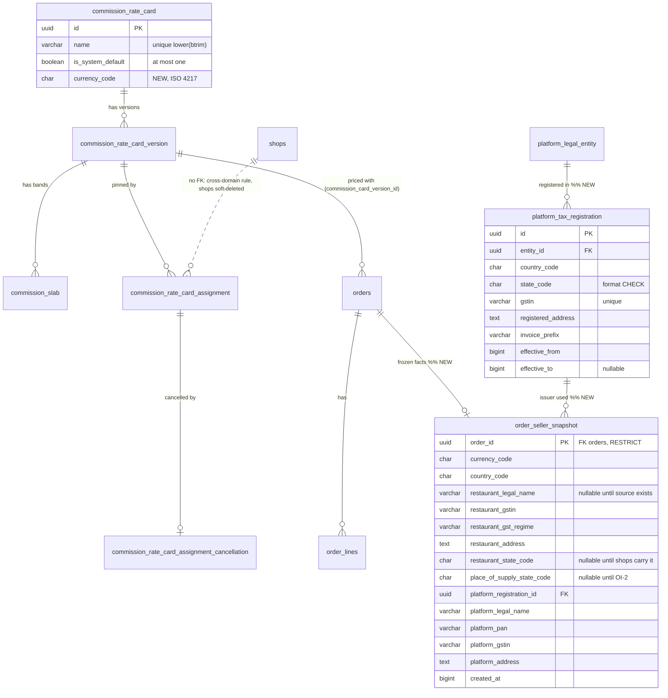
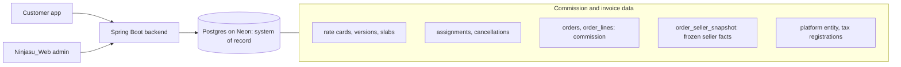
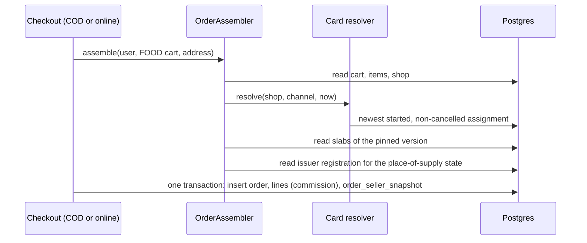

# 2b.13 Commission rate cards — implementation plan

Status: **BUILT 2026-10-20 on `feature/schedule-2b13`** (backend 5 commits, web 1 commit; local only: not pushed, not merged, not deployed). Devil's advocate + four Codex reviews were folded into the plan, and a fifth Codex review of the code found three issues, all fixed. See "As built" at the end. Replaces the 2a.4 percentage `commission_rate` model.
Decisions: [schedule-plan.md](schedule-plan.md) #45, #46, D17-D26; task row 2b.13 in
[schedule-implementation-order.md](schedule-implementation-order.md).

## Terms

- **Rate card**: a named table of slabs (formerly "plan"). Example: *Standard*.
- **Slab**: one band of a rate card (Rs100-149 → Rs10).
- **Version**: an immutable copy of a card's slabs. Editing slabs creates a new version.
- **Assignment**: "shop X uses card version V for channel C from date D". Channel = `FulfilmentType` (`EAT_NOW`, `SCHEDULE`).

## Decisions locked (Samivan, 2026-10-19)

1. Name: commission rate card; slab = one band.
2. D18: a shop can have the same or a different card per channel. Stored as **one append-only assignment stream per (shop, channel)**. The admin "copy to both channels for this change" checkbox writes two rows in one transaction with one `operation_id`. It does not link the channels permanently. (Codex second opinion agreed; a single BOTH row plus overrides was rejected because of precedence bugs at checkout.)
3. Assignments **pin a card version**. Editing a card moves nobody. A restaurant moves to a new version only through an assignment with a **chosen `effective_from`**, one shop at a time or with a bulk "move all N" action.
4. **Every restaurant always has a card on both channels (2026-10-20, supersedes D24 and the null-snapshot answer).** A system card **"No commission"** (one slab `(0, 0, 0)`) is the default: the one resolver returns it when a (shop, channel) has no assignment row, so every customer order placed after 2b.13 snapshots a card version, never NULL. Nobody becomes unsellable on deploy day. The default card's slabs are locked (a new version would silently charge every unassigned shop with no notice); its name is fixed. Admin list "shops on the default card" replaces "shops with no card". Prices unchanged.
5. D21: seed **Standard only**. Card names are editable (name on the card header; versions immutable; rename audited; unique ignoring case).
6. Changing a shop's card needs a confirmation dialog (old → new, channel, effective date, worked example). Backend independently enforces the date rules (decision 7) and writes a platform audit row. **No `consent_ref` / reference field in 2b.13** (Samivan 2026-10-20: build the agreement/notice reference later, after everything else); it can be added later as a nullable column.
7. **Notice, not approval (2026-10-20).** A commission change is Ninjasu's decision; restaurants receive notice and may object externally (Ninjasu and the restaurant talk it out; no in-app objection flow now). A change takes effect on its `effective_from` with no restaurant approval.
   - A change must start **at least 24 hours** after it is saved.
   - Exception 1: a shop's **first real card** on a channel may start immediately. "First" is judged from history: that (shop, channel) has never had an effective non-default row (no rows at all counts as on the default). A shop that had a real card, returned to the default, and gets a real card again needs the 24h (or the override).
   - Exception 2: the admin may tick **"apply immediately"** with a mandatory reason (e.g. Ninjasu's own restaurant, pre-launch shop), audited. Single and bulk changes alike.
   - The 2a.4 per-area `commission_notice_days` is no longer used (column kept; drop later, DO NOT RUN NOW). A shop with no service area can be assigned a card.
8. **Forward-only + cancel (2026-10-20).** A new assignment must start later than every existing (non-cancelled) row for its (shop, channel). A row not yet effective can be cancelled (append-only cancellation row, audited); the one resolver ignores cancelled rows. A started row cannot be cancelled; add a later change instead. After a cancellation, a new row may start earlier than the cancelled one (forward-only counts non-cancelled rows only).
8. 2b.12(c) stays unmerged; 2b.13 branches from `origin/main`.

## Commission rule (unchanged from #45)

Per order line: `unit = sum of the line's selected add-on selling prices` (online price after the restaurant-funded discount, D17; this is what `OrderAssembler.computeLineTotal` already sums from the cart snapshot, `CartPricingServiceImpl` uses `SalesChannel.DELIVERY`). Find the slab with the largest `from_amount ≤ unit`;
`unit_commission = round_half_up_to_rupee(flat_amount + percent_above × (unit − from_amount) / 100)`;
`line_commission = unit_commission × quantity`; order commission = sum of lines. Payout is **not** computed or stored per order: it is a batch figure (item proceeds − commission − GST on commission − TDS ± refunds) built in 2c.
Delivery and packaging are excluded. GST on commission is **not computed in 2b.13** (CA task 0.7); the snapshot stores the pre-GST commission.

Standard card v1: `(0, 5, 0) (100, 10, 0) (150, 15, 0) (200, 20, 0) (250, 25, 0) (300, 25, 10)` as `(from_amount, flat_amount, percent_above)`.

Validation of a version's slabs: at least one slab; the first `from_amount` is 0; `from_amount` strictly increasing; `flat_amount ≥ 0`; `percent_above` in 0-100; **commission never decreases as price rises** (at each boundary the new slab's flat amount ≥ the previous slab's commission at that price), so a dearer unit can never pay less.

## Slices (each a draft PR into `feature/schedule-2b13`; one final PR to `main`)

### S1 Backend — rate cards, versions, calculator
- Tables (hand-run SQL `db_manual/commission-rate-card-migration.sql`, idempotent):
  - `commission_rate_card(id, name, is_system_default BOOLEAN NOT NULL DEFAULT false, created_by, created_at, updated_at)`; unique index on `lower(btrim(name))`; partial unique index `ON (is_system_default) WHERE is_system_default` (at most one default). Only `name`/`updated_at` may change, and never on the default card.
  - `commission_rate_card_version(id, card_id, version_no, created_by, created_at)`; unique `(card_id, version_no)`; append-only trigger (UPDATE/DELETE/TRUNCATE blocked, copy of `commission_rate` triggers).
  - `commission_slab(id, version_id, from_amount NUMERIC(10,2), flat_amount NUMERIC(10,2), percent_above NUMERIC(5,2))`; unique `(version_id, from_amount)`; CHECKs; append-only trigger.
  - Seed the system card **"No commission"** v1 (`(0, 0, 0)`, `is_system_default = true`; a partial unique index allows only one; the API refuses rename and new versions for it).
  - Seed Standard v1 under a **fixed card id** (names are editable, so a rerun keyed on the name could create a second Standard); reruns leave the existing card and v1 alone.
  - Adding a version locks the card row; a duplicate `version_no` maps to 409.
- `CommissionSlabCalculator` (pure, no Spring): `unitCommission(slabs, unit)`, `lineCommission(slabs, unit, qty)`; `SlabValidator` (pure).
- Admin API (`/api/admin/commission-rate-cards`, `@PlatformAuditedEndpoint`): list; get with versions; create (name + first version); rename; add version. New audit actions `RATE_CARD_CREATED`, `RATE_CARD_RENAMED`, `RATE_CARD_VERSION_CREATED`.
- `ScheduleSchemaGuard`: add the new tables, unique indexes and triggers.
- Tests: slab boundaries (99 → 5, 100 → 10, 299 → 25, 300 → 25, 305 → 26, 400 → 35, 500 → 45); thali 200 + 20 + 10 = 230 → 20, × qty 3 → 60; validator rejects gaps, unsorted, negative, a decreasing boundary; rename keeps versions; duplicate name (case-insensitive) rejected; version rows immutable (schema test).

### S2 Backend — assignments
- Table `commission_rate_card_assignment(id, shop_id, fulfilment_type, card_version_id, effective_from BIGINT, operation_id, immediate_reason, created_by, created_at)` plus `commission_rate_card_assignment_cancellation(assignment_id PK, reason, created_by, created_at)` (append-only); unique `(shop_id, fulfilment_type, effective_from)`; append-only trigger; FK to `commission_rate_card_version` only (no FK to shops, cross-domain rule).
- Resolver (the only reader): among non-cancelled rows for `(shop, channel)`, the one with the greatest `effective_from ≤ at`; **none → the system "No commission" card's v1**; no area fallback.
- Assign endpoint: body `{ shopId, channels: [EAT_NOW, SCHEDULE] (1 or 2), cardVersionId, effectiveFromMs | applyNow + immediateReason, expectedLatest: {channel: assignmentId|null} }`. Rules: shop exists and is not deleted; version exists (the default card's v1 is a valid target: an explicit, audited return to no commission); the server takes one instant `now` for validation and the row; `effectiveFromMs ≥ now + 24h`, except (a) first real card for that (shop, channel), judged from history as in decision 7 (`≥ now` allowed) or (b) `applyNow` with a non-blank `immediateReason`; **forward-only**: `effectiveFromMs` > every non-cancelled row of that (shop, channel); within `MAX_HORIZON_DAYS` (constant moves here from `CommissionRateValidator`); **row lock on the shop**, then compare `expectedLatest` = the **latest assignment id per channel, including scheduled (future) rows**, and reject with 409 on any mismatch; both channel rows in one transaction with one `operation_id`.
- Cancel endpoint: only a row with `effective_from > now`; writes a cancellation row + audit `RATE_CARD_ASSIGNMENT_CANCELLED`; same shop lock + `expectedLatest` check.
- Preview endpoint for the confirmation dialog: current card + version per channel, the proposed one, worked example (Rs230 unit before → after).
- Bulk move: `GET .../versions/{id}/affected` lists (shop, channel) pairs whose **latest** assignment (current or scheduled) points to an older version of the same card, with N; `POST .../versions/{id}/move` with `effectiveFromMs` (or `applyNow` + reason), and the previewed pairs **each with its expected latest assignment id** (any mismatch rejects the whole move; nothing is written; the admin re-previews). The preview simply never lists pairs whose latest row points elsewhere. At most 200 pairs per request; shops locked in id order. The 24h rule applies to every pair; the first-real-card exception never applies (bulk moves only move shops already on a real card); `applyNow` + reason is allowed.
- Audit: `RATE_CARD_ASSIGNED` (one row per pair), `RATE_CARD_BULK_MOVED`; `operationId` is added to both actions' metadata allowlists (the recorder drops unlisted keys).
- Admin list "shops on the default card" — the S5 query (implicit and explicit cases, both tested); feeds the post-deploy checklist.
- Tests: copy-to-both writes 2 rows in one tx (and neither if one fails); stale `expectedLatest` → 409; a date under 24h rejected, exactly 24h accepted; first real card off the default may start now; `applyNow` without a reason rejected; a date not after an existing scheduled row rejected (forward-only); cancel works only before the row starts and the resolver then ignores it; no row → default card v1; shop without an area accepted; resolver picks the latest effective row and never a future one; a card edit moves nobody; bulk move moves exactly the previewed set; a placed order keeps its version after a reassignment (re-proves T2a-12/T2a-13).

### S3 Backend — Eat Now order snapshot
- Columns (nullable, hand-run SQL): `orders.commission_card_version_id`, `orders.commission_total`; `order_lines.unit_commission`, `order_lines.line_commission`. Every customer order after 2b.13 has values (the default card gives 0). NULL means only "not applicable": a dine-in channel (POS, guest QR, counter sale) or an order placed before 2b.13; written as a column comment.
- Rounding uses one shared rupee helper (the #27 function, built here, reused by 2c).
- In `OrderAssembler.buildLinesFromCartItems` (shared by COD `OrderServiceImpl` and online `PaymentServiceImpl`), for `OrderSource.CUSTOMER` orders only: resolve the shop's `EAT_NOW` card version through the one resolver at the assembly instant (no row → default "No commission" v1, commission 0); always fill line and order snapshots. POS, guest QR and counter sale record nothing.
- Prices, totals and customer responses unchanged (no DTO change for customers).
- Tests: snapshot equals the calculator for a multi-line order; delivery fee excluded; a shop with no assignment row → default v1 pinned, commission 0; a later reassignment doesn't change a placed order; POS order has nulls; online checkout path snapshots identically to COD.

### S3b Backend — order invoice snapshot (Samivan 2026-10-20: in 2b.13, same for Eat Now and Schedule)
Freeze at order time everything a later invoice, payout statement or GST return needs, so nothing is re-read from live, editable records (Codex payout research 2026-10-19).
- One shared step (e.g. `OrderSellerSnapshotBuilder`) called by `OrderAssembler` for customer orders; the Schedule checkout (2b.3/2b.5) must call the same step, never a copy.
- **Superseded 2026-10-21 (Data model review, PLACE-1):** these facts are one row per order in the side table `order_seller_snapshot` (`seller_*` columns, `platform_seller_profile_id`), not columns on `orders`. The original design follows for history. New nullable `orders` columns (hand-run SQL `db_manual/order-invoice-snapshot-migration.sql`, added to `ScheduleSchemaGuard` and to the pre-deploy SQL list): `restaurant_gstin` (`Restaurant.gstNumber`, NULL = unregistered), `restaurant_gst_regime` (`Shop.gstRegime`), `restaurant_address`, `restaurant_state` (`Shop` address fields); `platform_legal_name`, `platform_gstin`, `platform_address` (`PlatformBillingConfig`). The trade name is already frozen in `orders.shop_name`.
- Per line, the existing snapshot (`tax_class_code`, `tax_price_mode`, `tax_rate_percent`, `line_total_snapshot`) is the frozen tax classification; whether a line is a 9(5) restaurant service is read from its frozen `tax_class_code` (`RESTAURANT_SERVICE`). No new line columns.
- **No tax amounts are computed or stored in 2b.13.** Customer orders charge no GST today (`OrderAssembler`: `grand_total = subtotal + delivery fee`), and the dine-in `GstTaxEngine` taxes by the restaurant's GST regime, which is the wrong basis for 9(5) online orders (Ninjasu owes the food GST whatever the restaurant's regime). The online tax basis (prices GST-inclusive, or 5% added at checkout) is a separate decision (open question H) and must be settled before go-live.
- Data gaps found (not invented here; recorded for CA task 0.7 / onboarding): no **restaurant legal name** field (only the trade name); `Shop.state` is free text, not a GST state code; orders store no **delivery state** (only lat/lng + formatted address), which the place-of-supply rule may need. Each is a follow-up, not a 2b.13 build item, unless Samivan pulls it in.
- No invoice numbers, PDFs, payout batches, TDS or credit notes here: those are 2c, built from these frozen facts.
- Tests: snapshot equals the live values at order time and does not change when the shop's GSTIN/name or `PlatformBillingConfig` is edited afterwards; unregistered shop → NULL GSTIN; customer totals (`subtotal`, `grand_total`) are byte-for-byte unchanged by S3/S3b; POS, guest QR and counter-sale orders get no snapshot.

### S4 Retire 2a.4
- Remove the `CommissionRate` entity, repository, resolver, validator, service, controller, DTOs and their guard entries and tests; fix the `ServiceAreaValidator.java:28` comment; move the old controller's case in `AdminRoutesSecurityTest` to the new admin routes. Before the DROP script: Samivan runs `SELECT count(*) FROM commission_rate` on prod. **Keep** the `COMMISSION_RATE_CREATED` audit enum value (old `platform_audit_events` rows reference it). Keep `service_area.commission_notice_days` (deferred notice rule may use it).
- The `commission_rate` table stays; a DROP script is written and labelled **DO NOT RUN NOW** (run after 2b.13 is live and the table is confirmed empty or archived).

### S5 Web (Ninjasu_Web) — admin screens
- Rate cards page: list (name, latest version, shops on it per channel); create; rename; new version with a slab editor and a live example (Rs99 / 230 / 305 / 500 → commission and payout); version history (read-only).
- Shop commission panel (admin shop detail): current + scheduled assignment per channel; Change → card + version, channels, "copy to both channels for this change" (default on), effective date (min 24h ahead unless first real card) or "apply immediately" + reason; cancel a scheduled change; **confirmation dialog** with old → new and the worked example.
- Bulk move dialog on a new version: "this affects N restaurants", the list, one date (or apply immediately + reason), confirm.
- "Shops on the default (No commission) card" list, per channel, showing **implicit** (never assigned) vs **explicit** (assigned back, audited). Backend: one paginated query over live shops left-joined to each (shop, channel)'s latest non-cancelled effective assignment (index on `(shop_id, fulfilment_type, effective_from DESC)`), never a per-shop resolver loop.
- No mobile (RN) change: customers see no difference; the restaurant sees no commission yet (D25).

## Open questions for Samivan (from the devil's-advocate + Codex reviews, 2026-10-19)

- ~~A~~ decided: no per-order payout column; payout is a 2c batch figure.
- ~~B~~ decided → decision 8. ~~C~~ decided → decision 4 (write the D24 supersession into schedule-plan.md). ~~D~~ decided → decision 7 (update #46 and the 2b.13 row to match).
- ~~F~~ decided: S3b in 2b.13, shared by both channels. ~~G~~ decided: no reference field now; build later.
- **H. Online GST basis (NOT a 2b.13 build item; must be decided before go-live).** Customer orders charge no GST today. Under 9(5) Ninjasu must collect and pay the 5% food GST on every restaurant-service order. Decide with the CA (0.7): are online prices GST-inclusive (customer total unchanged, Ninjasu's taxable value = price ÷ 1.05) or is 5% added at checkout (customer total rises)? Then build the online tax calculation and its stored tax lines as their own task.
- Not live yet (Samivan 2026-10-20): no payouts are running, so no backfill or migration of live money data is needed.
- **E. D25** (the "keeps Rs X" line): **confirmed out of 2b.13** (Samivan 2026-10-19).

Review checks that passed (Codex, files read): COD and online checkout both go through `OrderAssembler.assemble`; online confirm loads the saved order and never reprices; counter sale and guest QR build lines in `PosOrderServiceImpl`; `DeliveryServiceImpl` does not assemble orders; the cart uses `SalesChannel.DELIVERY` → online price after discount; `ScheduleSchemaGuard` fails boot when hand-run objects are missing, so **SQL must run before the deploy**.

## Out of scope / deferred

- **D25: "Ninjasu keeps Rs X, you get Rs Y" in the restaurant menu editor — Samivan wants to discuss before 2b.13 proceeds.**
- Notice-period minimum (decision 7).
- GST on commission, 9(5) treatment (CA 0.7, before 2b.3). Also ask: do the 9(5) platform facts (platform GSTIN and address on the invoice) apply to grocery and product orders, or only food? The snapshot is written for every cart type today.
- Partial refunds: customer orders today refund whole orders only (`orders.refund_id`); the per-line snapshot is what a future partial refund will return. The "partial refund returns that line's commission" test lands with the refund feature (2c/2d).
- The agreement/notice reference on assignments (former `consent_ref`), and any in-app objection flow.
- Settlement export / payouts (2c).

## Rollout

1. S1, S2, S3 and S3b SQL handed to Samivan and run **before** the backend deploy (`ScheduleSchemaGuard` fails boot on any missing object; each script additive, nullable columns, no backfill).
2. Merge order: backend final PR first (prod auto-deploy), then web.
3. After deploy: Samivan assigns Standard v1 to pilot shops on `EAT_NOW` (and `SCHEDULE`) from the admin page.
4. S4 DROP script: DO NOT RUN NOW.

## As built (2026-10-20)

**Branches:** backend and web `feature/schedule-2b13` from `origin/main`. Backend commits: S1, S2, S3, S3b+S4, review fixes. Web: S5. Nothing pushed.

**Hand-run SQL, in this order, before the backend deploy** (all idempotent; `ScheduleSchemaGuard` fails boot if any object is missing):
1. `db_manual/commission-rate-card-migration.sql` (cards, versions, slabs, triggers, seeds "No commission" + Standard v1 under fixed ids)
2. `db_manual/commission-rate-card-assignment-migration.sql` (needs 1)
3. `db_manual/order-commission-snapshot-migration.sql` (needs 1; renames `orders.commission_card_version_id` to `commission_rate_card_version_id` on a database that ran the old file; constraints are `NOT VALID` then validated)
4. `db_manual/order-invoice-snapshot-migration.sql` (creates the append-only side table `order_seller_snapshot`)
5. `db_manual/platform-seller-profile-migration.sql` (the platform's own seller identities; copies the old single `platform_billing_config` row if one exists; adds the FK from `order_seller_snapshot.platform_seller_profile_id`; needs 4). After it runs, fill the profile through `POST /api/admin/platform-seller-profiles` (or the INSERT template at the bottom of the file); with no active default profile, orders complete without platform facts and a warning is logged.

**DO NOT RUN NOW:** `db_manual/commission-rate-drop-DO-NOT-RUN-NOW.sql` (drops the 2a.4 `commission_rate` table; run only after 2b.13 is live and `SELECT count(*) FROM commission_rate` is 0).

**Production note (2026-10-20):** a local `mvnw test` booted the app on the production Neon database (the default datasource) and left three empty, constraint-less tables: `commission_rate_card`, `commission_rate_card_version`, `commission_slab`. SQL file 1 uses `CREATE TABLE IF NOT EXISTS` and adds the constraints, indexes, triggers and seeds on top, so running it repairs them; nothing else was touched. Full-suite runs now exclude the context test: `-Dtest='!NinjaDeliveryServiceApplicationTests'`.

**Admin routes (all under the `/api/admin/**` catch-all):** `commission-rate-cards` (list, get, create, rename `PATCH`, `/{id}/versions`, `POST /preview` for the slab editor), `commission-rate-card-assignments` (state by `shopId`, `/preview`, `/on-default`, assign, `/{id}/cancel`), `commission-rate-card-versions/{id}` (`/affected`, `/move`). Web: `/admin/commission-cards`, `/admin/commission-cards/[id]`, and a Commission tab on the shop page.

**Differences from the plan text:**
- `POST /commission-rate-cards/preview` (stateless, `@NotAudited`) was added so the slab editor shows live commission and violations without the web app re-implementing the calculator.
- A `Clock` bean (`config/ClockConfig`) was added. The assign, cancel and bulk-move services read "now" after the shop lock is held, so a lock wait cannot shorten the 24-hour notice or let a change that has started be cancelled (Codex review finding).
- The shared rupee helper the plan put in S3 is `CommissionSlabCalculator` itself; there is no separate class.
- Snapshot columns are guarded by CHECK constraints (version and total both set or both null, never negative; regime values match `GstRegime`).
- A cancelled assignment still occupies its (shop, channel, start) key; a new row at exactly that moment is rejected with `DUPLICATE_EFFECTIVE_FROM`.
- The "shops on the default card" list says "Never assigned" (implicit) or "Set to no commission" (assigned on purpose).

**Geld changes (2026-10-21, backend `69017a8`):** side table, `currency_code` on cards, `NOT VALID` constraints, renames; suite 1134 tests, 0 failures (context test excluded). The line below is the earlier 2026-10-20 run.

**Verified:** backend suite with the context test excluded (990 tests, 0 failures), JPQL parse-checked offline, web `tsc` and `eslint` clean, 13 pure-logic web specs, static render of the list, detail, shop panel and slab editor.
**Not verified (no scratch database, browser or device):** the SQL scripts and trigger behaviour against Postgres; JPQL result correctness (parse only); every dialog (they render in a portal); any real click-through. Run both on a Neon branch before merging.

**Open before go-live:**
- Add the platform seller profile (legal name, GSTIN, address, invoice prefix); `platform_billing_config` is replaced by the many-row `platform_seller_profile` table and stays unread (drop later, DO NOT RUN NOW).
- Question H (online GST basis, CA task 0.7) is still undecided; the order snapshots store no tax amounts.
- Restaurant legal name, GST state code on shops and delivery state on orders are still missing (follow-ups for 0.7 and onboarding).

## Data model review

**Status:** FINAL — 2026-10-21 · **Verdict:** APPROVED WITH CHANGES for the feature's own design (PLACE-1, PLACE-2 as an accepted trade-off, MONEY-1, MIG-1 built in backend `69017a8`); the lens 0 blockers ENV-1 to ENV-3 are deferred by Samivan to pre-launch (see Approval record) · geld default, 2026-10-21 · previous: none
**Target:** PostgreSQL on Neon (major version unknown: OI-5) · no migration runner: hand-run SQL in `db_manual/` plus Hibernate `ddl-auto=update`; each file wraps itself in BEGIN/COMMIT · Neon pooler endpoint (`-pooler` host, `prepareThreshold=0`, Hikari max 10) · one Spring Boot server on EC2, Next.js admin, React Native app
**Lenses run:** 0-8 (pricing and billing feature with APIs: all apply) · **skipped:** none · **reference designs:** gate passed (core, multi-party money, versioned rules, costly to undo, known problem class) but NOT run in this pass: it needs web sources and none were read; say `compare` to run it
**Codex second opinion:** not run as a blind geld `deep` pass. A separate read-only Codex architecture review on 2026-10-20 reached the same four design changes (PLACE-1, PLACE-2, MONEY-1, ENV-1); it was not blind to the author's view.
**Open inputs:**
- OI-1 (deciding, expert): under GST section 9(5), which Ninjasu GSTIN issues the customer invoice for a delivery order: the registration in the state of the place of supply, of the restaurant, or a principal registration? Confirm with the CA (task 0.7). Decides PLACE-2's selection rule.
- OI-2 (deciding, expert): is the place of supply for these orders the delivery address state? Decides whether `place_of_supply_state_code` must be captured before go-live.
- OI-3 (deciding, owner): the rule for a slab that charges more than the unit price (payout below zero): forbid, cap at a percentage, or allow.
- OI-4 (assumption): sizing below (pilot 200 orders/day, 50 shops; 10x and 100x for growth).
- OI-5 (unknown): Neon Postgres major version, point-in-time-restore retention (ENV-5).
- OI-6 (unknown): where SQL files 1-3 have already been applied. Screenshots of 2026-10-21 show them run on a database where `commission_rate_card` already existed, which matches production (the bare tables from the 2026-10-20 accidental boot). Treat production as possibly migrated until confirmed. **Resolved 2026-10-21 (read-only query):** the database behind the `food-ninja-db` MCP has files 1-3 applied in their OLD form (`orders.commission_card_version_id` exists; `commission_rate_card` has no `currency_code`; `platform_seller_profile` and the side table do not exist). Rerunning the new files 1 and 3 upgrades it: file 1 adds `currency_code`, file 3 renames the column idempotently.

### Design changes
Overall: keep the rate card and assignment model as built; move the invoice facts off `orders` into their own frozen row, key the platform's tax identity by state instead of "the default", put a currency on every amount, and close the environment holes that let schema reach production outside review.

| # | before | after | problem it solves (findings) | why it is better | what it costs | alternative considered, why it lost |
|---|---|---|---|---|---|---|
| 1 | 7 seller-fact columns + `platform_profile_id` on `orders` | `order_seller_snapshot` (1:1, PK = `order_id`), append-only, written once at checkout | PLACE-1: every new invoice field widens the hottest table | written at one event, read only by invoicing/export; room for the known next fields without touching `orders` | one join for invoice/export reads, one extra insert per order, one new SQL file replacing file 4 | keep on `orders`: simpler now, but 4+ known fields are coming and `orders` already has 44 columns |
| 2 | `platform_seller_profile` with `is_default` deciding the issuer | `platform_legal_entity` (who) + `platform_tax_registration` (where: one row per state code, GSTIN, address, invoice prefix, effective period); the issuer is resolved by state | PLACE-2: one identity used for every state; wrong GSTIN on invoices once a second state is registered | the selection key is the business fact (jurisdiction), enforced by a unique key | 2 small tables instead of 1; resolver needs the order's state (OI-2) | multi-row profile + default flag (built): fails the moment two GSTINs exist |
| 3 | amounts without currency (slabs, commission totals, order facts) | `currency_code` on `commission_rate_card` and on `order_seller_snapshot`; commission totals take the pinned card version's currency (documented invariant) | MONEY-1: historical amounts cannot be re-labelled later | every amount interpretable without guessing | 2 columns, a CHECK; nothing to backfill (INR) | add when going abroad: then every existing row must be guessed |
| 4 | `ADD CONSTRAINT` CHECK / FK directly on `orders` and `order_lines` | `... NOT VALID`, then `VALIDATE CONSTRAINT` in a second statement | MIG-1: scan of the whole table under a blocking lock | reads and writes continue during validation | two statements instead of one | direct ADD: acceptable only while `orders` is tiny |
| 5 | app connects as `neondb_owner` with a prod fallback; `ddl-auto=update` | migration role for DDL, app role DML-only, no datasource fallback, `ddl-auto=validate` outside dev; later Flyway owns the schema | ENV-1 to ENV-4 | nothing can create or change tables outside review; triggers cannot be disabled by the app | Neon roles and grants, env vars on the server, a one-time check that `validate` passes; Flyway baseline is its own task | keep as is: it already created bare tables in production once |

### Tables
| table | grain (one row = one ...) | purpose | class | owner | phase | state |
|---|---|---|---|---|---|---|
| commission_rate_card | named card | header of a commission scheme | reference, mutable name only | commission (platform admin) | 2b.13 | built; maybe applied (OI-6) |
| commission_rate_card_version | immutable version of a card | the slabs an order or assignment pins | append-only | commission | 2b.13 | built; maybe applied |
| commission_slab | band of one version | price band and its charge | append-only | commission | 2b.13 | built; maybe applied |
| commission_rate_card_assignment | card version for one shop and channel from an instant | which version a shop pays | append-only, effective-dated | commission | 2b.13 | built; maybe applied |
| commission_rate_card_assignment_cancellation | cancelled future assignment | calls off a scheduled change without rewriting history | append-only | commission | 2b.13 | built; maybe applied |
| orders (+ commission_card_version_id, commission_total) | customer or dine-in order | version pin and total commission | hot | ordering | 2b.13 | built; maybe applied (file 3) |
| order_lines (+ unit_commission, line_commission) | order line | per-line commission for refunds and payouts | hot, written once | ordering | 2b.13 | built; maybe applied |
| order_seller_snapshot (PROPOSED) | the frozen seller and jurisdiction facts of one customer order | everything an invoice, payout statement or GST return needs | append-only | ordering (written at checkout) | 2b.13 | proposed (replaces file 4 columns) |
| platform_legal_entity (PROPOSED, replaces platform_seller_profile) | legal entity the platform trades as | legal name, PAN, country | reference | platform admin | 2b.13 | proposed |
| platform_tax_registration (PROPOSED) | one GST registration of an entity in one state | GSTIN, address, invoice prefix, effective period | reference, effective-dated | platform admin | 2b.13 | proposed |

### Built vs plan
| element | plan says | in code at | deployed | migration applied | depended on by | drift | source |
|---|---|---|---|---|---|---|---|
| rate cards, versions, slabs | S1 | `db_manual/commission-rate-card-migration.sql`, `entity/CommissionRate*.java` (branch feature/schedule-2b13, head f65ecfd) | no (not merged) | unknown, possibly prod (OI-6) | none | none | git; user screenshots |
| assignments, cancellation | S2 | `commission-rate-card-assignment-migration.sql` | no | unknown, possibly prod | none | none | same |
| order commission columns | S3 | `order-commission-snapshot-migration.sql` | no | unknown, possibly prod | none | none | same |
| seller facts on orders | S3b: 7 nullable `orders` columns | `order-invoice-snapshot-migration.sql:15-21`, `entity/Order.java` | no | unknown | none | none; this review changes it (PLACE-1) | git |
| platform seller profile | As built note: one row with `is_default` | `platform-seller-profile-migration.sql`, `PlatformSellerProfileRepository.java:22` | no | not run | none | plan text still names `platform_billing_config` in S3b | git |

### Entity relationships

### Column mapping (proposed changes only; built tables are in the SQL files)
`order_seller_snapshot`: `order_id uuid` PK, FK `orders(id)` ON DELETE RESTRICT · `currency_code char(3)` NOT NULL CHECK `~ '^[A-Z]{3}$'` · `country_code char(2)` NOT NULL CHECK `~ '^[A-Z]{2}$'` · restaurant columns as built plus `restaurant_legal_name text` NULL and `restaurant_state_code char(2)` NULL (NULL = source not yet captured) · `place_of_supply_state_code char(2)` NULL (NULL = not captured; becomes required after OI-2) · `platform_registration_id uuid` NULL FK RESTRICT (NULL = no registration existed) · platform text columns as built plus `platform_pan varchar(10)` · `created_at bigint` NOT NULL. Index: primary key only (read by order id). Lifecycle: append-only trigger (same function as the rate-card tables).
`platform_legal_entity`: `id uuid` PK · `code varchar(40)` unique `upper(btrim(code))` · `legal_name varchar(200)` · `pan varchar(10)` NULL CHECK format · `country_code char(2)` · `active boolean` · `is_default boolean` (UI convenience only, at most one) · timestamps.
`platform_tax_registration`: `id uuid` PK · `entity_id uuid` FK RESTRICT · `country_code char(2)` · `state_code char(2)` CHECK format · `gstin varchar(15)` NULL, unique when not NULL · `registered_address text` · `invoice_prefix varchar(10)` · `effective_from bigint` · `effective_to bigint` NULL · unique `(entity_id, country_code, state_code)` WHERE `effective_to IS NULL` (one open registration per state). Serves: resolve issuer by (entity, state) at checkout, one row read.
`commission_rate_card`: add `currency_code char(3) NOT NULL DEFAULT 'INR'` with the format CHECK; an assignment's card currency must equal the shop's country currency (service check, revisit before a second country).

### Invariants
| # | invariant | enforced by | evidence |
|---|---|---|---|
| 1 | a version's slabs never change | trigger | commission-rate-card-migration.sql (append-only triggers) |
| 2 | at most one system default card; it never changes | partial unique index + guard trigger | same file |
| 3 | slab bands start at 0, ascend, never charge less for a dearer unit | service only (SlabValidator) | trade-off: cross-row rule on immutable rows written only by one service; a trigger is possible but costly; accepted |
| 4 | at most 20 slabs per version | service only | SlabValidator.MAX_SLABS; accepted |
| 5 | one assignment per (shop, channel, instant) | unique index | assignment migration |
| 6 | a new assignment starts after every non-cancelled one | service, under the shop row lock (`findByIdForUpdate`) | CommissionAssignmentServiceImpl; safe under concurrency: second writer waits, then sees the first row and fails expectedLatest (409) |
| 7 | a started assignment is never cancelled | service, "now" read after the lock | fixed 2026-10-20 |
| 8 | commission version and total are both set or both NULL, never negative | CHECK | order-commission-snapshot-migration.sql |
| 9 | an order's invoice facts never change | today: `updatable=false` on entity only (INV-1); proposed: append-only trigger on `order_seller_snapshot` | Order.java |
| 10 | only one issuer registration per state at a time | today: nowhere (PLACE-2); proposed: partial unique index | — |
| 11 | commission does not exceed the unit price | nowhere (OI-3) | SlabValidator has no such check |

### Scenarios, access patterns, sizing
Scenarios: (a) checkout at evening peak resolves the card and snapshots in < 20 ms added p95; (b) adding phase 2c invoices, payouts, credit notes and tax lines needs only new tables; (c) a second GST registration never changes the GSTIN on an existing order.
| # | actor | r/w | path | filter | serving index | rows examined |
|---|---|---|---|---|---|---|
| 1 | customer checkout | r | resolve card in force | shop, channel, effective_from ≤ now, not cancelled | `ux_commission_assignment_effective` (backward scan) | 1-5 |
| 2 | checkout | r | slabs of a version | version_id | `ux_commission_slab_from` | ≤ 20 |
| 3 | checkout | w | order, lines, facts | — | PKs | 1 + lines + 1 |
| 4 | admin | r | shops on default card | live shops, latest started row per shop | correlated subquery per shop; measure at 10x (CONSIDER) | all live shops |
| 5 | admin | r | affected by new version | version's card, latest row per pair | `idx_commission_assignment_version` + PK | assignments on that card |
| 6 | checkout | r | issuer registration | entity, state | proposed partial unique index | 1 |
Sizing (OI-4 assumptions: 200 orders/day today, 10x = 2,000, 100x = 20,000; ~600 bytes per facts row with header and PK): `order_seller_snapshot` grows 0.04 GB, 0.4 GB, 4.4 GB per year; assignments stay below 100k rows even at 100x (5k shops × ~10 changes/year × 2 channels). Peak checkout at 100x: 20,000/86,400 × 10 peak factor ≈ 2.3 orders/second: trivial for these reads.

### Findings
#### Must change before the next affected deploy
**ENV-1 · risk · MUST (blocker)** — two schema writers: hand-run SQL plus Hibernate `ddl-auto=update`.
- Evidence: `application.properties:32` (fact); on 2026-10-20 a local test boot created `commission_rate_card`, `_version` and `commission_slab` in production with no constraints (fact, plan "As built").
- Failure: any boot of a new entity before its SQL file runs creates a constraint-less table; the SQL then only adds what its IF NOT EXISTS checks miss.
- Change: now, `spring.jpa.hibernate.ddl-auto=${DDL_AUTO:validate}` with `update` set only in `application-dev.properties` against a dev or branch database; next, Flyway owns the schema (baseline the current production schema, `db_manual` files become versioned migrations; rulebook SB-MIG-01).
- Cost to change now: cheap (config) for the first step; Flyway is a separate task.
**ENV-2 · risk · MUST (blocker)** — the default datasource is production, with the owner password committed as the fallback.
- Evidence: `application.properties:6-8` (fact).
- Failure: any local run or test without `DB_URL` writes to production (happened 2026-10-20).
- Change: remove the fallbacks (`${DB_URL}` with no default, startup fails without it); set the variables on the server; rotate the Neon owner password (already an open security item).
- Cost: cheap.
**ENV-3 · risk · MUST (blocker)** — the application connects as the database owner.
- Evidence: `application.properties:7` (`neondb_owner`) (fact).
- Failure: the append-only triggers protect nothing against the application or anyone holding its credentials: `ALTER TABLE ... DISABLE TRIGGER` and DDL are allowed.
- Change: a DML-only application role with grants on its tables; DDL through a separate migration role.
- Cost: cheap to moderate (Neon roles, grants, one env change).
**PLACE-1 · risk · MUST** — seller facts on the hot `orders` table.
- Evidence: `order-invoice-snapshot-migration.sql:15-21` adds 7 columns; `Order.java` already maps 44 columns; plan "Data gaps" lists restaurant legal name, GST state code and delivery state as coming, and question H adds tax lines (fact).
- Failure: each new invoice field is another nullable column on every order row, read by no order flow; the table drifts into a god table (lens 7 signal).
- Change: `order_seller_snapshot` as in Design changes 1; `OrderSellerSnapshotBuilder` writes one row; file 4 is replaced. If file 4 already ran somewhere, its columns stay unused and are dropped later (DO NOT RUN NOW).
- Cost: cheap (in code, not deployed; possibly applied: then a contract step later).
**PLACE-2 · risk · MUST** — the platform's tax identity is selected by a default flag, not by jurisdiction.
- Evidence: `PlatformSellerProfileRepository.java:22` `findFirstByDefaultProfileTrueAndActiveTrue`; `platform-seller-profile-migration.sql` stores state as free text (fact). The legal rule is unconfirmed (OI-1), so the risky answer holds.
- Failure: Ninjasu registers a second state; orders delivered there are frozen with the first state's GSTIN; the invoices and GSTR-1 for them are wrong and cannot be corrected by changing a profile.
- Change: Design changes 2; checkout resolves the registration by (default entity, place-of-supply state per OI-1/OI-2) and freezes its id and text in `order_seller_snapshot`. No matching registration: refuse the order or allow with NULL facts (decision D-2).
- Cost: free (file 5 not run anywhere).
**MONEY-1 · risk · MUST** — amounts have no currency.
- Evidence: `commission_rate_card` and `commission_slab` have no currency column; `orders` has none (pre-existing); shops carry `country_code` (`Shop.java:177`) (fact).
- Failure: a second country's card or order is indistinguishable from an INR one; reports and payouts sum mixed currencies.
- Change: `currency_code char(3)` on `commission_rate_card` (default INR) and on `order_seller_snapshot`; commission totals take the pinned version's card currency (documented invariant).
- Cost: free to cheap.
**MIG-1 · risk · DEFAULT** — constraints added to populated `orders` and `order_lines` scan under a blocking lock.
- Evidence: `order-commission-snapshot-migration.sql` adds two CHECKs and an FK in one step; `platform-seller-profile-migration.sql` adds an FK on `orders` (fact). Lock table: `reference/postgres-ddl-locks.md`; rulebook SQL-SCHEMA-11.
- Failure: at today's size seconds; at 10x+ orders a checkout outage while the scan runs.
- Change: `ADD CONSTRAINT ... NOT VALID`, then `VALIDATE CONSTRAINT` as a separate statement; set `lock_timeout`.
- Cost: cheap.
**PLACE-3 · risk · DEFAULT (revisit)** — other columns on `orders` that do not belong on the hot table.
- Evidence: `Order.java` still maps Razorpay ×6 (belong in `order_payments`), delivery OTP ×2, POS ×3 (fact).
- Revisit trigger: a second payment gateway, partial refunds, or phase 2c. Not changed in 2b.13.
#### Fine now, revisit at a phase or trigger
- **ENV-4 · DEFAULT** — recovery: Neon point-in-time-restore retention and a tested restore are not stated (OI-5). Revisit before go-live.
- **TRACE-1** — `OrderAssembler` passes `FulfilmentType.EAT_NOW` for every order; when 2b.4 adds `orders.fulfilment_type`, the snapshot must take the order's channel. Locked decision L-6.
- **MONEY-2** — ledger gate: Ninjasu will owe restaurants payouts, so phase 2c needs a double-entry settlement ledger (payable to restaurant, commission, GST on commission, TDS 194-O, refunds); the per-order commission columns are its inputs, not the ledger. Revisit at 2c.
- **MONEY-3** — tax lines per order line and component (type, basis, rate, amount, jurisdiction) after question H; a child table, not columns. Revisit after CA 0.7.
- **ACCESS-1 · CONSIDER** — "shops on default card" is a correlated query over all live shops; measure on a branch at 10x before calling it fine.
- **INV-2 · CONSIDER** — commission above the unit price (OI-3).
- **MODEL-1 · CONSIDER** — UUIDv4 primary keys via `GenerationType.UUID`; tables are small and assignments low-volume, so index locality does not matter here.
- **TEN-1 · trade-off** — tenancy is single tenant per deployment; licensing means a separate deployment per licensee. Record it (decision D-4); a shared-database licence would need an operator key on every table.
- **PII-1 · CONSIDER** — a sole-proprietor restaurant's address and GSTIN (contains the PAN) are personal data frozen forever in append-only facts; state the retention rule (tax records: years, per the CA).
#### Keep (good decisions)
- **SNAP-K1** — rate card versions are immutable and orders pin the version as well as snapshot the amounts (version pin + snapshot, lens 4).
- **SNAP-K2** — assignments are effective-dated, append-only, version-pinned per (shop, channel); cancellation is a separate append-only row, so history is never rewritten.
- **INV-K1** — the concurrent-admin race is closed by a shop row lock taken before `expectedLatest` is compared, with "now" read after the lock.
- **MONEY-K1** — rounding stated (half up per unit, × quantity); basis stated (online selling price after the restaurant-funded discount, delivery excluded); per-line amounts kept for partial refunds; no per-order payout column (payout is a batch figure in 2c).
- **PLACE-K1** — commission stays on `orders` and `order_lines` (reports sum it on most settlement reads); only the invoice-only text moves out.
- **MODEL-K1** — `shop_id` without FK, by the documented cross-domain rule, with an index and soft-deleted shops excluded in reads.
- **TIME-K1** — epoch-millisecond `bigint` instants instead of `timestamptz`: a project convention (orders, audit), consistent; not a finding.

### Devil's advocate trace
| DA point (2026-10-19) | outcome |
|---|---|
| store `orders.restaurant_payout` now? | already handled: plan "Commission rule" (payout is a 2c batch figure); MONEY-2 |
| forward-only assignments + cancel | already handled: plan decision 8; SNAP-K2 |
| NULL snapshot meaning, default-card list | already handled, superseded by decision 4 (every shop has a card) |
| shared rounding helper | already handled: `CommissionSlabCalculator` |
| bulk move cap 200, lock in id order | already handled: INV-K1 |
| retire 2a.4 steps | already handled: S4 |
| add version: lock card, 409 on duplicate | already handled |
| Codex payout research: snapshot restaurant legal name, GSTIN, state, Ninjasu identity, per-line tax | absorbed: PLACE-1, PLACE-2, MONEY-3 |

### Future phases
| phase | new tables it adds | change forced on this design |
|---|---|---|
| 2b.4 order and group schema | `fulfilment_type` on orders, groups | TRACE-1: pass the order's channel to the snapshot |
| 2b.3 / 2b.5 / 2b.8 Schedule pricing and checkout | Schedule cart and checkout | none: they call the same snapshot steps |
| CA 0.7 / question H | order line tax lines | none after PLACE-1 (a child table); before it, more `orders` columns |
| 2c settlement | payout batches, ledger entries, GST on commission, TDS, credit notes | none: new tables keyed by order, line and `order_seller_snapshot` |
| 2c invoices | invoice number allocator per registration, series and financial year | needs PLACE-2's registration table as the issuer key; with the built profile it would key on a default flag |
| a second country | country rate cards | none after MONEY-1 |

### Rollout
| change | expand / migrate / contract | slot | lock | N-1 safe | rollback | precondition |
|---|---|---|---|---|---|---|
| files 1-3 as built (plus MIG-1 form for the orders constraints) | expand | before the backend deploy | metadata only on new tables; NOT VALID + VALIDATE on orders | yes (new tables, nullable columns) | keep objects | run on a Neon branch first; OI-6 |
| new `order_seller_snapshot` file (replaces file 4) | expand | before the backend deploy | new table | yes | keep | decision D-1 |
| new platform entity + registration file (replaces file 5) | expand | before the backend deploy | new tables | yes | keep | decision D-2 |
| drop unused file-4 columns if they were applied anywhere | contract | after 2b.13 is live | ACCESS EXCLUSIVE, brief | yes | none needed | DO NOT RUN NOW |
| drop `platform_billing_config`, `commission_rate` | contract | after 2b.13 is live and both are confirmed unread | brief | yes | archive first | DO NOT RUN NOW |
Lens 0: 1 FAIL (ENV-1), 2 FAIL (ENV-1, ENV-2), 3 FAIL (ENV-2), 4 FAIL (ENV-3), 5 unknown (ENV-4), 6 planned (manual-test-todo-2b13.md, verify the branch by host), 7 not applicable (branch copies of production are short-lived; mask if kept), 8 pass (plan "Rollout", DO NOT RUN labels).

### Design versions
| version | phase | date | what changed | why |
|---|---|---|---|---|
| v1 | 2b.13 | 2026-10-20 | as built | plan |
| v2 (proposed) | 2b.13 | 2026-10-21 | invoice facts table, entity + state registrations, currency, NOT VALID constraints | this review |

### Locked decisions (handoff to /gcp and /judge; filled after approval)
| id | decision | enforced where | code paths, callers and enum values that must honour it |
|---|---|---|---|
| L-1 | commission is stamped only on customer FOOD carts | service | `OrderAssembler.assemble` (callers `OrderServiceImpl`, `PaymentServiceImpl`; `CartType` FOOD, GROCERY, PRODUCT) |
| L-2 | invoice facts are written once per customer order and never updated | trigger + service | `OrderSellerSnapshotBuilder`, every checkout path incl. the future Schedule checkout |
| L-3 | the issuer is resolved by state, never by a default flag | service + unique index | the registration resolver at checkout |
| L-4 | every amount carries or derives a currency | schema | rate cards, invoice facts |
| L-5 | no schema change reaches production except through the reviewed SQL path | config | `application*.properties`, CI, test config |
| L-6 | the snapshot channel is the order's fulfilment type once 2b.4 lands | service | `OrderAssembler`, Schedule checkout |

### Approval record
| finding or decision | option chosen | by | date |
|---|---|---|---|
| PLACE-1 seller facts off `orders` | side table `order_seller_snapshot` (append-only, one row per customer order, `seller_*` columns, plain-insert entity) | Claude, at Samivan's request | 2026-10-21 |
| PLACE-2 platform tax identity | keep the default `platform_seller_profile` row; accepted trade-off. Revisit trigger: a second state GST registration | Samivan | 2026-10-21 |
| MONEY-1 currency | `currency_code` on rate cards (immutable by trigger) and on the side table, now | Samivan | 2026-10-21 |
| MIG-1 constraint locks | `NOT VALID` then `VALIDATE` outside the transaction | Claude | 2026-10-21 |
| ENV-1/2/3 (two schema writers, prod datasource fallback, owner role) | deferred to pre-launch, together with Flyway | Samivan | 2026-10-21 |
| Naming | `order_seller_snapshot`, `platform_seller_profile_id`, `commission_rate_card_version_id` | Samivan | 2026-10-21 |

## System design

### Components

No cache, queue or other store is involved; all reads are indexed single-shop lookups.

### Main flows

Admin change flow: lock the shop row, compare `expectedLatest`, read "now", check the start rules, insert assignment rows and audit rows in one transaction.

### Decisions
- Version pin + snapshot vs live reference for commission: chosen pin + snapshot (old orders never move); cost: one version id per order. Revisit: never for money.
- 1:1 facts table vs columns on orders: proposed table (Design change 1). Revisit if the facts are read on most order reads.
- Issuer by jurisdiction vs default: proposed jurisdiction (Design change 2). Revisit if the CA says one registration always issues (OI-1); the table still holds.
- Hand-run SQL vs Flyway: hand-run kept for 2b.13 with ENV fixes; Flyway next.

### Isolation, tenancy, API
Commission tables are owned by the commission module and written only through its admin services; ordering writes the snapshots. Single tenant per deployment (TEN-1). Admin lists are paged (size ≤ 100, page ≤ 1000) or capped (200 pairs); assign is protected by `expectedLatest`, version creation by the "same as latest" check; money in the API is plain numbers today (currency implied INR): add the currency to responses with MONEY-1.
