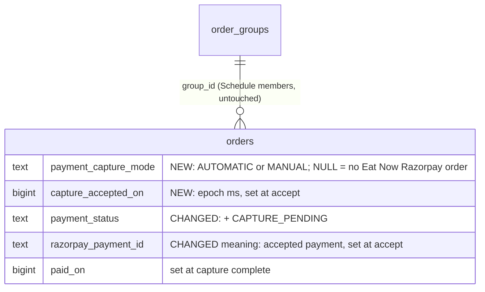
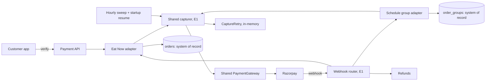
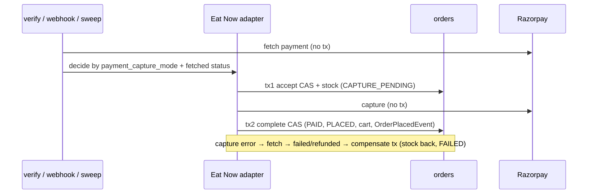

# Eat Now manual capture

Eat Now online orders switch from Razorpay automatic capture to manual capture, captured at payment confirm after the
stock check. Same model as Schedule Part B ([[schedule-group-manual-capture-plan]]); this plan reuses its capture
sequence instead of copying it.

Status: **v1.0 FINAL (2026-11-13)**: devil's advocate (C1-C12) and geld deep (APPROVED WITH CHANGES, accepted) done.
Next: /gcp brief, then write `db_manual/eatnow-manual-capture-migration.sql` (Block 1 / Block 2 per the geld sketch),
then E1.
Inputs: Claude read of `PaymentServiceImpl` + Schedule capture classes, and a blind read-only Codex map (2026-11-13);
every Codex-only claim below was checked in code or the database.

## Phases

| # | Phase | Repo | Branch | Base | Notes |
|---|---|---|---|---|---|
| E0 | Razorpay facts: Route transfers under manual capture, manual_expiry_period range | - | - | - | docs + test-mode; gates E2 |
| E1a | Shared capture core + webhook router (F4); zero behaviour change | ninja delivery service java | refactor/payment-capture-core | feature/schedule | refactor only, no SQL. **Router slice MERGED 2026-11-14** (`RazorpayWebhookProcessor`, PR #87 into feature/schedule, e680a4b; 2481 tests green, 9/9 mutants killed). **Capture-core slice MERGED 2026-11-14 (PR #88 into feature/schedule, 27cd5b0; E1b = PR #89, edec0bce, SQL Block 1 NOT RUN)**, built on `refactor/capture-core-extraction` (01dd07a + ba28529 + 5d5da23): shared `Capturer` over a `CaptureSubject` port, `GroupCaptureSubject` adapter, gateway/retry/validator moved to `service/payment/capture`; 16 `GroupCapturerTest` cases pass unchanged through it; Codex review: no behaviour change beyond a null-payment-id gap, fixed |
| E1b | (MERGED 2026-11-14, PR #89; **SQL Block 1 RUN by Samivan and verified 2026-11-14**; Block 2 not run, after the backend is live) | | | | Codex review found the pending-shape CHECK accepted a NULL mode (fixed, confirmed on PostgreSQL) |
| E1b | CAPTURE_PENDING enum, payment_capture_mode + capture_accepted_on fields (write AUTOMATIC), schema guard, SQL file | ninja delivery service java | feature/eatnow-capture-schema | feature/schedule | SQL Block 1 runs BEFORE its deploy; Block 2 after |
| E2a | Pure extraction of Eat Now checkout / confirm / verify / cancel / reconcile out of `PaymentServiceImpl` (624 -> ~160 lines, facade) into `service/payment/eatnow/` (`EatNowCheckout`, `EatNowConfirmation`, `EatNowReconciliation`, `EatNowCartReopener`); zero behaviour change | ninja delivery service java | feature/eatnow-manual-capture | feature/schedule | **MERGED 2026-11-14: PR #90 into feature/schedule (27327f4), CI `build` green, commit 07f0514; `/gcp judge quick` B provisional (F1 paise helper x8 and F2 cart-reopen owners are SCHEDULE follow-ups, F3 service.impl<->eatnow cycle DEFER to the ArchUnit gate).** 22 new characterization tests written first (all green on the old code), then moved; full suite 2532/0 (contextLoads excluded); Codex static diff review: no behaviour difference; 15/15 mutants killed (one test strengthened after M06 survived). Tests build the graph only through `service/payment/eatnow/EatNowPaymentFixture` (test tree). `CustomerOrderIdempotency` made public (checkout left its package); `OrderSnapshotCallersTest` allow-list now names `EatNowCheckout.java`. |
| E2b | Eat Now manual capture: `EatNowCaptureSettlement` over the shared `Capturer`, CAPTURE_PENDING, capture at confirm, resume + sweep, flag `app.payments.eatnow-manual-capture` (default off), Route shops forced AUTOMATIC (C9, E0 `route` not run) | ninja delivery service java | feature/eatnow-capture-adapter | feature/schedule | **MERGED 2026-11-15: PR #91 into feature/schedule (b7ca8dc), CI `build` green, commit 3ad6c75; `/gcp judge quick` B provisional (F1 gateway status literals x8 and F2 `OrderPlacedEvent.of(Order)` duplicate with the COD path are SCHEDULE follow-ups); `/gcp judge full` still owed before any merge to `main`.** New: `OrderCaptureRepository` (4 CAS queries fenced on payment id + MANUAL mode), `EatNowCaptureSettlement` (accept / complete / compensate / adoptCaptured), `EatNowCaptureSubject`, `EatNowCapturer` (verify, both webhooks, sweep and start-up resume enter here and act on the FETCHED status), `EatNowVerification` (verifyPayment lost its outer @Transactional: automatic orders keep one tx via TransactionTemplate, manual orders run no tx around gateway calls), `EatNowOrderPlaced`. The webhook routes authorized / captured / order.paid by the order's stored mode. Cancel and checkout-resume are refused while CAPTURE_PENDING. Full suite 2591/0 (contextLoads excluded); 29/29 mutants killed (25, plus 4 for the Codex fixes) after two harness bugs and three test gaps were fixed; Codex read-only review: 1 High (a captured payment on a FAILED order had no orphan refund), 1 Medium (start-up skipped captures under 2 min old), 1 Low (cancel-race refusal), all fixed and mutant-covered. **Not in E2b by design: C4 extra-captured-payment detection and the order-aware refund (BUG-2) = E2c.** SQL Block 2 only after the backend is live (it is on `feature/schedule`, not yet deployed); the flag stays off until E3 ships. Still untested: real UPI device round (B2), Route under manual capture |
| E3 | App: "Confirming payment" state, no Cancel/resume while pending | Food-Ninja-Frontend | feature/eatnow-capture-pending | feature/schedule | deploy before E2's flag is on |
| E4 | Web admin oversight shows CAPTURE_PENDING + age | Ninjasu_Web | - | feature/schedule | optional, see O2 |

Every branch is cut from `origin/feature/schedule`; every PR goes into `feature/schedule`.

## Why

With automatic capture Razorpay takes the money before we decide, so every "no" is a refund:

| Case | Today | After |
|---|---|---|
| Customer cancels, payment lands anyway (cancel race) | captured → orphan refund | authorised, never captured, Razorpay releases it at expiry |
| Stock gone at confirm | captured → refund (`CONFIRM_STOCK_FAIL`) | not captured, cart reopened |
| Amount / order mismatch | captured → manual handling | not captured |
| Shop declines after placement | refund | refund (unchanged, D2) |

## Decisions

Locked:
- **D1** Capture at payment confirm, after the stock check, not at shop accept. (Samivan 2026-11-13)
- **D2** Shop decline / customer cancel after placement stay normal refunds. (Samivan 2026-11-13)
- **D3** UPI manual capture is untested; risk accepted, the B2 real-payment round tests it. (Samivan 2026-11-13)
- **D4** The order stays `status = PENDING_PAYMENT` while `payment_status = CAPTURE_PENDING`. Every reader that already
  hides `PENDING_PAYMENT` (shop board, KDS, seller transitions, sales, dispatch, cash due) stays correct untouched;
  the shop is rung only when the capture is confirmed. (Claude + Codex agree)

Open (recommendation first):
- **O1** Eat Now `manual_expiry_period`: must exceed retries + next hourly sweep (C7), so about 120 minutes, the same as
  Schedule. Cost: a cancelled-then-authorised payment stays blocked on the customer's account until expiry, versus a
  refund of days today. Recommend 120; E0 confirms Razorpay's allowed range.
- **O2** E4 in scope? Recommend yes, small: oversight already lists every status; add the label and pending age.
- **O3** Kill switch `app.payments.eatnow-manual-capture` (default off): off = new orders created `automatic`, existing
  pending ones still finish. Recommend yes: `CAPTURE_PENDING` rows are not rollback-safe for an old backend, so the
  rollback is "flag off, drain pending, then redeploy", never a straight backend rollback.
- **O4** Pending age: new `capture_pending_at` column (recommended; bulk UPDATEs skip `@PreUpdate`, so `updated_on` is
  not reliable) vs setting `updated_on` inside each CAS. /geld decides.

## State machine (`orders.status / orders.payment_status`, Eat Now online only)

| From | Event | To | Writer (conditional UPDATE) |
|---|---|---|---|
| — | checkout | PENDING_PAYMENT / CREATED | insert (unchanged) |
| PENDING_PAYMENT / CREATED | valid authorised payment, stock decremented | PENDING_PAYMENT / CAPTURE_PENDING (+payment id, pending at) | `markCaptureAccepted` WHERE CREATED AND razorpay_payment_id IS NULL |
| PENDING_PAYMENT / CREATED | authorised but stock gone or mismatch | PAYMENT_FAILED / FAILED, cart reopened, no capture, no refund | `markFailedIfCreated` (+ reason) |
| PENDING_PAYMENT / CAPTURE_PENDING | Razorpay confirms capture of that payment id | PLACED / PAID (+paid_on), cart completed, `OrderPlacedEvent` | `markPaidCaptured` WHERE CAPTURE_PENDING AND payment id = :id |
| PENDING_PAYMENT / CAPTURE_PENDING | fetch shows failed / refunded | PAYMENT_FAILED / FAILED, stock credited once, cart reopened | `markCaptureFailed` WHERE CAPTURE_PENDING AND payment id = :id |
| PENDING_PAYMENT / CREATED | cancel / stale fail | PAYMENT_FAILED / FAILED | `markFailedIfCreated` (unchanged) |
| PENDING_PAYMENT / CAPTURE_PENDING | cancel | refused ("payment is being confirmed") | — |

`OrderPlacedEvent` moves from the stock step to the capture-complete step (D4).

## Path matrix (who calls what)

| Signal | CREATED | CAPTURE_PENDING | PAID | FAILED |
|---|---|---|---|---|
| verify (app) | fetch payment; authorised → accept + capture; captured (old automatic order) → old confirm | resume | no-op | no-op |
| webhook `payment.authorized` | accept + capture | no-op (same id) | no-op | ignore: expires uncaptured, no refund |
| webhook `payment.captured` / `order.paid` | old automatic order → old confirm | complete if same id | no-op | captured after fail → orphan refund (only when Razorpay says captured) |
| sweep | `fetchPayments`: every attempt, not just the first | resume (fetch stored id) | — | — |

Every gateway call (fetch, capture) runs with no database transaction open: verify and webhook are `@Transactional`
today (`PaymentServiceImpl.java:358`, `:435`), so E1's router suspends it the way the group path already does.

## Reuse (E1)

Shared, moved out of `service/schedule/payment/` into `service/payment/capture/`:
- `PaymentGateway` (fetch, capture, paymentsForOrder, createOrder with capture mode + expiry, signature) and its
  Razorpay implementation; Eat Now stops calling `razorpayClient` directly.
- `CaptureRetry` (1/2/5/10 min, one per key) and `Capturer` (accept → capture call → complete; fetch before
  compensate; resume; sweep) over a small `CaptureSubject` port: `accept`, `complete`, `compensate`, `findPending`,
  `expectation` (order id, amount, currency).
- Webhook router (F4): signature → dedup → audit row → owner. Owners: Schedule groups, Eat Now orders, refunds.

Stays per domain: the transaction adapters (`GroupCaptureSettlement`, new `EatNowCaptureSettlement`), lock order,
stock rules, cart/member updates, events, orphan and refund policy.

E1 is a pure refactor: the Schedule suite (2461 tests, PR #84 mutants) must pass unchanged.

## Readers that change (E2/E3)

| Reader | Change |
|---|---|
| checkout resume (`PaymentServiceImpl.java:144`) | CAPTURE_PENDING returns "confirming", never a fresh sheet |
| pending-order endpoint + order screen (`OrderServiceImpl.java:158`) | show "Confirming payment"; hide Cancel Payment |
| reconcile sweep (`:683-742`) | read authorised attempts; resume CAPTURE_PENDING by its own age; never stale-fail it |
| refund raise (orphan) | only on proof Razorpay captured; an uncaptured authorisation is never refunded |
| admin oversight | show CAPTURE_PENDING and its age (E4) |
| sales reports (`OrderRepository.java:213`, `:236`) | none under D4; add a test that a pending order never counts |

## Schema sketch (DO NOT RUN — for /geld)

- `orders_payment_status_check` += `CAPTURE_PENDING` (live check has the 6 old values, confirmed 2026-11-13).
- `capture_pending_at bigint NULL` (O4) + partial index `WHERE payment_status = 'CAPTURE_PENDING'`.
- Shape check: `payment_status <> 'CAPTURE_PENDING' OR (razorpay_payment_id IS NOT NULL AND paid_on IS NULL AND
  status = 'PENDING_PAYMENT')` — check Schedule member rows (same table) before adding.

## Deploy order

SQL → backend with flag off → app E3 → flag on. `payment.authorized` is already subscribed. Orders created before the
flag keep automatic capture and the old confirm path until they resolve.

## Risks (ranked)

1. Double charge or double stock credit across verify / webhook / sweep / cancel: one payment-id fence on every CAS.
2. A gateway call inside a transaction, or a webhook audit row that hides unfinished work after a crash.
3. Shop rung or revenue counted before capture (D4 broken somewhere).
4. Refunding an authorisation that was never captured.
5. Route split: transfers are attached at order create; confirm in E0 that they run on capture under manual mode.

## Razorpay facts (official docs, read 2026-11-13)

- A `paid` order takes no more payments ("No further payment requests are allowed once the order moves to the `paid`
  state", docs/payments/orders); a duplicate on a paid order is auto-refunded "Immediately" (payments/refunds/auto-refunds).
- An order `attempted` with an `authorised` payment blocks a new attempt on the same order id (payments/orders).
- Late authorisation (after the capture timeout) is auto-refunded; Razorpay polls the bank for 3 days (one page says 5).
- Manual capture: uncaptured authorisations are auto-refunded after `manual_expiry_period` (default and max 7200 min;
  must be >= `automatic_expiry_period`; automatic minimum 12 min). No API to void an authorisation early.
- **E0 `range` RUN 2026-11-14 (test mode, `schedule-b0-spike/e0-spike.mjs`):** the order API accepts `manual_expiry_period` 12 to 7200 minutes (12, 60, 120, 7200 accepted; 1, 11, 7201 rejected 400 "should in between 12 minutes and 5 days"). 120 (D5) is valid.
- **E0 `dup` RUN 2026-11-14 (automatic capture, test mode):** order `paid`, `amount_paid` 100; the first payment showed `authorized` at first poll and was `captured` seconds later (automatic capture is not instant). A second payment on the paid order was refused by Razorpay Checkout ("Uh! oh! Something went wrong"); no second payment record was created, so the auto-refund of a duplicate was NOT observed (nothing to refund). Prevention holds for the sequential case. Not tested: two attempts open at once before either pays (C4 detection stays as the net). 
- **E0 `route` (C9) NOT RUN 2026-11-14:** `keys/test-branch.env` has no test-mode Razorpay linked account (`RZP_LINKED_ACCOUNT`). Per C9, E2 must keep Route-settled shops on AUTOMATIC capture (fail closed) until a test-mode Route round trip (authorise, capture, transfer, refund with reversal) is run with `e0-spike.mjs route`. E0 gate for E2 is otherwise met (range + dup).
- Not stated anywhere: two attempts authorised at the same moment under automatic capture; Route transfers under
  manual capture (still E0).

## Devil's advocate (v0.2, 2026-11-13: Claude + blind Codex, Codex claims re-checked in code)

Verdict: **proceed with conditions**. Plan claims corrected: "one payment-id fence on every CAS" is not enough (C4, C5);
"readers that hide PENDING_PAYMENT stay correct" missed the pending endpoint (C1); "pending ones still finish after
flag-off" depends on recovery timing (C7).

Existing bugs found (not caused by this plan; fix first, own branches):
- **BUG-1 (Schedule, on feature/schedule):** `/orders/pending-payment` (`OrderServiceImpl.java:162`) returns a Schedule
  member, `reconcileIfStale` (`PaymentServiceImpl.java:665-677`) sees no Razorpay order id, and after 3 minutes
  `failStaleCheckout` → `markFailedIfCreated` fails that one member and unlocks the Schedule cart. The hourly sweep
  excludes members (`:686`); the lazy path does not. Trigger: app cold start while a group checkout is >3 min old.
  **FIXED 2026-11-13** on `fix/schedule-member-lazy-reconcile` (6118852, local, not pushed): pending lookup is
  `...AndGroupIdIsNull...`, `reconcileIfStale` skips members, `markPaidIfCreated`/`markFailedIfCreated` carry
  `o.groupId IS NULL`; both guards mutant-checked; full suite 2471/0.
- **BUG-2 (Eat Now, today):** a second captured payment on an already-PAID order is logged as a no-op
  (`PaymentServiceImpl.java:304-306`); the extra money is kept, never refunded.

Conditions:
- **C1** Every Eat Now entry point and CAS excludes `group_id IS NOT NULL` (pending endpoint, lazy reconcile, sweep,
  confirm, cancel, the new CAS queries). Schedule members are resolved only through their group. (BUG-1)
- **C2** Persist the capture mode on the order at checkout, before the Razorpay order is created; every signal routes by
  that stored mode. Old rows read as automatic and keep the old confirm and orphan-refund paths. (Codex #1: without
  it, an automatic order's `payment.authorized` would enter the manual accept path.) Column shape → /geld.
- **C3** One decision point per order, like Schedule's `onPayment`: verify, both webhooks and the sweep fetch the
  payment and act on its fetched status, never on the event name. Verify and the webhook handler run with no
  transaction open around fetch/capture (both are `@Transactional` today).
- **C4 (narrowed after the Razorpay docs check below)** Prevention first: under manual capture only the accepted
  payment id is ever captured, so a second authorisation lapses and Razorpay refunds it. Detection for what is left
  (automatic-capture orders): a captured payment whose id differs from the order's → log ERROR and fetch it; Razorpay
  already `refunded` it → record and stop; still `captured` → raise an order-aware extra-capture refund (make
  `ExtraCaptureRefundServiceImpl` accept an order, idempotent per payment id). E0 test-mode check: pay a paid order
  twice and confirm the immediate auto-refund. (BUG-2, Codex #3; Samivan 2026-11-13: fold into E2, prevent first.)
- **C5** Accept = one transaction: CAS + stock decrement + payment id + pending timestamp. Complete = one transaction:
  CAS + paid_on + PLACED + cart complete + `OrderPlacedEvent`. Compensate = one transaction: CAS + stock credit + cart
  reopen. Stock never moves outside its winning CAS. A repeat capture call is harmless (B0: second capture → 400 →
  fetch → captured).
- **C6** The webhook audit row commits in the outer transaction after the handler returns (today's order); a handler
  that throws rolls it back so Razorpay redelivers. E1 must not commit it earlier. Test crash points and duplicate
  deliveries for all three owners.
- **C7** Recovery outlives a restart: resume CAPTURE_PENDING at application start, plus the in-memory 1/2/5/10 retries
  and the hourly sweep. The expiry (O1) must exceed the worst case: retries exhausted + next hourly sweep. No new
  frequent poll (Neon scale-to-zero). Alert at 10 min pending (as Schedule).
- **C8** Rollback: E1 ships the `CAPTURE_PENDING` enum value (unused) one deploy before any writer, so the rollback
  target can still load such rows. Rollback after E2 = flag off, wait for pending = 0 (check twice), then redeploy.
- **C9** The shared gateway's create-order request carries the settlement config (Route `transfers`). E0 must show a
  test-mode Route round trip under manual capture (authorise, capture, transfer, refund with reversal); until then
  Route shops stay automatic (fail closed).
- **C10** E1 writes characterization tests for every Schedule captured-payment case (different id, mismatch, after
  fail/cancel) before moving any code; the domain adapter keeps Schedule's routing, locks and refund policy.
- **C11** The pending-shape CHECK is scoped to `group_id IS NULL`.
- **C12** Old app versions: cancel while pending is refused with a clear message; verify may return
  PENDING_PAYMENT, which the existing "pending" outcome already handles (check on device in E3).

New open decisions:
- **O5 → D6 (Samivan 2026-11-13):** fix BUG-1 and BUG-2 now, two small PRs into feature/schedule, before E1.
- **O1 → D5 (Samivan 2026-11-13):** Eat Now `manual_expiry_period` = 120 minutes, same as Schedule.

## Test plan (E2)

- Unit: every row of the state machine and path matrix; mutants on each CAS predicate.
- Embedded PostgreSQL: accept vs cancel race; two accepts with different payment ids; capture-complete twice.
- Transition: an automatic-capture order created before the flag confirms through the old path.
- B2 (device, real money): UPI authorise → capture; cancel race lapses at expiry; backend killed between accept and
  capture, sweep finishes it.

### E2c (BUG-2, backend PR #93) tests still TODO - test later (Samivan 2026-11-15: unit/DB tests are done and green, these wait)

Done and green locally: full suite 2639, 9/9 mutants killed, real-PostgreSQL repository sums and legacy sweeps.

| # | Test | Where | Why it matters |
|---|---|---|---|
| T1 | Pay an already-paid Eat Now order a second time in Razorpay TEST mode; confirm what Razorpay does (immediate auto-refund, or a second captured payment and a webhook) | device / test mode (C4 E0 check, never run) | If Razorpay always auto-refunds, the new path rarely fires; if not, this is the real proof |
| T2 | With a second captured payment: webhook raises the refund request; admin web shows it with payment id B; approve in full; Razorpay refunds payment B; order stays PAID; `orders.refund_id` and `refunded_on` untouched | test mode + admin web | The only end-to-end check of the gateway call for an extra payment |
| T3 | `refund.processed` webhook for the extra refund is matched by gateway refund id (HANDLED, not NOT_HANDLED); an unmatched external refund on payment B is only logged | real PostgreSQL or test mode | `RefundWebhookHandler` assumes the order owns the payment id |
| T4 | Admin retry of a FAILED extra refund end to end (no allocation copied, per-payment cap) | admin web | Retry path is unit-tested only |
| T5 | Race two real webhook deliveries (A and B) on a CREATED order: one order payment, one B obligation, both audit rows kept | real PostgreSQL, real threads (`ConcurrentRace`) | Order row lock is relied on, not tested |
| T6 | Real-PostgreSQL test of `ExtraCaptureOrderRefundServiceImpl` against `ux_payment_refunds_obligation` (FAILED then re-raise) | real PostgreSQL | Idempotency is unit-tested with mocks only |
| T7 | Production data audit before deploy, expect 0: `SELECT count(*) FROM payment_refunds r JOIN orders o ON o.id = r.order_id WHERE r.razorpay_payment_id IS DISTINCT FROM o.razorpay_payment_id;` | Neon, read-only (Samivan runs) | The own-payment filter would hide a refund row whose payment id differs from the order's |
| T8 | Route-split shop with a second captured payment: confirm it only logs ERROR and creates no row; after the Route round trip (C9) decide whether to allow it and what `reverse_all` does to an extra payment | test mode with a linked account | Today an admin must refund it in Razorpay by hand |
| T9 | Customer app My Orders: the extra refund shows as a normal "refund initiated" line; confirm that wording is acceptable (product call) | device | Customer summaries do not mark extra payments |
| T11 | Unrefundable extra captures (route-split shop, missing shop, already refunded outside the system) only log ERROR: no refund row, no admin push. Add an admin-visible record (a new `RefundAttentionEvent` kind that works without a refund id, or a row) so a double charge cannot go unseen. Also: a FAILED extra refund plus a redelivery under a new event id makes a second request (the cap stops a double refund) | design, then build | Code review of PR #93 (2026-11-15) |
| T10 | Manual-capture orders: a second captured payment (the capture-adoption path ignores PAID orders), and a FAILED manual order that has a stored payment id (the refund helper prefers the stored id over the supplied one) | with E2/E3 | Both are out of scope of E2c and must be covered before the manual-capture flag is on |

## Quality brief (/gcp, 2026-11-13, for E1a + E1b)

E1 split into E1a (pure refactor) and E1b (schema-facing) by Samivan 2026-11-13. Rulebook INDEX reported stale; card
rules used.

```
BRIEF - E1a shared capture core + webhook router (F4); E1b enum + order fields + guard + SQL Block 1
Base: origin/feature/schedule (603a3fe; plus PR #86 once merged)
Stacks: spring, sql-postgres, testing
Rules that apply:
- CORE-ARCH-01 [MUST] one routing decision per signal: router -> owner; one accept per domain
- SB-TX-02 [DEFAULT] no Razorpay call inside a tx: router keeps withoutTransactionTemplate (PaymentServiceImpl:121)
- SQL-SCHEMA-02 [DEFAULT] mode/pending shape in CHECKs (geld I2, I3), not only code
- SQL-SCHEMA-04 [MUST] new columns nullable; scope CHECK only after backfill (Block 2)
- SQL-SCHEMA-05 [DEFAULT] partial index CREATE INDEX CONCURRENTLY, outside the CHECK transactions
- CORE-REUSE-01 [DEFAULT] move, don't rewrite: Group* gateway/retry/capturer become the shared core
- CORE-STRUCT-10 [DEFAULT] service/payment/capture/ and service/payment/webhook/ as separate sub-feature folders
- TEST-UNIT-07 [DEFAULT] moved classes take their tests along (rename), no second copy
- TEST-MAINT-02 [DEFAULT] router characterization tests land BEFORE the move, in E1a
- CORE-VERIFY-01 [DEFAULT] "pure refactor" backed by an unchanged test count + named green suites
- Project rule wins: SB-MIG-01 (Flyway) -> hand-run db_manual SQL; ENV-1..3 deferred to pre-launch
Reuse map:
- gateway -> service/schedule/payment/GroupPaymentGateway + RazorpayGroupPaymentGateway (+Exception)
- retry -> GroupCaptureRetry; sequencing -> GroupCapturer (port: accept/complete/compensate/findPending)
- webhook signature -> Utils.verifyWebhookSignature (PaymentServiceImpl:441); dedup -> existsByEventId
- group-member test -> ScheduleMember.is; refund events -> PaymentRefundService.onGatewayRefundEvent
- boot schema check -> ScheduleSchemaGuard Kind COLUMN/CONSTRAINT/CONSTRAINT_ALLOWS/INDEX + SqlConsistencyTest
Low-impact reminders: SB-TX-07; CORE-STRUCT-05 router thin, routing in a pure function; CORE-STRUCT-06;
  CORE-JOB-05 sweep stays registered; CORE-READ-03; TEST-MAINT-04 one webhook-test helper; SQL-PERF-09 sweep
  predicate implies the partial index's; CORE-ERR-06 compensation scoped to its own payment id
Tests to write: E1a router characterization first (7 webhook tests exist): bad signature -> throws, no audit;
  duplicate eventId -> no dispatch; audit saved before dispatch (InOrder); authorized group -> onAuthorized outside
  tx; authorized Eat Now -> ignored; payment.failed -> no write; unknown event -> no write; captured unknown order
  -> no-op; group owner throws -> propagates (C6). E1b: new order columns guarded (copy
  theOrderTaxColumnsTheEntityMapsAreGuarded); checkout tx1 writes AUTOMATIC; Schedule member/COD/POS leave mode NULL;
  CAPTURE_PENDING maps both ways. Real DB: none for E1.
Copy check: GroupCapturer -> Capturer is a move (0 siblings); the E2 Eat Now adapter is the 2nd port user
Size budget: PaymentServiceImpl 768 (over fail 400) -> ~630 after the router leaves; add nothing to it.
  Router ~150 lines; Capturer ~120; GroupPaymentServiceImpl 172 stays
Folder shape: service/schedule/payment has 11 files (1 service + components); capture/ gets 6 components,
  webhook/ gets router + owner port; tests mirror under src/test (Java convention)
Cannot run here: Block 1 SQL (Samivan, after a Neon-branch rehearsal); embedded-Postgres tests don't load db_manual
  CHECKs (E2 decision: apply db_manual in the test lane for the shape-CHECK race tests)
Done means: mvnw test (contextLoads excluded) green, same count + new tests; mutants on router branches;
  /gcp judge quick per PR, full before push; read-only Codex diff review
```

## Data model review

### Summary (read this first)
**Verdict:** Design approved with 6 changes (all decided below, nothing left for you to choose); release stays blocked
on the inherited environment items ENV-1 to ENV-3 that you deferred to pre-launch, exactly as for Schedule Part B.

**What changes** (before → after):
- `orders` gets `payment_capture_mode` (`AUTOMATIC` / `MANUAL`), written when the order is created, so every payment
  signal follows the mode the order was born with, even while the flag flips or a rollback happens.
- `orders` gets `capture_accepted_on`: the moment we accepted an authorised payment. It drives the stuck-capture alert
  and the sweep, and stays true after the order is paid.
- `orders.payment_status` may hold `CAPTURE_PENDING`; one CHECK refuses a pending row missing its payment id or accept
  time, already marked paid, not `MANUAL`, or not `PENDING_PAYMENT`.
- The SQL runs in two blocks: Block 1 **before E1** (E1 already writes `AUTOMATIC` on new Eat Now online orders and
  knows the new enum value, so the rollback target reads every row E2 writes), Block 2 after E1 is live.

**Decisions you need to make:** none. Every choice is decided below; the gate only asks you to accept them.

**What geld decided for you:**
- A stored mode, not one derived from the payment status Razorpay reports: an automatic order's `payment.authorized`
  would otherwise enter the manual path (DA C2).
- NULL mode has one meaning, "this row has no Eat Now Razorpay order" (COD, POS, Schedule member); the 13 old Eat Now
  online rows are backfilled to `AUTOMATIC`. Rejected: NULL = "legacy automatic" (two meanings for one NULL).
- `capture_accepted_on`, not `capture_pending_at` (would lie once paid) and not `updated_on` (bulk UPDATEs skip
  `@PreUpdate`, `Order.java:215`). Epoch millis `bigint`, `_on` suffix: the `orders` convention (`placed_on`, `paid_on`).
- No "`paid_on` required when PAID" check now: confirm sets PAID and `paid_on` in two statements
  (`OrderRepository.java:175`, `PaymentServiceImpl.java:316`), and refunds keep history (revisit INV-2).
- Mode immutability in code (`@Column(updatable = false)`), not a trigger.
- Each CHECK swap runs inside one transaction, so a failure never leaves the column unchecked.

**What must happen before deploy:**
1. Rehearse on a Neon branch, then run `db_manual/eatnow-manual-capture-migration.sql` (written after approval)
   Block 1: two columns, widen `orders_payment_status_check`, add `chk_orders_capture_mode`,
   `chk_orders_capture_pending_shape`, `idx_orders_capture_pending`, column comment on `razorpay_payment_id`.
2. Deploy E1 (writes `AUTOMATIC`, knows `CAPTURE_PENDING`, schema guard lists the new objects).
3. Run Block 2: backfill `AUTOMATIC` on old Eat Now online rows (preflight count), then add `chk_orders_capture_mode_scope`.
4. E0 passed (Route round trip, paid-order duplicate check); deploy E2 with the flag off; app E3; flag on.

**Unknowns that could change this:** none deciding. Route under manual capture is E0's test; Route shops stay
automatic until it passes (C9).

**Status:** FINAL · **Verdict:** APPROVED WITH CHANGES (all 6 accepted by Samivan 2026-11-13) · geld deep, 2026-11-13
**Target:** PostgreSQL 17.12 on Neon (measured) · hand-run SQL in `db_manual/`, Hibernate `ddl-auto=update` also on · pooled connection · one EC2 backend instance
**Lenses run:** 0-8 (payment state on a shared table touches all) · **skipped:** none · **reference designs:** skipped (same authorise/capture pattern already reviewed for Schedule Part B)
**Codex second opinion (blind, 2026-11-13):** 6 points; agreed 4 (stored mode, dedicated timestamp + partial index, scoped shape CHECK, no paid_on check yet), Codex-only verified 2 (CHECK swap in one transaction; rollback must drain manual CREATED orders too), disagreement 1 (NULL mode = legacy automatic → rejected, backfill instead)
**Open inputs:** none

### Design changes
Overall: each order carries the capture mode it was created with, and the database refuses a half-written pending row.

| # | before (plan v0.2) | after | problem it solves | why it is better | what it costs | alternative, why it lost |
|---|---|---|---|---|---|---|
| 1 | mode implied by flag / fetched status | `payment_capture_mode` on the row, set in checkout tx1 | STATE-1 | routing cannot change during an order's life | 1 column; every entry point routes by it | derive from status: wrong for automatic orders |
| 2 | O4 open | `capture_accepted_on bigint`, set in the accept CAS | TIME-1 | exact alert and sweep age | 1 column | `updated_on`: not set by bulk CAS; `capture_pending_at`: lies after paid |
| 3 | shape check sketch | full pending-shape CHECK incl. mode and accept time | INV-1 | DB refuses it under any writer | accept writes all fields at once | code-only: drift |
| 4 | SQL before E2 | Block 1 before E1, Block 2 after E1 | MIG-1, MIG-2 | expand-contract; every state works with N-1 | two SQL runs | one run: old backend's insert breaks the scope CHECK |
| 5 | separate DROP/ADD statements | one transaction per CHECK swap | MIG-3 | no unchecked moment | none | — |
| 6 | rollback drains CAPTURE_PENDING | drains every unresolved MANUAL order | MIG-4 | clean rollback | longer drain (≤ 30 min) | — |



### Tables
| table | grain | purpose | class | owner | phase | state |
|---|---|---|---|---|---|---|
| orders | one row = one order (Eat Now, POS or Schedule member) | order and its payment state | hot (status updates); 94 rows | orders / payments | columns E1, writers E2 | live |

### Names
| name | what it holds | project word (grep) | clashes | verdict |
|---|---|---|---|---|
| `payment_capture_mode` | how Razorpay captures this order's payment | "capture" (`captured_amount`, `CAPTURE_PENDING`, `capture_options`); `capture_mode` grep: 0 hits | none | keep |
| `capture_accepted_on` | when we accepted the authorised payment | `*_on` = epoch ms on `orders` (`placed_on`, `paid_on`, `refunded_on`) | none | keep |
| `chk_orders_capture_mode`, `chk_orders_capture_mode_scope`, `chk_orders_capture_pending_shape`, `idx_orders_capture_pending` | constraints, index | `chk_order_groups_*` style | none | keep |

### Columns on touched hot tables
`orders` groups: ordering (shop, lines, totals, status), payment gateway (`payment_method`, `payment_status`,
`razorpay_*`, `paid_on`, `refund_id`, `refunded_on`, + the two new), delivery handover (OTP, rider), POS (`check_id`,
`kot_number`), Schedule (`group_id`, `group_suffix`, `release_at`). The payment group is written by the order's own
flows at its own events and read by checkout, confirm, reconcile, refunds and order views: it stays. Revisit EVOL-1.

### Built vs plan
Nothing built (E1/E2 not started). Cost to change now: free.

### Column mapping (orders, new and changed)
| column | type | null | default | constraint | phase | note |
|---|---|---|---|---|---|---|
| payment_capture_mode | text | yes | none | `IN ('AUTOMATIC','MANUAL')`; scope CHECK: not null iff Eat Now online | E1 | `updatable = false` |
| capture_accepted_on | bigint | yes | none | required when CAPTURE_PENDING | column E1, written E2 | kept after PAID / FAILED |
| payment_status | text | yes (23 legacy NULL rows) | NONE | + `CAPTURE_PENDING` | E1 | |

Index `idx_orders_capture_pending ON orders (capture_accepted_on, id) WHERE group_id IS NULL AND payment_status =
'CAPTURE_PENDING'`: serves the hourly sweep and the startup resume (C7); normally empty.

Sketch (DO NOT RUN — sketch for review):
```sql
-- Block 1 (before E1), one transaction per swap
ALTER TABLE orders ADD COLUMN IF NOT EXISTS payment_capture_mode text, ADD COLUMN IF NOT EXISTS capture_accepted_on bigint;
BEGIN; SET LOCAL lock_timeout = '3s';
ALTER TABLE orders DROP CONSTRAINT IF EXISTS orders_payment_status_check;
ALTER TABLE orders ADD CONSTRAINT orders_payment_status_check CHECK (payment_status IN
  ('NONE','CREATED','CAPTURE_PENDING','PAID','FAILED','REFUND_PENDING','REFUNDED'));
COMMIT;
ALTER TABLE orders ADD CONSTRAINT chk_orders_capture_mode CHECK (payment_capture_mode IN ('AUTOMATIC','MANUAL'));
ALTER TABLE orders ADD CONSTRAINT chk_orders_capture_pending_shape CHECK (group_id IS NOT NULL
  OR payment_status IS DISTINCT FROM 'CAPTURE_PENDING'
  OR (razorpay_payment_id IS NOT NULL AND capture_accepted_on IS NOT NULL AND paid_on IS NULL
      AND status IS NOT DISTINCT FROM 'PENDING_PAYMENT' AND payment_capture_mode IS NOT DISTINCT FROM 'MANUAL'));
-- (a plain "payment_capture_mode = 'MANUAL'" evaluates to UNKNOWN for a NULL mode and a CHECK accepts UNKNOWN:
--  caught by the blind Codex review of E1b, confirmed on PostgreSQL 2026-11-14)
CREATE INDEX IF NOT EXISTS idx_orders_capture_pending ON orders (capture_accepted_on, id)
  WHERE group_id IS NULL AND payment_status = 'CAPTURE_PENDING';
-- Block 2 (DO NOT RUN NOW: after E1 is live)
UPDATE orders SET payment_capture_mode = 'AUTOMATIC'
 WHERE payment_method = 'ONLINE' AND group_id IS NULL AND payment_capture_mode IS NULL;
ALTER TABLE orders ADD CONSTRAINT chk_orders_capture_mode_scope CHECK ((payment_capture_mode IS NOT NULL)
  = (payment_method IS NOT DISTINCT FROM 'ONLINE' AND group_id IS NULL));
```

### Invariants
| # | invariant | enforced by | evidence |
|---|---|---|---|
| I1 | one accepted payment per order | CAS `WHERE payment_status='CREATED' AND razorpay_payment_id IS NULL` | state machine |
| I2 | a pending row is complete | CHECK `chk_orders_capture_pending_shape` | change 3 |
| I3 | mode set for every Eat Now online order and only those | CHECK `chk_orders_capture_mode_scope` (Block 2) | change 4 |
| I4 | mode never changes | code (`updatable = false`) | geld decision |
| I5 | complete / compensate act only on the accepted id | CAS `WHERE payment_status='CAPTURE_PENDING' AND razorpay_payment_id=:id` | state machine |
| I6 | stock moves only in its winning CAS transaction | service | DA C5 |
| I7 | shop sees the order only after capture | status stays `PENDING_PAYMENT` + event in the complete tx | D4 |

### Scenarios, access patterns, sizing
- Correctness: verify, `payment.authorized` and the sweep arrive together for one payment → one accept, stock
  decremented once, the capture completes once (I1, I5, I6).
- Failure: backend killed between accept and capture → startup resume or the next sweep finishes inside the 120 min
  expiry (C7).
- Load: `orders` has 94 rows, 3 in the last 30 days, 12 indexes (measured 2026-11-13). At 100x the pending set is
  still a handful of rows; the partial index keeps the sweep at O(pending) and costs nothing on other writes.

### Findings
#### Must change before the next affected deploy
- **STATE-1 · risk · MUST** — routing by fetched status sends an automatic order's `payment.authorized` into the manual
  accept path. Change 1. Cost: free.
- **TIME-1 · risk · MUST** — pending age from `updated_on` is wrong: bulk CAS skips `@PreUpdate` (`Order.java:215`).
  Change 2. Cost: free.
- **INV-1 · risk · MUST** — a pending row missing its payment id or accept time cannot be resumed. Change 3. Cost: free.
- **MIG-1 · risk · MUST** — `ddl-auto=update` adds the new columns without CHECKs if a backend with the fields boots
  before the SQL; Block 1 runs before E1 and the schema guard lists the new objects in E1. Change 4. Cost: free.
- **MIG-2 · risk · MUST** — a scope CHECK added before every writer sets the mode makes the old backend's checkout
  insert fail. Block 2 after E1. Cost: free.
- **MIG-3 · risk · MUST** — DROP then ADD CHECK outside one transaction leaves a moment with no check. Change 5.
- **MIG-4 · risk · MUST** — rollback while a MANUAL order is still CREATED: the old code ignores its authorisation and
  the money is held 2 h. Change 6: rollback precondition "no unresolved MANUAL order", checked twice.

#### Fine now, revisit at <trigger>
- **MONEY-1** `orders` has no currency column; the Razorpay amount uses the configured currency
  (`PaymentServiceImpl.java:184`); accept compares the fetched currency with it. Revisit: first non-INR market.
- **INV-2** `paid_on` required when PAID: once every PAID writer sets both in one statement (incl. Schedule members,
  `GroupPaymentSettlement.java:164`).
- **MODEL-1** 23 legacy rows with NULL `payment_status`, meaning undefined; backfill to `NONE` when convenient.
- **EVOL-1** payment column group → `order_payments` 1:1 table at a second gateway or Eat Now split tender.
- **OWN-1** `ScheduleSchemaGuard` will list Eat Now objects; rename to `SchemaGuard` when a third domain joins.
- In-memory retries are per instance (same as Schedule): revisit at a second backend instance.

#### Keep
- One payment lifecycle column with a new value, not a boolean.
- Order stays `PENDING_PAYMENT` while pending (D4): every existing reader stays correct.
- No new frequent poll: startup resume + hourly sweep (Neon scale-to-zero).
- `razorpay_payment_id` reused as the accepted payment (meaning recorded; column comment in Block 1).

### Devil's advocate trace
| DA point | outcome |
|---|---|
| C1 group members excluded | handled (PR #86) + shape CHECK scoped `group_id IS NULL` |
| C2 stored mode | absorbed (STATE-1, change 1) |
| C3 one decision point, no tx around gateway | system design, no schema |
| C4 extra captures | service; refund rows already carry their payment id |
| C5 stock in the winning tx | I6 |
| C6 audit row last | system design |
| C7 restart recovery | partial index + startup resume |
| C8 enum one deploy early | absorbed and widened (MIG-1: SQL before E1) |
| C9 Route | E0 gate |
| C10 characterization tests | E1 build rule |
| C11 shape scoped | absorbed (INV-1) |
| C12 old app | API note below |

### Future phases
| phase | new tables | change forced |
|---|---|---|
| E3 app / E4 web | none | none |
| capture at shop accept (not planned) | none | a new mode value; fits |
| second gateway / split tender | `order_payments` | EVOL-1 |

### Rollout
| change | phase | slot | lock and rewrite | works with N-1? | rollback | precondition |
|---|---|---|---|---|---|---|
| add 2 nullable columns | expand | Block 1, before E1 | ACCESS EXCLUSIVE, no rewrite, 94 rows | yes | keep | Neon branch rehearsal |
| widen status CHECK, mode CHECK, shape CHECK, partial index | expand | Block 1 | one tx per swap, `lock_timeout 3s` | yes: old code never writes them | keep | — |
| backfill mode + scope CHECK | migrate / contract | Block 2, after E1 | 13 rows | yes: E1 writes the mode | drop scope CHECK | E1 live; preflight NULL-mode count |
| E2 writers | — | after Block 2 + E0 | — | flag off | flag off, drain MANUAL unresolved twice, redeploy E1 | E0 passed |

Lens 0: ENV-1 fail, ENV-2 fail, ENV-3 fail (inherited, deferred to pre-launch by Samivan 2026-10-21); ENV-4 unknown
(restore retention); rehearsal on a Neon branch; order of rollout above.

### Design versions
| version | phase | date | what changed | why |
|---|---|---|---|---|
| geld v1 | E1-E2 | 2026-11-13 | changes 1-6 | this review |

### Locked decisions (handoff to /gcp and /judge)
| id | decision | enforced where | code paths that must honour it |
|---|---|---|---|
| L1 | route every Eat Now payment signal by `payment_capture_mode` | service | verify, webhook (authorized, captured, order.paid), sweep, lazy reconcile, cancel |
| L2 | accept writes status, payment id, accept time and stock in one tx | CHECK + service | new Eat Now accept step |
| L3 | complete / compensate only on the accepted id | CAS | new `markPaidCaptured`, `markCaptureFailed` on `OrderRepository` |
| L4 | mode written in checkout tx1, never updated | `updatable = false` | `PaymentServiceImpl.checkout` |
| L5 | SQL Block 1 → E1 → Block 2 → E2 | deploy order | release checklist |

### Approval record
| finding or decision | option chosen | by | date |
|---|---|---|---|
| design changes 1-6 (STATE-1, TIME-1, INV-1, MIG-1..4) | accepted as proposed | Samivan | 2026-11-13 |

## System design

### Components


### Main flows


### Decisions
- Stored mode vs derived: stored (STATE-1). Revisit: never.
- In-memory retry vs DB job: in-memory + hourly sweep + startup resume (Neon). Revisit: second backend instance.
- Shared capturer vs a copy: shared core, per-domain adapters, characterization tests first (C10). Revisit: a domain
  needs a different retry policy.

### Isolation, tenancy, API
Ownership unchanged: the Eat Now adapter writes `orders`, the Schedule adapter writes `order_groups`; the shared core
writes no table itself. Tenancy unchanged (pooled, shop-scoped). API: `paymentStatus` gains `CAPTURE_PENDING`; old
app versions treat an unknown value as not paid (`OrderSummaryCard` default branch) and get a clear refusal on cancel
(C12); checkout and verify keep their idempotency keys.
