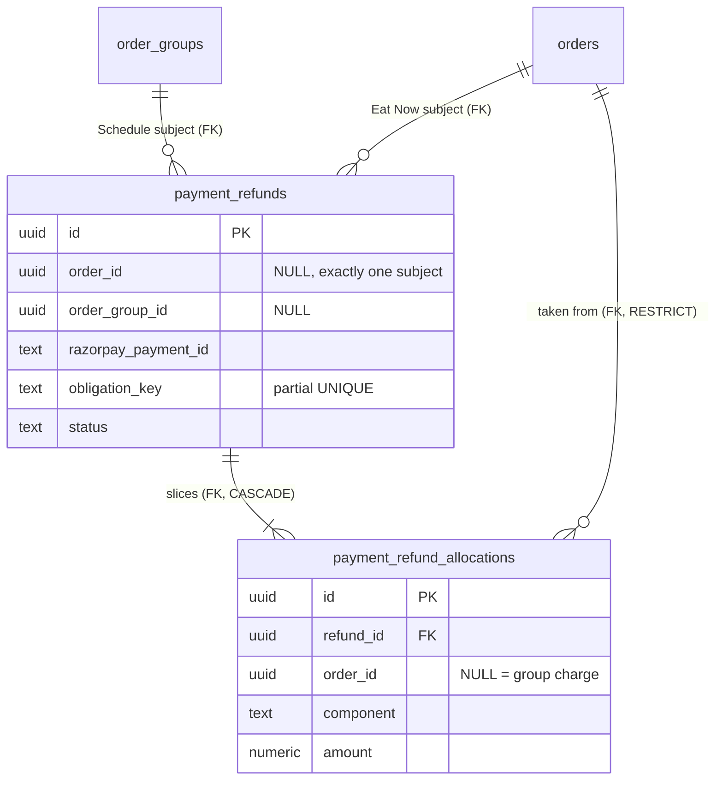
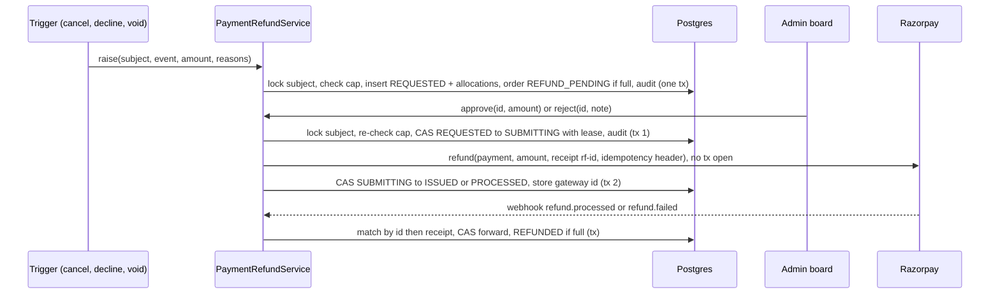
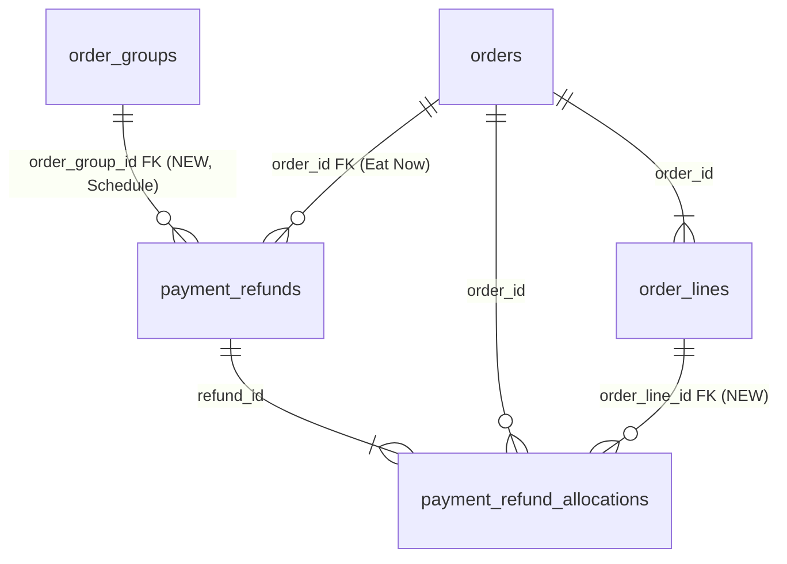

# Admin-approved refunds

Status: backend BUILT, MERGED and DEPLOYED 2026-10-29 (PR #69); web board, app copy and shop decline copy BUILT and committed on feature branches 2026-10-29 (not pushed, merged or run), see "Build status and TODO" at the end. Design FINAL v0.2 (2026-10-28) after /devils-advocate and /geld deep. Replaces the automatic 2b.7 "group refund core" design in [schedule-implementation-order.md](schedule-implementation-order.md) (row 2b.7) for now; automatic refunds come later.

## Why
- Samivan (2026-10-28): do not build automatic refunds yet. Existing features must be tested properly first; a person approves every refund for now.
- Today every online-payment refund is automatic (Eat Now): `OrderServiceImpl.refundIfPaidOnline` (cancel, decline), `PaymentServiceImpl.initiateOrphanRefund` (payment landed on a FAILED order), the confirm-time stock failure (`PaymentServiceImpl.java:328-346`). Each sets `orders.payment_status = REFUND_PENDING` and calls Razorpay at once (`attemptGatewayRefund`, `:632`, receipt `refund-<orderId>`); the hourly `PaymentReconciliationJob` retries; the `refund.processed` webhook sets `REFUNDED` (`:497-524`). No reason, no approver, no partial refund is stored.
- Bug found: the customer app shows "Refunded" while the order is still `REFUND_PENDING` (`Food-Ninja-Frontend/src/features/orders/components/OrderSummaryCard.tsx:23-24`).
- Schedule (pre-ordered lunch) pays once per **group** (`order_groups`, one member order per restaurant). 2b.6 voids a group on a failed late confirm but creates no refund (`ScheduleReservationSettler.confirm` → `ConfirmOutcome(VOIDED, ...)`).

## Decisions taken (Samivan, 2026-10-28)
| # | decision |
|---|---|
| D1 | A refund is a **request** that a Ninjasu platform admin approves or rejects on the admin board. Nothing reaches Razorpay without approval. |
| D2 | Approve calls the Razorpay refund API from the backend (no copy-paste into the Razorpay dashboard). The `refund.processed` webhook marks it done. |
| D3 | Only the **system** raises a request, on a detected failure (cancel, decline, payment after cancel, sold-out after a lapsed hold, amount mismatch). No admin-raised or customer-raised requests yet. |
| D4 | Usually the full amount; the admin may approve a partial amount. Never more than captured, in total. |
| D5 | The customer sees "Refund initiated" plus a plain-words reason from the moment the request exists, and "Refunded" only after Razorpay processes it. |
| D6 | Every request stores two reasons: a customer reason (shown in plain words) and a technical cause (a code plus details for developers), so recurring causes can be counted and fixed. |
| D7 | One model for Schedule groups and Eat Now orders. |
| D8 | Refunds must become rare: the causes are prevented, not just handled. Hold-lapse and capture-mismatch refunds should be zero in normal operation; when one happens it alerts a developer. |

## Proposed design (v0.1, superseded by the Data model review v0.2 below; kept as the reviewed input)

### Table `payment_refunds` (name to be checked by geld)
One row = one refund request against one captured Razorpay payment.

| column | meaning |
|---|---|
| `id` uuid PK | |
| `order_id` uuid NULL / `order_group_id` uuid NULL | exactly one is set: Eat Now order, or Schedule group |
| `razorpay_payment_id` text NOT NULL | the captured payment being refunded |
| `currency_code` char(3) NOT NULL | from the order or group |
| `requested_amount` numeric(10,2) > 0 | what the system asked for (normally the full capture) |
| `approved_amount` numeric(10,2) NULL | what the admin approved (≤ requested); NULL until approved |
| `customer_reason` text CHECK list | e.g. `CUSTOMER_CANCELLED`, `RESTAURANT_DECLINED`, `ITEM_UNAVAILABLE`, `PAYMENT_AFTER_CANCEL`, `PAYMENT_PROBLEM` |
| `technical_cause` text CHECK list | e.g. `HOLD_LAPSED_SOLD_OUT`, `HOLD_LAPSED_SLOT_FULL`, `CAPTURE_MISMATCH`, `ORPHAN_CAPTURE`, `CONFIRM_STOCK_FAIL`, `NONE` (business reason only) |
| `technical_detail` jsonb | dish, restaurant, hold expiry, capture time, lag ms, expected vs captured amount |
| `raise_key` text UNIQUE | `<technical or business cause>:<razorpay_payment_id>[:<order_id>]`; duplicate verify, webhook and reconcile calls create one request |
| `status` text | `REQUESTED → SUBMITTING → ISSUED → PROCESSED`; `REQUESTED → REJECTED`; `SUBMITTING → FAILED → (retry) SUBMITTING` |
| `decided_by_admin_id`, `decided_at`, `decision_note` | approver or rejecter; note required on reject or partial |
| `gateway_receipt` text UNIQUE | `rf-<id>`; Razorpay dedupes a repeated refund call on it |
| `gateway_refund_id` text UNIQUE NULL | set when Razorpay accepts |
| `requested_at`, `issued_at`, `processed_at`, `failure_message` (there is no `failed_at` column: the API's `failedAt` is `updated_at` of a FAILED row, which is final) | epoch millis (project convention) |

### Allocation (Schedule groups only)
`payment_refund_allocations(refund_id, order_id NULL, component, amount)`: which member order (or group-level charge: delivery, packaging) the approved money comes out of; sums to `approved_amount`. Needed for restaurant payout and commission.

### Rules
- **Cap:** under a row lock on the subject (group row, or the order row for Eat Now), `sum(amount of requests not REJECTED/FAILED) + new ≤ captured amount`; per member order, allocations ≤ its grand total.
- **Approve:** CAS `REQUESTED → SUBMITTING` (admin id, amount), commit, call Razorpay outside the transaction with `receipt = rf-<id>`, store `gateway_refund_id`, status `ISSUED` (or `PROCESSED` if Razorpay says processed). A Razorpay error → `FAILED` with the message; the admin can retry.
- **Webhook `refund.processed`:** find the row by `gateway_refund_id`, then by receipt; set `PROCESSED`. Falls back to the legacy per-order path for old refunds.
- **Customer view:** order and group responses carry a refund summary (status, amount, plain reason, date). App copy: "Refund initiated", "Refunded on <date>".
- **Audit:** request, approve, reject, issue, fail are written through `PlatformAuditRecorder` in the same transaction.
- **Stale alert:** a request still `REQUESTED` after N hours alerts the admin team.

### Prevention (D8)
- Hold lapse: the hold (180 s, admin setting) must outlast the Razorpay checkout; 2b.8 closes the sheet at the deadline (verify react-native-razorpay `timeout`). A late capture first tries to re-reserve; only if that fails is a request raised.
- Capture mismatch: Razorpay orders are created server-side with a fixed amount, so a mismatch means our bug. Keep the check, raise the request, page a developer.
- A count of requests by `technical_cause` per week is the scoreboard.

## Rollout
| phase | repo | what | base |
|---|---|---|---|
| R1 | backend + Ninjasu_Web + app | table, service, admin endpoints + board, app refund status copy, Schedule hand-off (2b.9 and 2b.10 raise requests) | `feature/schedule` |
| R2 | backend | Eat Now triggers (cancel, decline, orphan, confirm stock failure) raise requests instead of calling Razorpay; legacy sweep stops issuing | `main` (live production path; ask first) |
| later | backend | auto-approve selected causes (the future automatic refund) | |

## Open questions for review
- Q1 Partial refund of a Schedule group: does the admin pick lines and quantities (commission and payout recomputed from snapshots), or type an amount (platform absorbs it, payout unchanged)?
- Q2 What does the customer see when a request is REJECTED?
- Q3 What happens to the Eat Now orders already `REFUND_PENDING` when R2 switches over?
- Q4 Does `orders.payment_status` keep `REFUND_PENDING` / `REFUNDED` (reports and sales read model filter on it) or is the refund status read from the new table?

## Devil's advocate (2026-10-28, Claude; the Codex blind pass is compared in the geld trace)

> **Proposal:** build R1 (table, board, Schedule hand-off) on `feature/schedule`, Eat Now later.
> **Failure scenario:** nothing raises a Schedule request until 2b.9 and 2b.10 exist, and `feature/schedule` cannot boot until the unrun schedule migration is applied, so the board can only be tested on fixtures. The real refunds today are Eat Now cancels and declines, which keep refunding automatically with no approval: the goal ("test existing features properly, a person approves every refund") is not met by R1.
> **Mitigation:** build the refund core with the Eat Now switch first, on its own branch from `origin/main`; Schedule hooks attach in 2b.9 and 2b.10 after `main` is merged back into `feature/schedule`.
> **Verdict:** `stop — ask the user` (it touches the live `main` branch: OD1).

> **Proposal:** keep `orders.payment_status = REFUND_PENDING` while a request waits.
> **Failure scenario:** the hourly `retryPendingRefunds` (`PaymentServiceImpl.java:687-694`, called unconditionally from `PaymentReconciliationJob.java:64`) refunds every `REFUND_PENDING` order through Razorpay. The first tick after a request is raised pays it with no approval.
> **Mitigation:** after the switch, no code path calls the Razorpay refund API except the approved-submit path of the new service (L-1); the legacy sweep only finishes refunds already issued before the switch (L-9).
> **Verdict:** `proceed with conditions: L-1, L-9`.

> **Proposal:** partial refunds allowed (D4).
> **Failure scenario:** net sales exclude a whole order once it is `REFUND_PENDING`/`REFUNDED` (`OrderRepository.java:222-227`), so a ₹100 partial refund on a ₹1,000 order shows either ₹0 or ₹1,000. Route-split shops always send `reverse_all=1` (`RouteSplitSettlement.java:60`), so a partial refund's effect on the restaurant transfer is unverified.
> **Mitigation:** partial requests leave `payment_status = PAID`; net sales subtract processed partial allocations (L-6). Partials blocked for route-split shops until Razorpay's behaviour is verified (OD4).
> **Verdict:** `proceed with conditions: L-6, OD2, OD4`.

> **Proposal:** a system-raised request is audited through `PlatformAuditRecorder`.
> **Failure scenario:** `PlatformAuditRecorderImpl.record` throws `ForbiddenException` unless the request is an admin request (`:46-48`); a webhook that raises a request would roll the request back.
> **Mitigation:** a system-actor entry point (`AuditActorType.SYSTEM` already exists) with refund action keys (L-8).
> **Verdict:** `proceed with conditions: L-8`.

> **Proposal:** copy and labels stay as they are.
> **Failure scenario:** the customer sees "Refunded" while the refund is only requested (`OrderSummaryCard.tsx:23-24`); the shop's decline dialog promises "Declining will automatically refund the customer via Razorpay" (`ShopOrdersScreen.tsx:154`).
> **Mitigation:** "Refund initiated" / "Refunded on <date>" / "Refund not approved"; decline copy "the customer's refund will be initiated" (L-10).
> **Verdict:** `proceed with conditions: L-10`.

## Data model review

### Summary (read this first)
**Verdict:** design APPROVED WITH CHANGES once you decide OD1 to OD4 below; release stays blocked on the deferred environment fixes (ENV-1 to ENV-3, same as 2b.4).

**What changes** (v0.1 → v0.2):
- Every request gets allocation rows (Eat Now too: one row), so "how much was refunded from this order" has one read path; no new columns on the busy `orders` table.
- `raise_key` becomes an **obligation key** built from the payment and the business event (cancel, decline, void), not the technical cause, so one event classified two ways still makes one request.
- `FAILED` now means only "Razorpay confirmed it failed". An unknown outcome (timeout, crash) stays `SUBMITTING` with a lease (a time-limited claim) and is reconciled by receipt before anything is re-sent; its money stays reserved.
- A refund made by hand in the Razorpay dashboard is recorded as its own `EXTERNAL` row and counted in the cap.
- After the switch, only the approve path calls Razorpay; the hourly sweep no longer issues new refunds.

**Decisions you need to make:**
| # | decision | options | recommended, and why | if you pick the other option |
|---|---|---|---|---|
| OD1 | where R1 is built | (a) refund core + Eat Now switch on `feature/refund-approval` from `origin/main`, merged to `main` after testing; Schedule hooks in 2b.9/2b.10 · (b) Schedule-first on `feature/schedule`, Eat Now later | (a): the only flow with real refunds to test; lands the core before 2b.9 as planned | (b): the board is tested only on fixtures until 2b.9; Eat Now keeps auto-refunding |
| OD2 | who pays for a partial refund | (a) partial = typed amount, platform-funded (restaurant payout and commission unchanged); a full refund of a member order zeroes that order's payout, as a cancel does · (b) admin picks lines and quantities; payout and commission recomputed from line snapshots | (a): partials are rare (D4), the maths stays trivial, and platform faults are the platform's cost anyway | (b): fairer when the restaurant is at fault; needs a line picker and the commission maths |
| OD3 | what a rejection does | (a) note required; the customer sees "Refund not approved: <note>. Contact support"; the order returns to `PAID` · (b) rejection not allowed for system-raised requests | (a): needed for duplicates and test orders; rare | (b): a wrong request can only be refunded |
| OD4 | partial refunds for route-split shops | (a) full refunds only until Razorpay's `reverse_all` behaviour on a partial is verified · (b) allow, verify later | (a): a partial with `reverse_all=1` may reverse more of the restaurant transfer than the refund | (b): risk of a wrong transfer reversal |

**What geld decided for you:** two tables (`payment_refunds`, `payment_refund_allocations`); the obligation key format; the state machine; the cap formula and lock; Razorpay call with `receipt` and the `X-Refund-Idempotency` header both `rf-<id>`; webhook matching order; a system audit path; epoch-millis times (project convention).

**What must happen before deploy:** (1) the SQL file runs before the first boot of code that has the entity (`ddl-auto=update` would otherwise create the table without its CHECKs; add a schema guard like `ScheduleSchemaGuard`); (2) rehearse it on a Neon branch, verified by host; (3) count and classify today's `REFUND_PENDING` orders (L-9); (4) the app and shop copy ship with the backend switch.

**Unknowns that could change this:** whether the `refund.processed` webhook payload carries `receipt` (fallback: fetch the refund by id) · Razorpay's effect on a route-split transfer for a partial refund with `reverse_all=1` (OD4) · whether a reused receipt after a *failed* refund is rejected (so a retry uses a new row and receipt) · who watches the board daily (owner).

**Status:** FINAL (v0.2, 2026-10-28; OD1-OD4 decided, see Approval record) · **Verdict:** APPROVED WITH CHANGES; release blocked on deferred ENV-1 to ENV-3 · geld deep, 2026-10-28 · previous: none
**Target:** PostgreSQL (Neon, one database = production) · Hibernate `ddl-auto=update` plus hand-run `db_manual/*.sql` · Neon pooler · one Spring Boot backend on EC2, Next.js admin web, Expo app
**Lenses run:** 0-8 · **skipped:** none · **reference designs:** skipped (well-known problem class, but neither complex nor costly to undo: two new tables, no change to existing ones)
**Codex second opinion:** agreed 9, Codex-only verified 3 (audit recorder rejects system actors; route-split `reverse_all`; unknown outcome must stay reserved), disagreements 1 (dashboard refunds: Codex MUST, Claude revisit; taken as MUST, EXT-1)
**Open inputs:** the four unknowns above; `REFUND_PENDING` volume (assumed under 10 a day).

### Design changes
v0.2 makes the approval gate structural (no unapproved Razorpay call is possible), keeps one cap under one lock, and survives every gateway uncertainty without a double refund.
| # | before (v0.1) | after (v0.2) | problem it solves | why it is better | what it costs | alternative, why it lost |
|---|---|---|---|---|---|---|
| 1 | allocations for groups only | allocation rows for every request | MONEY-2: two read paths for "refunded per order" | one query for sales, payout and the customer view | one extra insert per request | refunded column on `orders`: hot table, second source of truth |
| 2 | `raise_key` = cause + payment | `obligation_key` = payment + business event + subject; partial UNIQUE where status ≠ `FAILED` | INV-2: one event classified two ways makes two full requests; no retry after a confirmed failure | duplicate raises return the existing row; rejection closes the obligation | none | key on technical cause: classification is not stable |
| 3 | `FAILED` on any Razorpay error, excluded from the cap | unknown outcome stays `SUBMITTING` with `lease_until`; `FAILED` only when confirmed; retry = new row | INV-3: Razorpay accepted, response lost, a second request also issued | money stays reserved until the gateway's answer is known | a reconcile step in the existing hourly job | admin retries blindly: double refund |
| 4 | system rows only | `EXTERNAL` rows for dashboard refunds found by the webhook | EXT-1: a hand refund outside the cap → over-refund, wrong totals | the cap counts every real refund | an unmatched-webhook branch | ignore them: totals lie |
| 5 | sweep untouched | legacy sweep finishes only pre-switch issued refunds | STATE-1: sweep pays unapproved requests | approval is the only path to money | one query change | keep the sweep: defeats D1 |

### Tables
| table | grain (one row = one ...) | purpose | class | owner | phase | state |
|---|---|---|---|---|---|---|
| `payment_refunds` | refund request (or recorded external refund) against one captured Razorpay payment | approval, gateway submission, customer status | transactional; status moves forward only | new `PaymentRefundService` | R1 | planned |
| `payment_refund_allocations` | slice of one refund taken from one order or one group-level charge | sales, payout, per-order cap | append-only | same | R1 | planned |

### Names
| name | what it holds | project word (grep) | clashes with | verdict |
|---|---|---|---|---|
| `payment_refunds` | online-payment refund requests | "refund" (`bill_refunds`, `orders.refund_id`) | `bill_refunds` = dine-in bill refunds, schema only, no writer (`BillRefund.java:9-35`) | keep; table comment: "online (Razorpay) captures only; dine-in bill refunds live in bill_refunds" |
| `obligation_key` | dedupe key of the business event that owes money | none | none | keep |
| `gateway_receipt`, `gateway_refund_id` | receipt we send, Razorpay refund id | `razorpay_payment_id` on orders | `orders.refund_id` (legacy single Razorpay refund id) | keep; new-model reads never use `orders.refund_id` |
| `customer_reason`, `technical_cause` | plain-words reason, developer cause | H-20 reason codes | 2b.6 codes | keep; H-20 codes become `technical_cause` values |

### Entity relationships

Both tables are NEW. Foreign keys to `orders` and `order_groups` stay inside the order and payment domain, so they are allowed (the FK-free rule covers references to shops).

### Column mapping: `payment_refunds`
| column | type | null | key / FK | constraint | note |
|---|---|---|---|---|---|
| `id` | uuid | no | PK | | |
| `order_id` | uuid | yes | FK `orders` RESTRICT | `num_nonnulls(order_id, order_group_id) = 1` | Eat Now subject |
| `order_group_id` | uuid | yes | FK `order_groups` RESTRICT | | Schedule subject |
| `razorpay_payment_id` | text | no | | | the captured payment |
| `currency_code` | char(3) | no | | `~ '^[A-Z]{3}$'` | from the group, else the order's seller snapshot, else the shop country |
| `obligation_key` | text | no | partial UNIQUE `WHERE status <> 'FAILED'` | | `<payment id>:<event>:<order id or GROUP>`; event in CANCEL, DECLINE, VOID, PAYMENT_AFTER_FAILURE, CONFIRM_STOCK_FAIL, CAPTURE_MISMATCH, LEGACY, EXTERNAL-<refund id> |
| `raised_by` | text | no | | IN (`SYSTEM`, `EXTERNAL`) | admin- and customer-raised later |
| `requested_amount` | numeric(10,2) | no | | `> 0` | |
| `approved_amount` | numeric(10,2) | yes | | `> 0 AND <= requested_amount` | NULL = not approved |
| `customer_reason` | text | no | | IN (list) | |
| `technical_cause` | text | no | | IN (list incl. `NONE`) | |
| `technical_detail` | jsonb | no | | default empty object | never filtered; no personal data (service-built) |
| `status` | text | no | | IN (`REQUESTED`, `REJECTED`, `SUBMITTING`, `ISSUED`, `PROCESSED`, `FAILED`) | |
| `decided_by_admin_id`, `decided_at`, `decision_note` | uuid, bigint, text | yes | | `SYSTEM` row beyond `REQUESTED` ⇒ admin and time NOT NULL; `REJECTED` or partial ⇒ note NOT NULL | approval is structural |
| `gateway_receipt` | text | no | UNIQUE | | `rf-<id>`; also the `X-Refund-Idempotency` value |
| `gateway_refund_id` | text | yes | UNIQUE | | |
| `lease_until` | bigint | yes | | NOT NULL when `SUBMITTING` | |
| `retry_of_id` | uuid | yes | FK self | | new row after a confirmed `FAILED` |
| `failure_message` | text | yes | | | |
| `requested_at`, `submitted_at`, `issued_at`, `processed_at`, `updated_at` | bigint | mixed | | | epoch millis |

Indexes: `(status, requested_at)` for the board's oldest-first queue; `(order_id)`, `(order_group_id)` for the cap; `(lease_until) WHERE status = 'SUBMITTING'` for reconcile. Lifecycle: forward-only status (service CAS); no deletes.

`payment_refund_allocations`: `id`, `refund_id` (FK CASCADE), `order_id` (NULL only for a group charge), `component` IN (`ORDER`, `DELIVERY_FEE`, `PACKAGING_FEE`, `ROUND_OFF`), `amount > 0`, `(order_id IS NOT NULL) = (component = 'ORDER')`; index `(order_id)`. Written once with the approved amount (the requested split until approval); the service checks the slices sum to the refund amount.

### Invariants
| # | invariant | enforced by | under concurrency |
|---|---|---|---|
| I-1 | no Razorpay refund call for a row without an admin decision | CHECK (decision required beyond `REQUESTED`) + one submit path | CAS `REQUESTED → SUBMITTING` |
| I-2 | requested (open) + submitting + issued + processed ≤ capture base (group `captured_amount`; Eat Now order `grand_total`) | service under `SELECT ... FOR UPDATE` on the subject row, for raise, approve, reject and every outcome | the lock serialises every writer of one subject |
| I-3 | per order, live allocations ≤ its grand total | same lock | same |
| I-4 | one request per business event | partial UNIQUE `obligation_key` | insert conflict returns the existing row |
| I-5 | status never moves backwards (`PROCESSED` is not overwritten by `ISSUED`) | every update `UPDATE ... WHERE status IN (<allowed from>)` | CAS |
| I-6 | Razorpay issues at most one refund per row | `receipt` and `X-Refund-Idempotency` = `rf-<id>`, same body on resend; reconcile by receipt before resend | gateway dedupe |

### Scenarios, access patterns, sizing
Scenarios: cancel of a paid Eat Now order · shop decline · payment after a failed checkout · confirm-time stock failure · Schedule group void (2b.9) · approve full · approve partial · reject · two admins click at once · Razorpay times out · Razorpay accepts but our save fails · webhook before our save · dashboard refund · retry after a confirmed failure.
Access: board list (`REQUESTED`, oldest first, paginated); order and group detail (refunds by subject); webhook lookup (`gateway_refund_id`, then receipt); reconcile (stale `SUBMITTING`). Sizing: tens a day today, hundreds at 10x; trivially small.

### Findings
#### Must change before the next affected deploy
- **STATE-1 · risk · MUST**: the hourly sweep issues unapproved refunds. Evidence `PaymentServiceImpl.java:687-694`, `PaymentReconciliationJob.java:64` (fact). Change L-1, L-9. Cost: free (not built).
- **INV-2 · risk · MUST**: a cause-based key duplicates or blocks obligations (Codex). Change: design change 2. Cost: free.
- **INV-3 · risk · MUST**: an unknown gateway outcome released from the cap (Codex). Change: design change 3. Cost: free.
- **MONEY-1 · risk · MUST**: partial refunds make net sales wrong. Evidence `OrderRepository.java:222-227` (fact). Change L-6. Cost: one query change.
- **EXT-1 · risk · MUST**: dashboard refunds sit outside the cap, and the legacy fallback marks a whole order `REFUNDED` from `payment_id` alone (`PaymentServiceImpl.java:510-523`). Change: design change 4; the legacy fallback runs only for orders with no `payment_refunds` row. Cost: free.
- **AUD-1 · risk · MUST**: the recorder rejects system actors (`PlatformAuditRecorderImpl.java:46-48`). Change L-8. Cost: small.
- **WH-1 · risk · MUST**: webhook before our save, and `refund.failed` unhandled (`PaymentServiceImpl.java:481` handles only `refund.processed`). Change L-7. Cost: free.
- **MIG-1 · risk · MUST**: in-flight legacy `REFUND_PENDING` orders at switch-over (Codex). Change L-9 and rollout step 3. Cost: a read-only count and a backfill.
- **ENV-1 to ENV-3 · MUST (deferred by Samivan 2026-10-21)**: two schema writers, production default datasource, owner role. Carried from 2b.4; the SQL-before-boot schema guard is the local mitigation.
#### Fine now, revisit at
- Stale-request alert: v1 is the board's oldest-first list with an age badge over 4 hours; add an external alert after the first missed refund SLA.
- Admin-raised and customer-raised requests: when support needs them (`raised_by` gains values).
- Auto-approve by cause: the future automatic refund.
#### Keep
- One model for both flows (D7); exactly-one subject; one lock per subject; CAS for competing decisions; per-row immutable receipt; separate customer and technical reasons (D6); no new columns on `orders`.

### Devil's advocate trace
| DA point | outcome |
|---|---|
| R1 untestable on `feature/schedule` | absorbed: OD1 |
| sweep pays unapproved requests | absorbed: STATE-1 |
| partial refunds vs net sales and route split | absorbed: MONEY-1, OD4 |
| audit recorder rejects system actor | absorbed: AUD-1 |
| "Refunded" label and decline copy | absorbed: L-10 |

### Future phases
| phase | adds | change forced on this design |
|---|---|---|
| 2b.9 group payment | raises `VOID` / `CAPTURE_MISMATCH` requests inside the group CAS transaction (H-15) | none (subject = group) |
| 2b.10 cancel/decline | raises `CANCEL` / `DECLINE` per member order | none |
| 2c settlement | payout reads allocations | none |
| later auto-approve | approve by policy for selected causes | `decided_by` gains a policy actor |

### Rollout
| step | what | precondition |
|---|---|---|
| 1 | `db_manual/payment-refunds-migration.sql` (expand only: two new tables) | rehearsed on a Neon branch; run before the first boot of the new code |
| 2 | deploy the backend with the new service and admin endpoints; triggers still legacy | schema guard passes |
| 3 | count and classify `REFUND_PENDING` orders: `refund_id` set → legacy finishes them; no `refund_id` → backfill `REQUESTED` rows (event `LEGACY`) | read-only count first |
| 4 | switch all four Eat Now triggers to raise requests; restrict the sweep (L-9); ship app and shop copy | step 3 done |
Rollback: the switch is code only; the tables can stay. Lens 0: 1 FAIL, 2 FAIL, 3 FAIL, 4 FAIL (all deferred), 5 unknown, 6 planned, 7 n/a, 8 pass.

### Design versions
| version | phase | date | change | why |
|---|---|---|---|---|
| v0.1 | R1 | 2026-10-28 | proposal | manual approval decision |
| v0.2 | R1 | 2026-10-28 | allocations always, obligation key, unknown-outcome reservation, external rows, sweep restriction | DA + geld deep (Claude + Codex) |

### Locked decisions (handoff to /gcp and /judge)
| id | decision | enforced where | code paths that must honour it |
|---|---|---|---|
| L-1 | only `PaymentRefundService.submit` calls `razorpayClient.payments.refund` | service + a grep test | `attemptGatewayRefund` retired for new requests |
| L-2 | approval required beyond `REQUESTED` for `SYSTEM` rows | CHECK + service | admin approve endpoint |
| L-3 | caps I-2, I-3 under the subject row lock for every write | service | raise, approve, reject, outcome, webhook |
| L-4 | obligation key per business event; a duplicate returns the existing row | partial UNIQUE | the 4 Eat Now triggers, 2b.9, 2b.10 |
| L-5 | an unknown outcome stays `SUBMITTING` with a lease; reconcile by receipt before resend; a retry after `FAILED` is a new row | service + hourly job | Razorpay call, reconcile |
| L-6 | full request → order `REFUND_PENDING`; full processed → `REFUNDED`; rejected → back to `PAID`; partials leave `PAID`; net sales subtract processed partial allocations | service + query | `sumNetSalesForPeriod`, `SalesReadModelService`, order DTO |
| L-7 | webhook: match `gateway_refund_id`, then receipt (fetch the refund if absent), CAS forward only; handle `refund.failed`; unmatched → `EXTERNAL` row + log alert | service | `processWebhook` |
| L-8 | audit every transition: admin actions via `record`, system raises and gateway outcomes via a new system-actor method (`AuditActorType.SYSTEM`) | service | recorder, action allowlist |
| L-9 | the legacy sweep only finishes orders with `refund_id` set and no `payment_refunds` row | query | `retryPendingRefunds` |
| L-10 | customer: "Refund initiated" / "Refunded on <date>" / "Refund not approved: <note>"; the shop decline dialog says the refund will be initiated | app + web | `OrderSummaryCard.tsx:23`, `ShopOrdersScreen.tsx:154`, Ninjasu_Web order views |
| L-11 | approve defaults to the full requested amount; a lower amount is a platform-funded partial (payout and commission unchanged); an order whose live allocations equal its grand total counts as fully refunded (payout 0, as a cancel); no payout column is stored | service + admin UI | approve endpoint, 2c payout |
| L-12 | partial approval is refused when the order's shop settles by route split (`SettlementStrategy` is route split) | service | approve endpoint |

### Approval record
| finding or decision | option chosen | by | date |
|---|---|---|---|
| D1-D8 | as listed in Decisions taken | Samivan | 2026-10-28 |
| OD1 | one shared refund core used by Eat Now and Schedule, built on `feature/refund-approval` from `origin/main` (code on `main` reaches both flows; `feature/schedule` takes it by merging `main`); merge to `main` asked separately (production deploy) | Samivan ("make it a shared thing, reusable by both") | 2026-10-28 |
| OD2 | full amount by default; a partial is a typed amount paid by the platform (it holds the money and does the restaurant split); restaurant payout and commission unchanged; a full refund of a member order zeroes its payout as a cancel does | Samivan | 2026-10-28 |
| OD3 | reject allowed with a required note; customer sees "Refund not approved: <note>. Contact support"; order returns to `PAID` | Samivan | 2026-10-28 |
| OD4 | route-split shops: full refunds only until Razorpay's `reverse_all` behaviour on a partial is verified | Samivan | 2026-10-28 |

## System design

### Main flow

Unknown outcome: the hourly job finds `SUBMITTING` rows with an expired lease, fetches the payment's refunds from Razorpay, matches the receipt, and moves the row forward or resends with the same key.

### Decisions
- Manual approval over automatic refund (D1): slower for the customer, safer while features are tested; revisit with auto-approve per cause.
- One table for both flows over a group-only table: one board, one cap rule; costs an exactly-one-subject CHECK.
- Refund status in its own table over new columns on `orders`: `orders` stays untouched; `payment_status` remains the coarse flag existing readers use.

### Isolation, tenancy, API
Owned by the payments module. Admin endpoints under `/api/admin/refunds` (list paginated by status and age, detail, approve with amount and note, reject with note, retry), platform-admin only (same guard as the other admin routes). Customer order and group responses gain a `refunds` list (status, amount, plain reason, dates). Money as decimal strings with currency.

## Build status and TODO (updated 2026-10-29)

### Integration branch (decided 2026-10-29, Samivan)
CORRECTED 2026-10-29: the real target is `feature/schedule` (policy rule 2 lists refunds); `feature/refund-approval` is only a temporary holding branch, see "Branch ledger" in [schedule-branching-policy.md](schedule-branching-policy.md). Next: merge into `feature/schedule` via slice PRs, backend first (conflict in `ScheduleSchemaGuard.java`). The text below describes the holding branch only. The refund follow-ups were merged into `feature/refund-approval` in each repo, NOT `main`. Backend branch fast-forwarded to `main` (`e2e26cc`); web and app branches created from `origin/main`. Merge order (dependency): 1) backend #70 `refund-admin-notify` (exposes `failedAt`, admin push, no SQL) 2) Ninjasu_Web #43 `refund-board-web` (reads `failedAt`) 3) Food-Ninja-Frontend #34 `refund-app-copy` (TODO 1-3). Gate before the FINAL PRs `feature/refund-approval` -> `main` (web and backend deploy to production; ask first): manual tests on a Neon branch (`manual-test-todo-refunds.md`), TODO 4 (duplicate-receipt in test mode), TODO 5 (boot log line), TODO 12 (`/judge full`).

### Status
Backend BUILT, MERGED and DEPLOYED: PR #69 into `main` (merge commit `e2e26cc`, work commit `60287bc`). `db_manual/payment-refunds-migration.sql` was run on the production Neon database (15 statements, no rehearsal branch) before the deploy; CI and the deploy workflow were green. api.ninjasu.com answered after the deploy; the new version is not independently confirmed (the deploy workflow has no health check). Judge full run 2026-10-29 graded the pre-fix tree D (tests lens); the 7 DO NOW findings and the five decisions were applied afterwards (suite 1166 tests green, 3 mutation checks killed) but the judge was not re-run.

Decisions taken after the judge (Samivan delegated them, 2026-10-29):
- Raise on cancel/decline asks for the remaining refundable balance and skips when it is 0.
- A refund that failed at the gateway stays "Refund initiated" for the customer; the admin board must show FAILED rows first, and a FAILED row older than 24 hours adds an "action needed" status.
- An order idempotency key owned by another customer returns 409 (placeOrder and checkout).
- `OrderResponseEnricher` owns the refund summaries on order responses.
- `RefundPageDto` has `totalPages`.

Decisions taken after the UI build (Samivan, 2026-10-29):
- Timeout: approve and retry on the web board wait 60 s, then say the refund may still have gone through. No global timeout on `apiClient` or the proxy.
- "Action needed" counts from `failedAt` (API field, no SQL), falling back to the decision time.
- Daily owner: no person is named for now. The platform admins get a push when a refund request is created or a refund fails (not for retries or the legacy backfill). Delivery needs an admin logged into the mobile app with notifications on. Email and a stale-request reminder come later.

### TODO
Until the first three are done, admins can approve only through the API and customers still see "Refunded" for a pending refund.

| # | task | repo | notes |
|---|---|---|---|
| 1 | Admin refund board: list REQUESTED oldest first with age badge, FAILED rows on top, detail, approve (full or typed partial with note), reject (note), retry | Ninjasu_Web, new branch from `origin/main` | BUILT 2026-10-29, committed `69359a3` on `feature/refund-board-web`, not pushed or merged; not run in a browser. Partial approval needs a note (backend rule); owner of the daily check still undecided; timeout decision open |
| 2 | App copy: "Refund initiated" / "Refunded on <date>" / "Refund not approved: <note>"; add `refunds` to the order type; fix `OrderSummaryCard.tsx:23-24` showing Refunded while pending | Food-Ninja-Frontend, new branch from `origin/main` | BUILT 2026-10-29, committed `86e40ac` on `feature/refund-app-copy`, not pushed or merged; not run on a device. L-10 |
| 3 | Shop decline dialog: "the customer's refund will be initiated" (`ShopOrdersScreen.tsx`) and Ninjasu_Web order views | Food-Ninja-Frontend, Ninjasu_Web | Dialog DONE in `86e40ac`; Ninjasu_Web has no refund text in its order views, nothing to change |
| 4 | Test Razorpay duplicate-receipt behaviour in test mode (two refunds, one receipt); if the second is not rejected, claim a single-use submission state before the call | backend | judge F2; before the first real approval |
| 5 | Confirm the new version booted: container log line "Payment refund schema verification passed" | ops | no health check in the deploy workflow |
| 6 | Reconcile ISSUED refunds by gateway id (a lost webhook leaves the order REFUND_PENDING) | backend | judge F3 |
| 7 | Webhook: do not call Razorpay inside the open webhook transaction (skip the fetch for a refund with no receipt) | backend | judge F35 |
| 8 | Admin list: one `findAllById` for the page instead of one order lookup per row | backend | judge F36 |
| 9 | Partial index on `orders (id) WHERE payment_status = 'REFUND_PENDING'`, created CONCURRENTLY | backend + SQL | judge F7; run by Samivan |
| 10 | Structure clean-up: ObjectProvider in `LegacyRefundBackfill`, package cycle with `service.impl`, split `service/refund` into admin/query/gateway, move the legacy refund path out of `PaymentServiceImpl` | backend | judge F21-F23; DEFER until group refunds land |
| 11 | Reuse clean-up: shared `ApiResponse.ok`, paise helper, transaction-template config, constants for event names, currency and page cap | backend | judge F28-F34 |
| 12 | Re-run `/judge full` on the backend before the next merge | backend | the D grade has not been re-measured |
| 13 | Order of work after refunds (unchanged): Schedule 2b.8 checkout, 2b.9 group payment (raises refund requests through this core, adds the `order_group_id` FK), 2b.10, 2b.11 | backend | Schedule SQL `schedule-reservation-migration.sql` still NOT RUN |

Not done and not planned yet: admin-raised and customer-raised requests, auto-approve by cause, partial refunds for route-split shops (OD4), a stale-request alert beyond the board's age badge. Group refunds: see "Group refunds (2b.7) — geld deep review" below.

## Group refunds (2b.7) — geld deep review

Replaces row 2b.7 of [schedule-implementation-order.md](schedule-implementation-order.md) (old `group_refunds` tables, automatic design). One shared core made group-aware and item-aware, manual admin approval (D1).

### Summary (read this first)
**Verdict:** the first draft of this scope (2026-10-29 morning) would have refunded a whole order or a typed amount, never "only the item that is out of stock", and would have kept paying the restaurant for that item. This review fixes that; design approved with changes once you answer 3 questions below. Nothing is built, no SQL has run.
**What changes** (before → after):
1. Refund allocations name an order only → they can also name one order line and a quantity, so "item X out of stock" refunds exactly that item (its price plus its tax).
2. Tax is not stored per line (only per order) → checkout freezes each line's tax share, so a line refund is exact to the paisa and later a GST credit note can be produced.
3. A refund has one allocation line → many lines (member orders, fees); approve is all-or-nothing for multi-line refunds, a typed partial amount stays only for single-line refunds.
4. Restaurant payout was "unchanged" for any partial → for an item refund the restaurant is not paid for that item (its commission snapshot is reversed); a typed amount stays platform-funded.
5. Round-off could not be refunded when it was negative (allocations must be positive) → round-off is settled once, on the refund that closes the group, and may be negative.
6. Two refund workers could both call Razorpay → the claim becomes a conditional update on the lease; this also fixes the same gap in the deployed Eat Now path.

**Decisions you need to make:**
| # | decision | options | recommended, and why | if you pick the other option |
|---|---|---|---|---|
| Q1 | After the order is placed, one item cannot be supplied (restaurant marks it unavailable): who bears it? | (a) item refund, restaurant not paid for that item · (b) item refund, platform absorbs, restaurant paid | (a): the restaurant caused it; Uber Eats deducts it from the merchant's payout | (b): payout and commission stay as ordered; the platform eats the cost |
| Q2 | Payment lands after the 3-minute hold and a dish is gone (2b.6 chose all or nothing) | (a) keep all or nothing, whole group refunded · (b) pay the group but refund only the missing item | (a): you chose it on 2026-10-28 to avoid half-confirmed groups; one rare case | (b): 2b.9 must confirm a group with unreserved lines; more states, more tests |
| Q3 | Delivery and packaging fee after one member order was already delivered and the rest fail | (a) never refunded automatically; admin can approve a typed goodwill amount · (b) refunded | (a): the delivery happened; simple and safe | (b): needs a cause-based rule (our fault vs customer's) |

**What geld decided for you:** every Schedule refund is group-subject (a member order has no payment id); delivery and packaging fees are refunded only when no member order remains live and none was delivered; no `group_refunds` tables; the claim for submitting uses a conditional update; the customer is told "refunded within 24 hours" as agreed; auto-approve stays off, with `ITEM_UNAVAILABLE` as the first candidate later.
**What must happen before deploy:** (1) `/gcp` brief, then build on a slice branch from `feature/schedule`; (2) SQL below, in order, only after `schedule-reservation-migration.sql` and `order-group-migration.sql` are applied on a Neon branch (DO NOT RUN NOW); (3) TODO 4 duplicate-receipt test in Razorpay test mode; (4) the CA question on GST credit notes (does not block the build, blocks real use).
**Unknowns:** who issues the GST credit note for a partial refund when the platform is the deemed supplier (CA); whether the production deploy runs more than one backend instance (decides how urgent the claim fix is for Eat Now); Razorpay's real duplicate-receipt reply (test mode).

**Status:** FINAL (Q1 to Q3 answered 2026-10-29) · **Verdict:** APPROVED WITH CHANGES · geld deep, 2026-10-29 · previous: none for this scope
**Target:** PostgreSQL on Neon (scale to zero, one database that is production), Spring Boot 4 / Hibernate, hand-run idempotent SQL with boot guards (`PaymentRefundSchemaGuard`), no Flyway.
**Lenses run:** 0, 2, 3, 4, 5, 7, 8 · **skipped:** 1 (refund volume is tiny, the admin list is already paged), 6 (no hot table, no polling added) · **reference designs:** run as market research, see below.
**Codex second opinion:** blind pass, agreed 6, Codex-only verified 3 (negative round-off vs positive allocations, `BillTotalsCalculator` taxes grouped lines, delivered-member condition for fees), disagreements 0.
**Open inputs:** Q1 to Q3; GST credit-note issuer (CA); multi-instance deploy; Razorpay duplicate receipt reply.

### How comparable products do it (research, 2026-10-29; claims tagged by confidence)
- **Itemised refund is the norm.** Uber Eats (merchant policy): a missing item refunds "the sales price of the item (including tax)"; delivery, service and small-order fees are refunded only when the whole order is missing. Uber's retail API removes the unavailable line and refunds it automatically. Instacart removes it before checkout, so nothing is charged. (Uber source: uber.com/au blog "managing refunds for missing or incorrect orders", April 2024.)
- **Who pays:** Uber deducts the refund from the merchant's payout and shows it as an adjustment within 1-2 weeks. Other apps: unconfirmed.
- **India:** Swiggy's written policy offers cancelling the whole order for a refund up to 100%; item-level outcomes depend on the agent or an in-app prompt. Zomato has no public policy found. So an itemised, automatic-copy refund would be ahead of both. Timing promises elsewhere are vague (5-10 days).
- **Razorpay (docs):** partial refunds are allowed, many of them, as long as the sum is at most the captured amount; `receipt` is the duplicate guard ("Duplicate receipt found for this refund request"); `speed=optimum` tries instant and falls back to normal (5-7 working days; instant carries a fee); refund goes to the original method and cannot be cancelled; normal refunds fail after 6 months; the account needs enough balance; webhooks `refund.created/processed/failed`. With no Route (our case) no extra rule is documented.
- **Stripe (comparison):** many partial refunds per charge up to the total; on a platform charge you reverse or reduce the seller's transfer yourself, which matches our "payout is derived from refunds in 2c".
- **GST:** unconfirmed who issues the credit note under s.9(5); confirm with a CA. We store the tax part of every refund line so the note can be produced.

### Built vs plan
| element | plan says | in code | applied | note |
|---|---|---|---|---|
| `payment_refunds`, `payment_refund_allocations` | shared core | built, deployed (PR #69) | prod Neon | order-subject only |
| `order_group_id` FK | with the group-payment phase | no FK | n/a | `order_groups` itself is NOT RUN anywhere |
| `order_groups.captured_amount`, `razorpay_payment_id` | written by 2b.9 | columns exist, nothing writes them | n/a | no group payment exists yet |
| group lock, `OrderGroupRepository.findByIdForUpdate` | 2b.4 | built | n/a | |
| `order_lines`: line total, `unit_commission`, `line_commission`, tax class, rate | 2b.3/2b.4 | built | prod | no tax amount per line |

### Design changes
| # | before | after | problem it solves | why better | cost | alternative that lost |
|---|---|---|---|---|---|---|
| 1 | allocation = order only | allocation may carry `order_line_id` + `refunded_quantity` + `tax_amount` | MODEL-1: cannot refund one item; payout would still pay for it | exact item refund, payout derivable (qty × `unit_commission`) | 3 nullable columns on a just-deployed small table (metadata-only) | typed amount: wrong payout, error-prone |
| 2 | tax only on the order | `order_lines.tax_amount`, frozen by checkout, order tax split by taxable value, largest remainder, last line takes the residual | MONEY-1: rate alone does not give the charged tax (tax is computed on grouped lines) | exact paise, credit-note ready | 1 nullable column on live `order_lines`, written by 2b.8 | derive at refund time: two code paths can disagree |
| 3 | one allocation per refund, approve overwrites it | many lines; multi-line refund is approve-or-reject; a typed partial only for a single-line refund | MODEL-2: proportional scaling would turn a specific item refund into an arbitrary amount | no scaling rule to get wrong | admin must reject and re-raise to pay less | proportional scaling: silent, hard to audit |
| 4 | positive allocations, group round-off inexpressible | `ROUND_OFF` allocation may be negative, allocated only on the closing refund | MONEY-2: rounded-down group: sum of member totals + fees exceeds the capture | group refunds sum to the capture exactly | one CHECK change | freeze shares per line: heavy |
| 5 | submit extends the lease with a read-then-write | conditional `UPDATE ... WHERE status='SUBMITTING' AND lease_until < now`; only rowcount 1 proceeds | INV-1: two workers both call Razorpay | single claimant, receipt stays a second guard | one query | rely on Razorpay duplicate receipt only: not verified |
| 6 | group FK deferred | `payment_refunds.order_group_id` FK, ON DELETE RESTRICT, plus boot guard | INV-2: dangling group subject | referential integrity | needs `order_groups` applied first | no FK: cross-module soft reference is not justified here |

### Tables
| table | grain (one row = one ...) | purpose | class | owner | phase | state |
|---|---|---|---|---|---|---|
| `payment_refunds` | one refund request on one captured payment | request, decision, gateway state | ledger-like, mutable status | payments | 2b.7 changes | built, live |
| `payment_refund_allocations` | one slice of a refund: a member order, an item, or a group fee | where the money comes from, payout and tax derivation | append-only after approve | payments | 2b.7 changes | built, live |
| `order_lines` | one dish line of an order | gains the frozen tax share | snapshot | orders | 2b.8 writes | built, live |

### Names
| name | holds | project word (grep) | clash | verdict |
|---|---|---|---|---|
| `order_line_id` | the refunded line | `order_lines` table, `OrderLine` | none | keep |
| `refunded_quantity` | units of that line refunded by this slice | `quantity` on `order_lines` | none | keep |
| `tax_amount` (allocation and line) | tax part of the slice / frozen tax of the line | `tax_total` on orders, `taxRatePercent` on lines | none | keep |
| cause `ITEM_UNAVAILABLE` | already in `chk_payment_refunds_reasons` as a customer reason | used | none | keep; also add technical cause `ITEM_UNAVAILABLE_AFTER_ORDER` (see SQL) |

### Entity relationships


### Column mapping (DO NOT RUN NOW: sketch for review; order: after `order-group-migration.sql` and `schedule-reservation-migration.sql` are applied on a Neon branch)
```sql
-- DO NOT RUN — sketch for review
ALTER TABLE public.order_lines ADD COLUMN IF NOT EXISTS tax_amount NUMERIC(10,2);  -- NULL = Eat Now / not frozen
ALTER TABLE public.payment_refund_allocations
  ADD COLUMN IF NOT EXISTS order_line_id UUID REFERENCES public.order_lines(id) ON DELETE RESTRICT,
  ADD COLUMN IF NOT EXISTS refunded_quantity INTEGER,
  ADD COLUMN IF NOT EXISTS tax_amount NUMERIC(10,2) NOT NULL DEFAULT 0;
-- amount > 0 except a ROUND_OFF slice, which may be negative but never zero
ALTER TABLE public.payment_refund_allocations DROP CONSTRAINT chk_payment_refund_allocations_values;
ALTER TABLE public.payment_refund_allocations ADD CONSTRAINT chk_payment_refund_allocations_values
  CHECK (component IN ('ORDER','DELIVERY_FEE','PACKAGING_FEE','ROUND_OFF')
    AND (order_id IS NOT NULL) = (component = 'ORDER')
    AND (amount > 0 OR (component = 'ROUND_OFF' AND amount <> 0))
    AND tax_amount >= 0 AND tax_amount <= GREATEST(amount, 0)
    AND (order_line_id IS NULL) = (refunded_quantity IS NULL)
    AND (order_line_id IS NULL OR (component = 'ORDER' AND refunded_quantity > 0)));
CREATE INDEX IF NOT EXISTS idx_payment_refund_allocations_line ON public.payment_refund_allocations (order_line_id);
ALTER TABLE public.payment_refunds ADD CONSTRAINT fk_payment_refunds_group
  FOREIGN KEY (order_group_id) REFERENCES public.order_groups(id) ON DELETE RESTRICT;
-- reasons: add technical cause ITEM_UNAVAILABLE_AFTER_ORDER to chk_payment_refunds_reasons (drop and recreate the constraint)
```
`order_lines` is live; `ADD COLUMN` of a nullable column is metadata-only, no table rewrite. Allocations hold no rows for groups yet. The reasons CHECK is rewritten on a table with few rows.

### Money rules
- **Item refund amount** for `k` units of a line with `qty` units: `round(line_total × k / qty)` minus what was already refunded for earlier units (cumulative, so the parts always sum to the line total). Tax part the same way from `order_lines.tax_amount`. Allocation `amount` = item part + tax part.
- **Member order refund** (decline, or last item): `ORDER` slice with no line, amount = the order's grand total minus what its item slices already took; its `tax_amount` = order tax minus refunded tax.
- **Fees:** `DELIVERY_FEE` and `PACKAGING_FEE` slices only when no member order is live and none was delivered. Each at most its group value, once.
- **Round-off:** the group's signed round-off is one `ROUND_OFF` slice on the closing refund, the one that brings the group's refunded total to `captured_amount`, so a full refund equals the capture exactly.
- **Commission and payout:** never rewritten. An item slice reverses `refunded_quantity × unit_commission`; payout after refund is derived in 2c from slices. A typed partial amount stays platform-funded (payout unchanged, OD2).

### Invariants
| # | invariant | enforced by | evidence |
|---|---|---|---|
| 1 | open and processed refunds of a group never exceed `captured_amount` | service under group row lock, sum over `payment_refunds.order_group_id` | Codex, `RefundState.java:47-49` is order-only today |
| 2 | per member order, `ORDER` slices never exceed its grand total | service under member lock | |
| 3 | per line, refunded quantity never exceeds its quantity; its item plus tax slices never exceed its frozen share | service under member lock; the sum counts only REQUESTED, SUBMITTING, ISSUED, PROCESSED refunds | |
| 4 | each fee slice at most once, at most the group's fee | service under group lock | |
| 5 | a slice's order belongs to the refund's group, a line belongs to that order | service, test (a cross-table rule; a composite FK is possible later) | |
| 6 | lock order: group row, then member rows by id, for raise, approve, cancel, decline | service, shared helper, test | 2b.4 L-12 |
| 7 | one claimant submits to Razorpay | conditional update on `lease_until`; receipt as second guard | `PaymentRefundSubmitter.java:55-83` |
| 8 | the same item is not refunded twice by two causes | invariant 3 (cap counts open slices) plus obligation key per cause and subject | |

### Findings
#### Must change before the first real group approval
**MODEL-1 · risk · MUST** — no line-level refund. Evidence: allocation has `order_id` only (`PaymentRefundAllocation.java`, migration `:34-40`); `OrderLine` has line total and commission snapshots but no tax amount (fact). Failure: item out of stock → the admin types an amount, payout still pays the restaurant for it, tax part unknown. Change: design change 1 and 2. Cost now: cheap (no group rows exist; one nullable column on a live table).
**MONEY-2 · risk · MUST** — negative round-off cannot be allocated. Evidence: `RoundingPolicy.java:12-19` ("negative when rounded down"), allocation CHECK `amount > 0` (fact). Failure: group paid 410.00 for 410.40 of parts; a full refund of parts plus fees asks for 410.40 and exceeds the capture, Razorpay refuses. Change: design change 4. Cost: cheap.
**INV-1 · risk · MUST** — two submitters can both reach Razorpay. Evidence: `submit` reads status, extends the lease, no conditional claim (`PaymentRefundSubmitter.java:57-79`); Razorpay documents the receipt as the duplicate guard but we have not verified it (fact / not verified). Failure: reconciler and a second instance run together, two refunds of one request, or one fails and is marked FAILED. Change: design change 5; also applies to the deployed Eat Now path (ask Samivan whether prod runs one instance). Cost: cheap.
**MODEL-2 · risk · MUST** — approve overwrites a single allocation line (`PaymentRefundServiceImpl.java:163-166`). Failure: group refund with 3 slices cannot be approved, or scaling silently changes an item refund. Change: design change 3.
**INV-2 · risk · MUST** — the group cap does not exist and `sumOpenAmountForOrder` is blind to group-subject rows. Change: invariants 1 to 4 and 6. Cost: free.
**MONEY-3 · risk · MUST** — fee refund rule lacked the delivered-member condition (2b.4 plan line 242 has it, the scope draft dropped it). Change: money rules above; Q3 for the platform-fault case.
**STATE-1 · risk · MUST** — group-subject paths still throw "Group refunds are not supported yet" in four places (raise, lock, submit, webhook) and the processed-state, summary and unmatched-webhook lookups are order-only (`RefundState.java:53-64`, `PaymentRefundQueryServiceImpl.java:45-51`, `RefundWebhookHandler.java:125-129`). Change: make all group-aware.
#### Fine now, revisit at
- **MONEY-4 · revisit at 2c** — GST credit note for a partial refund: who issues it. We store `tax_amount` per slice so it can be produced; confirm with a CA.
- **API-1 · revisit at 2b.10** — the restaurant "item unavailable" action that raises an `ITEM_UNAVAILABLE` request. This scope provides the core; the endpoint and its permissions belong to 2b.10.
- **COST-1 · revisit at 2b.9** — Razorpay `speed`: default normal (free). Offer `optimum` only if you want instant refunds and accept the fee.
- **EVOL-1 · revisit at first Eat Now item refund** — Eat Now lines have `tax_amount` NULL; item refunds there need a backfill or derivation.
#### Keep
- One shared refund table for Eat Now and groups, exactly-one-subject CHECK, no refund counters, refund status in its own table (2b.4 L-6).
- `receipt = rf-<id>`, receipt-first reconcile, lease on SUBMITTING, unique obligation key, `EXTERNAL` rows for dashboard refunds.
- Manual approval with a reason and a cause on every refund.

### Devil's advocate trace
| point | outcome |
|---|---|
| "the typed partial amount is enough for item refunds" | rejected: payout wrong, error-prone, Codex agrees (MODEL-1) |
| "derive line tax at refund time, no new column" | rejected: grouped-line tax can differ by paise from a per-line recompute; one frozen value, written once (MONEY-1, design change 2) |
| "freeze a signed round-off share on every line" | rejected: heavy; one signed slice on the closing refund is enough (design change 4) |
| "scale a typed partial across several slices" | rejected: silent arbitrary result; multi-line refunds are approve or reject (design change 3) |
| "refund fees when the last item is refunded, always" | absorbed with a limit: only if no member was delivered (MONEY-3); Q3 for platform fault |
| "auto-approve out-of-stock refunds, as the industry does" | deferred: D1 holds; `ITEM_UNAVAILABLE` is the first auto-approve candidate later |
| "a refund and the restaurant's decline can race" | already handled: group then members lock order and the open-slice caps (invariants 3, 6, 8) |
| "adding columns to a deployed table is risky" | absorbed: nullable, metadata-only, no group rows yet; SQL labelled DO NOT RUN NOW |
| "build this together with 2b.9" | rejected: 2b.9 is the riskiest phase and needs this as its safety net |

### Future phases
| phase | new tables | change forced here |
|---|---|---|
| 2b.8 checkout | none | writes `order_lines.tax_amount` and the group totals |
| 2b.9 group payment | none | writes `captured_amount`, `razorpay_payment_id`; calls raise on capture mismatch and failed late capture |
| 2b.10 cancel / decline / item unavailable | none | raises group, member and item refunds, voids reservations (restock) |
| 2c settlement | payout view | derives payout after refund from slices; none forced |

### Rollout
| change | phase | slot | lock | N-1 safe | rollback | precondition |
|---|---|---|---|---|---|---|
| `order_lines.tax_amount` | expand | with 2b.8 | metadata only | yes (nullable) | leave unused | SQL on Neon branch first |
| allocation columns and CHECK | expand | before the build deploys | CHECK rewrite on a small table | yes: existing rows have NULL line and 0 tax | roll forward | payment refund tables exist |
| group FK | expand | after `order_groups` applied | brief lock on a small table | yes | drop constraint | `order-group-migration.sql` applied |
| reasons CHECK | migrate | with the build | small table | yes | recreate | |
Lens 0: one migration path is hand-run idempotent SQL plus boot guard (known, accepted for this project); the guard must be extended (new columns, CHECK, FK) so boot fails if SQL was not run. One Neon database is production, so every sketch above runs on a Neon branch first. Recovery: Neon point-in-time restore (retention not confirmed here: ask).

### Design versions
| version | phase | date | what changed | why |
|---|---|---|---|---|
| v0 | 2b.7 | 2026-10-29 | first scope draft | gap list |
| v1 | 2b.7 | 2026-10-29 | item-level refund, frozen line tax, signed round-off, claim, approve-or-reject | geld deep, Codex, research |

### Locked decisions (handoff to /gcp and /judge; locked 2026-10-29)
| id | decision | enforced where | code paths that must honour it |
|---|---|---|---|
| G-1 | Schedule refunds are group-subject; slices name member, line, fee | service + CHECK | raise, approve, submit, webhook, summaries |
| G-2 | lock order group then members by id | shared helper + test | every raise, approve, cancel, decline |
| G-3 | caps: group ≤ capture; member ≤ grand total; line ≤ quantity and frozen share; fee once | service under lock | raise and approve |
| G-4 | line tax frozen at checkout, residual to the last line | checkout (2b.8) | `OrderAssembler` Schedule path |
| G-5 | signed `ROUND_OFF` only on the closing refund | CHECK + service | raise |
| G-6 | multi-line refund is approve or reject; typed partial only for one slice | service | approve |
| G-7 | claim by conditional update on lease; receipt second guard | query + test | submitter, reconciler, retry |
| G-8 | item refund reverses `refunded_quantity × unit_commission` in 2c, never rewrites snapshots | 2c derivation | payout read model |
| G-9 | fees only when no member live and none delivered (Q3: manual goodwill only) | service | raise |
| G-10 | customer copy: refunded within 24 hours | app copy | order and group screens |

### Approval record
| finding or decision | option chosen | by | date |
|---|---|---|---|
| Q1 item refund bearer | restaurant not paid for the refunded item (recommended option; Samivan asked for the reasoning, see chat, and went with it) | Samivan | 2026-10-29 |
| Q2 late payment on a lapsed hold | keep all or nothing (2b.6) | Samivan | 2026-10-29 |
| Q3 fees after a delivered member | never refunded automatically; an admin refunds manually with a typed amount | Samivan | 2026-10-29 |

### What is built after approval (slices)
1. Group-aware raise, caps, allocation lines, lock helper, tests (fixtures).
2. Approve with several slices, submit without a shop, webhook and summary group paths, claim by conditional update.
3. SQL, boot guard, FK (Neon branch, then prod, in that order).
4. Item-level slices and the frozen line tax (needs 2b.8 for the tax write).
Not in scope: writing `captured_amount` (2b.9), when a refund is raised and restock (2b.10), the restaurant "item unavailable" action (2b.10), group refund copy on the app (2b.8 to 2b.10).

**Build status (2026-10-30):** slice 1 BUILT locally on backend branch `feature/schedule-2b7-group-refund-raise` (from `feature/schedule`), uncommitted, not pushed. New package `service/refund/group` (`GroupRefundService.raise`, `GroupRefundMath`, `RaiseGroupRefundCommand`), group lock helper `OrderRepository.findByGroupIdForUpdateOrderById`, group sums in the two refund repositories, `RefundAttentionEvent` carries a group id. Full suite 1656 tests green (`-Dtest=!NinjaDeliveryServiceApplicationTests`); five mutations of `GroupRefundMath` all killed. NOT verified: the three new JPQL sums and the member lock against a real database (parse-checked offline only), no SQL run, so a negative `ROUND_OFF` row cannot be saved yet. Slices 2 to 4 not started.

**Slice 2 (2026-10-30), BUILT locally on the same branch, uncommitted:** approve, reject, retry, submit and the webhook now work for group refunds. New `RefundSubjectLocks` (group row, then members by id), `RefundApproval` (multi-slice group refund = approve or reject; typed partial only for one slice), group submit on the platform account with no shop, webhook match and EXTERNAL group refund (no slices), and the submit claim is a conditional update `claimLease` (lease unchanged AND expired; approve sets the lease to now so the first claim works). The claim also protects the deployed Eat Now path. Full suite 1679 tests green; seven mutations of the new paths all killed; Codex wrote the group tests blind and reviewed the diff (its critical finding, the lease race, is fixed). **Known and deferred:** (1) an external refund on a group has no slices, so a later whole-member refund can exceed the captured balance and needs a typed amount; (2) the same event cannot raise a second refund for the same member (obligation key has no amount, same as Eat Now); (3) customer order summaries (`PaymentRefundQueryServiceImpl`) ignore group refunds, no consumer until the group read in 2b.8 to 2b.10; (4) the admin refund view shows no slice list, add `slices` to `RefundDto` with the web board change in slice 3; (5) JPQL of all new queries only parse-checked offline, the claim race itself needs a Neon-branch test.
