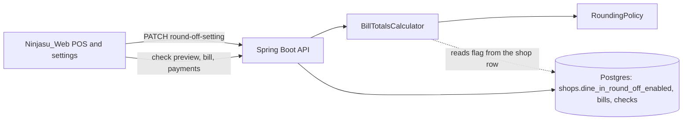

# Per-shop dine-in round-off toggle: design review

Plan row: [schedule-implementation-order.md](schedule-implementation-order.md), row 2b.3, slice (b). Rounding rule built in 2b.3(a): `RoundingPolicy`.

## Data model review

### Summary (read this first)
**Verdict:** The design is sound with 5 changes (two further points are tracked as revisit items); nothing is built, so every change is free to make now. Release also needs the standing environment baseline accepted by you (hand-run SQL, no migration tool).
**What changes** (before → after):
- Every shop is rounded to a whole rupee on dine-in bills today → each shop gets a switch, on by default, so existing shops behave exactly as now.
- With the switch off, a bill keeps its paise (349.66 stays 349.66) and the round-off line shows 0.00.
- Bills already issued never change when the switch flips; only checks that are still open change.
- Schedule (online) orders ignore the switch and stay whole-rupee.
**Decisions you need to make** (owner decisions only):
| # | decision | options | recommended, and why | if you pick the other option |
|---|---|---|---|---|
| D1 | Who may flip the switch | (a) shop owner only, (b) owner and managers | (a): it changes the amount customers pay and is the same rule as the POS on/off switch | (b): add a new permission to the permission list and the role editor |
| D2 | A check that is already open when the switch flips | (a) its payable changes at once, (b) it keeps the rule it was opened under | (a): the payable is recomputed live today, so (a) needs no new column; staff should flip it between services | (b): a new column on every check plus a branch in the preview, about 4 more files |
| D3 | Accept the standing environment baseline for this change (hand-run SQL, `ddl-auto=update` also running in production, local runs able to reach production) | (a) accept for this change, (b) fix first | (a): it is a documented project decision and every Schedule slice shipped under it; this change adds the safest possible column (default on, safe even if the SQL is skipped) | (b): migration tool first, a separate project |
**What geld decided for you:**
- The column lives on `shops`, not a new table: it is one yes/no fact about the shop, read on every bill, and the shop row is already loaded there (`BillTotalsCalculator` already receives the shop).
- Its own endpoint, not the general shop update: the general update skips missing values, so it cannot reliably switch a boolean off, and it would also bypass the owner check and the audit entry (the repo already did this for `posEnabled`).
- Every flip is audited with the before and after value.
- The web screens show two decimals when an amount has paise. Today four screens print `n.toFixed(0)`, so with the switch off a ₹349.66 bill would read ₹350 on the check panel and in history while the payment dialog (which already handles paise) asks for ₹349.66: confusing for staff, and history would understate revenue by up to 49 paise a bill.
- The column is named `dine_in_round_off_enabled` (Codex's suggestion, adopted): the name itself says online orders are excluded.
- Schedule and online totals never read the switch.
**What must happen before deploy** (run order):
1. You approve this review.
2. Run `db_manual/round-off-toggle-migration.sql` (sketch below, written only after approval) on the production database, in pgAdmin, one block at a time.
3. Deploy the backend (code that reads the column).
4. Deploy the web app (two-decimal display, settings toggle). The web change can ship before or after step 3 as long as the switch stays on.
**Unknowns that could change this:**
- Whether an accountant must approve bills that carry paise (GST invoices normally allow it, but confirm with your CA).

**Status:** FINAL · **Verdict:** APPROVED WITH CHANGES (D1-D3 answered 2026-10-24) · geld deep, 2026-10-24 · previous: none
**Target:** PostgreSQL 17.11 on Neon (read-only `select version()`, 2026-10-24; `shops.dine_in_round_off_enabled` confirmed absent) · hand-run SQL files in `db_manual/`, no migration tool, Hibernate `ddl-auto=update` also active · pooled connections (unconfirmed) · single Spring Boot service on one EC2 host
**Lenses run:** 0, 1, 2, 3, 4, 5, 7, 8 · **skipped:** 6 (performance and cost: one boolean on a row that is already loaded; no new query, job or table) · **reference designs:** skipped (not core to the product: a settings flag; fails the "well-known problem class" test)
**Codex second opinion:** blind pass run before any finding was written. Agreed: 7 (column on `shops`, immediate effect on open checks, Schedule must stay whole-rupee, `@ColumnDefault` and SQL-first, dedicated owner-only audited path, web display of paise, closed bills protected by their stored snapshot). Codex-only, verified by me and adopted: 3 (the clearer column name, rollback as a policy change, a short `lock_timeout` on the ALTER). Disagreements: 1, in my favour on evidence: Codex implied the payment dialog needs the two-decimal fix; I checked `RecordPaymentDialog.tsx` and it already works in paise, so only the display screens change.
**Open inputs:** CA view on paise on dine-in tax invoices.

### Design changes
One summary line: a per-shop switch that is safe to add, cannot change a bill that already exists, and cannot leak into online orders.
| # | before | after | problem it solves (findings) | why it is better | what it costs | alternative considered, why it lost |
|---|---|---|---|---|---|---|
| 1 | no setting; every bill rounds | `shops.dine_in_round_off_enabled boolean NOT NULL DEFAULT true`, `@ColumnDefault("true")` on the entity | PLACE-1, MIG-1: new column on a live table | existing shops keep today's behaviour; skipping the SQL cannot break boot | one hand-run SQL block | settings table: a join and a second row for one fact; per payment type: rounding belongs to the bill, not to how it is paid |
| 2 | `BillTotalsCalculator.forOrders` always rounds | `forOrders` passes the shop's flag to `RoundingPolicy`; `forScheduleLines` always rounds | INV-1: online totals must stay whole-rupee | one rule, one place | `RoundingPolicy` gets one parameter | a second calculator: duplicated tax logic |
| 3 | no way to change it | owner-only PATCH endpoint, audited, excluded from the general shop update | API-1 | the same pattern as the POS switch, plus audit | one endpoint, one audit action | folding into the shop PUT: cannot switch off, bypasses audit |
| 4 | web shows `toFixed(0)` | two decimals when the bill has paise | MONEY-1 | the cashier sees what the server will accept | 4 web files and the payment dialog | rounding on the server only: breaks the point of the switch |

### Tables
| table | grain (one row = one ...) | purpose | class | owner | phase | state |
|---|---|---|---|---|---|---|
| shops | shop | gains one setting column | existing | shop module | 2b.3(b) | planned |

### Names
| name | what it holds | project word for this concept (grep evidence) | clashes with | verdict |
|---|---|---|---|---|
| `dine_in_round_off_enabled` / `dineInRoundOffEnabled` | whether dine-in bills round to a whole rupee | `rounding` is the bill column (`Bill.rounding`, `BillTotals.rounding`) and "round-off" the UI line (`CheckAmounts.roundOff`, `TableCheckServiceImpl:497`); the booleans on `Shop` are `posEnabled`, `guestOrderingEnabled` | none | keep (matches the `*Enabled` pattern) |

### Columns on touched hot tables
`shops` groups: identity (name, owner), location and delivery (lat/lng, radius, delivery mode), tax and country (`gst_regime`, `country_code`), POS (`pos_enabled`, `guest_ordering_enabled`, business day start hour), media. `dine_in_round_off_enabled` belongs with the tax and country group (it is a bill-calculation rule, read by the same code that reads `gst_regime`). No misplaced group is created by this change.

### Built vs plan
| element | plan says | in code at | deployed | migration applied | depended on by | drift |
|---|---|---|---|---|---|---|
| everything in this review | planned | not built | n/a | not applied | nothing | none |
Source: git status on `feature/schedule` after PR #63; read-only query of production shows no `dine_in_round_off_enabled` column.

### Entity relationships
No new table or relationship. One column on `shops`, read by `BillTotalsCalculator` (dine-in, POS, counter-sale, live check preview).

### Column mapping
| column | type | null | default | key / FK | constraint | phase | note |
|---|---|---|---|---|---|---|---|
| `shops.dine_in_round_off_enabled` | boolean | NOT NULL | true | none | none | 2b.3(b) | true = whole rupee as today |
Indexes: none (never filtered on). Lifecycle: mutable, audited, never soft-deleted.

### Invariants
| # | invariant | enforced by | evidence |
|---|---|---|---|
| 1 | a bill that exists never changes when the switch flips | the bill stores `rounding` and `grand_total` at creation | `BillServiceImpl:314,344` (fact) |
| 2 | Schedule and online totals are always whole-rupee | `forScheduleLines` never reads the flag; test | `BillTotalsCalculator` (fact) |
| 3 | payments must equal the bill total exactly | existing check | `BillServiceImpl:182` (fact) |
| 4 | an existing shop is ON after the migration | `NOT NULL DEFAULT true` and `@ColumnDefault("true")` | to build |

### Scenarios, access patterns, sizing
Scenarios: (1) cashier closes a bill with the switch on; (2) same with it off; (3) owner flips it; (4) guest QR customer views a live payable; (5) day summary report. Access: the flag is read with the shop row already loaded per bill or check preview: no extra query. Sizing: one boolean per shop; no growth.

### Findings
#### Must change before the next affected deploy
**MONEY-1 · risk · MUST** — four web screens hide paise.
- Evidence: web `CheckPanel.tsx:37`, `CheckHistory.tsx:33`, `OrderTicket.tsx:67` (`₹${n.toFixed(0)}`), `OrderHistoryTable.tsx:71` (fact). The payment dialog is already correct: `RecordPaymentDialog.tsx:57` converts the server's `amountDue` to paise and pays exactly that (fact, verified); the server then requires payments to equal the bill total (`BillServiceImpl.java:182`).
- Failure: switch off, bill 349.66 → check panel and history show ₹350 while the payment dialog shows ₹349.66; order history shows ₹350 for a ₹349.66 sale. (First draft of this review said every payment would be rejected; that was wrong, the dialog prefills the server figure.)
- Change: those four screens show two decimals when the amount has paise; whole rupees stay unchanged for shops that keep rounding on.
- Cost to change now: free (not built).
**API-1 · risk · MUST** — a money-affecting setting must have one authorised, audited path.
- Evidence: the general shop update skips missing values and already excludes `posEnabled`, `guestOrderingEnabled`, `gstRegime` (`ShopServiceImpl:~447`); endpoint-declaration test requires an audit action for any new mutating endpoint (`AuditEndpointDeclarationTest`) (fact).
- Failure: left in the general update, an edit by anyone allowed to update the shop could flip rounding with no audit entry, and an explicit "off" could be lost as a missing value.
- Change: `PATCH /api/shops/{shopId}/round-off-setting` body `{dineInRoundOffEnabled: boolean}`, owner check in the service, `AuditAction.ROUND_OFF_SETTING_CHANGED` with before and after, `@AuditedEndpoint`, a SecurityConfig matcher (SHOP or ADMIN, service enforces owner), and add `dineInRoundOffEnabled` to the general update's ignored properties. The shop GET returns the value read-only.
- Cost to change now: free.
**MIG-1 · risk · MUST** — the new column must be safe whether or not the SQL ran first.
- Evidence: `application.properties:32` `ddl-auto=update`; the same pattern already hit 2b.12 (`menu.md:153`) (fact).
- Failure: code deployed before the SQL → Hibernate adds the column with no default → existing shops read NULL → bill calculation fails or rounds the wrong way.
- Change: `@ColumnDefault("true")` plus `nullable = false` on the entity so even Hibernate creates it correctly (the `Shop.java` comment at the `guestOrderingEnabled` field records the same failure on this table); SQL file idempotent; deploy order SQL first; boot guard names the column if missing (same pattern as `ScheduleSchemaGuard`, which checks existence only; the verify query in the SQL file covers NOT NULL and the default).
- Cost to change now: free.
```sql
-- DO NOT RUN — sketch for review (write db_manual/round-off-toggle-migration.sql only after approval)
ALTER TABLE public.shops
    ADD COLUMN IF NOT EXISTS dine_in_round_off_enabled boolean NOT NULL DEFAULT true;
-- verify: SELECT count(*) FILTER (WHERE dine_in_round_off_enabled) AS on, count(*) FILTER (WHERE NOT dine_in_round_off_enabled) AS off FROM public.shops;
-- rollback: not needed (old code ignores the column); to remove later: ALTER TABLE public.shops DROP COLUMN dine_in_round_off_enabled;
```
**INV-1 · risk · MUST** — online and Schedule totals must never take paise.
- Evidence: Schedule tests assert the payable never carries paise (`BillTotalsCalculatorScheduleTest`); `forScheduleLines` and `forOrders` share one private method (fact).
- Failure: a refactor that passes the shop's flag into the shared method would let a Schedule order keep paise for a shop that switched off.
- Change: the flag is a parameter of `forOrders` only; `forScheduleLines` passes `true`; one test per path.
- Cost to change now: free.
**PLACE-1 · decision · MUST** — column on `shops`, default true (see Design changes 1). Evidence: `Shop.java` already holds `gstRegime`, `countryCode`, `posEnabled` of the same kind. Cost: free.
**MONEY-3 · risk · MUST** — one rounding rule, two states, all callers.
- Evidence: callers of `forOrders`: `BillServiceImpl:289`, `CounterSaleServiceImpl:79`, `CheckAmountsResolver:45` (used by `TableCheckServiceImpl:66` and `GuestOrderServiceImpl:59`) (fact).
- Failure: if one caller read the flag and another did not, the preview and the bill would disagree by up to 0.49.
- Change: only `BillTotalsCalculator` reads the shop's flag, so all three callers agree by construction; one test through each caller.
- Cost to change now: free.
#### Fine now, revisit at <trigger>
**TIME-1 · trade-off** — an open check changes its payable when the switch flips (the preview is live). Decision D2. Revisit when: a restaurant reports a customer surprised by a changed total.
**TIME-2 · sensitivity** — a flip between a quote and the payment. Counter sale quotes and creates through separate calculator calls (`CounterSaleServiceImpl:74` and `:93`), so a client that quoted ₹100.00 and pays after an OFF flip meets ₹100.49. Already handled: the payment check throws "Payments add up to X but the bill total is Y — the bill may have changed, refresh and try again" (`BillServiceImpl:182`). Revisit when: staff report that message after a flip.
**MIG-2 · revisit** — rollback is a policy change, not just a revert. Reverting the code while a shop is OFF would round that shop's still-open checks again (closed bills stay fixed). Plan: keep the column, turn the shop back ON with an audit entry, then revert; never drop the column on rollback. The ALTER takes a brief lock: run it with `SET lock_timeout = '3s'` in a quiet window and retry on timeout.
**MONEY-4 · pre-existing, not caused by this change** — `table_checks.billed_total` (used by `netSalesForPeriod`, `TableCheckRepository:62`) is a check-level snapshot taken before the bill's tax and rounding, while `Bill.grand_total` is the amount charged. The two already differ for any shop with tax; the switch adds nothing new but makes the gap visible. Revisit when: a purchasing or sales report is reconciled against bills.
**MONEY-2 · sensitivity** — reports. `ReportServiceImpl` has no rounding code (grep for round, setScale, grand returned nothing), so sales totals sum the stored `numeric(10,2)` columns and carry paise correctly (inference from absence; confirm with the first off-switch bill in the day summary). Revisit when: the first shop switches off.
#### Keep (good decisions)
**SNAP-1 · keep** — the bill stores `rounding` and `grand_total` at creation, so a flip can never rewrite history.
**ACCESS-1 · keep** — the flag rides on the shop row that the calculator already receives: no new query.

### Devil's advocate trace
| DA point | outcome |
|---|---|
| a skipped SQL step breaks boot (the 2b.12 incident) | absorbed (MIG-1) |
| general update can change it unaudited | absorbed (API-1) |
| online totals pick up paise | absorbed (INV-1) |
| the web hides paise | absorbed (MONEY-1) |

### Future phases
| phase | new tables it adds | change forced on this design |
|---|---|---|
| 2b.4 order and group schema | orders, groups, charges | none: Schedule orders always round |
| bill model (BILLED settle flow, not built) | bill numbering | none: reads the same calculator |

### Rollout
| change | step | slot | lock | compatible with old code | rollback | precondition |
|---|---|---|---|---|---|---|
| add column | expand | any, before deploy | metadata only (Postgres 17.11, fast default) | yes: old code ignores it | leave the column (harmless) or drop it later | none |
| backend reads it | deploy | after SQL | none | yes | redeploy old build | SQL applied |
| web shows two decimals | deploy | any | none | yes with the switch on | redeploy old build | none |
Lens 0: see below.

**Lens 0 (environment):**
| check | result | evidence |
|---|---|---|
| 1 one migration authority | fail (documented project baseline) | no Flyway or Liquibase; SQL files are hand-run (`db_manual/`) |
| 2 no unreviewed schema writer | fail (documented baseline) | `application.properties:32` `ddl-auto=update`; mitigated here by `@ColumnDefault` |
| 3 no default path to production | fail (documented baseline) | local runs default to the production database (project memory, confirmed in earlier sessions) |
| 4 split credentials | unknown | not visible from the repo; ask who holds the application and migration roles |
| 5 recovery | unknown | Neon point-in-time restore exists; retention and a tested restore are not recorded here |
These are the standing baseline of the whole project, not caused by this change: decision D3.

### Design versions
| version | phase | date | what changed | why |
|---|---|---|---|---|
| v1 | 2b.3(b) | 2026-10-24 | first proposal | per-shop round-off switch |
| v1.1 | 2b.3(b) | 2026-10-24 | column renamed `dine_in_round_off_enabled`; MONEY-1 corrected from "payments rejected" to "four screens hide paise"; D1-D3 locked | Codex blind pass; verified payment dialog |

### Locked decisions (handoff to /gcp and /judge)
| id | decision | enforced where | code paths that must honour it |
|---|---|---|---|
| L1 | `shops.dine_in_round_off_enabled boolean NOT NULL DEFAULT true`, entity `@ColumnDefault("true")` | database and entity | `Shop`, SQL file, boot guard |
| L2 | only `forOrders` reads the flag; `forScheduleLines` always rounds | service | `BillTotalsCalculator` and its three callers |
| L3 | dedicated owner-only audited PATCH; excluded from the general shop update | service and controller | `ShopServiceImpl` ignore list, new controller method, `AuditAction`, SecurityConfig |
| L4 | web amounts show two decimals when paise exist and payments prefill from the server figure | web | `CheckPanel`, `CheckHistory`, `OrderTicket`, `OrderHistoryTable`, payment dialog |

### Approval record
| finding or decision | option chosen | by | date |
|---|---|---|---|
| D1 who may flip it | shop owner only | Samivan | 2026-10-24 |
| D2 open check when it flips | payable changes at once | Samivan | 2026-10-24 |
| D3 environment baseline | accepted for this change | Samivan | 2026-10-24 |
| MIG-1, API-1, INV-1, MONEY-1, MONEY-3, PLACE-1 | geld's recommended changes, locked as L1 to L4 | geld (no owner decision needed) | 2026-10-24 |

## System design

### Components

`shops` holds the setting (system of record). Bills hold the rounded result (snapshot).

### Main flows
```mermaid
sequenceDiagram
  participant S as Staff (web POS)
  participant A as API
  participant C as BillTotalsCalculator
  participant D as Postgres
  S->>A: open check preview
  A->>C: forOrders(shop, kots)
  C-->>A: totals (flag on: whole rupee; off: paise)
  S->>A: create bill
  A->>D: store rounding and grand_total on the bill
  S->>A: pay (amount = shown total, two decimals)
  A->>A: paid sum must equal bill total exactly
```

### Decisions
| decision | options | chosen | negative consequences | revisit when |
|---|---|---|---|---|
| where the flag lives | shops column; settings table; per payment type | shops column | one more column on a wide table | shops gets a second billing setting: then group them into a settings table |
| how it is changed | general shop update; dedicated endpoint | dedicated endpoint | one more endpoint | never |
| flip while a check is open | live; frozen per check | live (D2) | a changed payable mid-meal | a complaint |

### Isolation, tenancy, API
Per-shop setting; the owner check is in the service. Money format: the API already returns amounts with two decimals (`numeric(10,2)`); only the web display needs to stop dropping them.
