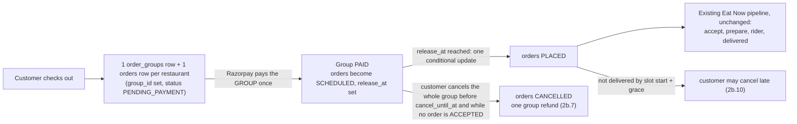
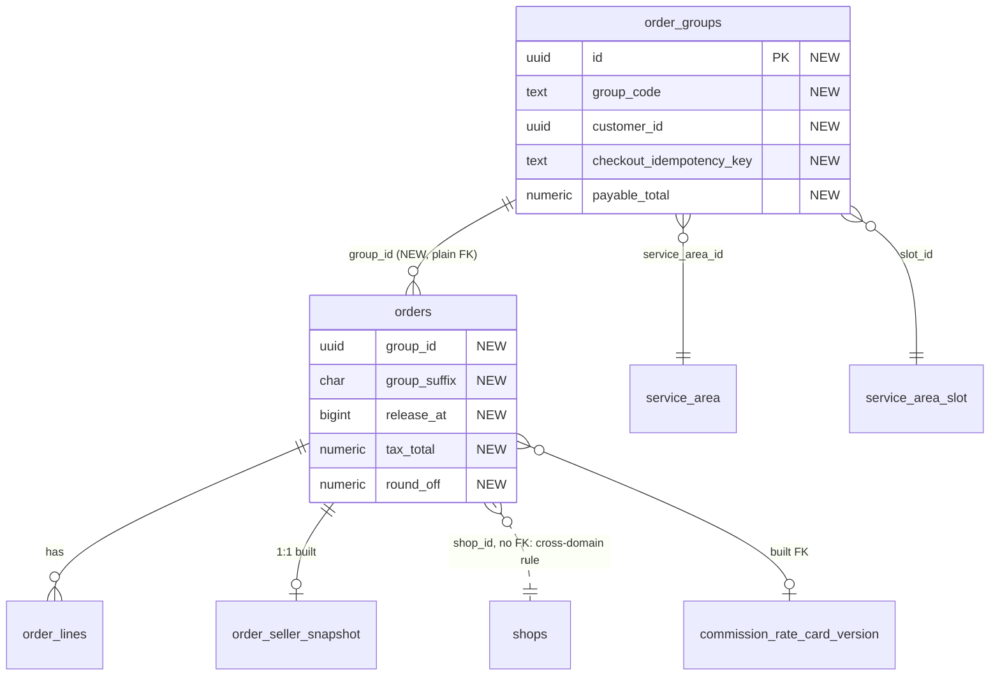
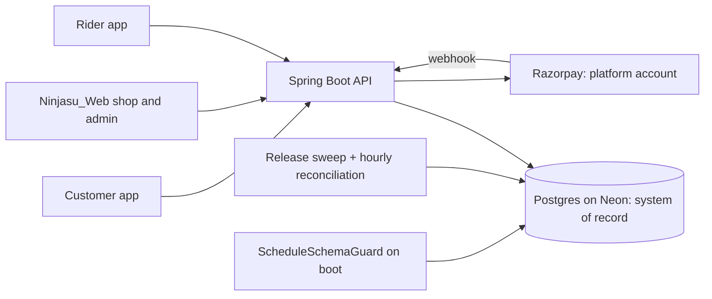

# Schedule 2b.4: order and group schema (geld review)

Design view: https://claude.ai/artifact/6BharT1U9qd5pGpLjdqBT4

Source plan: row 2b.4 of `schedule-implementation-order.md`, decisions 18, 30-37a, 42 and D28-D30 of `schedule-plan.md`.
Decided 2026-10-24 (Samivan): Eat Now FOOD orders also get 5% GST added on top at checkout, on at deploy (not live yet). Task 2b.4 is built in two slices: 2b.4a is the tax columns plus the Eat Now GST checkout change (customer-visible), 2b.4b is the Schedule tables and cancel settings; Schedule checkout wiring stays in 2b.8.
Version 2.7, LOCKED for implementation (2026-10-25). History and the reason for each change are in "Design versions".

## Data model review

### Summary (read this first)

**Verdict:** The design is approved with changes and is now smaller than the plan it reviewed: one new table instead of three, five new `orders` columns instead of thirteen, no triggers. Release stays blocked on the three environment fixes Samivan deferred to pre-launch on 2026-10-21, and on CA confirmation of the tax facts before go-live.

**What changes** (before → after):
1. The plan adds about 13 columns to `orders`. After review `orders` gets 5: `group_id`, `group_suffix`, `release_at` (Schedule) and `tax_total`, `round_off` (Eat Now and Schedule GST).
2. Area, date and slot live only on the group (`order_groups`); the plan copied them onto every order.
3. Commission columns already exist under other names (`commission_rate_card_version_id`, `commission_total`, `unit_commission`, `line_commission`); the plan's new names are not added.
4. Payout and refund figures leave `orders`. Refund totals are added up from refund rows (2b.7). The frozen payout row (`order_payout_snapshot`) is created by the 2b.8 slice that first writes it.
5. Eat Now GST gets storage as two columns on `orders`. The per-part tax rows (`order_tax_lines`) wait for the 2c invoices, which are their first reader.
6. `order_charges` is dropped: delivery fee, packaging fee and group round-off are columns on `order_groups`.
7. Customer cancel has two snapshots on the group, set at payment: `cancel_until_at` (a time blocker: the group's earliest `release_at` minus a Ninjasu setting `cancel_freeze_minutes`; empty means customer cancel is disabled) and `late_cancel_from_at` (slot start plus a grace, default 15 minutes, after which an undelivered order can be cancelled). Cancel also freezes when an order is ACCEPTED, by the restaurant or a Ninjasu admin: from then no ordinary customer cancel and no refund (v2.5, TIME-3, STATE-1).

**Decisions (answered by Samivan, 2026-10-24 and 2026-10-25):**

| # | decision | answer | effect on this plan |
|---|---|---|---|
| 1 | When do Eat Now customers start paying the 5%? | On at deploy: the product is not live yet | no platform switch; backend, cart and checkout tax lines and the customer app ship together; CA confirmation before go-live, not before deploy |
| 2 | Does the 5% apply to Grocery and Product carts? | No, and grocery is not designed now | FOOD carts only; GROCERY and PRODUCT carts are untouched |
| 3 | Does any restaurant use ROUTE_SPLIT? | Asked for an explanation | no API or DTO can set `settlement_mode` (only a hand edit); the transfer fix is made regardless (MONEY-3) |
| 4 | Payout snapshot for Eat Now? | Schedule first; propose reuse | table is keyed by order, not by Schedule; see "Payout snapshot: Schedule now, Eat Now later" |
| 5 | Review again, keep it simple, run Codex and a devil's advocate, finalize (2026-10-25) | done | v2 below |
| 6 | Which order stages still allow a customer whole-group cancel? (2026-10-25, revised) | cancel freezes when an order is ACCEPTED, by the restaurant or by a Ninjasu admin (Ninjasu delivers Schedule orders and watches them); cancel is allowed only while every remaining order is SCHEDULED or PLACED; once ACCEPTED there is no customer cancel and no refund | invariant 10; Eat Now keeps its own rule (PLACED or ACCEPTED) |
| 7 | What closes customer cancel by time? (revised) | a Ninjasu time blocker before the order is handed to the restaurant: the group's earliest `release_at` minus `service_area.cancel_freeze_minutes`; orders cannot change in that window, and it may fall before a dish's order-until | `order_groups.cancel_until_at` |
| 8 | Default for `cancel_freeze_minutes`? | 30 adopted as the default for implementation (an area setting, changeable any time; empty = customer cancel disabled for the area) | must be at least 0 so the blocker never falls after release |
| 9 | Late-delivery cancel (2026-10-25) | if an order has not arrived by slot start + `late_cancel_grace_minutes` (default 15), the customer can cancel, even after the freeze | `order_groups.late_cancel_from_at` (snapshot); stages, refund and rider recall are specified in 2b.10 |
| 10 | Restaurant 'freeze' and the proposed 'PREPARING only after last call' guard (2026-10-25) | freeze = ACCEPTED (decision 6); the guard is withdrawn because there is no cancel-time promise | STATE-1, L-14 |
| 11 | Late-cancel details | recommendation recorded as invariant 11; settled in 2b.10 and does not block 2b.4 (the two time snapshots are the only schema it needs) | invariant 11 |

**What geld decided for you:**
- `fulfilment_type` is not stored on orders: an order is a Schedule order exactly when it has a group.
- Order code = group code + '-' + suffix; only the suffix is stored.
- One order per restaurant per group, and unique suffixes, are enforced in the database.
- Checkout key is unique per customer (not globally) and carries a request fingerprint; the same scoping fix is made to the existing Eat Now lookup (API-1).
- Tax: totals as columns now; per-part rows and the frozen payout row wait for their first reader. Old orders get 0.
- A SCHEDULED order must have a `release_at` (database check), or it would never be released.
- Shop net-sales query excludes tax and round-off (restores its old meaning).
- Refund balances are derived from refund rows in 2b.7; no counters.
- Two SQL files, 2b.4a (tax) then 2b.4b (groups).

**What must happen before deploy:** (1) the customer app and web screens are ready to show the tax line, because there is no switch; (2) CA confirmation (unknowns below) before go-live, not before the code ships; (3) rehearse both SQL files on a Neon branch, verified by host; (4) run `order-tax-snapshot-migration.sql` (2b.4a), then deploy the 2b.4a code; (5) run `order-group-migration.sql` (2b.4b), then deploy the 2b.4b code; (6) add every new constraint and index to `ScheduleSchemaGuard`; (7) the legacy-guard test matrix passes (TRACE-2), and 2b.4a has a test per checkout path (COD and online) asserting 5% tax and the payable identity; (8) the deferred environment fixes ENV-1 to ENV-3 before real launch.

**Unknowns that could change this:** (CA) is 5% added on top of GST-exclusive online prices lawful as D28 states; (CA) GST on commission: rate, and inclusive or exclusive; (CA) tax on delivery and packaging fees; (CA) IGST for a customer in another state; (Samivan) live order counts (the read-only database tool was down, so sizes below are assumptions).

**Status:** LOCKED for implementation (v2.7, 2026-10-25) · **Verdict:** APPROVED WITH CHANGES; release blocked on the deferred environment fixes (ENV-1 to ENV-3) and, before go-live, on CA confirmation · geld deep all, 2026-10-24; reviewed again 2026-10-25 · previous: v1 APPROVED WITH CHANGES, 2026-10-24
**Target:** PostgreSQL 17.11 on Neon (pooled endpoint, scale-to-zero) · hand-run SQL (pgAdmin, one block at a time) plus Hibernate `ddl-auto=update` at boot · Spring Boot 4.0.3 / Java 21 · one backend deployment
**Lenses run:** 0-8, all (`all`, no triage) · **skipped:** none · **reference designs:** run (core, multi-party money, costly to undo, well-known problem)
**Codex second opinion:** five passes (1 blind on 2026-10-24; reviews 2 to 5 on 2026-10-25, see the sections below) plus a devil's-advocate pass on the design and one on the restaurant-freeze idea. Pass 1: agreed 9, Codex-only verified 2 (net-sales and route-split include tax: confirmed in code), disagreed 3 (decided on evidence).
**Open inputs:** order and group volumes (assumed: pilot 1 area, ~200 groups/day, 10x and 100x scaling); production schema of `orders` not re-read (database tool offline); CA facts above; whether `orders.user_id` has a database foreign key.

### Bird's-eye view

An order's whole life, and where the group matters. After release a Schedule order goes through the same status machine and the same kitchen screen as an Eat Now order. Three things still differ: payment and refunds stay on the group, dispatch batches by group (2d), and the restaurant's ticket is published at the slot's last call, not at each order's own `release_at`. One existing bug must be fixed before any rider is assigned: the rider flow records the full `grand_total` as cash to collect whatever the payment method (`DeliveryServiceImpl.java:288`, verified), which is wrong for every prepaid order; plan task 2d.7 owns it.



The group only matters at four moments: payment, whole-group cancel, refund, and the handover code on the bag. Three things a new developer must remember:
1. `group_id IS NOT NULL` means a Schedule order. Legacy sweeps and endpoints must skip it (TRACE-2 test matrix).
2. Pay and refund happen on the group, never on a member order.
3. `release_at` is what moves an order from SCHEDULED to PLACED.

**What `release_at` is.** The instant (epoch milliseconds) when a paid Schedule order is handed to its restaurant: the release job flips it from SCHEDULED to PLACED then. It is set once, at payment, to the earliest cutoff among the order's dishes (each dish's order-until, capped by the slot's last call; `schedule-plan.md` item 18) and never changes after that, even if the restaurant later edits order-until or stock. Example: biryani order-until 11:00, dessert 11:30, slot last call 11:45 → `release_at` = 11:00 that day. It decides when the restaurant sees the order and which orders its ticket contains. It does not decide whether the customer may cancel: that is a separate Ninjasu policy, stored as `order_groups.cancel_until_at` (TIME-3). It is per order because different restaurants have different dishes and order-until times. It is NULL before payment and for Eat Now orders.

### Design changes

The proposed design stops `orders` growing a column per feature, keeps one new table, makes the database refuse inconsistent groups, and gives Eat Now GST a frozen record.

| # | before | after | problem it solves (findings) | why it is better | what it costs | alternative considered, why it lost |
|---|---|---|---|---|---|---|
| 1 | Plan: 13 new `orders` columns, area/date/slot copied to orders | 3 Schedule + 2 tax columns; area/date/slot only on `order_groups` | PLACE-1: an order and its group could disagree on date or slot, so the rider batches wrong | one writer per fact; no copies | one join to the group for slot/date | Copy + composite foreign key: more columns and an extra unique index for no reader |
| 2 | New commission names in the plan | built names kept | DRIFT-1: Hibernate would create a second column beside the built one | no duplicate columns | none | Rename built columns: migration for no gain |
| 3 | No tax storage; `grand_total = subtotal + delivery fee` | `orders.tax_total`, `orders.round_off` + identity check | MONEY-1: nowhere to freeze Eat Now GST | payable is always explained by its parts | 2 columns | Tax rows now: no reader until 2c; Bill-only: nothing at checkout |
| 4 | `payout_amount`, `original_payout_amount` on orders | frozen `order_payout_snapshot`, created in 2b.8 | MONEY-6: payout inputs include an unconfirmed GST rule; no reader until 2b.8/2c | no table shaped around a guess | none now | Create now: columns may change after the CA answers |
| 5 | `refunded_amount`, `refund_state` on orders and groups, counted twice | no counters; sum refund rows under the group row lock (2b.7) | MODEL-1: double count lets a refund exceed the capture | one source of truth | a small sum per refund | Counters: revert logic on every failure |
| 6 | `order_charges` plus group fee columns | group fee columns only | PLACE-2: same fact twice | simpler | new table later if a third charge appears | Keep both: dead branch |
| 7 | Global unique checkout key | unique per customer + request hash; legacy lookup scoped by user | API-1: another customer's key returns their order | no cross-customer reuse | one column, one query change | Global key: leak |
| 8 | Group has no total or currency | `payable_total`, `round_off`, `currency_code` on the group | MONEY-4: 2b.9 must compare the capture to a stored total | capture check is possible | 3 columns | Recompute from members: drifts |
| 9 | (v1) composite foreign key, frozen-columns trigger, `earliest_locked_cutoff_at`, single-value `fulfilment_type` on both tables | removed | SIMPLE-1: each guards what one transaction or the entity already guarantees | fewer moving parts | tests replace constraints | See SIMPLE-1 |

### Tables
| table | grain (one row = one ...) | purpose | class | owner | phase | state |
|---|---|---|---|---|---|---|
| orders (existing) | one restaurant's order (a KOT for dine-in) | customer order, now with group link and tax | hot | orders | 2b.4a/b | built; live |
| order_groups | one Schedule checkout (one payment, one drop) | payment owner, delivery fee, handover code | hot until paid, then read-mostly | schedule | 2b.4b | planned |
| order_payout_snapshot | one Schedule order | frozen payout for settlement | append-only | schedule | 2b.8 | deferred (sketch below) |
| order_tax_lines | one tax part of one order | frozen CGST/SGST detail for invoices | append-only | orders | 2c | deferred |
| service_area (existing) | one delivery area | gains two Ninjasu cancel settings | reference | schedule | 2b.4b | built; live |
| order_seller_snapshot (existing) | one customer order | frozen seller facts | append-only | orders | 2b.13 | built |

### Names
Vocabulary grep: `snapshot` (frozen facts: `order_seller_snapshot`), `*_at` bigint epoch ms (`created_at` on Schedule tables; older order columns use `_on`), plural names for entity or child tables (`orders`, `order_lines`, `bills`, `bill_tax_lines`), singular for 1:1 snapshots. `order_group` appears only in plan documents; `group` alone is a reserved word and is never used as a name.

| name | what it holds | project word | clashes | verdict |
|---|---|---|---|---|
| order_groups | one checkout group | plural entity, as `orders` | none | keep |
| group_suffix (orders) | one letter A-Z | none existing | none | keep (plan said `order_code`; the code is derived) |
| tax_total, round_off (orders) | tax and rounding in the payable | `tax_total`, `rounding` on `bills` | `bills.rounding` | keep `round_off` (matches the dine-in round-off feature) |
| release_at | locked release instant | `_at` on Schedule tables | none | keep |
| cancel_until_at, late_cancel_from_at (order_groups) | the customer's cancel time blocker and late-cancel start, as epoch ms snapshots | `_at` bigint epoch ms | none | keep |
| cancel_freeze_minutes, late_cancel_grace_minutes (service_area) | Ninjasu cancel settings | `last_call_minutes`, `pickup_lead_minutes` (minutes settings on the same table) | none | keep |
| commission_plan_id/version, commission_amount | commission snapshot | built: `commission_rate_card_version_id`, `commission_total` | duplicates built columns | do not add |

### Columns on touched hot tables
`orders` today (about 44 mapped columns, `Order.java`), grouped: identity and ownership (`id`, `user_id`, `shop_id`, `shop_name`, `cart_type`, `order_type`, `order_source`); dine-in POS (`check_id`, `kot_number`, `placed_by_staff_id`); status and timing (`status`, `placed_on`, `updated_on`, `estimated_minutes`, `decline_reason`); money (`subtotal`, `delivery_fee`, `platform_fee`, `grand_total`, commission snapshot ×2); payment gateway ×6 (`payment_method`, `payment_status`, `razorpay_*`, `paid_on`, `refund_id`, `refunded_on`); delivery address ×4 and delivery OTP ×2. The Razorpay group (six columns) belongs in a payments table (revisit when a second gateway or partial refunds arrive; it is why groups own their own payment fields). This change moves nothing and adds 5 columns.

### Built vs plan
| element | plan says | in code at | deployed | migration applied | depended on by | drift | source |
|---|---|---|---|---|---|---|---|
| orders.commission_* | `commission_plan_id`, `_version`, `commission_amount` | `Order.java:112-116` `commission_rate_card_version_id`, `commission_total` | unknown | unknown (hand-run file exists) | checkout, guard | plan names stale | code, `order-commission-snapshot-migration.sql` |
| order_lines.commission | `commission_amount` | `OrderLine.java:55-59` `unit_commission`, `line_commission` | unknown | unknown | checkout | plan names stale | code |
| order_seller_snapshot | not in 2b.4 row | `OrderSellerSnapshot.java` | unknown | unknown | invoices later | none | code |
| OrderStatus.SCHEDULED | 2b.1 | `OrderStatus.java:31` | not deployed | n/a (enum text) | 2b.11 | none | code |
| FulfilmentType enum | EAT_NOW, SCHEDULE | `FulfilmentType.java` | unknown | n/a | commission assignment | none | code |
| tax on customer orders | none stored | `OrderAssembler.java:133-135` grand_total = subtotal + delivery fee | live | n/a | 2b.4a | new decision | code |
| 2b.4 tables and columns | planned | not in code | no | no | none | none | git |
Deployed and applied status for 2b.12/2b.13 is Samivan's to confirm; nothing in 2b.4 is built.

### Entity relationships


### Column mapping

**orders (added columns)**
| column | type | null | default | key / FK | constraint | phase | note |
|---|---|---|---|---|---|---|---|
| tax_total | numeric(10,2) | NOT NULL | 0 | — | `chk_orders_tax_identity` | 2b.4a | tax included in `grand_total`; 0 = none charged |
| round_off | numeric(10,2) | NOT NULL | 0 | — | same | 2b.4a | Eat Now: order-level. Schedule member: 0 (round-off is on the group) |
| group_id | uuid | NULL | — | FK → order_groups(id), RESTRICT | `chk_orders_group_shape` | 2b.4b | NULL = Eat Now or dine-in order |
| group_suffix | char(1) | NULL | — | — | `^[A-Z]$`, set iff group_id set | 2b.4b | order code = group code + '-' + suffix |
| release_at | bigint | NULL | — | — | `chk_orders_scheduled_release` | 2b.4b | locked release instant, set at payment |

Constraints on orders:
- `chk_orders_tax_identity`: `grand_total = subtotal + delivery_fee + platform_fee + tax_total + round_off`, unconditional. Every existing writer already satisfies it (online and COD checkout: `OrderAssembler.java:135`; POS: `PosOrderServiceImpl.java:130-133,183-186` with zero fees), so no legacy exception is needed. The SQL file first runs a preflight count of rows where `grand_total <> subtotal + delivery_fee + platform_fee`; the check is added `NOT VALID` and validated only if that count is 0 (if test rows violate it, fix them or fall back to a check scoped to rows with tax). The database cannot prove a FOOD checkout charged tax (zero tax is a consistent total), so 2b.4a needs a test per path (COD `placeOrder` and online `checkout`) asserting tax = 5% of the items and the identity.
- `chk_orders_group_shape`: `(group_id IS NULL) = (group_suffix IS NULL)`; `group_id IS NOT NULL OR release_at IS NULL`; `group_id IS NULL OR (user_id IS NOT NULL AND payment_method = 'ONLINE' AND check_id IS NULL)`.
- `chk_orders_scheduled_release`: `status <> 'SCHEDULED' OR release_at IS NOT NULL`. Without it a paid SCHEDULED order with no `release_at` never matches the release sweep and the restaurant never sees it.
Indexes: `uq_orders_group_shop` UNIQUE (group_id, shop_id) WHERE group_id IS NOT NULL (one order per restaurant per group, and the foreign-key lookup); `uq_orders_group_suffix` UNIQUE (group_id, group_suffix) WHERE group_id IS NOT NULL; `idx_orders_release_pending` (release_at) WHERE status = 'SCHEDULED' (release sweep).
Entity rule: the new fields are initialised (`BigDecimal.ZERO`) like `platformFee` at `Order.java:104`, otherwise Hibernate inserts NULL into the NOT NULL columns; `@ColumnDefault` as at `Order.java:145`.
Implicit filter (documented in the SQL file): any reader of `orders` that must not see Schedule members filters `group_id IS NULL`.

**order_groups** (all new, 2b.4b)
| column | type | null | default | key / FK | constraint | note |
|---|---|---|---|---|---|---|
| id | uuid | NOT NULL | gen_random_uuid() | PK | — | project convention |
| group_code | text | NOT NULL | — | — | `^[0-9]{4,6}$` | human handover code |
| customer_id | uuid | NOT NULL | — | FK users(id) if `orders.user_id` has one | — | verify |
| checkout_idempotency_key | text | NOT NULL | — | — | length ≤ 64 | client key |
| checkout_request_hash | char(64) | NOT NULL | — | — | hex | fingerprint of the request |
| service_area_id | uuid | NOT NULL | — | FK service_area RESTRICT | — | |
| service_date | date | NOT NULL | — | — | — | calendar date in the area's zone (`ServiceDateResolver`) |
| slot_id | uuid | NOT NULL | — | FK service_area_slot RESTRICT | — | slot-in-area checked by the writer and a test |
| delivery_lat, delivery_lng, delivery_formatted_address, delivery_label | as `orders` | NOT NULL except label | — | — | — | address snapshot; same words as `orders` |
| currency_code | char(3) | NOT NULL | 'INR' | — | `^[A-Z]{3}$` | |
| delivery_fee, packaging_fee, round_off | numeric(10,2) | NOT NULL | 0 | — | ≥ 0 for fees | group-level charges |
| payable_total | numeric(10,2) | NOT NULL | — | — | > 0 | what Razorpay is asked to collect |
| payment_status | text | NOT NULL | 'CREATED' | — | IN (CREATED, PAID, FAILED, CAPTURE_MISMATCH, CANCELLED) | 2b.9 may widen |
| razorpay_order_id, razorpay_payment_id | text | NULL | — | UNIQUE each | — | NULL until created or captured |
| captured_amount | numeric(10,2) | NULL | — | — | ≥ 0 | stored after capture validation |
| cancel_until_at | bigint | NULL | — | — | — | the time blocker: the group's earliest member `release_at` minus `cancel_freeze_minutes`, set at payment confirm by one `CancelWindowResolver`; never later than that release (cross-table, so checked by the resolver and a test); on a PAID group NULL means customer cancel is disabled; a value already past at payment is stored as is; the cancel endpoints refuse unpaid groups |
| late_cancel_from_at | bigint | NULL | — | — | — | slot start + `late_cancel_grace_minutes`, set at payment confirm; from this instant (database time) a customer may cancel an undelivered member (invariant 11); on a PAID group NULL means no late-cancel right |
| created_at, updated_at | bigint | NOT NULL | — | — | — | epoch ms, project convention |
**service_area (existing table, two columns added in 2b.4b):** `cancel_freeze_minutes` INTEGER NULL DEFAULT 30, CHECK `>= 0`: customer cancel closes this many minutes before the group's earliest `release_at` (the handover window in which orders cannot change); NULL means customer cancel is disabled for the area. `late_cancel_grace_minutes` INTEGER NULL DEFAULT 15, CHECK `>= 0`: minutes after slot start after which an undelivered order may be cancelled by the customer; NULL means no late-cancel right. Both sit beside `last_call_minutes` and `pickup_lead_minutes`. The blocker is measured from the order's own release time, not the slot start, because a dish's order-until can release an order long before the slot. An admin save shows a non-blocking warning when `cancel_freeze_minutes` is 0 (no gap before release). The defaults (30 and 15) are adopted for implementation and stay changeable as settings.

Indexes: `uq_order_groups_code` (service_area_id, service_date, group_code); `uq_order_groups_customer_key` (customer_id, checkout_idempotency_key); `uq_order_groups_razorpay_order`; `uq_order_groups_razorpay_payment`; `idx_order_groups_customer` (customer_id, service_date DESC); `idx_order_groups_slot` (service_area_id, service_date, slot_id).
Frozen columns: identity, fee, total and key columns are `updatable = false` in the entity (precedent `Order.java:112,115`); no trigger (the app connects as the database owner, so a trigger would not stop it). Lifecycle: payment fields change by conditional updates; the rest is written once.

**Deferred, sketch kept for the slice that writes it**
- `order_payout_snapshot` (2b.8): `order_id` PK FK orders; `currency_code`; `gross_amount` (the order's subtotal); `commission_amount` (copy of `orders.commission_total`); `commission_gst_rate_percent`; `commission_gst_deducted` (0 if Ninjasu absorbs it); `payout_amount` with `CHECK (payout_amount = gross_amount - commission_amount - commission_gst_deducted)`; `created_at`; append-only. Shape may change once the CA answers D30.
- `order_tax_lines` (2c): `order_id`, `tax_class_code`, `component` (CGST, SGST, IGST), `rate_percent`, `taxable_amount`, `tax_amount`, all NOT NULL, amounts and rate ≥ 0, UNIQUE (order_id, tax_class_code, component); first reader is the online invoice or credit note. Until then a FOOD cart has one class, so CGST and SGST are each `tax_total / 2`, and each line already freezes its class and rate (`OrderLine.java:61-72`). Trigger to build it: the first invoice or credit-note design, a second tax class in FOOD carts, or IGST.

### Payout snapshot: Schedule now, Eat Now later (proposal, 2026-10-24)

Samivan's decision: write it for Schedule orders first, and show how Eat Now fits the same table.

**Why it fits as one:** the snapshot is keyed by `order_id` and holds nothing Schedule-specific (no group, slot or date). An Eat Now order is a row of the same shape.
- Eat Now already freezes its commission at checkout for every FOOD order (`OrderAssembler.java:162-165`; the default "No commission" card gives 0). So gross is the order's `subtotal`, commission is `orders.commission_total`, and the same formula applies.
- Every checkout already calls one shared builder for the seller snapshot (`OrderAssembler.java:167`). The payout snapshot gets the same shape: one `OrderPayoutSnapshotBuilder` that takes an `Order`. Schedule checkout (2b.8) calls it first; Eat Now calls it from the same place later.
- Reading is identical: settlement (2c) selects from one table for both kinds of order.

| topic | Schedule | Eat Now | decision owner |
|---|---|---|---|
| GST on commission (rate, inclusive or exclusive) | D30, CA | same rule, same CA answer | CA |
| who holds the cash | prepaid online | online or COD: a COD order's cash is with the rider; the snapshot says what the restaurant is owed, 2c's ledger says who owes whom | 2c settlement design |
| refunds | group allocations (2b.7) | whole-order refund (`refund_id`) today | 2c: one function "payout after refund" |
| marketplace settlement shops | rejected at Schedule checkout | possible by hand edit; Razorpay Route transfer at payment time | MONEY-3 rule |

**Cost to wire Eat Now:** one builder call in the Eat Now checkout and a test; no schema change. Orders with no row mean "payout not computed". The product is not live, so there are no old orders. **Recommendation:** build the builder generic in 2b.8 and wire Eat Now in the same change that records the CA's answer on GST on commission, because the snapshot freezes that rate.

### Invariants
| # | invariant | enforced by | evidence |
|---|---|---|---|
| 1 | payable = items + fees + tax + round-off, for every order | `chk_orders_tax_identity` (unconditional, after a preflight count) | `OrderAssembler.java:135`, `PosOrderServiceImpl.java:130-133` |
| 2 | one order per restaurant per group | `uq_orders_group_shop` | missing in plan |
| 3 | suffix unique in a group; group code unique per area per date | `uq_orders_group_suffix`, `uq_order_groups_code` | plan lines |
| 4 | a member order belongs to its group's customer | one transaction writes both from one `userId`; test + reconciliation query (no composite key) | simplification SIMPLE-1 |
| 5 | a dine-in order is never in a group; member orders are prepaid | `chk_orders_group_shape` | `Order.java:66,86` (COD default) |
| 6 | a SCHEDULED order always has `release_at` | `chk_orders_scheduled_release` | new |
| 7 | one checkout per customer and key, same request | `uq_order_groups_customer_key` + `checkout_request_hash` | `OrderServiceImpl.java:73-77` unscoped today |
| 8 | group payable = sum of member totals + fees + round-off | service at write; group money columns `updatable = false`; reconciliation query | new |
| 9 | refunds never exceed the capture | 2b.7: group row lock + sum of refund rows | plan 2b.7 |
| 10 | a whole-group customer cancel changes every eligible remaining member and nothing else, or changes nothing | one transaction: lock the group row, then `SELECT` all members `FOR UPDATE` in id order, then read the database clock once; allowed only if the group is PAID, `cancel_until_at` is not NULL, database time is strictly before it, no member is ACCEPTED, PREPARING, READY, OUT_FOR_DELIVERY or DELIVERED; members already DECLINED or CANCELLED are skipped and excluded from the refund; then update the remaining members (SCHEDULED or PLACED), void reservations and create one bounded refund request; a member that was already released (an audited early release, or a zero buffer) also gets the restaurant notified and its ticket amended. `cancel_until_at` is at or before the earliest `release_at`, so a normal cancel never overlaps release or acceptance; at a zero buffer both sides recheck time and status after taking the locks. One database clock serves payment confirmation, cancel, accept and release; a timer alone cannot arbitrate transactions | plan 2b.10/2b.11; Codex reviews 2 to 5 |
| 11 | the late-delivery cancel (database time at or after `late_cancel_from_at`) is a per-member exception to the ordinary whole-group rule: each undelivered member may be cancelled from any status before DELIVERED, including when the release job failed; delivered siblings do not block it; the refund is issued against the group payment; a cancelled order is never marked DELIVERED | one transaction decides it: lock the group row, then the target member row (siblings are read, not locked, for the fee rule); recheck paid status, database time, and the current order and delivery states; then in that same transaction set the order CANCELLED, cancel any live delivery of that order and invalidate its delivery OTP. Whichever transition commits first wins: a committed DELIVERED rejects the cancel; a committed cancel rejects completion and an OTP already typed on the rider's phone. After commit: a durable, retryable rider recall with explicit copy ("Customer cancelled: do not deliver"), the restaurant ticket amendment and the batch amendment. Refund = that member's items + tax + its allocated round-off, recorded as allocation components (2b.7) and idempotent under the group lock; members already CANCELLED or DECLINED are excluded; the delivery fee and the packaging fee are refunded only when the last refundable member is cancelled and no member was delivered. If food was physically handed over before the rider learned of a committed cancel, ops settles it as a dispute (default: the cancel stands and nothing is clawed back automatically; owner to confirm in 2b.10) | Codex reviews 5 and 6; to confirm in 2b.10 |
| 12 | an order that is CANCELLED or DECLINED never becomes DELIVERED, and never regains a live delivery | every writer of DELIVERED or of a live delivery state is conditional on the current order status and takes the member lock. Writers found in the code: seller status route (`OrderServiceImpl.java:338`, a plain save whose transitions at `:371-378` include OUT_FOR_DELIVERY to DELIVERED), customer cancel (`:193`, conditional) and decline (`:321`, conditional), the delivery-to-order projection (`DeliveryOrderSyncListener.java:61`, which only checks that the status differs), rider completion (`DeliveryServiceImpl.completeDelivery`, `:454-515`, which checks the delivery status and the OTP but not the order status), staff force-completion, assignment, rider accept, pickup and out-for-delivery (`DeliveryServiceImpl` `transitionTo` `:328`), payment (`PaymentServiceImpl.java:154,210,274,307,329,400,803`) and the POS paths (`PosOrderServiceImpl.java:127,299,338`, dine-in only). OTP verification refuses a cancelled order | Codex review 6; verified at the cited lines; required transition-matrix test in 2b.10 |

### Scenarios, access patterns, sizing
Scenarios:
1. Load: at 10x (about 3,200 orders/day, 60% inside a two-hour window, ~0.3 orders/s) checkout writes at most 12 rows and answers p95 < 1 s.
2. Change: a third group-level charge or tax on the delivery fee adds a column or table on the group; `orders` is untouched.
3. Failure: the same checkout key sent twice returns the same group with no second row; the same key with a different request is refused.
4. Correctness: a decline and a customer cancel at the same moment never refund more than was captured.
5. Consistency: a reconciliation query finds zero orders whose payable differs from the sum of their parts.

| # | actor | r/w | path | filter | sort | limit | peak/min | p95 | serving index | rows examined |
|---|---|---|---|---|---|---|---|---|---|---|
| 1 | customer | w | Schedule checkout | key | — | — | ~20 | 1 s | `uq_order_groups_customer_key` | 1 |
| 2 | gateway | w | payment confirm | razorpay order id | — | — | ~20 | 300 ms | `uq_order_groups_razorpay_order` | 1 |
| 3 | customer | r | my scheduled orders | customer, date | date desc | 20 | ~30 | 200 ms | `idx_order_groups_customer` | ≤20 |
| 4 | job | r/w | release sweep | status SCHEDULED, release_at ≤ now | release_at | 200 | 1-6 | 100 ms | `idx_orders_release_pending` | pending only |
| 5 | ops | r | batch by area, date, slot | area, date, slot | code | 200 | ~5 | 200 ms | `idx_order_groups_slot` | ≤ groups in slot |
| 6 | shop | r | prep list for a date | shop, group date | status | 100 | ~10 | 300 ms | existing `idx_orders_kds_feed` then group primary key | one shop's orders |
| 7 | rider/ops | r | find by handover code | area, date, code | — | 1 | ~10 | 100 ms | `uq_order_groups_code` | 1 |
| 8 | any | r | order totals | order id | — | — | high | 50 ms | primary key | 1 |

Sizing (assumed; production counts unavailable): launch 200 groups/day, 1.6 orders/group → 320 orders/day; 10x 3,200; 100x 32,000. Bytes per row: group ~450, order ~700. Groups: 73k/yr at launch, 0.7M at 10x, 7M at 100x. Peak factor 6 on the daily average. `group_code` at 4 digits holds about 10,000 codes per area per date, so the CHECK allows 4-6 digits and the generator retries on collision. `order_groups` is hot until paid, then read-mostly; read:write about 5:1.

### Findings

#### Must change before the next affected deploy

**PLACE-1 · risk · MUST** — the plan puts 13 columns on `orders`, three of them copies of the group.
- Evidence: `schedule-implementation-order.md` row 2b.4 (fact); `Order.java` already maps about 44 columns and the 2b.13 review ruled that new per-order facts get side tables (`commission-rate-cards-plan.md` PLACE-1) (fact).
- Failure: a bug or manual fix writes a different `service_date` on a member order than on its group; the restaurant prepares for the wrong day while the rider batch (built from the group) goes out on the right day.
- Change: orders get only `group_id`, `group_suffix`, `release_at`; area, date and slot only on the group.
- Cost to change now: free.
- Codex pass 1: agreed on moving area/date/slot; disagreed on `release_at` (Codex: 1:1 table). Decided: `release_at` stays on `orders` because release is one conditional update on one table and its index holds only unreleased orders.

**DRIFT-1 · risk · MUST** — the plan names commission columns that are already built under other names.
- Evidence: `Order.java:112-116`, `OrderLine.java:55-59`, `order-commission-snapshot-migration.sql:15-26` (fact).
- Failure: the new backend boots first and Hibernate adds `commission_plan_id` next to `commission_rate_card_version_id`; two columns hold one fact.
- Change: use the built columns; add none. Update the plan row (done).
- Cost: free.

**MONEY-1 · risk · MUST** — Eat Now GST has nowhere to be stored.
- Evidence: `OrderAssembler.java:133-135`; no tax stored on orders; `GstTaxEngine.java:31-38` and `BillTotalsCalculator.java:36-39` already compute it for Schedule (fact).
- Failure: the customer is charged 5% but nothing says how much of `grand_total` is tax or round-off, so a refund, a GST return or a credit note cannot be explained.
- Change: `orders.tax_total`, `orders.round_off`, `chk_orders_tax_identity`. Historical orders keep 0. Eat Now must call a platform-liable path so the shop's GST regime does not zero the tax, and FOOD carts only.
- Cost: cheap (constant defaults on PostgreSQL 17 do not rewrite the table).
- Codex pass 1 wanted tax rows too; deferred to 2c (SIMPLE-2).

**MONEY-2 · risk · MUST** — GST on top changes the Eat Now total the customer pays, so every place that shows or checks a total must change in the same release.
- Evidence: cart preview total is built in `CartServiceImpl` (known to disagree with the order fee, ~:593); order total from `OrderAssembler.java:135` (fact); how the customer app and web read totals is not verified (inference).
- Failure: the backend charges ₹168 + fee while a cart screen still shows ₹160 + fee.
- Change: no switch (Samivan: not live, on at deploy). The release carries together: the new columns, `OrderAssembler` platform-liable tax for FOOD carts, `taxTotal` and the CGST/SGST tax lines in the cart preview (the preview cannot know the distance-based delivery fee, so the final payable and round-off come from checkout), the breakdown (`subtotal`, `deliveryFee`, `taxTotal`, `roundOff`) in the checkout response, `taxTotal` and `roundOff` on the order response, the customer app's tax line, and shop-facing screens that stop showing the customer total (MONEY-3).
- Cost: cheap in schema; the app and web work is the real cost.

**MONEY-3 · risk · MUST** — three money paths read `grand_total` and would now include tax.
- Evidence: `RouteSplitSettlement.java:39-41` transfers the full `grandTotal` to the restaurant's account; `OrderRepository.java:213-219` sums `grandTotal` for net sales, which feeds the purchasing food-cost %; `OrderMapper.java:94` returns `grandTotal` to every reader including shop screens (fact; web screen content not verified). Razorpay (`PaymentServiceImpl.java:171,228,647`) and rider cash (`DeliveryServiceImpl.java:288,518,784`) correctly use the full total.
- Failure: a ROUTE_SPLIT restaurant is paid Ninjasu's GST (no API can set `settlement_mode`, so this needs a hand-edited shop row, but the fix is one line and is made regardless); food-cost % shrinks because net sales include tax; a restaurant sees an order total it will never receive.
- Change: route-split transfer excludes `tax_total` and `round_off`; net sales uses `grand_total - tax_total - round_off`; shop-facing views show items, not the customer total (the delivery fee already inflates these today: pre-existing, revisit).
- Cost: cheap (code). Codex-only, verified in code.

**MONEY-4 · risk · MUST** — a group has no payable total or currency.
- Evidence: plan 2b.4 `order_groups` column list; plan 2b.9 validates the capture against "the group total" (fact).
- Failure: the total is recomputed from members at capture time; a member changed since checkout makes a correct payment look like a mismatch, or a wrong one look right.
- Change: `payable_total`, `round_off`, `currency_code` on the group, frozen.
- Cost: free.

**MODEL-1 · risk · MUST** — refund counters on orders and groups would be counted twice.
- Evidence: plan 2b.7 checks `group.refunded_amount + open requests + amount ≤ captured_amount` while also updating each member's `refunded_amount` when a request is inserted, reverting on failure (fact).
- Failure: a reservation is counted once as a counter and once as an open request, so a legitimate refund is refused, or a missed revert lets a refund exceed the capture.
- Change: 2b.4 creates no refund counters; 2b.7 sums refund allocation rows under the group row lock (open requests count once). Add a cached total only when a list needs it and a measurement says so.
- Cost: free now. Codex: agreed it is critical.

**INV-1 · risk · MUST** — nothing stops two orders from one restaurant in a group.
- Evidence: plan 2b.4 lists group uniques but no `(group, shop)` rule (fact).
- Failure: a retried checkout inserts a second order for the same restaurant; two bags carry the same code.
- Change: `uq_orders_group_shop`, `uq_orders_group_suffix`, `chk_orders_group_shape` (also dine-in exclusion and prepaid-only).
- Cost: free.

**TIME-2 · risk · MUST** — a paid SCHEDULED order with no `release_at` is never released.
- Evidence: plan row 2b.11 releases `WHERE release_at ≤ now`; a NULL never matches; `release_at` is set at payment, separately from `status` (fact + inference).
- Failure: the paid-confirm step sets `status = 'SCHEDULED'` and a bug skips `release_at`; the customer paid, the restaurant never sees the order, and no error is raised anywhere.
- Change: `chk_orders_scheduled_release`; the confirm step sets status and `release_at` in one statement.
- Cost: free. Devil's advocate finding.

**TIME-3 · risk · MUST** — the customer's cancel deadline was tied to the kitchen release time.
- Evidence: plan decisions 14 and 35 and task 2b.10 ("before the earliest locked cutoff"); v2.1 derived it as the smallest member `release_at` (fact). The owner's rule (2026-10-25): Ninjasu decides whether and until when a customer may cancel.
- Failure: Ninjasu wants cancel to close 60 minutes before the slot, or to be disabled, or to stay open after the kitchen has the order. Every such change would have to move `release_at`, which also controls when the restaurant sees the order, the ticket, and batching.
- Change: two snapshots on the group, set at payment by one `CancelWindowResolver` from `service_area` settings: `cancel_until_at` (the group's earliest `release_at` minus `cancel_freeze_minutes`; NULL on a PAID group = customer cancel disabled) and `late_cancel_from_at` (slot start plus `late_cancel_grace_minutes`; NULL = no late-cancel right); the cancel endpoints read only the stored columns and refuse unpaid groups. (v2.2 to v2.4 also carried a `customer_cancel_allowed` flag; Codex review 5 found it redundant and v2.5 removed it.) Re-keyed: decisions 14 and 35, tasks 2b.9, 2b.10, 2d.2 (the cancel reminder of a paid group), 4.4, tests T2b-16 and T4-06. Not re-keyed: T2b-14 and T4-05 (payment after the cutoff) concern ordering, and the 'reminder if nothing ordered yet' concerns ordering.
- Cost: free (nothing built); two added columns on a small existing table.
- Why it was missed: see "Why geld missed TIME-3".

**STATE-1 · risk · MUST (before 2b.10)** — accepting an order (by the restaurant or a Ninjasu admin) freezes customer cancel, and must not race it.
- Evidence: the seller step PLACED→ACCEPTED is a plain read-then-save with the comment "not flagged as racing with anything" (`OrderServiceImpl.java:336-339`, transitions at `:373-374`); the legacy customer cancel is a conditional update on PLACED or ACCEPTED (`OrderRepository.java:188-191`); `ShopOrderController#updateStatus` is on the unaudited baseline (`audit-endpoint-allowlist.txt:96`); `orders.updated_on` is the only time record and there is no status history; no platform-admin accept path was found in the code reviewed (fact, searched by mechanism).
- Failure: the customer's group cancel commits and refunds while a stale seller request saves ACCEPTED over the CANCELLED order, so a refunded order is accepted and cooked. With no audit row nobody can show who accepted when, which decides "no cancel, no refund".
- Change: freeze = ACCEPTED (Samivan, 2026-10-25), no new field. The accept step, by a restaurant member or a Ninjasu admin, is a conditional update from PLACED only (`WHERE status = 'PLACED'`; accepting a SCHEDULED order is refused, and an early freeze is an explicit audited early release first) that for group members takes the member lock (group row, then members by id) and rechecks the status under it. The time blocker means a normal cancel and a normal accept never overlap. An audit row records actor, old and new status and server time. A platform admin cannot use the shop route (`/api/shops/{shopId}/orders/{id}/status` needs that shop's `ONLINE_ORDERS_MANAGE`, `ShopOrderController.java:54-63`) and `/api/admin/orders` is GET-only (`AdminOrderController.java:26`), so Ninjasu needs a distinct audited accept action, ADMIN- or area-authorized (the planned `/api/ops/**` scope), that loads the order's real shop and area and uses the same transition and locks. Ops can override a mistaken accept with an audited exception.
- Cost: cheap (code, one audit event type, one admin path); no schema change. Fixes the same race for Eat Now orders.
- Devil's advocate (point 5) and Codex reviews 4 and 5 agree on the race; the earlier proposed 'PREPARING only after last call' guard is withdrawn because the freeze is now ACCEPTED.

**API-1 · risk · MUST** — the checkout key is global, has no request fingerprint, and the existing lookup has no owner check.
- Evidence: plan 2b.4 "UNIQUE NOT NULL"; `OrderServiceImpl.java:73-77` (COD) returns `findByIdempotencyKey(key)` for any user with no user check; the online checkout does the same at `PaymentServiceImpl.java:132-143`, where another user's PENDING_PAYMENT order is resumed (fact). The staff paths `PosOrderServiceImpl.java:96`, `CounterSaleServiceImpl.java:103` and `TableCheckServiceImpl.java:220` use the same lookup and are reviewed separately.
- Failure: customer B sends the same key as A and receives A's order, address included. The same key with a different basket silently returns the first one.
- Change: group key unique per customer plus `checkout_request_hash`; same key and different hash is refused; member order key = sha256(group id + ':' + shop id); suffixes assigned in a fixed shop order; while the first request is in flight the second waits on the unique row and returns the same response. In the 2b.4a release, scope the existing Eat Now lookups by user.
- Cost: free for groups; one query change for Eat Now.

**TRACE-2 · risk · MUST** — the legacy guard list is incomplete, and the missing filters are an implicit-filter trap.
- Evidence: the plan guards history, cancel, decline/status and payment-cancel. Unfiltered readers confirmed: `OrderRepository.java:194` (`findByStatusAndPlacedOnLessThan`, stale pending-payment sweep), `:197` (`findByPaymentStatus`, hourly refund retry), `PaymentReconciliationJob` (hourly), `:42,:47` (active order), `findForShopBoard`, `findForAdminOversight`, `findKdsFeed`; 26 classes use `OrderRepository`. `markCancelledOrDeclinedIfActive` only matches PLACED and ACCEPTED (`:190`), so legacy cancel cannot touch a SCHEDULED order but can touch a released one (fact).
- Failure: an unpaid member order has no Razorpay id on the order; the hourly sweep treats it as an orphan and cancels it, or a paid member order is picked up by the Eat Now refund retry; after release a member can be cancelled through the legacy endpoint.
- Change: add `group_id IS NULL` to the two sweep queries; a test matrix inserts a member order and runs every path above, asserting reject or exclude; each new query joins the matrix; the SQL file carries the filter comment.
- Cost: cheap.

**ENV-1 to ENV-3 · risk · MUST (blockers, deferred)** — two schema writers; production is the default datasource with the owner password committed as the fallback; the app runs as the database owner.
- Evidence: `application.properties:6-8` and `:32` (`ddl-auto=update`); no test datasource override (fact).
- Status: deferred to pre-launch by Samivan on 2026-10-21 (2b.13 approval record). Carried forward, not re-asked.

#### Fine now, revisit at a trigger
- **SIMPLE-1 · DEFAULT** — removed from v1: the composite foreign key (the group and its members are written in one transaction from one `userId`), the frozen-columns trigger (the owner role can disable it; `updatable = false` does the job), `order_groups.earliest_locked_cutoff_at` (removed as a cancel field: the customer's deadline is now its own snapshot, TIME-3; the cancel race is closed by the member locks in invariant 10), `fulfilment_type` on both tables (single legal value; add with default `'SCHEDULE'` when a second type uses groups), the slot-in-area composite key. Revisit when a second writer of members appears.
- **SIMPLE-2 · DEFAULT** — `order_tax_lines` and `order_payout_snapshot` have no reader until 2c / 2b.8, and the GST-on-commission rule (D30) is open. They are created by the slice that first reads or writes them. Codex pass 1 called tax rows critical; the totals and line class/rate are frozen now, and there are no old orders to protect because the product is not live.
- **MIG-1 · DEFAULT** — constraints on `orders` go in `NOT VALID` then `VALIDATE`; `SET lock_timeout`; index builds `CONCURRENTLY` once the order count is known to be large; every new constraint and index is a `ScheduleSchemaGuard` entry because Hibernate creates bare columns first. Codex said `NOT NULL DEFAULT` rewrites the table: not on PostgreSQL 17 (a constant default is metadata only, `postgres-ddl-locks.md`).
- **PLACE-2 · CONSIDER** — `order_charges` removed; revisit when a third group-level charge appears.
- **SIZE-1 · CONSIDER** — group code space; 4-6 digit CHECK and bounded retry on collision.
- **TRACE-3 · docs** — D29, D30 and 2b.3's "Eat Now totals unchanged" test text are stale after D28 and the Eat Now decision; D29(b) no longer applies because the customer pays the GST.
- **MONEY-5 · revisit at 2b.7** — a refund returns tax too: record tax and round-off parts on the refund allocation; decide line-level tax for quantity-level partial refunds.
- **MONEY-6 · open input** — payout formula uses GST on commission (D30 open).
- **PII-1 · CONSIDER** — group address snapshot is personal data; retention follows orders (no erasure rule exists today).
- **PERF-1 · CONSIDER** — the release sweep wakes the scale-to-zero database each tick; other pollers already do.
- **TIME-1** — `service_date` is a calendar date in the area's zone; keep `ServiceDateResolver` the only computer.
- **TRACE-4 · hard stop before the first rider assignment** — the rider flow sets `codAmount = grand_total` for any order, whatever its payment method (`DeliveryServiceImpl.java:288`, verified). A prepaid member order would tell the rider to collect cash; online-paid Eat Now orders have the same fault today. Owner: plan task 2d.7.

#### Keep (good decisions)
- **KEEP-1** group payment with one order per restaurant (differs from Shopify and Saleor, which have one seller per order; here each restaurant is a separate supplier).
- **KEEP-2** commission snapshots stay on `orders` and `order_lines` (2b.13 PLACE-K1).
- **KEEP-3** group is the payment owner on the platform account; group refunds are rows with a lease and gateway receipt.
- **KEEP-4** epoch-ms bigint instants, hand-run SQL with boot guard.
- **KEEP-5** deterministic member order keys.
- **KEEP-6** after release an order uses the existing status machine and kitchen screen (the bird's-eye view lists what still differs).

### Reference designs (run: core, multi-party money, costly to undo, well-known problem)
Sources read: Saleor `saleor/order/models.py` (open source, tier A); Shopify Admin GraphQL `Order` object (tier A, first 100,000 of 111,427 characters read).
| plan choice | reference choice | why they differ | verdict |
|---|---|---|---|
| totals and tax on the order row | Saleor: net and gross totals, tax rate on `Order`/`OrderLine`; Shopify: tax and totals on `Order`, `TaxLine` objects separate | same | adopt (columns for totals; rows for parts later) |
| refund counters on order and group | Saleor: refunds are rows; `total_charged` stored. Shopify: `refunds` list plus `totalRefundedSet` | both keep a cached total beside refund rows | adapt: rows now, cached total only when measured |
| payments on the order | Saleor `payments`/transactions and Shopify `transactions` are separate objects | — | adopt: group owns the payment |
| N orders under one group | both: one order, many fulfilment groups | one seller per order there | differ: separate suppliers here |

### Devil's advocate trace
Pass on 2026-10-25 (eight points).
| DA point | outcome |
|---|---|
| 1 six columns on orders, implicit filter | absorbed: TRACE-2 (sweeps verified unfiltered), SIMPLE-1 (no `fulfilment_type`) |
| 2 GST storage | absorbed: SIMPLE-2 (no tax rows now); entity fields initialised to zero |
| 3 group extras | absorbed: SIMPLE-1 (all four removed) |
| 4 payout snapshot timing | absorbed: SIMPLE-2 (created in 2b.8) |
| 5 no refund counters | already handled: MODEL-1 |
| 6 `release_at` | absorbed: TIME-2 |
| 7 keys | absorbed: API-1 (legacy lookup also scoped) |
| 8 two SQL slices | already handled: Rollout |
Earlier trace: 2b.3's DA conditions are handled (`TaxContext.platformLiable`, `PayoutCalculator`).

### Why geld missed TIME-3
- The plan stated the equality as a decision (decisions 14 and 35, task 2b.10). Geld respects documented decisions and flags only drift, and no lens asked whether the equality was intended or only the launch default.
- Lens 4 covered snapshots of money, tax, identity and time columns, but not promises made to a user, so "cancel until" was treated as a read of an operational time.
- The v2 simplification deleted `earliest_locked_cutoff_at` as "derivable", which made the equality permanent. The devil's advocate and Codex pass 2 attacked the derivation (it can disagree after a partial failure) and none asked which business concept the column carried.
- The owner found it by asking who decides the deadline, which is the right question for every promised deadline.
- Fix: lens 4 of the geld skill now has "Promises and deadlines" and a test for dropped columns (field note 2026-10-25).

### Codex review 2 (2026-10-25, a review of v1 of the finished plan; non-blind)
Read-only; no database inspected, so production counts and constraint validity stay unverified.
| Codex finding | outcome |
|---|---|
| group `fulfilment_type` has one legal value (HIGH) | agreed, removed (SIMPLE-1) |
| keep `orders.fulfilment_type` because commission selection uses the channel | disagreed, decided on evidence: the checkout passes the channel as an argument (`OrderAssembler.java:162-165`), and nothing reads it from a stored column after checkout; "is a Schedule order" is `group_id IS NOT NULL`. Add the column with a default when a second type uses groups |
| delete `earliest_locked_cutoff_at` (derivable; can disagree after a partial failure) | agreed, removed |
| after release the order is not wholly ordinary (dispatch by group, group-owned refunds, ticket at last call; rider cash bug) | agreed, bird's-eye wording corrected; the rider cash bug (`DeliveryServiceImpl.java:288`) is verified and stays with task 2d.7, which must land before any rider is assigned (it already affects every online-paid Eat Now order) |
| composite key `(slot_id, service_area_id)` has no unique target (BLOCKER) | already handled in v2: plain foreign key on `slot_id`, slot-in-area checked by the writer and a test |
| a paid member could lack `release_at` (HIGH) | already handled in v2: `chk_orders_scheduled_release` |
| tax identity accepts any total when tax is zero (HIGH) | agreed, check made unconditional with a preflight (every verified writer satisfies it) |
| the database cannot prove a FOOD checkout switched to GST (HIGH) | agreed, cannot be a constraint; a test per path is part of 2b.4a |
| `order_tax_lines` lacks NOT NULLs (MEDIUM) | agreed, added to the deferred sketch |
| commission snapshots must stay frozen; refund reductions are rows (MEDIUM) | agreed, L-11 |
| per-order conditional update does not arbitrate whole-group cancel vs several releases (HIGH) | agreed, cancel takes group and member locks, L-12 |
| `ddl-auto=update` plus hand-run SQL: use one schema writer (HIGH) | already carried as ENV-1, deferred to pre-launch by Samivan on 2026-10-21 |

### Codex review 3 (2026-10-25, the cancel-deadline change; non-blind)
Superseded in part by v2.4: the cancel stages are SCHEDULED and PLACED, the freeze is ACCEPTED, and the deadline is measured from the earliest `release_at` (decisions 6 and 7); rows below that mention PREPARING or ACCEPTED as cancellable record the earlier outcome.
Read-only; no database inspected.
| Codex finding | outcome |
|---|---|
| list of places that tie cancel to the cutoff (plan decisions 14 and 35, tasks 2b.9, 2b.10, 2d.2, 4.4, tests T2b-16 and T4-06) | agreed, all re-keyed to `cancel_until_at` in the plan, task list and acceptance tests |
| T4-05 and T2b-14 concern ordering and payment after the cutoff, not cancelling; the first v2.2 draft was wrong to list T4-05 | agreed, corrected in TIME-3 |
| the 'reminder if nothing ordered yet' is about ordering and has no group deadline | agreed, task 2d.2 now names two separate reminders |
| the cited code has no customer deadline comparison; legacy cancel allows PLACED and ACCEPTED only (`OrderRepository.java:188-191`) and must stay unavailable to group members | agreed, the group endpoint has its own eligibility rule (invariant 10) |
| members after release need ticket amendments and, after dispatch, rider recall | partly agreed: the chosen rule (decision 6) refuses cancel from PREPARING, so no rider recall is needed; ticket amendment and restaurant notification stay in 2b.10 |
| `CHECK (payment_status <> 'PAID' OR cancel_until_at IS NOT NULL)` does not enforce NULL before payment and clashes with 'NULL = disabled' | agreed at the time (v2.2 to v2.4 used an explicit `customer_cancel_allowed` flag); Codex review 5 then called the flag redundant, and v2.5 removed it: on a PAID group a NULL `cancel_until_at` means the right is disabled, and the cancel endpoints refuse unpaid groups |
| invariant 10 'never some cancelled, others released' is wrong once release may precede cancel | agreed, rewritten: cancel changes every eligible remaining member or nothing; delivered member rejects; declined skipped |
| keep `chk_orders_scheduled_release` and the partial `release_at` index; a due-reminder index only if reminders are queried by due time | agreed, no reminder index now (revisit when the reminder job is designed) |
| decide the cancel stages as a customer-facing policy | decided by Samivan (decision 6): SCHEDULED, PLACED, ACCEPTED; refused from PREPARING |

### Codex review 4 (2026-10-25, the restaurant-freeze idea; non-blind)
Read-only; no database inspected.
| Codex finding | outcome |
|---|---|
| freeze = PREPARING for v1; a new field only if the business wants a distinct action before cooking starts | agreed, L-14 |
| do not reuse `customer_cancel_allowed` (group policy snapshot, set at payment) | agreed |
| L-12 does not close the PREPARING race with today's seller path (CRITICAL) | agreed, matches devil's advocate point 5, STATE-1 |
| seller step has no time guard; permit PREPARING only after the slot's last call; record actor and time; show early or late taps to ops | withdrawn by Samivan 2026-10-25: the freeze is ACCEPTED and there is no cancel-time promise; the audit row and ops view stay (STATE-1) |
| keep the freeze one-way for staff; ops gets an audited exception | agreed, L-14 |
| options for other restaurants' orders: block all, cancel only unstarted (delivery fee refunded only when the last member is cancelled), or per-order cancel; recommend block all for v1 with explicit copy | agreed (decision 35 unchanged); if cancel-only-unstarted is chosen later, packaging-fee treatment must be specified |
| no durable seller status history; only `updated_on` | agreed, audit row in STATE-1 |
| legacy per-order customer cancel must stay unavailable to group members | already in TRACE-2 and the task list |
| the displayed deadline can end early through PREPARING; both conditions must be in the customer copy | already in decision 6 |

### Codex review 5 (2026-10-25, the owner's revised cancel rules; non-blind)
Read-only; no database inspected. Codex read the plan partway through the v2.4 edits, so its remark that the plan still measured from slot start was already fixed.
| Codex finding | outcome |
|---|---|
| `cancel_until_at` = earliest `release_at` minus a buffer of at least 0; cancel needs database time strictly before it; recheck time and status after the locks; one database clock | agreed, invariant 10 |
| payment confirm takes the group row then members by id, sets `release_at` and the snapshots atomically; decide what a payment inside or after the freeze window does | agreed, L-13 and task 2b.9: the deadline is stored already past |
| reject ACCEPTED while SCHEDULED; an early freeze is an explicit audited early release | agreed, STATE-1 and L-14 |
| late cancel as a per-member exception from any undelivered status, rider recall, refund composition, fees only on the last member | recorded as invariant 11 and decision 11; to confirm in 2b.10 |
| a platform admin cannot use the shop route; `/api/admin/orders` is GET-only (verified, `AdminOrderController.java:26`); add a distinct audited admin or area accept action | agreed, STATE-1 |
| rename to `cancel_freeze_minutes`; `late_cancel_grace_minutes` nullable only if NULL disables | already done in v2.4 |
| `customer_cancel_allowed` is redundant with a nullable deadline | agreed, removed in v2.5 (this reverses the review 3 choice) |
| revise decisions 14 and 35, invariant 10, STATE-1, TIME-3, L-12 to L-14, rows 2b.9 to 2b.11 and 2d.2 | done in v2.4 and v2.5 |
| decisions 18 and 42 stay; a cancel after ticket publication needs a ticket amendment and, after dispatch, recall | agreed, invariant 11 |

### Codex review 6 (2026-10-25, final review: late cancel and the rider, then simplicity; non-blind)
Read-only; no database inspected. Claims marked verified were checked in the code by Claude.
| Codex finding | outcome |
|---|---|
| cancellation is not an atomic stop for the rider: an after-commit listener cancels the delivery in a new transaction and swallows failure | agreed, verified (`OrderCancellationDeliveryListener.java:34`); invariant 11 and L-17 |
| a completed delivery can overwrite CANCELLED: `completeDelivery` checks the delivery status and OTP but not the order status; the projection only checks that the status differs; the seller route can advance OUT_FOR_DELIVERY to DELIVERED | agreed, verified (`DeliveryServiceImpl.java:464-509`, `DeliveryOrderSyncListener.java:58-62`, `OrderServiceImpl.java:376-377`); invariant 12 |
| decide the door and OTP race by the locked transition | agreed, invariant 11 |
| the rider notice is generic and fallible | agreed, verified ("Delivery reassigned", `DeliveryRiderNotificationListener.java:93-94`); explicit copy, refresh, server authoritative; the rider app is a separate app |
| prevent new work for a cancelled order (assign, accept, pickup, out for delivery) | agreed, invariant 12 |
| no new schema column is needed; customer attribution can live in the audit and delivery events | agreed, schema unchanged |
| invariant 11's "recall first" ordering is unsafe | agreed, rewritten: the locked cancel decides, recall follows |
| keep the core schema; defer speculative rows | agreed, no change |
| late cancel should lock the group and the target member only; invariant 10's ticket amendment is unreachable under its own deadline | agreed, both applied |
| each unique constraint should be backed by one index | agreed, handoff note |
| name the authoritative address; fix the wording conflict on defaults | agreed, L-16, wording fixed |
| enumerate and gate every order-status writer; require a 2b.10 transition matrix | agreed, invariant 12 and the 2b.10 gate |
| physical handoff dispute; idempotent refund allocation | agreed, invariant 11 (dispute default to confirm in 2b.10) |
| the no-delivery-after-cancel guarantee must gate the late-cancel endpoint | agreed, "Gate for 2b.10" |

### Future phases
| phase | new tables it adds | change forced on this design |
|---|---|---|
| 2b.5 carts | cart type, per-line shop | none |
| 2b.6 reservations | `schedule_stock_ledger`, `service_area_slot_day`, `schedule_reservations` | none |
| 2b.7 group refunds | `group_refunds`, `group_refund_allocations` | none; uses the no-counter rule |
| 2b.8 checkout | `order_payout_snapshot` | writes groups, orders, snapshots |
| 2b.9 group payment | none | may widen the `payment_status` CHECK; at the PAID transition takes the group row then members by id and sets `release_at`, `cancel_until_at` and `late_cancel_from_at` in one transaction; a payment confirmed inside or after the freeze window stores a deadline already past |
| 2b.10 cancel | none | reads the two cancel snapshots; eligible stages SCHEDULED and PLACED; late-cancel path as a per-member exception (invariant 11): stages, rider recall, refund; post-release path (notify the restaurant, amend its ticket); a distinct audited Ninjasu-admin accept action; may add `cancelled_at` (nullable column) |
| 2b.11 release | none | uses `idx_orders_release_pending` |
| 2c settlement and invoices | `order_tax_lines`, payout batches, ledger, invoice numbers | reads the snapshots; online `Bill` issued from them |
| 2d dispatch | batches | keyed by `group_id` |

### Rollout
| change | phase | release slot | lock and rewrite | works with app N-1? | rollback | precondition |
|---|---|---|---|---|---|---|
| orders: tax_total, round_off (NOT NULL DEFAULT 0) | expand | 2b.4a | brief exclusive lock, no rewrite (PG 17) | yes: inserts omit them | leave columns | `lock_timeout` 3 s |
| `chk_orders_tax_identity` | expand | 2b.4a | `NOT VALID`, then `VALIDATE` (scan) | yes | drop constraint | preflight: count of rows where `grand_total <> subtotal + delivery_fee + platform_fee` = 0 |
| Eat Now checkout writes tax (FOOD carts); legacy key lookup scoped by user | migrate | 2b.4a code, on at deploy | none | not for the customer app: ships in the same release | revert the release | app and web tax-line work done; CA before go-live |
| order_groups | expand | 2b.4b | new table | yes | leave | confirm target database host |
| service_area: `cancel_freeze_minutes` INTEGER NULL DEFAULT 30 and `late_cancel_grace_minutes` INTEGER NULL DEFAULT 15, both CHECK ≥ 0 | expand | 2b.4b | brief lock, no rewrite (PG 17); small table | yes | leave columns | admin area form shows both fields and the zero-buffer warning |
| orders: group_id, group_suffix, release_at | expand | 2b.4b | brief lock, no rewrite | yes | leave | — |
| orders constraints, FK, 3 indexes | expand | 2b.4b | `NOT VALID` then `VALIDATE`; plain index under short lock, or `CONCURRENTLY` | yes | drop | order count known |
| two sweep queries gain `group_id IS NULL` | migrate | 2b.4b code | none | yes | revert | matrix passes |
| ScheduleSchemaGuard entries | — | each slice | none | guard fails boot if file not run | — | file run first |
Lens 0: 1 FAIL (two writers), 2 FAIL, 3 FAIL, 4 FAIL, 5 unknown (restore point and time not stated), 6 planned (rehearse both files on a Neon branch; verify by host), 7 not applicable, 8 pass (hand-run files labelled; later steps marked DO NOT RUN NOW). ENV-1 to ENV-3 deferred by Samivan 2026-10-21.

DO NOT RUN — sketch for review (2b.4a, not final):
```sql
-- ALTER TABLE public.orders ADD COLUMN IF NOT EXISTS tax_total numeric(10,2) NOT NULL DEFAULT 0;
-- ALTER TABLE public.orders ADD COLUMN IF NOT EXISTS round_off numeric(10,2) NOT NULL DEFAULT 0;
-- Preflight (expect 0 before adding the check):
-- SELECT count(*) FROM public.orders WHERE grand_total <> subtotal + delivery_fee + platform_fee;
-- ALTER TABLE public.orders ADD CONSTRAINT chk_orders_tax_identity CHECK (
--   grand_total = subtotal + delivery_fee + platform_fee + tax_total + round_off) NOT VALID;
-- ALTER TABLE public.orders VALIDATE CONSTRAINT chk_orders_tax_identity;
```

### Design versions
| version | phase | date | what changed | why |
|---|---|---|---|---|
| v1 | 2b.4 | 2026-10-24 | first geld review of the plan row | Eat Now GST decided; placement challenged |
| v2.7 | 2b.4 | 2026-10-25 | final Codex review: late cancel must never end DELIVERED (invariants 11 and 12, L-17 and a gate before the late-cancel endpoint); address copy authority (L-16); invariant 10 ticket clause trimmed; wording fixes | Samivan's rider requirement; Codex review 6 |
| v2.6 | 2b.4 | 2026-10-25 | self-review and lock for implementation: stale header and status text fixed, names and tables completed, sequence diagram shows the cancel snapshots, invariant 10 stage list explicit, L-15 added, L rows ordered, cancel snapshots computed from reserved members, implementation handoff added | Samivan asked for a final review and lock |
| v2.5 | 2b.4 | 2026-10-25 | removed `customer_cancel_allowed` (a NULL deadline on a PAID group means disabled); strict-before database-clock rule; payment confirm lock order; invariant 11 (late cancel as a per-member exception); distinct audited admin accept action; accept only from PLACED | Codex review 5 |
| v2.4 | 2b.4 | 2026-10-25 | owner's cancel rules: time blocker before release (`cancel_freeze_minutes`), freeze at ACCEPTED by restaurant or Ninjasu admin with no refund, late-delivery cancel (`late_cancel_from_at`, `late_cancel_grace_minutes`); PREPARING guard withdrawn; STATE-1 and L-13/L-14 rewritten | Samivan's answers 2026-10-25; Codex review 5 |
| v2.3 | 2b.4 | 2026-10-25 | restaurant freeze = PREPARING status; STATE-1 (conditional, locked and audited seller step), L-14; proposed pilot guard PREPARING only after last call | Samivan's freeze idea; devil's advocate and Codex review 4 |
| v2.2 | 2b.4 | 2026-10-25 | cancel deadline separated from `release_at`: `order_groups.customer_cancel_allowed` + `cancel_until_at`, `service_area.cancel_lead_minutes` (default 60, minutes before slot start), eligible stages SCHEDULED/PLACED/ACCEPTED, invariant 10 and L-12 rewritten, L-13 | owner rule: Ninjasu decides if and until when a customer may cancel; Codex review 3 |
| v2.1 | 2b.4 | 2026-10-25 | tax identity check made unconditional (with preflight); whole-group cancel takes group and member locks (L-12); "ordinary order" wording corrected; frozen-snapshot rule L-11; deferred tax-row sketch gets NOT NULLs | Codex review 2 |
| v2 | 2b.4 | 2026-10-25 | removed `orders.fulfilment_type`, group composite FK, frozen trigger, `earliest_locked_cutoff_at`, group `fulfilment_type`; deferred `order_tax_lines` and `order_payout_snapshot`; added `chk_orders_scheduled_release`, legacy key scoping, sweep filters | self-review, devil's advocate and Codex review 2: simpler and safer |

### Locked decisions (handoff to /gcp and /judge)
| id | decision | enforced where | code paths that must honour it |
|---|---|---|---|
| L-1 | `orders` gains only `group_id`, `group_suffix`, `release_at`, `tax_total`, `round_off`; no commission, refund or payout columns | review | entity `Order`, `ScheduleSchemaGuard` |
| L-2 | an order is a Schedule order iff `group_id IS NOT NULL`; legacy readers and jobs skip it | `chk_orders_group_shape` + test matrix | every legacy order reader and job (TRACE-2) |
| L-3 | restaurant-facing totals and transfers exclude `tax_total` and `round_off` | service | `RouteSplitSettlement`, `sumNetSalesForPeriod`, `OrderMapper` consumers |
| L-4 | tax is platform-liable for FOOD carts only; GROCERY and PRODUCT carts get no tax | service | `OrderAssembler.assemble` |
| L-5 | Eat Now tax is charged from the 2b.4a deploy (no switch); cart preview, checkout response and order response carry it in the same release | service | `CartServiceImpl`, `OrderAssembler`, `OrderMapper`, customer app, web |
| L-6 | refunds are never stored as counters; derived from refund rows | service (2b.7) | `GroupRefundService` |
| L-7 | group checkout key unique per customer, with request hash; member key = sha256(group id + ':' + shop id); legacy Eat Now key lookups scoped by user | constraint + service | Schedule checkout, `OrderServiceImpl` |
| L-8 | the order's commission channel is passed by the checkout flow (Eat Now or Schedule), not read from a column | service | `OrderCommissionSnapshot` call in `OrderAssembler` (today hard-coded EAT_NOW) |
| L-9 | `release_at` is set once, at payment, in the same statement that sets SCHEDULED | `chk_orders_scheduled_release` | group payment confirm (2b.9) |
| L-10 | group money and identity columns are `updatable = false`; no triggers | entity | `OrderGroup` entity |
| L-11 | a placed order's commission and payout snapshots are never updated; refund adjustments are rows (2b.7) | entity `updatable = false` + service | `Order` commission columns, `GroupRefundService` |
| L-12 | whole-group cancel locks the group row, then all member rows in id order, before changing any member; eligibility and the single bounded refund request are decided in that transaction (invariant 10) | service | 2b.10 cancel, 2b.7 refund request, 2b.11 release job |
| L-13 | customer cancel is governed by two group snapshots set once at payment by `CancelWindowResolver` from `service_area` settings, computed from the members that were successfully reserved and using `ServiceDateResolver` for the slot start instant: `cancel_until_at` (earliest member `release_at` minus `cancel_freeze_minutes`, never later than that release; NULL on a PAID group = customer cancel disabled) and `late_cancel_from_at` (slot start plus `late_cancel_grace_minutes`; NULL = no late-cancel right); the cancel endpoints refuse unpaid groups; no code derives the snapshots from `release_at` or any cutoff afterwards; a later policy change never alters a paid group; payment confirm takes the group row then members by id and sets `release_at` and both snapshots in one transaction (a payment confirmed inside or after the freeze window stores a deadline already past) | service | group payment confirm (2b.9), cancel endpoints (2b.10), cancel reminders, customer app copy |
| L-14 | customer cancel freezes when an order is ACCEPTED, by the restaurant or a Ninjasu admin: from then no ordinary customer cancel and no refund (a restaurant decline or ops cancel still refunds; the late-delivery cancel of invariant 11 is a separate exception); accepting is a conditional update from PLACED only, under the same member lock as the group cancel, and is audited; a Ninjasu admin uses a distinct audited accept action, and an early freeze of a SCHEDULED order is an explicit audited early release first | service + audit | `OrderServiceImpl.updateOrderStatus`, a Ninjasu admin accept action, 2b.10 cancel, ops tools |
| L-15 | the two cancel settings live on `service_area`: `cancel_freeze_minutes` (default 30) and `late_cancel_grace_minutes` (default 15), both INTEGER NULL with CHECK ≥ 0, NULL = that right is disabled; the admin form shows both and warns on a zero buffer; the `ServiceArea` entity fields carry `@ColumnDefault` so ddl-auto cannot fail on existing rows | constraint + entity | `ServiceArea` entity and admin DTOs, `ServiceAreaValidator`, `ScheduleSchemaGuard` |
| L-16 | the group's address is authoritative (batching, ops); each member order carries a copy in its own `delivery_*` columns because the existing rider flow (geofence, OTP, maps) reads `orders.delivery_*`; checkout writes both in one transaction, and an ops address correction updates the group and all its members in one transaction, only before batching | service | Schedule checkout (2b.8), ops address correction, `DeliveryServiceImpl.completeDelivery` (reads the order copy) |
| L-17 | a CANCELLED or DECLINED order never becomes DELIVERED and never regains a live delivery: the cancel, the revocation of its live delivery and the invalidation of its delivery OTP commit in one locked transaction; every writer listed in invariant 12 is conditional on the current order status and takes the member lock; the rider gets an explicit, durable, retryable "Customer cancelled: do not deliver" notice and the server rejects completion whatever the app shows; this is a hard gate before the late-cancel endpoint is enabled | service | the writers in invariant 12; `Ninjasu_Rider_App` messaging and delivery screen (separate app, built by a teammate) |
| L-18 | checkout orders only the ticked cart lines, as `cart.md` says: assembly prices, taxes, stock-checks and snapshots only the selected lines (none selected is refused); after success `OrderAssembler.completeCheckout` removes the ticked lines, re-ticks the rest and sets the session ACTIVE (COMPLETED with rows kept when every line was ticked); failure and cancel paths unlock with all lines intact | service | `OrderAssembler`, `OrderServiceImpl.placeOrder`, `PaymentServiceImpl` confirm, `CartServiceImpl` preview |
| L-19 | no platform fee is charged or shown: `app.cart.platform-fee` is removed and `CartResponse.platformFee` is 0; a future fee is read from the service area | service | `CartServiceImpl`, customer app cart bill |
| L-20 | an order key replays only the same actor's same kind of order: customers need their own delivery order (`CustomerOrderIdempotency`), staff need the same shop, order type, check and source (`StaffOrderIdempotency`); anything else is refused and never suppresses a new KOT; Schedule member keys are server-derived and never replayable through either path | service | `OrderServiceImpl`, `PaymentServiceImpl`, `PosOrderServiceImpl`, `TableCheckServiceImpl`, `CounterSaleServiceImpl` |

### Implementation handoff (locked 2026-10-25)
Order: slice 2b.4a, then 2b.4b. Each slice is its own branch and a draft PR into `feature/schedule` (never `main`).

**2b.4a: tax and Eat Now GST**
1. SQL `order-tax-snapshot-migration.sql` (hand-run, idempotent, labelled "RUN BEFORE deploying the backend that reads these columns"): the two `orders` columns, the preflight count, `chk_orders_tax_identity` as `NOT VALID` then `VALIDATE`, `SET lock_timeout`.
2. Entity `Order`: `taxTotal` and `roundOff` initialised to `BigDecimal.ZERO` with `@ColumnDefault("0")`.
3. `OrderAssembler`: FOOD carts compute tax through the platform-liable path (a new `BillTotalsCalculator` entry for online lines, whole-rupee round-off) and write `taxTotal`, `roundOff`, `grandTotal`; GROCERY and PRODUCT carts unchanged.
4. Cart preview (`CartServiceImpl`: `taxTotal` and `taxLines` only), checkout response (`subtotal`, `deliveryFee`, `taxTotal`, `roundOff`) and order response (`taxTotal`, `roundOff`) carry the tax; the customer app and web show them. BUILT in the backend on branch `feature/schedule-2b4a` (2026-10-25, uncommitted); the app and web work is still to do.
5. `RouteSplitSettlement` transfer and `OrderRepository.sumNetSalesForPeriod` exclude tax and round-off; shop-facing views show items, not the customer total.
6. Refuse a checkout key that belongs to another user (`OrderServiceImpl` placeOrder and `PaymentServiceImpl` checkout); the key column stays globally unique, so the rule is "same user replays, any other user is refused with a generic message". The staff paths (`PosOrderServiceImpl`, `CounterSaleServiceImpl`, `TableCheckServiceImpl`) are reviewed separately.
7. `ScheduleSchemaGuard`: COLUMN entries for `orders.tax_total` and `orders.round_off`; CONSTRAINT entry `chk_orders_tax_identity`.
8. Tests: COD `placeOrder` and online `checkout` each produce 5% tax and satisfy the identity; a GROCERY cart is unchanged; net sales and the route-split transfer exclude tax; key scoping; update 2b.3's "Eat Now totals unchanged" test.

**2b.4b: groups and cancel settings**
1. SQL `order-group-migration.sql` in this order: `order_groups` with its constraints and indexes; the `service_area` columns with CHECKs; the three `orders` columns; the foreign key; `chk_orders_group_shape`; `chk_orders_scheduled_release`; the three `orders` indexes (plain under a short `lock_timeout`, or `CONCURRENTLY` once the order count is known to be large); each unique index is the only index on its columns (no duplicate non-unique twin). The file carries the "readers filter `group_id IS NULL`" comment.
2. Entities: `OrderGroup` (identity, fee, total and key columns `updatable = false`); `Order` fields `groupId`, `groupSuffix`, `releaseAt`; `ServiceArea` fields with `@ColumnDefault` (L-15).
3. `ScheduleSchemaGuard`: TABLE `order_groups`; COLUMN entries for every new `orders` and `service_area` column; CONSTRAINT entries `fk_orders_group`, `chk_orders_group_shape`, `chk_orders_scheduled_release`, the group CHECKs and the `service_area` CHECK; INDEX entries `uq_orders_group_shop`, `uq_orders_group_suffix`, `idx_orders_release_pending`, `uq_order_groups_code`, `uq_order_groups_customer_key`, `uq_order_groups_razorpay_order`, `uq_order_groups_razorpay_payment`, `idx_order_groups_customer`, `idx_order_groups_slot`.
4. `group_id IS NULL` on `OrderRepository.findByStatusAndPlacedOnLessThan` and `findByPaymentStatus`; the legacy-guard test matrix (TRACE-2) with a member order for every reader listed there.
5. Admin area form and DTO: the two settings and the zero-buffer warning.
6. Tests: uniqueness of `(group, shop)`, suffix, group code and key per customer; `chk_orders_group_shape` rejections (dine-in, COD, no user); `chk_orders_scheduled_release`; the guard refuses boot when a file was not run; the matrix.

**Gate for 2b.10 (the late-cancel endpoint is not enabled until all of this holds):** (1) a transition-matrix test runs every order-status writer in invariant 12 against a cancelled member, including both lock orders and an OTP typed at the same moment as a cancel; (2) every DELIVERED writer is conditional and under the member lock; (3) the cancel, the delivery revocation and the OTP invalidation commit together, the after-commit listener (`OrderCancellationDeliveryListener`, which swallows failures) stays only as a safety net, and the recall push is durable and retried; (4) the rider app shows the explicit cancel copy and refreshes its active job (separate app `Ninjasu_Rider_App`); (5) the ops dispute path for food already handed over is written down. The address copy on member orders (L-16) is part of 2b.8, not 2b.4.

**Not in 2b.4:** `order_payout_snapshot` (2b.8), `order_tax_lines` (2c), refund tables (2b.7), cancel endpoints and the Ninjasu-admin accept action (2b.10), the release job (2b.11), group checkout (2b.8), group payment confirm (2b.9).

**Rules for running it:** confirm the target database host before any SQL (never the production default); SQL is shown one block at a time and run by Samivan; verify read-only afterwards; later-phase SQL is labelled DO NOT RUN NOW. Run the full suite as `./mvnw test -Dtest='!NinjaDeliveryServiceApplicationTests'`.

**Process:** `/gcp` brief first; `/gcp judge full` before pushing; a read-only Codex review of each slice's diff, with every finding reproduced before fixing; PRs as drafts; merge only when Samivan says so.

### 2b.4a follow-ups and known limits (2026-10-25, from the Codex second opinion on partial checkout, staff keys and the platform fee)
Built in 2b.4a beyond the first checklist: partial checkout (L-18), platform fee removed (L-19), staff key check (L-20). Not done, each with the reason and when to do it:
| item | why not now | when |
|---|---|---|
| lock the cart session row (`FOR UPDATE`) in checkout assembly and in every cart mutation, and complete from the ordered cart-line ids instead of the ticks at confirm time | a mutation that read ACTIVE just before the lock commits can still change a tick, so the customer could see an ordered line still in the cart; needs changes in six mutation paths; the window is milliseconds | cart hardening, before real traffic |
| re-validate the selected lines at checkout (item unavailable, addon removed) | existed before: the cart view flags `hasChanges`, assembly checks channel policy only | with cart hardening |
| one lock namespace for every order-key writer, and a 409 for a unique-key violation across channels | today only counter sale locks; two channels sending the same client key at the same moment get a 500; client keys are random UUIDs | hardening |
| request hash for staff KOT fire and counter sale (the same key with a different basket replays the old order) | same fix as the group's `checkout_request_hash` | hardening |
| customer replay also requires `group_id IS NULL` | the column arrives in 2b.4b | 2b.4b |

### Approval record
| finding or decision | option chosen | by | date |
|---|---|---|---|
| Eat Now gets 5% GST on top | yes | Samivan | 2026-10-24 |
| ENV-1/2/3 | deferred to pre-launch | Samivan | 2026-10-21 |
| decision 1: Eat Now GST timing | on at deploy, no switch (not live yet) | Samivan | 2026-10-24 |
| decision 2: grocery and product carts | no 5% now, not designed | Samivan | 2026-10-24 |
| decision 3: ROUTE_SPLIT | explanation asked; transfer fix made regardless | Samivan / geld | 2026-10-24 |
| decision 4: Eat Now payout snapshot | Schedule first; reuse proposed above | Samivan | 2026-10-24 |
| v2 simplification, devil's advocate, Codex review, finalize | requested | Samivan | 2026-10-25 |
| decisions 6 to 10: cancel stages, time blocker, freeze at ACCEPTED, late-delivery cancel, guard withdrawn | as in the decisions table | Samivan | 2026-10-25 |
| decision 8: `cancel_freeze_minutes` default 30 | adopted as the implementation default, changeable as a setting | geld, on Samivan's request to lock | 2026-10-25 |
| lock for implementation | v2.6 | Samivan (requested) | 2026-10-25 |

## System design

### Components

Everything lives in one database; no cache or queue holds money or order state. Razorpay is the system of record for captured money, reconciled by id.

### Main flows
```mermaid
sequenceDiagram
  participant C as Customer app
  participant A as API
  participant D as Postgres
  participant R as Razorpay
  C->>A: Schedule checkout (key, basket)
  A->>D: insert group, orders, lines, seller snapshots (one transaction)
  A->>R: create Razorpay order for group payable (outside the transaction)
  A->>D: store gateway order id
  R-->>A: webhook: captured
  A->>D: compare capture to payable_total; group CREATED→PAID; reserve each order; each reserved order SCHEDULED + release_at; group gets cancel_until_at and late_cancel_from_at (one transaction: group row, then members by id)
  Note over D: release sweep later flips SCHEDULED→PLACED where release_at <= now
```
Eat Now: unchanged shape; `OrderAssembler` additionally computes tax and round-off, writes `tax_total` and `round_off` in the same transaction, and the Razorpay amount is the new `grand_total`.

### Decisions
| decision | options | chosen | negative consequence | revisit when |
|---|---|---|---|---|
| where Schedule fields live | all on `orders`; all in a side table; split by owner | split by owner (3 columns on `orders`, rest on the group) | one join for slot and date | a measured shop-list query is slow |
| tax storage | columns only; summary table + rows; columns + rows | columns now, rows at 2c | parts derived until invoices exist | first invoice design, second tax class, IGST |
| refund balances | counters; derived from rows | derived | a sum per refund | a list needs the total |
| group charges | `order_charges` rows; columns | columns | new table later for a third charge | a third charge type |
| group integrity | composite keys and triggers; plain keys + tests | plain keys + tests | rely on one writer | a second writer of members |
| customer cancel deadline | derive from `release_at`; own snapshots from an area setting | own snapshots (`cancel_until_at`, `late_cancel_from_at`) from `CancelWindowResolver` | two group columns, two area settings, a resolver | Ninjasu wants a per-restaurant or per-customer rule |
| Eat Now rollout | on at deploy; switch | on at deploy (not live yet) | app and web ship the tax line in the same release | before real customers exist, if the CA objects |

### Isolation, tenancy, API
Single tenant per deployment (2b.13 TEN-1). Module ownership: orders domain owns `orders`; schedule owns groups and payout snapshots. Group endpoints are customer-scoped (ownership checked server-side); lists are paged by (customer, date) with `id` as tiebreak. Money in the API is amount plus currency. Checkout is idempotent as in API-1.
