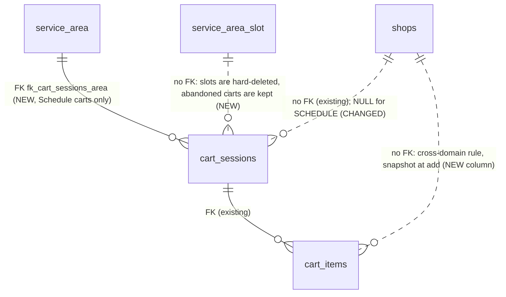
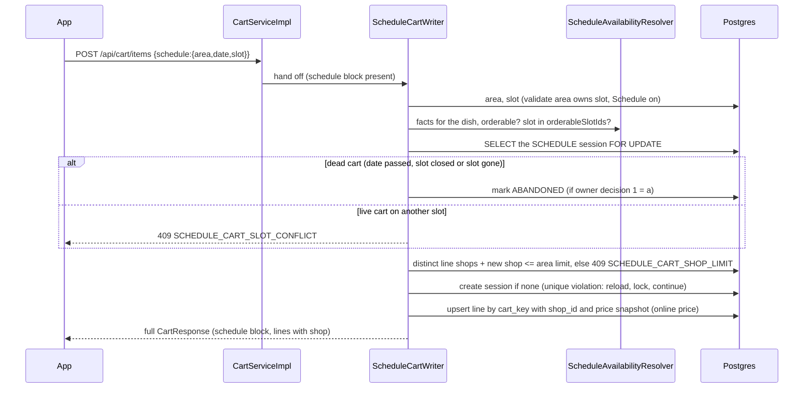

# Schedule 2b.5: Schedule cart (build plan)

Source: row 2b.5 of `schedule-implementation-order.md`; decisions 13 and 43 of `schedule-plan.md`; acceptance tests T2b-10 and T2b-25; 2b.2 conditions DA2-5 and DA2-7 (`schedule-menu-2b2-plan.md`).
Version 0.3, **LOCKED for implementation (2026-10-27)** after devil's advocate, `/geld` (deep) and a read-only Codex pass. Where sections 1-9 differ from "Data model review", the review wins. Build conditions are also in the memory note `followup_schedule_2b5_da`.

## 1. Summary

A Schedule cart holds dishes from up to `schedule_max_shops_per_cart` restaurants (area setting, default 3) for one area, one service date (today) and one slot. Eat Now carts keep their one-shop rule unchanged. 2b.5 builds the cart only: add, read, edit, clear, accept changes. Schedule checkout is 2b.8, reservations 2b.6, group payment 2b.9.

Backend only. Customer screens come in phase 4; the API contract is fixed here so the app can be built against it.

## 2. Decisions (Samivan, 2026-10-27)

| # | question | answer | effect |
|---|---|---|---|
| 1 | Sequencing with 2b.2 | Land 2b.2 first | 2b.5 branches from `feature/schedule` only after PRs #59-#61 are merged; the cart reuses `ScheduleAvailabilityResolver` and the one Schedule add-on function (DA2-5) |
| 2 | How a Schedule cart is told apart | New `CartType.SCHEDULE` | every existing `FOOD` lookup (cart, checkout, payment confirm at `PaymentServiceImpl.java:315`) can never pick up a Schedule cart; the unique index `idx_one_active_cart_per_user_per_type` is unchanged |
| 3 | How many Schedule carts; slot change | One active Schedule cart per user. Adding for another area, date or slot while that cart is live returns 409 and the customer clears it. A dead cart (date passed, slot closed or slot deleted) is cleared by the add itself, with a message (owner decision 1, 2026-10-27) | mirrors `DIFFERENT_SHOP_CART_EXISTS`; the existing unique index enforces "one" for free |
| 4 | FulfilmentPolicy scope | Cart part only | the policy has the shop limit and the cart-type mapping; location (`OrderAssembler.java:108-116`) moves to 2b.8, payment owner to 2b.9, cancel to 2b.10, release to 2b.11 |

Plan-row corrections these decisions make:
- The row's CHECK `fulfilment_type = 'SCHEDULE' OR shop_id IS NOT NULL` names a column that does not exist; it becomes a CHECK on `cart_type` (section 4).
- The row moves the assembler's radius check into 2b.5; that is checkout code and moves to 2b.8.
- The design review (2026-10-08, line 167-169) said the slot travels in the checkout request, not the cart. Decision 13 (revised 2026-10-14) puts one date and one slot on the Schedule cart. Decision 13 wins; the staleness risk the review named is handled by the read rules in section 6.3.

## 3. Prerequisite: land 2b.2

1. Samivan confirms owner items O-1..O-4 of 2b.2 (built on the spec's recommendations, unconfirmed).
2. Rebase #59 (a), #60 (b), #61 (c) onto `feature/schedule` (they are 14 commits behind it on 2026-10-27).
3. Confirm the 2b.2 schema SQL has been run on the target database; if not, it runs first.
4. Full suite green, `/gcp judge full`, merge into `feature/schedule` in order a, b, c.

2b.5 starts only after step 4.

## 4. Schema (draft for `/geld`)

`cart_sessions`:
- `shop_id` DROP NOT NULL (a Schedule cart has no single shop).
- New nullable columns: `service_area_id UUID`, `service_date DATE`, `slot_id UUID`.
- `chk_cart_type` widened to `('FOOD','GROCERY','PRODUCT','SCHEDULE')` (drop and re-add).
- New `chk_cart_sessions_shape`, added `NOT VALID` then validated (every existing row is FOOD with a shop, so it passes):
  `cart_type = 'SCHEDULE'` requires `shop_id IS NULL` and area, date and slot all set; any other type requires `shop_id IS NOT NULL` and all three NULL.
- Unique index `idx_one_active_cart_per_user_per_type` unchanged.

`cart_items`:
- New `shop_id UUID`, **nullable**. The new code writes it on every line of every cart type.
- Contract step, **DO NOT RUN NOW**: backfill `cart_items.shop_id` from its session for Eat Now rows, then NOT NULL. It runs only after the code that writes the column has reached `main`. Running it earlier breaks Eat Now add-to-cart on production, because `main` does not write the column and local backends write to production Neon.

Rollout: one hand-run file `db_manual/schedule-cart-migration.sql`, idempotent, numbered blocks, `lock_timeout = '3s'`, verify queries at the end (same shape as `order-group-migration.sql`). Every change is backward compatible with the code on `main`. `spring.jpa.hibernate.ddl-auto=update` is on, so entity declarations must match the SQL exactly. `ScheduleSchemaGuard` gets one entry per new column and constraint (it checks existence only).

## 5. Policy

Package `service/fulfilment/`:
- `FulfilmentPolicy`: `FulfilmentType fulfilmentType()`, `int maxShopsPerCart(CartSession session)`.
- `EatNowFulfilmentPolicy`: 1. The existing `DIFFERENT_SHOP_CART_EXISTS` 409 and its body stay exactly as they are.
- `ScheduleFulfilmentPolicy`: the area's `scheduleMaxShopsPerCart`.
- `FulfilmentPolicies.forCartType(CartType)`: SCHEDULE maps to the Schedule policy, everything else to Eat Now.

Later phases add methods when they first need them; no unused methods now.

## 6. Code

### 6.1 Add (`POST /api/cart/items`)
`AddToCartRequest` gets an optional `schedule` block: `{ areaId, serviceDate, slotId }`. Without it the request takes today's path unchanged. With it, `CartServiceImpl.addToCart` hands off to a new `ScheduleCartWriter`. `CartServiceImpl` is already 720 lines, so the Schedule rules live outside it.

Schedule add, in order:
1. Load the area; it must exist with Schedule on. The slot must belong to the area and be active.
2. Load the facts with 2b.2's `ScheduleFactsLoader` and run `ScheduleAvailabilityResolver`. The dish must be orderable, and `slotId` must be in `orderableSlotIds`. Otherwise return 400 `SCHEDULE_DISH_REFUSED` with the reason (API-4).
3. Add-on options are checked with the one Schedule add-on function (`offForSchedule`, independent of the live `is_available` toggle, DA2-5). Required groups must be satisfied.
4. Quantity: min is the item's `minOrderQty`; max is `min(app.cart.default-max-line-qty, result.remainingQty)`. **Never `StockLedgerService`**: Schedule must not read live Eat Now stock (design review line 166). `remainingQty` is the daily max until the 2b.6 ledger counts sales.
5. Price: online price, through the same `CartPricingService` call Eat Now uses (`SalesChannel.DELIVERY`). 2b.2 was re-planned with no separate Schedule price.
6. Lock the user's ACTIVE Schedule session row (`findForUpdate`, INV-2) if one exists, then re-read the idempotency cache (INV-3):
   - a dead cart (date passed, slot closed or slot deleted) is marked ABANDONED and the add continues with a new cart and a `CartMessage` ("Your 12:30 cart closed and was cleared");
   - a live cart on a different area, date or slot returns 409 `SCHEDULE_CART_SLOT_CONFLICT` (body in API-3);
   - the shop count after the add above the policy limit returns 409 `SCHEDULE_CART_SHOP_LIMIT`;
   - a LOCKED session returns 409 `SESSION_LOCKED` (existing rule).
7. Create the session if none exists (`cart_type = SCHEDULE`, shop NULL, area, date, slot). Upsert the line by `cart_key`, writing `shop_id`.
8. The idempotency hash includes the `schedule` block.

### 6.2 Eat Now changes
- Every new Eat Now line writes `cart_items.shop_id` (the session's shop).
- `PlaceOrderRequest` (`POST /api/orders`) and `CheckoutRequest` (`POST /api/payments/checkout`) reject `cartType = SCHEDULE` with 400 (T2b-10). `OrderAssembler.assemble` also refuses a SCHEDULE session as a backstop.
- Null-safety where a Schedule session reaches code that assumes a shop: `CartServiceImpl.java:262` (`GET /api/carts`), 503, 601, 616. Schedule carts are routed to the Schedule view before those lines. The test proves `GET /api/carts` returns 200 for a user who holds both carts.

### 6.3 Read (`GET /api/cart?type=SCHEDULE`, `GET /api/carts`)
- `CartResponse` gets a nullable `schedule` block: `serviceAreaId`, `areaName`, `serviceDate`, `slotId`, `slotStart`, `maxShops`, `state`. `shopId` and `shopName` are null for a Schedule cart.
- `CartItemResponse` gets `shopId` and `shopName` (filled for both cart types).
- Line validation runs through the resolver, never live stock or the live add-on toggle:

  | resolver result | `CartItemValidation` |
  |---|---|
  | orderable, prices and names match | `OK` / `PRICE_CHANGED` / `NAME_CHANGED` (existing rules) |
  | `ORDER_BY_PASSED` | new `ORDERING_CLOSED` (DA2-7: "ordering for this dish closed at 11:00") |
  | `SOLD_OUT` | new `SOLD_OUT` |
  | `REQUIRED_OPTION_UNAVAILABLE`, a selected option off for Schedule | `ADDON_REMOVED` |
  | any other reason | `UNAVAILABLE` |

- Cart `state`:
  - `OPEN`;
  - `SLOT_CLOSED`: the slot's last call has passed, or the slot was deleted;
  - `DATE_PASSED`: the service date is before today in the area's zone.

  Reads never write, so a dead cart is not abandoned on read. The next add clears it (6.1 step 6), and the customer can also clear it.
- Money: `subtotal` and `totalSavings` as today. `deliveryFee` is the area's `scheduleDeliveryFee`. A new `packagingFee` is the area's `schedulePackagingFee`. `taxTotal` and `taxLines` are null, and a `CartMessage` says "Taxes are added at checkout". Tax and round-off are quoted by Schedule checkout (2b.8) (owner decision 2).
- `GET /api/carts` lists the Schedule cart with `cartType = SCHEDULE`, a null shop and the schedule block. The current app only calls `type=FOOD` and cannot create a Schedule cart, so it is unaffected.

### 6.4 Edit, clear, accept
- `PATCH .../quantity`: the max for a Schedule line comes from 6.1 step 4, not `stockLedgerService` (`CartServiceImpl.java:295`).
- `PATCH .../selection`, `DELETE /api/cart/items/{id}`, `DELETE /api/cart?type=SCHEDULE`: the existing code works by type; tests confirm it.
- `PUT /api/cart/accept-changes?type=SCHEDULE`: lines that are not orderable are deleted; price and name snapshots are refreshed (existing rule).

## 7. Tests

| test | covers |
|---|---|
| Eat Now second shop still returns `DIFFERENT_SHOP_CART_EXISTS`, body unchanged | T2b-10 |
| Schedule cart accepts two shops; the shop over the area limit returns `SCHEDULE_CART_SHOP_LIMIT`; the limit follows the area setting | T2b-10, decision 43 |
| Add for another area, date or slot returns `SCHEDULE_CART_SLOT_CONFLICT` | T2b-10 |
| `POST /api/orders` and `POST /api/payments/checkout` with `cartType = SCHEDULE` return 400 | T2b-10 |
| An Eat Now payment confirm leaves an ACTIVE Schedule cart untouched | T2b-25, first half (the group-confirm half lands with 2b.9) |
| A Schedule line ignores live stock and the live add-on toggle; a Schedule-off option is rejected | DA2-5 |
| A dish past its order-by time reads `ORDERING_CLOSED`; a closed slot gives `SLOT_CLOSED` and blocks adds | DA2-7, section 6.3 |
| `GET /api/carts` with both carts returns 200 | section 6.2 |
| `ScheduleSchemaGuard` consistency test covers the new columns and constraints | section 4 |
| The existing cart, order and payment suites pass unchanged | regression |

## 8. Build order (Sonnet session)

1. Branch `feature/schedule-2b5` from `feature/schedule`, after section 3.
2. Write the SQL file; Samivan runs it; paste the verify output.
3. Entities, `CartType.SCHEDULE`, schema guard entries.
4. Policy (section 5), then the Schedule add path (6.1), then the Eat Now changes (6.2).
5. Read, edit and accept (6.3, 6.4).
6. Tests (section 7). Full suite: `./mvnw test -Dtest='!NinjaDeliveryServiceApplicationTests'`.
7. Docs in the same PR: `02-Domain/cart.md` (cart types table, Schedule cart section, new 409 codes and validation values), `skills/code_map.md` entries.
8. `/gcp judge full`, then a draft PR into `feature/schedule` (never `main`). Push only when Samivan says.

## 9. Open questions (all closed 2026-10-27)

Closed:
- **G-1:** FK to the area only, no slot FK (MODEL-1).
- **G-2:** contract step after `main` with no older backend running (Rollout row 6).
- **G-3:** no tax in the cart (owner decision 2).
- **G-4:** yes.
- **G-5:** yes, with a lock query and reload-on-conflict (INV-2).
- **G-6:** dead cart cleared by the next add (owner decision 1).
- **G-7:** the address is on checkout (owner decision 3).

The table below keeps the original recommendations.

| # | question | recommendation |
|---|---|---|
| G-1 | Foreign keys from `cart_sessions` to `service_area` and `service_area_slot`? | yes, as `order_groups` does (same Schedule domain); no FK to shops (cross-domain rule) |
| G-2 | When does the `cart_items.shop_id` contract step run? | after the 2b.5 code reaches `main`; label it DO NOT RUN NOW in the SQL file |
| G-3 | Schedule cart money preview | subtotal plus area delivery and packaging fees; tax and round-off from checkout (2b.8) |
| G-4 | Does the delivery channel block (`ChannelPolicy.requireAllowed(..., DELIVERY)`) apply to Schedule dishes? | yes: Schedule is an online channel |
| G-5 | Row lock on Schedule add | yes, `FOR UPDATE` on the session, so two adds cannot both pass the shop limit |
| G-6 | Stale cart (slot closed, date passed) | flag on read, reject adds, customer clears; no auto-abandon |
| G-7 | Delivery address on the Schedule cart (decision 13 says one address) | not on the cart: checkout carries it (as Eat Now does) and 2b.8 checks it lies inside the area |

## Data model review

### Summary (read this first)
**Verdict:** The design is approved with 12 changes (6 from geld, 6 more from the Codex cross-check), pending 3 owner decisions. As in 2b.4, release is blocked on the three environment fixes deferred to pre-launch on 2026-10-21; deploy to `feature/schedule` is not blocked.

**What changes** (before → after):
1. A Schedule cart could reach the tax and commission rules that only fire for `FOOD`, silently charging 0% GST. After: `CartType.vertical()` maps SCHEDULE to FOOD, and every vertical rule calls it (INV-1).
2. The plan put foreign keys on both the area and the slot. After: area only. Admins hard-delete slots, and abandoned carts are kept forever, so a slot FK would block every slot delete (MODEL-1).
3. The allowed-cart-type check was to be dropped and re-added. After: swapped in one transaction, added NOT VALID then validated, so there is no window without a check and no long lock (MIG-2).
4. The SQL runs before anyone boots the 2b.5 branch. `ddl-auto=update` and local backends that point at production would otherwise add the columns to production without their checks (MIG-1).
5. Two first adds at the same moment: the loser now reloads and continues instead of returning 500 (INV-2).
6. `cart_items.shop_id` NULL has one meaning: an Eat Now line written before 2b.5. One accessor resolves it (MODEL-2).
7. A repeated tap with the same idempotency key could add the dish twice. After: the Schedule writer re-checks the key after taking the session lock (INV-3).
8. An older backend can't read a cart of the new type. After: a rollback runbook abandons Schedule carts first, and Schedule testing uses only the dev test account (MIG-3).
9. Every cart response for a Schedule cart, including after edits and on the carts list, goes through one cart-type-aware builder with defined 409 bodies and a validated request block (API-1..4).

**Decisions you need to make**
| # | decision | options | recommended, and why | if you pick the other option |
|---|---|---|---|---|
| 1 | A Schedule cart whose date passed or whose slot closed, when the customer adds for a live slot (DA-2) | a) the add clears the dead cart and says so; b) 409 and the customer clears it (decision 3 as written) | a: a dead cart can never be ordered, so the 409 is a daily dialog with only one possible answer | b: the customer taps "Clear cart" every day they come back |
| 2 | Tax shown in the Schedule cart (G-3, DA-7) | a) no tax in the cart, a "Taxes are added at checkout" message, the full total at checkout (2b.8); b) quote tax per restaurant in the cart now | a: checkout must quote anyway, and 2b.5 stays a cart-only slice | b: about one more day of work; the Eat Now cart already shows tax, so Schedule would match it |
| 3 | Where the Schedule delivery address lives (G-7; decision 13 says "one delivery address" on the cart) | a) the checkout request carries it, 2b.8 checks it lies inside the cart's area, and decision 13's wording is revised; b) store the address on the cart | a: same as Eat Now; the cart stays a dish list, and the address is snapshotted once on `order_groups` at checkout | b: address columns on `cart_sessions`, an edit endpoint, and staleness when the user moves |

**What geld decided for you:**
- No FK to the slot, for the reason in item 2 above.
- The vertical mapping in item 1. Schedule orders store `orders.cart_type = FOOD`, and the fulfilment is carried by `group_id`.
- Lock the Schedule session row on add (G-5).
- The delivery-channel block applies to Schedule (G-4), through the same `ChannelPolicy` as Eat Now.
- The address stays on checkout (G-7). 2b.8 checks that the address lies inside the cart's area.
- The NOT NULL on `cart_items.shop_id` waits for `main` (G-2).

**What must happen before deploy:**
1. Land 2b.2 (section 3).
2. Samivan runs `schedule-cart-migration.sql` blocks 1-4, then pastes the verify output.
3. Only then boot or test the 2b.5 branch.
4. Block 5 (the `cart_items.shop_id` NOT NULL) is DO NOT RUN NOW. It runs after 2b.5 reaches `main` and the preflight count is 0.

**Unknowns that could change this:** row counts of `cart_sessions` and `cart_items` in production (assumed small: the product is not live); whether `cart_sessions.shop_id` is NOT NULL in production today (the entity says so, and `ddl-auto` created it, so `DROP NOT NULL` is written idempotently either way).

**Status:** FINAL · **Verdict:** APPROVED WITH CHANGES (all accepted; decisions 1-3 answered 2026-10-27) · geld deep, 2026-10-27
**Target:** PostgreSQL 17.11 (Neon `neondb`) · hand-run SQL in pgAdmin, one block at a time, plus Hibernate `ddl-auto=update` · Neon pooler · Spring Boot 4 monolith on one EC2 host
**Lenses run:** 0, 1, 2, 3, 4, 6, 7, 8 · **skipped:** 5 (no new stored amount; fees come from the area; the add-on price snapshots are unchanged) · **reference designs:** skipped (a known pattern, cheap to change: two nullable columns and a check)
**Codex second opinion:** read-only run, 2026-10-27; it saw the plan, not these findings.
- **Agreed (6):** a SCHEDULE value must not reach orders or the FOOD rules; the first-add race; the check swap in one transaction; DELIVERY pricing; G-3; G-4.
- **Codex-only, verified (7):**
  - concurrent idempotency double-add (`CartServiceImpl.java:114` checks before, `:236` stores after) → INV-3;
  - the old binary can't read a SCHEDULE row (`@Enumerated(STRING)`) → MIG-3;
  - there is no lock query (`CartSessionRepository.java:14-18`) → part of INV-2;
  - `CartSummaryResponse` has no schedule field → API-1;
  - every mutation returns through the shop-bound builder → API-2;
  - 409 bodies are undefined → API-3;
  - the nested request block is not validated → API-4.
- **Disagreements (4):**
  - G-1 composite area+slot FK: rejected, because no slot FK is used (MODEL-1); the service check I-5 stays.
  - G-2 timing: absorbed. The precondition is now "zero NULL lines immediately before", plus the backfill in the same block.
  - G-6: left to owner decision 1.
  - "an old binary re-adds NOT NULL via `ddl-auto`": rejected, because Hibernate `update` only adds missing tables and columns and never changes nullability (ENV-2 already covers `ddl-auto`).
- **Extra from Codex:** G-7 contradicts decision 13's wording ("one delivery address") → owner decision 3.
**Open inputs:** production cart row counts (assumed < 10k)

### Design changes
The proposed design makes a Schedule cart a first-class cart without letting it leak into Eat Now's tax, commission or one-shop rules.

| # | before | after | problem it solves | why it is better | what it costs | alternative considered, why it lost |
|---|---|---|---|---|---|---|
| 1 | `cart_type` compared to `FOOD` for tax (`OnlineOrderQuote.java:37`), commission (`OrderAssembler.java:174`) and the cart preview (`CartServiceImpl.java:641`) | `CartType.vertical()`; the vertical rules call it | INV-1: a SCHEDULE value gets 0% GST and no commission | one place decides "is this food" | three call sites plus a test | a `fulfilment_type` column: rejected by decision 2 |
| 2 | FK `cart_sessions.slot_id` → `service_area_slot` | no FK; a deleted slot reads as `SLOT_CLOSED` | MODEL-1: `deleteSlot` (`ServiceAreaAdminServiceImpl.java:173`) throws once any cart ever used the slot | admin delete keeps working; the cart re-validates the slot on every read anyway | an orphan slot id can sit on an abandoned cart (harmless) | FK with ON DELETE SET NULL: breaks the shape check (a Schedule cart needs a slot) |
| 3 | drop and re-add `chk_cart_type` | one transaction: drop, then add NOT VALID, then VALIDATE | MIG-2: no window without a check; no scan under ACCESS EXCLUSIVE | safe on a live table | none | separate statements: a short window without a check |
| 4 | SQL any time before deploy | SQL before the first boot of the branch anywhere | MIG-1: `ddl-auto=update` adds the columns to production without their checks | the checks exist before any writer | an ordering step | none |
| 5 | `FOR UPDATE` on the existing session only | plus catch the unique violation at create, reload, lock, continue once | INV-2: the first-add race returns 500 | no 500 on double-tap | a few lines | `INSERT ... ON CONFLICT`: the conflict target is a partial index on a JPA entity; harder to keep in one style |
| 6 | NULL `cart_items.shop_id` undefined | NULL = an Eat Now line written before 2b.5; `shopIdOr(session)` | MODEL-2: a new reader trusts a NULL | one rule, then NOT NULL after `main` | one accessor | write only on Schedule lines: NULL would then mean two things for ever |

### Tables
| table | grain (one row = one ...) | purpose | class | owner | phase | state |
|---|---|---|---|---|---|---|
| `cart_sessions` | one cart of one user for one cart type and one lifetime (ACTIVE to COMPLETED or ABANDONED) | the mutable pre-order workspace | hot | cart | 1D.5, changed in 2b.5 | live |
| `cart_items` | one distinct dish plus option selection in one cart | the cart line, snapshot at add | hot | cart | 1D.5, changed in 2b.5 | live |

### Names
| name | what it holds | project word (grep evidence) | clashes | verdict |
|---|---|---|---|---|
| `cart_sessions.service_area_id` | the Schedule area of the cart | `order_groups.service_area_id` (order-group-migration.sql:18) | none | keep |
| `cart_sessions.service_date` | the delivery date, a calendar date in the area's zone | `order_groups.service_date` | none | keep |
| `cart_sessions.slot_id` | the chosen slot (soft reference) | `order_groups.slot_id` | none | keep |
| `cart_items.shop_id` | the line's restaurant, snapshot at add | `cart_sessions.shop_id`, `orders.shop_id` | none | keep |
| `CartType.SCHEDULE` | the Schedule cart | `FulfilmentType.SCHEDULE` (entity/FulfilmentType.java:6) | same word, different enum: intended | keep |
| `chk_cart_sessions_shape` | which columns a cart type must and must not fill | `chk_orders_group_shape` | none | keep |
| `fk_cart_sessions_area` | area reference | `fk_orders_group` | none | keep |
| `SCHEDULE_CART_SLOT_CONFLICT`, `SCHEDULE_CART_SHOP_LIMIT` | 409 codes | `DIFFERENT_SHOP_CART_EXISTS` | none | keep |
| `CartItemValidation.ORDERING_CLOSED`, `SOLD_OUT` | Schedule line states | `ScheduleReason.ORDER_BY_PASSED`, `SOLD_OUT` | `SOLD_OUT` reused on purpose | keep |

### Built vs plan
Nothing in 2b.5 is built. `cart_sessions` and `cart_items` are live in production (Eat Now). `ServiceArea.scheduleMaxShopsPerCart` exists (2a). `ScheduleAvailabilityResolver` exists only on unmerged 2b.2 branches (#59-#61). Every finding's cost to change now is **free**.

### Entity relationships

### Column mapping
`cart_sessions` (changed):
| column | type | null | default | key / FK | constraint | phase | note |
|---|---|---|---|---|---|---|---|
| `shop_id` | uuid | yes (was NOT NULL) | | | shape check | 2b.5 | NULL only for SCHEDULE |
| `cart_type` | varchar(20) | no | 'FOOD' | | `chk_cart_type` adds SCHEDULE | 2b.5 | |
| `service_area_id` | uuid | yes | | FK `service_area(id)` ON DELETE RESTRICT | shape check | 2b.5 | set only for SCHEDULE |
| `service_date` | date | yes | | | shape check | 2b.5 | calendar date in the area's zone |
| `slot_id` | uuid | yes | | none (soft) | shape check | 2b.5 | validated on every add and read |

Indexes: unchanged. `idx_one_active_cart_per_user_per_type` (user_id, cart_type) WHERE ACTIVE/LOCKED serves "the user's Schedule cart" and enforces one. No index on `service_area_id`: areas are never deleted and no read filters by it (scan accepted, stated).

`cart_items` (changed):
| column | type | null | default | key / FK | constraint | phase | note |
|---|---|---|---|---|---|---|---|
| `shop_id` | uuid | yes until block 5, then NOT NULL | | none (cross-domain) | | 2b.5 / block 5 after `main` | NULL = an Eat Now line written before 2b.5 |

Indexes: none new. The distinct-shop count reads a cart's lines through `idx_cart_items_session`.

Lifecycle: both are mutable while ACTIVE. COMPLETED and ABANDONED rows are kept (existing rule, no retention: PERF-1 revisit).

### Invariants
| # | invariant | enforced by | concurrent writers? | mechanism | evidence |
|---|---|---|---|---|---|
| I-1 | one ACTIVE or LOCKED cart per user per cart type (so one Schedule cart) | partial unique index | two first adds | unique violation; the loser reloads (INV-2) | cart_module_constraints.sql:7 |
| I-2 | SCHEDULE: no shop, area + date + slot set; other types: shop set, the three NULL | CHECK `chk_cart_sessions_shape` | n/a | constraint | section 4 |
| I-3 | a Schedule cart holds at most `schedule_max_shops_per_cart` shops | service, under `FOR UPDATE` on the session | two adds with different shops | the row lock serialises them | section 6.1 step 6 |
| I-4 | a Schedule line has `shop_id` | service until block 5, then NOT NULL | n/a | service assert + test | DA-3 |
| I-5 | the slot belongs to the cart's area | service at add and read | n/a | no slot FK by MODEL-1 | |
| I-6 | a Schedule line is orderable for the cart's area, date and slot when added; reads re-validate | `ScheduleAvailabilityResolver` | n/a | one rule (DA2-5) | 2b.2 |
| I-7 | an Eat Now checkout or payment never reads a SCHEDULE cart | lookups keyed by `cart_type`; 400 on SCHEDULE at `POST /api/orders` and `/api/payments/checkout` | n/a | type key + request guard + assembler backstop | `PaymentServiceImpl.java:315` |
| I-8 | vertical rules (tax, commission) treat SCHEDULE as FOOD | `CartType.vertical()` | n/a | one method + test | INV-1 |

### Scenarios, access patterns, sizing
Scenarios:
- **Correctness:** two taps adding dishes from two shops at once never exceed the limit and never return 500.
- **Change:** 2b.8 checkout needs only new tables (`order_payout_snapshot`) and reads area, date, slot and line shops from the cart.
- **Load:** at lunch peak, assumed 20 Schedule adds per minute per area, `GET /api/cart?type=SCHEDULE` answers in p95 < 300 ms with at most 3 shops × 10 lines.

| # | actor | r/w | endpoint | filter | index | rows |
|---|---|---|---|---|---|---|
| 1 | customer | w | POST /api/cart/items (Schedule) | user + SCHEDULE + ACTIVE/LOCKED | the partial unique index | 1 |
| 2 | customer | r | GET /api/cart?type=SCHEDULE | same, then lines by session | the partial unique index; `idx_cart_items_session` | ≤ 30 lines |
| 3 | customer | r | GET /api/carts | user + ACTIVE/LOCKED | `idx_cart_sessions_user` | ≤ 4 |

Sizing (assumptions): each Schedule user leaves about one cart per ordering day (date-bound). 1,000 daily users gives about 365k `cart_sessions` rows a year plus about 3 lines each. Small at 10x (3.6M rows a year, under 2 GB with lines and add-ons); at 100x, retention is needed (PERF-1).

### Findings
#### Must change before the next affected deploy
**INV-1 · risk · MUST**: a SCHEDULE cart type reaches FOOD-only rules.
- Evidence: `OnlineOrderQuote.java:37` (`if (cartType != CartType.FOOD)` returns no tax); `OrderAssembler.java:174` (commission only for FOOD); `CartServiceImpl.java:641` passes `session.getCartType()` to the quote (fact).
- Failure: a Schedule cart or order priced through any of these gets 0% GST and NULL commission, with no error.
- Change: add `CartType.vertical()` (SCHEDULE → FOOD); the three call sites use it; Schedule orders store `orders.cart_type = FOOD` (2b.8); test that a Schedule line quotes 5% GST and commission.
- Cost to change now: free.

**MODEL-1 · risk · MUST**: an FK to the slot blocks slot deletes.
- Evidence: `deleteSlot` hard-deletes with no reference check (`ServiceAreaAdminServiceImpl.java:168-173`); ABANDONED carts are never deleted (cart.md "keep their rows for analytics") (fact).
- Failure: an admin deletes the 12:30 slot that one customer once carted, and the delete throws a constraint violation.
- Change: FK to `service_area` only; `slot_id` is a soft reference validated on add and read; a missing slot reads as `SLOT_CLOSED`.
- Cost to change now: free.

**MIG-1 · risk · MUST**: Hibernate `ddl-auto=update` can create the columns without their checks.
- Evidence: `application.properties:32`; local backends default to production Neon (project rule) (fact).
- Failure: a developer boots the 2b.5 branch before the SQL runs; Hibernate adds the nullable columns to production with no shape check, and a test write can store a SCHEDULE cart with a shop.
- Change: the SQL (blocks 1-4) runs before the first boot of the branch anywhere; `ScheduleSchemaGuard` gets an entry per constraint so a boot without them fails.
- Cost to change now: free.

**MIG-2 · risk · MUST**: swap `chk_cart_type` safely.
- Change: one transaction, `DROP CONSTRAINT chk_cart_type` then `ADD CONSTRAINT chk_cart_type CHECK (... 'SCHEDULE') NOT VALID`, then `VALIDATE` (postgres-ddl-locks: ADD CHECK).
- Cost to change now: free.

**INV-2 · risk · MUST**: the first-add race (Codex agreed).
- Evidence: the session is created after a lookup that found none (`CartServiceImpl.java:159-181`); the unique index rejects the second insert; `CartSessionRepository` has no lock query (lines 14-18) (fact).
- Failure: a double tap on two shops' "Add" returns 500 for one; with no lock query, `FOR UPDATE` does not exist yet.
- Change:
  - add `@Lock(PESSIMISTIC_WRITE)` `findForUpdate(userId, cartType, statuses)` and use it for every Schedule mutation;
  - on a unique violation at create, reload the winner with it and continue once, so the slot conflict and shop limit are then checked against the winner.
- Cost to change now: free.

**INV-3 · risk · MUST**: a concurrent same-key add runs twice (Codex, verified).
- Evidence: the idempotency cache is read at `CartServiceImpl.java:114` before the mutation and written at `:236` after it; `IdempotencyServiceImpl.store` swallows the duplicate-key insert (lines 64-68) (fact).
- Failure: two requests with the same key both see no cached response, and the quantity is added twice.
- Change: the Schedule writer re-reads the idempotency cache after taking the session lock; the first request commits before the second gets the lock, so the second returns the cached response. The same gap on the Eat Now path is pre-existing (parked 2b.4a hardening), not widened here.
- Cost to change now: free.

**MIG-3 · risk · MUST**: an older backend can't read a SCHEDULE row (Codex, verified).
- Evidence: `CartType` is `@Enumerated(STRING)` (`CartSession.java:27-29`); a binary without the SCHEDULE value throws when it loads one; `GET /api/carts` loads every ACTIVE/LOCKED session (`CartSessionRepository.java:18`) (fact).
- Failure:
  - a local `feature/schedule` backend (which writes to production Neon) creates a Schedule cart for a real user, and production `main` then returns 500 on that user's `GET /api/carts`;
  - after go-live, a rollback of `main` past 2b.5 does the same for every user with a Schedule cart.
- Change:
  - Schedule carts are created only with the dev test account (9999999001) until 2b.5 reaches `main`;
  - the rollback runbook marks every ACTIVE SCHEDULE cart ABANDONED before deploying an older build (old readers filter ACTIVE/LOCKED, so abandoned rows are never loaded).
  - A separate compatibility release (Codex's proposal) costs a release slot for the same protection; rejected.
- Cost to change now: free.

**API-1 · risk · MUST**: `GET /api/carts` cannot carry the Schedule fields.
- Evidence: `CartSummaryResponse.java:13-18` (fact).
- Change: add a nullable `schedule` summary (`serviceDate`, `slotStart`, `areaName`, `shopCount`) to `CartSummaryResponse`; a SCHEDULE summary has a null shop.

**API-2 · risk · MUST**: every mutation returns through the Eat Now builder.
- Evidence: quantity, selection, remove and accept-changes all end in `buildCartResponse`, which reads the session shop and `DeliveryConfig` (`CartServiceImpl.java:306, 317, 343, 412, 499-503, 598-616`) (fact).
- Change: one `buildCartResponse(session)` dispatcher picks the Eat Now or Schedule builder by cart type; reads and every mutation return through it; a test covers each endpoint on a Schedule cart.

**API-3 · risk · MUST**: 409 bodies are undefined.
- Evidence: `CartConflictResponse.java:11-18` only carries shops (fact).
- Change:
  - new `ScheduleCartConflictResponse { error, existing: {areaId, areaName, serviceDate, slotId, slotStart}, requested: {same}, message }` for `SCHEDULE_CART_SLOT_CONFLICT`;
  - `{ error, maxShops, shopsInCart: [{shopId, shopName}], message }` for `SCHEDULE_CART_SHOP_LIMIT`;
  - each with its own handler in `GlobalExceptionHandler`, following `DifferentShopCartExistsException`.
  - The code field is `error`, not `code`: both existing 409 bodies (`CartConflictResponse`, `SessionLockedResponse`) use `error` (Raphael, 2026-10-27).
  - Area is named `areaId`, not `serviceAreaId`: `ShopServiceAreaAccessGuardTest` (T2a-08) bans that string in every non-admin DTO.

**API-4 · risk · MUST**: the nested request block is not validated.
- Evidence: `AddToCartRequest.java:14-27` validates only add-ons (fact).
- Change: `@Valid` on `schedule`, and `@NotNull` on `areaId`, `serviceDate` and `slotId`.
- Resolver refusals (dish not orderable, or the chosen slot closed) return 400 with a typed body `{ error: "SCHEDULE_DISH_REFUSED", reason, menuItemId, message }`, where `reason` is a `ScheduleReason` name, the same vocabulary the Schedule menu already returns, so the app branches on `reason` and never on the message text (Raphael, 2026-10-27). `ScheduleDishRefusedException` extends `BusinessRuleViolationException`, so it is still a 400 business rule. Input mistakes (wrong date, unknown slot, unknown option) stay plain 400 messages.

**TEST-1 · risk · MUST**: Eat Now payment paths with a Schedule cart present.
- Evidence: payment looks sessions up by the order's cart type at `PaymentServiceImpl.java:215-219, 315-339, 415-419, 814-818` (Codex, verified in part at :315).
- Change: a regression test per unlock and complete path showing that an ACTIVE Schedule cart is untouched.

**MODEL-2 · risk · MUST**: define NULL on `cart_items.shop_id`.
- Change: NULL = an Eat Now line written before 2b.5; `CartItem.shopIdOr(CartSession)` is the only reader; the Schedule writer asserts non-null; block 5 makes it NOT NULL after `main`.
- Cost to change now: free.

#### Fine now, revisit at a trigger
- **PERF-1**: COMPLETED and ABANDONED carts are kept with no retention, and Schedule adds about one cart per user per ordering day. Revisit at 1M `cart_sessions` rows: a retention job, or roll up to analytics.
- **STATE-1**: a stale LOCKED Schedule cart cannot occur in 2b.5 (no Schedule checkout). 2b.9 owns releasing it, the same way the Eat Now stale pending-payment sweep does.
- **EVOL-1**: `cart_type` now carries a fulfilment value (decision 2). Revisit if a second vertical (grocery) ever gets Schedule; the answer then is a `fulfilment_type` column with expand and contract.
- **OWN-1** (side finding, live today): the `order_groups.slot_id` FK (run 2026-10-27) blocks `deleteSlot` once a group exists. Groups are created from 2b.8, so before 2b.8, `deleteSlot` must deactivate a referenced slot instead of deleting it.

#### Keep
- Area, date and slot on the session: same lifecycle as the cart, set once at creation; same names as `order_groups`.
- `cart_items.shop_id` stored, not derived: identity is snapshotted at add, and 2b.8's split by shop must not depend on a live item row.
- Line prices stay a snapshot at add, re-validated on read (existing cart rule); the moment of truth for the paid price stays checkout (T2b-11).
- The slot is a live reference on the cart (mutable workspace); `order_groups` snapshots it at payment.
- One Schedule cart per user through the existing partial unique index: no new index.

### Devil's advocate trace
| DA point | outcome |
|---|---|
| DA-1 vertical | absorbed: INV-1 |
| DA-2 dead cart | owner decision 1 |
| DA-3 NULL shop on lines | absorbed: MODEL-2 |
| DA-4 slot FK | absorbed: MODEL-1, OWN-1 |
| DA-5 first-add race | absorbed: INV-2 |
| DA-6 channel rule in two places | already handled: section 6.1 uses `ChannelPolicy`; a test is added to section 7 |
| DA-7 no tax in the cart | owner decision 2 |
| DA-8 address at checkout | already handled: G-7, carried into the 2b.8 gate |
| DA-9 implicit filter | already handled: I-2 shape check plus a column comment |

### Future phases
| phase | new tables | change forced on this design |
|---|---|---|
| 2b.6 reservations | `schedule_stock_ledger`, `service_area_slot_day`, `schedule_reservations` | none: `remainingQty` from the resolver starts counting sales |
| 2b.8 checkout | `order_payout_snapshot` | none: reads area, date, slot and line shops; checks the address is in the area; sets `orders.cart_type = FOOD` |
| 2b.9 group payment | none | completes the SCHEDULE cart by user + type; releases a stale LOCKED Schedule cart |
| 2b.10, 2b.11 | none | none |

### Rollout
| change | phase | lock and rewrite | works with app N-1 (main)? | rollback | precondition |
|---|---|---|---|---|---|
| 1. `cart_sessions` + `service_area_id`, `service_date`, `slot_id` (nullable) | expand | brief ACCESS EXCLUSIVE, metadata only | yes: main never writes them | leave | `lock_timeout` 3 s |
| 2. `cart_sessions.shop_id` DROP NOT NULL | expand | brief, no scan | yes: main always writes a shop | leave | |
| 3. `chk_cart_type` swap (one transaction, NOT VALID, VALIDATE) | expand | brief, then a scan without blocking writes | yes | the old check | |
| 4. `chk_cart_sessions_shape` NOT VALID + VALIDATE; FK `fk_cart_sessions_area` NOT VALID + VALIDATE | expand | as above | yes: every existing row is FOOD with a shop and NULL Schedule columns | drop | preflight: count of rows with `shop_id IS NULL` = 0 |
| 5. `cart_items` + `shop_id` (nullable) | expand | brief, metadata | yes | leave | |
| 6. backfill `cart_items.shop_id` from the session, CHECK NOT NULL NOT VALID, VALIDATE, SET NOT NULL | contract, **DO NOT RUN NOW** | batched update; brief lock | needs every writer to set it | leave nullable | 2b.5 code on `main` and no older backend running anywhere (local ones included); the backfill runs in the same block, and the NULL count is 0 immediately before VALIDATE |

Lens 0 environment:
- Checks 1-3 fail: hand-run SQL plus `ddl-auto=update`; local backends point at production. These are ENV-1..3, deferred by Samivan to pre-launch on 2026-10-21, unchanged by this plan.
- Check 4 (split credentials) is unknown.
- Check 8 (order of rollout) passes (this table).

### Design versions
| version | phase | date | what changed | why |
|---|---|---|---|---|
| 0.1 | 2b.5 | 2026-10-27 | first draft | plan |
| 0.2 | 2b.5 | 2026-10-27 | geld review: no slot FK, vertical mapping, check swap, SQL before boot, first-add race, NULL meaning | INV-1, MODEL-1/2, MIG-1/2, INV-2 |
| 0.3 | 2b.5 | 2026-10-27 | Codex cross-check: idempotency re-check, old-binary rollback runbook, summary DTO, one response dispatcher, 409 DTOs, nested validation, payment regression tests; owner decisions 1-3; LOCKED | INV-3, MIG-3, API-1..4, TEST-1 |

### Locked decisions (handoff to /gcp and /judge)
| id | decision | enforced where | code paths that must honour it |
|---|---|---|---|
| L-1 | SCHEDULE is a cart type; its vertical is FOOD | service | `OnlineOrderQuote.quote`, `OrderAssembler` commission, `CartServiceImpl` preview, every future `== CartType.FOOD` |
| L-2 | one active Schedule cart per user | the partial unique index | Schedule add |
| L-3 | a Schedule cart's shape | `chk_cart_sessions_shape` | every `CartSession` writer |
| L-4 | no FK to the slot | schema | add and read treat a missing slot as `SLOT_CLOSED` |
| L-5 | the shop limit is checked under the session row lock | service | Schedule add |
| L-6 | Eat Now checkout and payment refuse SCHEDULE | service | `OrderServiceImpl.placeOrder`, `PaymentServiceImpl.checkout`, `OrderAssembler.assemble` |
| L-7 | Schedule lines never read live stock or the live add-on toggle | service | add, read, quantity, accept-changes |
| L-8 | every cart response goes through one cart-type-aware dispatcher | service | add, get, quantity, selection, remove, clear, accept-changes, `/api/carts` |
| L-9 | a dead Schedule cart is cleared by the next add, never by a read | service | Schedule add; GET stays read-only |
| L-10 | Schedule carts are created only with the dev test account until 2b.5 is on `main`; a rollback first abandons ACTIVE Schedule carts | runbook | MIG-3 |

### Approval record
| finding or decision | option chosen | by | date |
|---|---|---|---|
| decisions 1-4 (section 2) | as listed | Samivan | 2026-10-27 |
| owner decision 1 (dead cart) | a) the next add clears it, with a message | Samivan | 2026-10-27 |
| owner decision 2 (tax in the cart) | a) no tax in the cart, "Taxes are added at checkout" | Samivan | 2026-10-27 |
| owner decision 3 (address) | a) checkout carries it; 2b.8 checks it is inside the area; decision 13 reworded | Samivan | 2026-10-27 |
| INV-1, MODEL-1/2, MIG-1/2/3, INV-2/3, API-1..4, TEST-1 | as written | geld + Codex, accepted with the lock | 2026-10-27 |
| Codex G-1 composite FK; "old binary re-adds NOT NULL" | rejected (reasons in the Codex line) | geld | 2026-10-27 |

## System design

### Main flow: add to the Schedule cart

### Decisions
- **Cart type vs fulfilment column:** options a `CartType.SCHEDULE` value or a `fulfilment_type` column. Chosen: cart type (decision 2). Negative: `cart_type` mixes vertical and fulfilment, handled by `vertical()`. Revisit: a second vertical on Schedule (EVOL-1).
- **Where Schedule cart rules live:** inside `CartServiceImpl` or a new `ScheduleCartWriter`. Chosen: the new class (`CartServiceImpl` is 720 lines; the Schedule rules depend on 2b.2's resolver). Negative: one more class in the cart module. Revisit: never.

### Isolation, tenancy, API
- The cart module owns both tables. It reads the Schedule module through `ScheduleAvailabilityResolver` and `ScheduleFactsLoader` (2b.2's one rule) and never writes Schedule tables.
- Single platform, no tenancy columns.
- API changes are additive: an optional `schedule` request block; nullable `schedule`, `shopId` and `shopName` response fields; new enum values only on SCHEDULE carts. The current app sends only `type=FOOD` and cannot create a Schedule cart.
- The idempotency fingerprint includes the `schedule` block.
