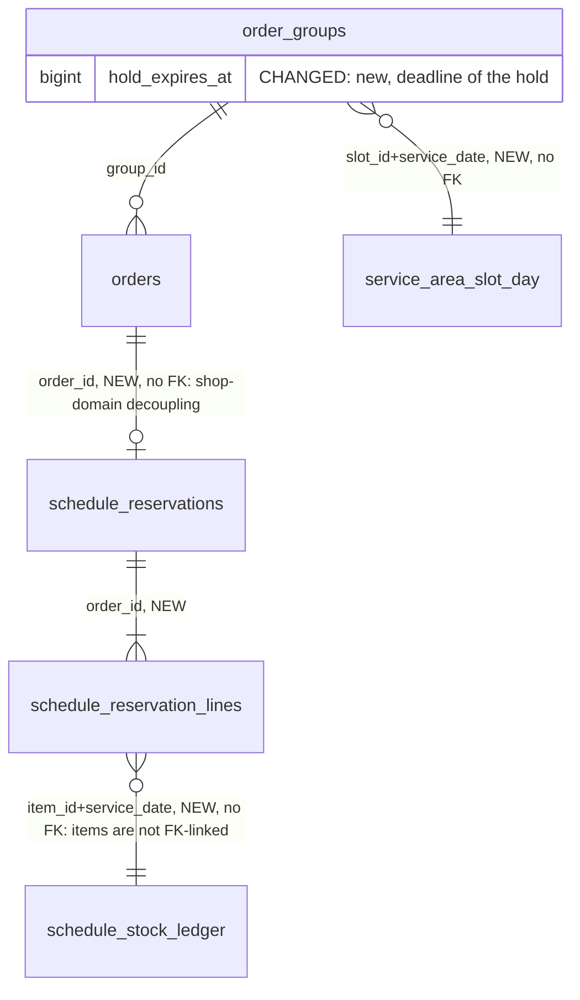

# Schedule 2b.6: stock and slot holds (hold at checkout)

Status: FINAL v1.1, approved by Samivan 2026-10-28 (geld deep + devil's advocate + three Codex passes; round 2 merged). Build from this file.
It wins over the "reserve at payment confirm" text in `schedule-implementation-order.md` rows 2b.6, 2b.8, 2b.9. Eat Now is untouched in this phase and moves to holds in a later phase (Future phases).

## Data model review

### Summary (read this first)
**Verdict:** APPROVED WITH CHANGES. Holding stock at checkout is the right call; the design below changes four things in the proposal that would have broken it.

**What changes** (before → after):
- Stock is taken at payment confirm, so the second customer for the last dish is charged and then refunded → stock and the slot are held for 3 minutes at checkout, so the customer is told "sold out" before paying.
- The "held" quantity is a sum read under a row lock, not a stored counter: when a hold lapses it simply stops counting, so stock stays correct with no cleanup job.
- A payment that lands after the 3 minutes is not refused: it re-checks stock and succeeds if every dish in the checkout is still free; otherwise the whole checkout is refunded in one refund (all or nothing).
- A customer can have only one unresolved checkout per service date (database rule), which is also the hoarding limit.
- Carts and menus show a held dish as "held by another customer, try again shortly", not "sold out".

**Decisions (all taken by Samivan, 2026-10-28):**
| # | decision | chosen | why |
|---|---|---|---|
| 1 | Hold length | 3 minutes, a global admin setting `platform_schedule_config.hold_seconds` (default 180); not an env value, not a constant | one knob for the platform; each checkout snapshots its own deadline |
| 2 | Close the payment screen at the deadline | yes: the app passes Razorpay's `timeout` checkout option | the customer cannot keep paying on an expired hold; a UPI approval already sent can still land and is handled by H-4 |
| 3 | Abuse: cooldown, portion cap, warnings, strikes | parked as one future feature | only H-6 (one unresolved checkout per customer per date) is built now, because it also prevents a double charge; lapsed checkouts are kept as history (H-12) |
| 4 | Eat Now | unchanged now; a follow-up phase moves it to holds | different stock table, many untracked items; count `confirmPayment STOCK_FAIL` refunds first |

**What geld decided for you:**
- Held quantity is derived under the `(item, date)` row lock, not counted in a column (lens 2/3: no counter to drift, no scheduler needed for correctness).
- No "extend the hold while a payment is in flight"; instead a new checkout is blocked while the previous group has a captured or in-flight payment (removes a network call from the hold path and an unbounded-hold abuse window).
- An active hold is honoured even if the restaurant lowers its max, or the order-by time passes, while the customer is paying; a lapsed hold is fully re-checked.
- The hold deadline lives on `order_groups` (one checkout, one deadline, one timer shown to the customer).
- Every deadline write and comparison uses the database clock, never a JVM clock (Codex; several JVMs and restarts then agree).
- Hold acquisition re-runs the availability check on every line under the lock (closure, order-by time, daily max, required options), not only the stock count (Codex).
- No new scheduler is needed for stock. The existing hourly stale-payment sweep is extended to groups in 2b.9 as housekeeping (fail abandoned groups, unlock carts); stock stays correct without it.
- Codex preferred stored counters (`held_qty`, `held_groups`) plus a lazy-and-sweeper expiry; geld kept derived held quantities (reason in the Codex section).

**What must happen before deploy:** (1) `/gcp` brief; (2) SQL file `db_manual/schedule-reservation-migration.sql` hand-run before first boot of the new code (tables are new including the one-row `platform_schedule_config`, `order_groups` gets one column; `order_groups` has 0 rows today, verified read-only 2026-10-28); (3) release is blocked by two environment fails that already exist (below) until fixed or accepted by you.

**Unknowns that could change this:**
- Razorpay: whether an order or a UPI request can be closed at our deadline, and how long a UPI approval can stay pending (vendor docs, [[feedback_verify_vendor_sdk_specific_docs]]). Affects how often a late payment happens, not correctness.
- Peak checkouts per minute for HSR lunch (assumed 10/min, measure).
- Whether the React Native Razorpay SDK honours the `timeout` checkout option (our local types cover only `open`, `src/types/react-native-razorpay.d.ts:42-46`; check the SDK's own docs at build).

**Status:** FINAL · **Verdict:** APPROVED WITH CHANGES · geld deep, 2026-10-28 · previous: none
**Target:** PostgreSQL on Neon (pooled endpoint, `prepareThreshold=0`, so transaction pooling: row locks inside a transaction are fine, session-level advisory locks are not used) · hand-run SQL in `db_manual/` plus boot guards, Hibernate `ddl-auto=update` also active · Spring Boot 4.0.3, Java 21, several JVMs possible.
**Lenses run:** 0, 1, 2, 3, 4, 5 (no new money; refund path only), 6, 7, 8 · **skipped:** none (close calls included) · **reference designs:** skipped: well-known class (TTL inventory hold as in ticketing), applied by name, not a core-data redesign.
**Codex second opinion:** ran (blind, read-only): agreed 7, Codex-only and verified 3, disagreements 2; see the end.
**Open inputs:** peak rate (assumed 10 checkouts/min, ~30 live holds), Razorpay expiry behaviour and the RN SDK `timeout` option.

**Environment (lens 0), pre-existing, not introduced here:**
| check | result | evidence |
|---|---|---|
| 1 one migration authority | fail (accepted project convention for hand-run SQL; `ddl-auto=update` is a second schema writer) | `application.properties:32` |
| 2 no unreviewed schema writer | fail: `ddl-auto=update` alters tables on boot | `application.properties:32` |
| 3 no default path to production | fail: datasource URL, user and password default to prod Neon | `application.properties:6-8` (already in [[followup_security_findings_2026_10_13]]) |
| 4 split credentials | unknown (app runs as `neondb_owner`, the DDL role) | `application.properties:7` |
| 5-8 recovery, rehearsal, masking, rollout order | unknown / DEFAULT: SQL order given in Rollout below | |

### Design changes
This design makes the last dish or slot go to exactly one paying customer, and tells the loser before they pay.
| # | before | after | problem it solves | why better | what it costs | alternative, why it lost |
|---|---|---|---|---|---|---|
| 1 | reserve at payment confirm (roadmap 2b.9) | hold at checkout (2b.8), convert at confirm | MODEL-1: two customers pay for the last unit; the second is charged then refunded | customer learns before paying | one hold write per checkout, a deadline, a cleanup rule | keep reserve-at-confirm: simpler, but charge-then-refund on every contested unit |
| 2 | single conditional `UPDATE` on `sold_qty` | lock the `(item,date)` row, sum active holds, then write | STATE-1: a conditional UPDATE cannot see holds without a stored `held_qty` | no counter to drift; lapsed holds need no job | a row lock per dish per checkout (milliseconds) | `held_qty` counter + 30 s sweeper: drifts if a sweep is missed, and a poller keeps Neon awake (see [[reference_neon_realtime_constraints]]) |
| 3 | "do not expire while a payment is in flight" | strict expiry; late capture re-checks stock; a new checkout is blocked while the old group is unresolved | TIME-1: extension is unbounded and needs a gateway call on the hold path; double-charge if the customer retries after the app showed "expired" | bounded and simple | one gateway status check before a new checkout | keep extension: unbounded hold, abuse window |
| 4 | one reservation row per order | one reservation row per order + lines; the deadline on `order_groups` | OWN-1: three deadlines for one checkout can disagree | one clock, one countdown | one new column | deadline per reservation: duplicated |
| 5 | abuse handled by "warn then suspend" | structural limit now (one unresolved group per customer per date); cooldown, portion cap, warnings and strikes parked as one future feature | ACCESS-1: automatic suspension has no mechanism and false positives | enforceable today | a partial unique index and a count query | behaviour table + suspension now: no reader yet (SIMPLE-2) |

### Tables
| table | grain (one row = one ...) | purpose | class | owner | phase | state |
|---|---|---|---|---|---|---|
| `schedule_stock_ledger` | dish on a service date | `sold_qty`, `restocked_qty`, `turned_away_count`, `sold_out_at`; also the row lock for that dish-day | counter + lock | schedule | 2b.6 | planned |
| `service_area_slot_day` | slot on a service date | `reserved_groups` (confirmed groups only); also the row lock for that slot-day | counter + lock | schedule | 2b.6 | planned |
| `schedule_reservations` | member order | state `HELD` / `CONFIRMED` / `VOIDED`, `group_id`, `confirmed_at`, `voided_at`, `void_reason` | state | schedule | 2b.6 | planned |
| `schedule_reservation_lines` | dish in a reservation | `item_id`, `service_date`, `qty` | detail | schedule | 2b.6 | planned |
| `order_groups` | group | + `hold_expires_at` | existing | order | 2b.6 | built, SQL run, 0 rows |
| `platform_schedule_config` | the platform (one row, id 1) | `hold_seconds`, admin-editable | config | schedule | 2b.6 | planned |

### Names
| name | holds | project word (grep evidence) | clashes with | verdict |
|---|---|---|---|---|
| hold, held | a temporary claim before payment | grep of `entity/` for hold: only English prose ("hold a role"), no table or column | none | keep |
| `schedule_reservations` | the claim per member order, any state | roadmap word; no entity named reservation | none | keep |
| `schedule_stock_ledger` | Schedule dish-day counts | Eat Now has `item_stock_ledger` (`OrderLine.java:44`) | different prefix, different table | keep, never join them |
| `hold_expires_at` | deadline for the checkout's hold, epoch ms | sibling columns `cancel_until_at`, `late_cancel_from_at` are `Long` epoch ms | none | keep, same type |
| `platform_schedule_config`, `hold_seconds` | Schedule-wide settings; the hold length | one-row pattern of `platform_pricing_config` (`PlatformPricingConfig.java`, id 1) | none | keep |
| `reserved_groups` | confirmed groups in a slot-day | roadmap word | none | keep: "reserved" = confirmed; holds are never added to it |

### Built vs plan
| element | plan says | in code | deployed | SQL applied | depended on by | drift |
|---|---|---|---|---|---|---|
| `order_groups` | 2b.4b | `OrderGroup.java` | n/a | yes, prod Neon, 0 rows (read-only query 2026-10-28) | nothing yet | none |
| ledger, slot-day, reservations | 2b.6 | none | none | no (information_schema count 0) | nothing | none |
| Schedule cart uses `LOCKED` | 2b.5 | `ScheduleCartWriter.java:83,175` | feature/schedule | yes | cart freeze (F) | none: freeze already exists |
| stale-payment sweep covers groups | 2b.9 | no: `PaymentServiceImpl.java:740` filters `GroupIdIsNull` | n/a | n/a | n/a | gap: unpaid groups have no owner until 2b.9 |

### Entity relationships


### Column mapping (sketch, `DO NOT RUN — sketch for review`)
`order_groups`: `hold_expires_at BIGINT NOT NULL` (table has 0 rows, so NOT NULL needs no default).
`platform_schedule_config`: `id SMALLINT PK CHECK (id = 1)`, `hold_seconds INT NOT NULL DEFAULT 180 CHECK (hold_seconds BETWEEN 60 AND 900)`, `updated_at BIGINT NOT NULL`; seeded with its one row; admin edit audited through `PlatformAuditRecorder`; read through a short cache like `ServiceAreaCatalog` (30 s TTL, evict after commit). An edit applies to new checkouts only, never to a running hold (H-8).
`schedule_stock_ledger`: `id`, `item_id UUID`, `shop_id UUID`, `service_date DATE`, `sold_qty INT DEFAULT 0 CHECK >= 0`, `restocked_qty INT DEFAULT 0 CHECK >= 0`, `turned_away_count INT DEFAULT 0`, `sold_out_at BIGINT NULL`, `created_at`, `updated_at`; UNIQUE `(item_id, service_date)`.
`service_area_slot_day`: `id`, `service_area_slot_id UUID`, `service_date DATE`, `reserved_groups INT DEFAULT 0 CHECK >= 0`, timestamps; UNIQUE `(service_area_slot_id, service_date)`.
`schedule_reservations`: `order_id UUID PK`, `group_id UUID NOT NULL`, `state TEXT CHECK IN ('HELD','CONFIRMED','VOIDED')`, `confirmed_at`, `voided_at`, `void_reason`, timestamps; index `(group_id)`; partial index `(state) WHERE state = 'HELD'`.
`schedule_reservation_lines`: `order_id`, `item_id`, `service_date`, `qty INT CHECK > 0`; PK `(order_id, item_id)`; index `(item_id, service_date)`.
Partial unique index on `order_groups (customer_id, service_date) WHERE payment_status = 'CREATED'`: one unresolved checkout per customer per date.
Lifecycle: ledger and slot-day mutable counters; reservations mutable by state only; lines append-only.

### Invariants
| # | invariant | enforced by | evidence |
|---|---|---|---|
| H-1 | active held qty of a dish-day = sum of lines whose reservation is `HELD` and whose group is `CREATED` with `hold_expires_at` after the clock sample (H-11); every reader uses the one query or view `schedule_active_holds` | one repository method; test that no other code sums lines | DA check 8 |
| H-2 | sequence for every hold, confirm, restock and max edit: upsert the dish-day / slot-day row if missing, `SELECT ... FOR UPDATE` it, then count in a separate later statement (under READ COMMITTED that statement sees every hold committed while this one waited). A dish is taken only after locking its ledger row, and only if `max + restocked − sold − activeHeldByOthers ≥ qty`; a slot only after locking its slot-day row, and only if `reserved_groups + activeHeldGroupsByOthers + 1 ≤ capacity` (active held groups = `order_groups` with `payment_status = 'CREATED'`, same slot and date, `hold_expires_at > now`; partial index on `(slot_id, service_date) WHERE payment_status = 'CREATED'`) | service under the row locks | lens 2 race |
| H-3 | one lock order for checkout, confirm, cancel, resolve and void: cart session, group, member orders by id, slot-day, ledger rows by ascending `item_id`. A path that starts from a payment id (verify, webhook, reconcile) reads the group's customer without a lock, then takes the cart lock first. Restock and max edits lock only the ledger row. Legacy order payment paths never write group members (their sweeps filter `GroupIdIsNull`, `PaymentServiceImpl.java:688,740`). No lock is held across a Razorpay call | one service, covered by a concurrent test | deadlock (Codex round 2) |
| H-4 | confirm of an active hold needs no capacity check (a later max edit, closure or order-by cannot revoke it). Confirm of a lapsed hold on a group still `CREATED` re-checks every member line and the slot under all locks, **all or nothing** (Samivan 2026-10-28): all pass → confirm all; any fails → void all and one refund of the full captured amount. A capture on a group already `FAILED` or `CANCELLED` is refunded in full, never re-checked. Every group refund goes through 2b.7 `GroupRefundService` (receipt `gr-<id>`, group sweep), never the legacy per-order refund, which refunds one order's total under `refund-<orderId>` (`PaymentServiceImpl.java:648-660`) | one `confirm` method | decision |
| H-5 | `reserved_groups` and `sold_qty` change only on `HELD → CONFIRMED` and `CONFIRMED → VOIDED`, each guarded by a compare-and-set on the state, in the same transaction; the group's `CREATED → PAID` flip and the slot-day `reserved_groups + 1` commit together, so the slot is never briefly uncounted | service | double confirm |
| H-6 | one unresolved group per customer per service date | partial unique index | hoarding, double charge |
| H-7 | before a new checkout, the customer's unresolved group is resolved: captured payment → resume it; in-flight payment → block the new checkout until the gateway settles it or the group is 30 minutes old (the existing `RECONCILE_FAIL_AFTER_MS`, `PaymentServiceImpl.java:88`); none → mark `FAILED`, void its hold, unlock the cart | one `resolveUnresolvedGroup` helper called by checkout, cart read, cart write and cancel | lapsed group with `LOCKED` cart |
| H-8 | a hold is never extended | no code path writes `hold_expires_at` after insert (`updatable = false`) | TIME-1 |
| H-9 | Schedule never reads Eat Now stock | unchanged ([[followup_schedule_2b5_da]]) | 2b.5 |
| H-10 | acquiring a hold re-runs the availability check per line under the lock (closure, order-by, max, required options) and freezes exactly the lines the group's orders were built from; every Schedule cart mutation (add, quantity, selection, remove, clear, accept-changes) locks the session row (`findForUpdate`) before its `LOCKED` check. The status check already exists on all of them (`ScheduleCartWriter.java:175-176`; `CartServiceImpl.java:477-483` via `requireSessionMutable`), but the non-add edits read the session without a lock (`CartServiceImpl.java:467-474`), so an edit can commit while checkout freezes the cart | service + test per mutation | Codex round 2 (corrects v1.0, which wrongly said the non-add edits were unchecked) |
| H-11 | the deadline is written from the database clock; every hold decision samples `clock_timestamp()` once, after all its locks are taken (never `now()`, which is the transaction start and goes stale during a lock wait); `hold_expires_at <= sample` means expired | SQL, no JVM time | Codex round 2 |
| H-12 | lapsed, failed and cancelled groups are never deleted; they are the history the future strikes feature counts | no DELETE path; housekeeping changes status only | Samivan 2026-10-28 |
| H-13 | the hold length comes from `platform_schedule_config.hold_seconds`, read once at checkout and turned into `hold_expires_at`; no env value, no constant | service | Samivan 2026-10-28 |
| H-14 | whenever a group leaves `CREATED`, the same transaction settles every member reservation to `CONFIRMED` or `VOIDED` with the matching ledger and slot-day changes; no terminal group keeps `HELD` lines | service + assertion test | Codex round 2 |
| H-15 | the group's payment status is the single compare-and-set gate for confirm, cancel, resolve and orphan capture; the winning transaction persists the refund obligation (the 2b.7 request row, keyed by the gateway payment id), so duplicate webhook, verify and reconcile calls reach one decision | service + unique key | Codex round 2 |
| H-16 | checkout idempotency: the same key while the hold is live returns the same group and deadline; the same key after failure or expiry returns the terminal-key error, as legacy does (`PaymentServiceImpl.java:130-143`), and the app starts a new key; a unique-index conflict reloads and resumes the existing group, never a raw 500; a `CREATED` group with no Razorpay order id is failed after a 3-minute grace (legacy `RECONCILE_ORPHAN_GRACE_MS`, `:95`) | service | Codex round 2 |
| H-17 | resolving from a read path (cart GET) never blocks the read: it schedules bounded async reconciliation and makes transitions in a `REQUIRES_NEW` writable transaction (legacy pattern, `:103-116`); a gateway error means "unknown", never "no payment" | service | Codex round 2 |
| H-18 | every query uses the group's stored `service_date`, never "today" re-derived; cutoffs compare in the area's zone | service | Codex round 2 |
| H-20 | every group refund records a reason code from a fixed list (not free text) in 2b.7's `group_refunds.reason`, plus the dish or restaurant that caused it, and the customer sees it in plain words on the order and payment screens (and admin sees it). Codes from this phase: `HOLD_LAPSED_SOLD_OUT` ("Your payment arrived after the 3-minute hold and Chicken Biryani had sold out"), `HOLD_LAPSED_SLOT_FULL`, `PAID_AFTER_CANCEL` (payment landed after the checkout was cancelled or failed), `CAPTURE_MISMATCH` (amount or currency did not match); 2b.10 adds its own (customer cancel, restaurant decline) | enum + 2b.7 row + response field + app copy | Samivan 2026-10-28 |
| H-19 | the admin hold-length edit records a new allowlisted platform audit action beside `ONLINE_PRICE_CAP_CHANGED` (`PlatformAuditAction.java:47`); a change reaches every JVM within the 30 s cache TTL and applies to new checkouts only | service + audit test | Codex round 2 |

### Scenarios, access patterns, sizing
Scenarios: (1) two customers pay for the last unit; (2) hold lapses and the customer pays late; (3) customer cancels the attempt; (4) restaurant lowers its max while holds exist; (5) customer retries after the app showed "expired"; (6) abandoner chains holds; (7) two JVMs, restart mid-hold; (8) menu browse during a held dish.
Access: menu and cart read (hot: active held per dish for a shop and date, one grouped query); checkout (writes: slot-day + each ledger row + reservation rows); confirm; void; restock; max edit.
Sizing: assumed 10 checkouts/min at peak × 3-min hold ≈ 30 live holds; 100× = 3,000 live holds, still a small indexed range. Measure the menu read before caching it.

### Findings
#### Must change before the next affected deploy
**MODEL-1 · risk · MUST** — hold the stock, do not just count sales. Evidence: `PaymentServiceImpl.java:309-346`, Eat Now takes stock at confirm and refunds on failure (fact). Failure: two customers pay for the last biryani, the second is charged and refunded. Change: hold at checkout. Cost now: free (no tables, 0 group rows).
**STATE-1 · risk · MUST** — a stored `held_qty` counter plus lazy expiry drifts. Failure: a lapsed hold never decremented → dish shows held forever, or decremented twice → oversell. Change: derive held under the row lock (H-1, H-2). Cost: free.
**TIME-1 · risk · MUST** — no extension while a payment is in flight. Failure: a pending UPI request keeps stock indefinitely; abusers hold stock at will. Change: strict expiry (H-8), late capture re-checks (H-4), block a new checkout while the old group is unresolved (H-7). Cost: free.
**STATE-2 · risk · MUST** — nothing owns an unpaid group today. Evidence: `PaymentServiceImpl.java:740` excludes group orders (fact); the Schedule cart is frozen with `LOCKED` (`ScheduleCartWriter.java:175`). Failure: a customer closes the app, the group stays `CREATED`, the cart stays `LOCKED`, the hold lapses and nothing unlocks it. Change: `resolveUnresolvedGroup` (H-7) called from every entry point; no scheduler required. Cost: free.
**ACCESS-1 · risk · MUST** — one unresolved group per customer per date (H-6). Failure: a customer retries after "expired" while the first payment lands, and pays twice. Cost: free. The repeat-abandon case (chaining 3-minute holds all lunch) is accepted until the strikes feature (decision 3).
**ENV-1 · risk · MUST before release** — see lens 0 table; not caused by this design.

#### Fine now, revisit at a trigger
- **PERF-1:** the menu read gains one grouped query on active holds. Revisit if browse p95 rises after launch.
- **TIME-2 (adopted, H-11):** one clock, the database's, for writing and comparing the deadline.
- **API-1:** a late capture with a lapsed hold that fails the re-check refunds through 2b.7; count these, since many means the 3 minutes is too short.
- **ACCESS-2:** multiple accounts per person defeat a per-account cooldown; revisit with device or payment-instrument signals if abuse appears.

#### Keep
- Atomic counter rows as the lock (the ledger and slot-day rows).
- Eat Now stays reserve-at-confirm; Schedule diverges on purpose.
- Reusing `LOCKED` as the cart freeze.
- Schedule counters kept apart from `item_stock_ledger`.

### Devil's advocate trace
| DA point | outcome |
|---|---|
| Held counter drifts (check 5, shared mutable state) | absorbed: STATE-1 |
| `HELD` rows that are lapsed look live (check 8, implicit filter) | absorbed: H-1, one query or view |
| Frozen cart never unfreezes (check 9, goal vs delta: every entry point) | absorbed: STATE-2 / H-7 |
| `NULL` meaning of `hold_expires_at` (check 4) | absorbed: `NOT NULL`, set at insert, never updated |
| Restock edit is a second writer of the ledger (check 5) | absorbed: restock goes through the same service and lock (H-3) |
| Double charge after "expired" (state transitions) | absorbed: H-6, H-7 |
| Poller keeps Neon awake (scale to 10×) | absorbed: no poller, lazy resolution |
| "COD or Buy Now later" | already handled: reservation states do not depend on payment; a COD order would insert straight to `CONFIRMED` |

### Future phases
| phase | new tables | change forced on this design |
|---|---|---|
| 2b.8 checkout | `order_payout_snapshot` | creates holds in its first transaction, returns `holdExpiresAt` and server time, typed 409 per line (`SOLD_OUT` vs `HELD`); the app closes the Razorpay sheet at the deadline (`timeout` checkout option; confirm the React Native SDK honours it). `ScheduleReservationService.acquire` takes dish ids and quantities only, so checkout must run the cart's per-line validation (`ScheduleCartViewBuilder`, including `ADDON_REMOVED` for a selected option that is gone) under the locked cart session before it builds the orders (Codex review, 2026-10-28) |
| 2b.9 group payment | none | confirm = `HELD → CONFIRMED` (H-4); late-capture path; fixes the `PaymentServiceImpl.java:740` sweep gap for groups |
| 2b.10 cancel | none | cancel-before-pay voids the hold at once |
| 2b.7 refunds | none | none |
| Buy Now / COD | none | fits: insert straight to `CONFIRMED` |
| Abuse: warnings, strikes, cooldown, portion cap (future feature) | outcome or strike records only if counting `order_groups` is not enough | fits: reads lapsed groups (H-12) |
| Eat Now holds (follow-up phase) | none expected; uses `item_stock_ledger` | same model (hold at checkout, re-check on late capture); first count `confirmPayment STOCK_FAIL` refunds to size it |

### Build checklist (from round 2)
- `DishFacts` gains `heldQty` and `ScheduleReason` gains `HELD`, placed after the order-by precedence: `SOLD_OUT` when `max + restocked − sold` is below the minimum; `HELD` when that passes but `− held` does not. The two assemblers that pass literal zeros for sold and restocked today (`ScheduleCustomerMenuAssembler.java:107`, `ScheduleMenuViewAssembler.java:79`) load the ledger and the grouped active holds. Update reason visibility, cart validation (`ScheduleCartViewBuilder.java:211-222`), accept-changes (`CartServiceImpl.java:431-446`), API responses and app copy.
- Lock the slot-day row before inserting the group (simplest order; the fresh count of H-2 also covers the reverse).
- The restaurant max edit and restock go through the ledger lock (H-2, H-3).
- An emergency shop closure with active holds or confirmed orders is an ops cancel through 2b.10, never a silent edit.
- Launch metric: expired groups per customer per day (hoarding watch; per-line cap is 25 units, `cart.md:261`).
- Concurrent tests: last unit, last slot, first row of the day, expiry during a lock wait, cancel versus capture, duplicate webhook, two devices, crash between tx1 and tx2.

### Rollout
| step | change | slot | lock | N-1 compatible | rollback | precondition |
|---|---|---|---|---|---|---|
| 1 | `CREATE TABLE` ×5 (including `platform_schedule_config` and its one seed row), `ALTER TABLE order_groups ADD hold_expires_at`, partial indexes | before the first boot of the 2b.6 code | `order_groups` is empty, brief | yes: no running code inserts groups yet (2b.8 not built), so a `NOT NULL` column without default breaks nothing | drop new objects | 0 group rows (verified) |
| 2 | boot guard entries in `ScheduleSchemaGuard` | with the code | n/a | n/a | n/a | step 1 run |
Nothing to run now: the SQL file is written during the build and run before the first boot of the 2b.6 code.

### Design versions
| version | phase | date | what changed | why |
|---|---|---|---|---|
| v0.1 | 2b.6 | 2026-10-28 | hold at checkout, 3 min, derived held under lock | Samivan's decision + review |
| v1.0 | 2b.6 | 2026-10-28 | FINAL: hold length as a global admin setting, payment sheet closes at the deadline, abuse rules and Eat Now parked, groups never deleted | Samivan's decisions |
| v1.1 | 2b.6 | 2026-10-28 | round 2: lock-then-fresh-count, post-lock clock sample, late capture all or nothing, group refunds only via 2b.7, H-14..H-19, H-10 corrected, build checklist | two Codex passes + devil's advocate; Samivan chose all or nothing |

### Locked decisions
| id | decision | enforced where | code paths that must honour it |
|---|---|---|---|
| L-1 | hold at checkout; confirm converts; late capture re-checks or refunds | service | 2b.8 checkout, 2b.9 confirm / webhook / reconcile |
| L-2 | held quantity and held groups are derived under the row lock, never stored | service + one query (H-1) | menu read, cart read, checkout, confirm |
| L-3 | strict expiry, never extended | `hold_expires_at` not updatable | everything |
| L-4 | hold length from `platform_schedule_config.hold_seconds` | service | checkout |
| L-5 | one unresolved group per customer per date | partial unique index + `resolveUnresolvedGroup` | checkout, cart read and write, cancel |
| L-6 | one lock order (H-3), database clock (H-11) | service | every reservation path |
| L-7 | groups are never deleted | no DELETE | housekeeping, sweep |
| L-8 | Eat Now unchanged in this phase | n/a | `PaymentServiceImpl` Eat Now confirm |
| L-9 | a late capture on a lapsed hold is all or nothing for the whole group | service (H-4) | 2b.9 confirm, webhook, reconcile |
| L-10 | group refunds go only through 2b.7 `GroupRefundService`; the group status CAS is the single gate (H-15) | service + unique key | 2b.7, 2b.9, 2b.10 |
| L-11 | every refund has a reason code and its cause, visible to the customer (H-20) | enum + response field | 2b.7 request, order and payment screens, admin |

### Approval record
| finding or decision | option chosen | by | date |
|---|---|---|---|
| hold at checkout vs reserve at confirm | hold at checkout | Samivan | 2026-10-28 |
| hold length | 3 min, global admin setting | Samivan | 2026-10-28 |
| payment screen at deadline | closed by the app | Samivan | 2026-10-28 |
| abuse rules (cooldown, cap, warnings, strikes) | parked as a future feature | Samivan | 2026-10-28 |
| Eat Now | follow-up phase | Samivan | 2026-10-28 |
| Buy Now, COD | parked, built on top later | Samivan | 2026-10-28 |
| late capture on a lapsed multi-restaurant hold | all or nothing, one full refund | Samivan | 2026-10-28 |
| refund reason | every refund carries a reason code and the cause, shown to the customer (H-20) | Samivan | 2026-10-28 |

## System design

### Main flows
```mermaid
sequenceDiagram
  participant C as Customer app
  participant K as Checkout (2b.8)
  participant R as ScheduleReservationService
  participant D as Postgres
  participant G as Razorpay
  C->>K: checkout
  K->>R: resolveUnresolvedGroup (H-7)
  K->>D: tx1: group(hold_expires_at=now+180s), orders, reservations HELD
  R->>D: lock slot-day, ledger rows by item_id; check; insert lines
  K->>G: create Razorpay order (outside tx)
  K->>D: tx2: store gateway id
  K-->>C: holdExpiresAt, serverNow
  C->>G: pay
  G-->>K: confirm / webhook (2b.9)
  K->>R: confirm: active hold → CONFIRMED; lapsed → re-check or refund (H-4)
```

### Decisions
1. Hold at checkout vs reserve at confirm: chosen hold; costs a hold write and a deadline; revisit if late captures exceed a few percent (API-1).
2. Derived held vs stored counter: chosen derived; costs a row lock per dish; revisit if checkout latency under contention is measured above target.
3. Strict expiry vs extension: chosen strict; revisit if Razorpay shows many valid approvals past 3 minutes.

### Isolation, tenancy, API
All writes go through `ScheduleReservationService`; the restaurant restock and max-edit endpoints call it. Checkout retry within the hold returns the same group and the same `holdExpiresAt`; after it, a new idempotency key is required (existing rule, `PaymentServiceImpl.java:140-141`).

## Codex second opinion
Blind, read-only run (thread 01a18152-6883-7521-8d16-ecfe0bf031fd). Its citations were re-checked against the code: `PaymentServiceImpl.java:87-95` (15 / 30 / 3 minute reconcile constants), `:477-480` (`payment.failed` is per attempt and changes nothing), `:394-420` (cancel is a compare-and-set that unlocks the cart), `ScheduleCartViewBuilder.java:216` (resolver `SOLD_OUT` maps straight to the cart validation) all hold. Razorpay web sources it cited were not opened here; treat them as unverified.

**Agreed (7):** hold at checkout is sound; one slot claim per group plus dish claims per member; expiry and conversion must be atomic with the counters; a late capture re-acquires or refunds through 2b.7; the legacy stale-payment sweep skips groups, so a group needs its own resolution; group cancel must release the hold in the same transition; menu, cart and checkout need a distinct "held" reason beside `SOLD_OUT`.

**Codex-only, verified and adopted (3):** use the database clock (H-11); re-run the availability check at acquisition and freeze the exact lines (H-10); fix one lock order including the cart session (H-3). Codex also noted that a Razorpay order allows several payment attempts while the sheet is open (`:477-478` confirms it): the app must close the sheet at the deadline, and a payment can still land after it, which H-4 covers.

**Disagreements (2), decided on evidence:**
1. *Stored `held_qty` and `held_groups` counters with a lazy-plus-sweeper expiry (Codex) vs derived held quantities under the row lock (geld).* Kept derived. A stored counter stays occupied until something decrements it, so correctness then depends on a sweeper, and Codex's own note that reads must tell an expired row from reclaimed capacity is the symptom. With derived values a lapsed hold simply stops counting. The platform also avoids pollers that reach Postgres on Neon (`reference_neon_realtime_constraints`). Revisit if contention on a hot dish's ledger row shows up in measurement; then add the counter and the sweeper together.
2. *A bounded payment-in-flight extension (Codex) vs strict expiry (geld).* Kept strict. Codex's own condition for an extension is a hard cap plus reconciliation, which is the same machinery as late-capture handling (H-4) with more state. Strict expiry plus re-check on late capture gives the same customer outcome whenever the dish is still free, and a refund only for the contested unit. Revisit if late-capture refunds (API-1) are more than a few percent.

Codex's remaining items (restaurant edits during a hold, hoarding thresholds, the three-minute length) are already covered by H-4, decision 2 and decision 1.

### Round 2 (2026-10-28): two blind read-only Codex passes on the FINAL plan, plus devil's advocate
Pass A checked the plan against the code; pass B attacked it for races. Every code citation they gave was re-checked: `CartServiceImpl.java:467-484` (edits use `requireSessionMutable` but load the session without a lock), `ScheduleCustomerMenuAssembler.java:107` and `ScheduleMenuViewAssembler.java:79` (sold and restocked passed as literal 0), `PaymentServiceImpl.java:103-116` (`REQUIRES_NEW` for lazy reconcile), `:648-660` (legacy refund is per order), `PlatformAuditAction.java:47`, `cart.md:261` (line cap 25). All hold. The deployment facts (SQL applied, 0 rows) came from a read-only database query, not code.

**Adopted (10):** lock then count in a fresh statement, including the first row of the day (H-2); post-lock `clock_timestamp()` sample (H-11); late capture all or nothing (H-4, Samivan's choice); group refunds via 2b.7 only, with the group CAS as the single gate (H-4, H-15); every terminal group settles its reservations in the same transaction (H-14); cart edits lock the session (H-10, corrected); one lock order including payment-started paths (H-3); idempotency, unique-conflict and null-gateway-id handling (H-16); non-blocking read-path resolution (H-17); stored `service_date` everywhere (H-18); audit action and the 30 s propagation (H-19); the HELD wiring list (build checklist).

**Disagreed (2):**
1. *Pass B: a slot oversell if the group row is inserted before the slot-day lock.* Not an oversell under H-2: the transaction that locks second counts in a fresh statement and sees the first one's committed group. Adopted the simpler order (lock the slot-day row first) anyway, since it costs nothing.
2. *Pass A: "unresolved" should include `CAPTURE_MISMATCH`.* Rejected: the partial unique index exists to stop two payable checkouts at once, and a mismatch group is not payable; its full refund belongs to 2b.7.

**Accepted with explicit policy:** 30 s config propagation; active holds honoured past edits, closure and order-by; repeat hoarding until the strikes feature, watched by a launch metric.
