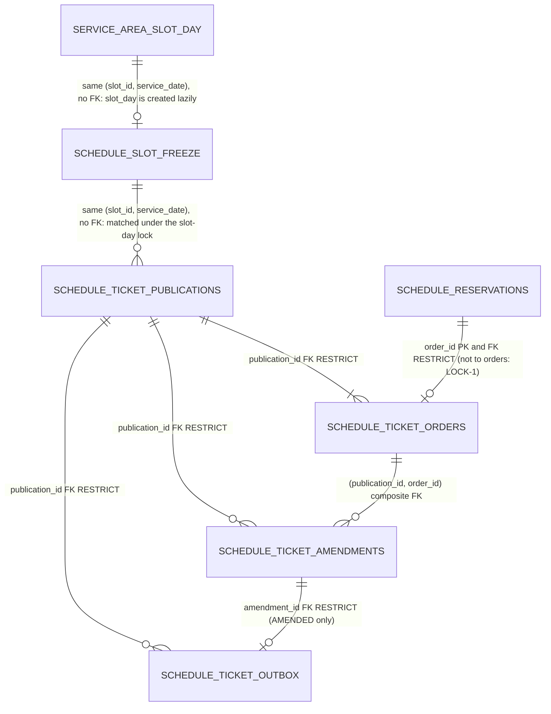
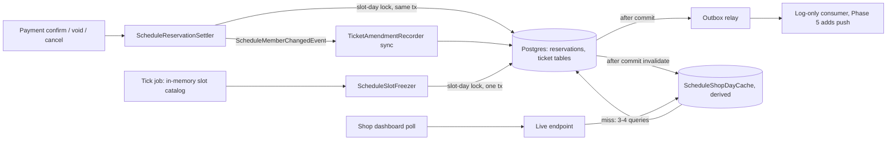

# Schedule 2d.1 + 2d.3 — prep tickets and live counts

Source tasks: [schedule-implementation-order.md](schedule-implementation-order.md) 2d.1 and 2d.3 (Phase 2d table).
Design history: [schedule-plan.md](schedule-plan.md) decisions 19, 37, 42; [schedule-design-review.md](schedule-design-review.md) P15 (late orders), P16 (live counts by polling);
tests T2d-01, T2d-02, T2d-06 in [schedule-acceptance-tests.md](schedule-acceptance-tests.md).
Status: **FINAL v1.0, 2026-11-05** (geld deep with a blind Codex pass, devil's advocate absorbed, D1-D3 decided). Next step: `/gcp`, then build; no SQL file, migration or entity is written before then.

## Goal

A restaurant sees, for each Schedule slot, what it must prepare: a **draft ticket** that grows live from the first paid order, then one **frozen publication** at the slot's last call, then **amendments** for anything that changes after. 2d.1 owns the freeze, the immutable record and the event; 2d.3 owns the fast read side. They share one read model.

## Already built (verified in code, 2026-11-05)

- Reservations: `schedule_reservations` (PK `order_id`, state HELD/CONFIRMED/VOIDED, `confirmed_at`), `schedule_reservation_lines`, `service_area_slot_day` (`reserved_groups`), `schedule_stock_ledger`. All counter changes happen in `ScheduleReservationSettler` (`confirm` :19, `voidGroup` :68, `voidMember` :100) under the **slot-day row lock** taken by `ScheduleLockSequence.lock` (`service/impl/ScheduleLockSequence.java:21`, lock order: group row, orders, slot-day, ledgers). `locked.nowMs()` is the DB clock read after the lock. The settler publishes **no** event.
- Last call: `ServiceDateResolver.lastCallAt` (`service/schedule/ServiceDateResolver.java:37`) = slot start minus `service_area.last_call_minutes`, in the area zone; `isSlotOpen` is strictly before it (:57). Payment stores `orders.release_at = lastCallAt` per order at that moment (`GroupPaymentSettlement.finishPaid`).
- **No job moves anything at last call.** 2b.11 (release job) is PARKED; same-day orders go SCHEDULED to ACCEPTED by the shop (`ScheduleMemberTransitions`). Existing `@Scheduled` jobs are hourly or daily, no ShedLock, no job table (`ItemStockResetJob`, `PaymentReconciliationJob`, `GroupPaymentSweepJob`, `GuestSessionCleanupScheduler`).
- Shop alarms for Schedule members are **already suppressed** for new orders and customer cancels (`OrderNotificationListener.java:59, :94`, `ScheduleMember.is` = `group_id != null`). Customer status pushes are **not** suppressed per order (`:138-152`): that is 2d.2's scope (handoff H1).
- Shop Schedule tab already reads members via `ScheduleShopOrderRepository` and gates with `permissions.requirePermission(shopId, userId, ONLINE_ORDERS_MANAGE)` (`ScheduleShopOrderService.java:72`). That check runs two queries (`PermissionServiceImpl.java:11-12`), and `JwtAuthFilter.java:67` loads the user on every request.
- Cache pattern to copy: `cache/ScheduleHoldConfigCache.java` (Caffeine, `evictAfterCommit()`).
- Migrations are hand-run SQL in `db_manual/`, verified at boot by `ScheduleSchemaGuard` (`REQUIRED` list). Hibernate `ddl-auto=update` is on (`application.properties:32`).
- Nothing for tickets exists yet (no entity, SQL, job, event).

## Scope (build)

1. **Slot freeze** (`service/schedule/ticket/`): `ScheduleSlotFreezer.freezeSlot(slotId, date)` and a tick job that finds due slot-days from the in-memory slot catalog (no Postgres query outside last-call moments) plus a boot catch-up. Idempotent: the freeze row is the marker.
2. **Prep-ticket records**: `schedule_slot_freeze`, `schedule_ticket_publications`, `schedule_ticket_orders`, `schedule_ticket_amendments`, `schedule_ticket_outbox` (one SQL file, guard entries, immutability triggers).
3. **Amendment recorder**: a synchronous listener of `ScheduleMemberChangedEvent` (new, published by the settler and by 2d.6's approvals) that, only when the slot-day is already frozen, appends membership, amendment and outbox rows in the same transaction.
4. **Outbox relay**: after-commit send plus a boot sweep and an in-memory retry; consumer in 2d is a log-only listener (alarm and push consumers are Phase 5).
5. **Shop-day read model + cache** (`ScheduleShopDayCache`): one loader per `(shopId, serviceDate)`, invalidated after commit; serves the live-counts endpoint now and the ticket document (draft or published) to 2d.6/Phase 5.
6. **Live-counts endpoint** `GET /api/shops/{shopId}/schedule/live?date=` (shop audience, `ONLINE_ORDERS_MANAGE`): per slot, dish totals, order count, ticket state, `nextPollSeconds`.
7. **Frozen slot-days reject new holds** (one check in `ScheduleHoldChecker`, TIME-2).

## Data model review

### Summary (read this first)

**Verdict:** The design in the roadmap is right in intent but cannot be built as written: nothing triggers the freeze, nothing decides which paid orders are in "v1" when a payment and the freeze race, and the event can be lost on a crash. With the changes below the design is sound; release stays blocked on the deferred environment items ENV-1 to ENV-3 (same as 2b.4), as already accepted by Samivan.

**What changes** (before to after):
- "A job freezes the ticket" becomes a **freeze marker row per slot-day**, written under the existing slot-day lock, so a payment and the freeze can never both miss the same order.
- "payload_json with order codes" becomes **typed membership rows plus a payload with no personal data**, because the payload is immutable and cannot be erased.
- "`version` on publications" is dropped: one publication per shop/slot/day; later changes are amendments (ticket version shown to clients = 1 + number of amendments).
- "One event" becomes a **row in an outbox written with the publication**, so a crash between commit and send cannot lose the restaurant's alarm.
- "In-process cache, refresh at most every 30 s, polls never hit the DB" becomes **invalidate-on-commit with a 10 minute drift guard**, and the test is reworded: the counts query never runs per poll, but each poll still costs three small lookups for login and permission (not changed by this phase).
- Admin changing `last_call_minutes` after the freeze can no longer reopen the slot: **a frozen slot-day rejects new holds**.

**Decisions you need to make** (owner decisions only):
| # | decision | options | recommended, and why | if you pick the other option |
|---|---|---|---|---|
| D1 | A customer whose hold started before last call pays after the freeze | (a) order joins the ticket as an amendment, restaurant can decline via "can't make" (b) auto-void and refund | (a): follows plan decision 42 and P15; the customer acted in time and paid; restaurant keeps the choice | (b): fewer surprises for the kitchen, but refunds customers who did nothing wrong and needs a new refund reason |
| D2 | What the kitchen sees per order line in the frozen ticket | (a) dish name, quantity and chosen option labels, no customer name or notes (b) also customer cooking notes | (a): option labels are needed to cook; free-text notes can hold personal data and can never be erased from an immutable row | (b): add a notes column and an erasure rule first |
| D3 | Who consumes the release event in 2d | (a) log-only listener now; alarm and push in Phase 5, and Schedule checkout stays OFF for real restaurants until that consumer exists (b) build the alarm push in 2d | (a): keeps 2d small; the checkout-off gate is already how Schedule ships | (b): pulls Phase 5 notification work (FCM, ringing) into 2d |

**What geld decided for you:** no `version` column; typed membership table; soft references to shop and slot (project convention, shops are soft-deleted); tickets created for a shop only when it has an order, and a first order that pays after the freeze creates that shop's ticket on the spot; recorder runs in the payment transaction but only after the freeze (fail closed, small blast radius); ticket document HTTP endpoint is left to 2d.6 (contract freeze).

**What must happen before deploy:** (1) review and run `db_manual/schedule-ticket-migration.sql` on Neon (Samivan runs SQL; DO NOT RUN until the build is approved); (2) the schema guard entries ship with the code; (3) ENV-1 to ENV-3 stay deferred to pre-launch; (4) device test is not needed (backend only); (5) the log-only consumer is on, no push consumer yet.

**Unknowns that could change this:** Neon major version and restore retention (ENV-4/5, same open item as 2b.13); whether a second backend instance is planned (the cache and the relay assume one).

**Status:** FINAL v1.0 (D1-D3 decided 2026-11-05, see Approval record) · **Verdict:** APPROVED WITH CHANGES; release blocked on deferred ENV-1 to ENV-3 · geld deep, 2026-11-05 · previous: none
**Target:** PostgreSQL on Neon (version not stated in repo, OI-1) · hand-run SQL from `db_manual/`, no migration tool, Hibernate `ddl-auto=update` also on · pooled connection (`-pooler`, `prepareThreshold=0`) · one EC2 backend instance (stated in design review P16; not in `01-Architecture`, see EVOL-2)
**Lenses run:** 0, 1, 2, 3, 4, 6, 7, 8 · **skipped:** 5 money (tickets carry dish quantities only, no amounts; refund amounts stay in refund rows) · **reference designs:** skipped (not a core money or identity table; no two of the gate conditions hold)
**Codex second opinion:** blind read-only run: agreed 7, Codex-only verified 2 (customer-push suppression gap H1, late-job cutoff question), disagreements 2 (see trace)
**Open inputs:** OI-1 Neon major version; OI-2 orders per ticket (assumed 14, from T2d-01) and shop count (assumed 20) for sizing; OI-3 hold length stays 180 s (admin setting) so late-paid orders are at most one hold plus gateway delay behind the freeze.

### Design changes

One line: the freeze, the record and the event become database facts instead of a cache-and-job sketch.
| # | before | after | problem it solves | why it is better | what it costs | alternative considered, why it lost |
|---|---|---|---|---|---|---|
| 1 | "A job freezes at last call" (no job exists) | `schedule_slot_freeze` marker written under the slot-day lock by an idempotent tick + boot catch-up | TRACE-1, STATE-1: no trigger; payment and freeze race so an order can be in neither v1 nor an amendment | exactly-once by primary key; same lock the payment already takes | one table, one lock call from a new class | freeze from cache: loses orders on restart, not durable |
| 2 | `payload_json` holds order codes and group codes | typed `schedule_ticket_orders` (PK `order_id`) plus payload without personal data | MODEL-1, PII-1: "which ticket is this order on" needs a join; immutable payload cannot be erased | typed join, erasure-safe | one more insert per order | order codes only in JSON: no join, parse JSON on every cancel |
| 3 | `version` column on publications | none; amendments carry `seq` | MODEL-2: only v1 is ever written; a column nothing writes | grain is one row per ticket, the unique key is the whole identity | a future republish adds the column (small table) | ticket identity row plus versions (Codex): two tables for one version |
| 4 | one `ScheduleTicketReleased` event | outbox rows for RELEASED and AMENDED, written with the cause | ISO-1: crash after commit loses the restaurant alarm | at-least-once, consumer dedupes by `event_key`; no polling | one table | after-commit Spring event only: loses the event on a crash |
| 5 | cache "refresh at most every 30 s, updated on reserve/void" | `(shop, date)` read model, Caffeine loader, invalidate after commit, 10 min drift guard | PLACE-1, PERF-1: incremental counters drift; 30 s refresh makes polls reach the DB | fresh on next poll after any change, queries scale with writes | loader query on first poll after a change | per-event counter increments: drift on missed events |
| 6 | admin can lower last call after the freeze and reopen the slot | frozen slot-day rejects new holds | TIME-1, TIME-2 | one rule, ordering stays closed | one check in the hold checker | forbid admin edits: blocks legitimate edits for other slots |
| 7 | membership FK to `orders` (natural first choice) | membership FK to `schedule_reservations` | LOCK-1: deadlock between the freeze and `voidMember` | the settler already treats the reservation as the Schedule unit; no lock conflict | none | FK to orders with a lock-order change in the settler: touches payment code for no gain |
| 8 | membership table read directly for "who is on the ticket" | view `schedule_ticket_current_orders` is the only reader | TRAP-1: removed orders still sit in the append-only table | one definition, no filter to remember | one view | `removed_at` column: makes the table mutable |

### Tables

| table | grain (one row = one ...) | purpose | class | owner | phase | state |
|---|---|---|---|---|---|---|
| `schedule_slot_freeze` | slot on one service date | marks the slot-day frozen; holds the cutoff, slot start and ready-by snapshots | append-only | schedule/ticket | 2d.1 | planned |
| `schedule_ticket_publications` | shop, slot and service date | the frozen prep ticket (dish totals, per-order lines) | append-only | schedule/ticket | 2d.1 | planned |
| `schedule_ticket_orders` | order on a ticket | which ticket an order belongs to and how it joined (FREEZE or AMENDMENT) | append-only | schedule/ticket | 2d.1 | planned |
| `schedule_ticket_amendments` | change to a published ticket | late order, removal, quantity reduction | append-only | schedule/ticket | 2d.1 | planned |
| `schedule_ticket_outbox` | event to deliver | RELEASED / AMENDED delivery with retry state | hot (few updates) | schedule/ticket | 2d.1 | planned |

### Names

| name | holds | project word (grep evidence) | clashes with | verdict |
|---|---|---|---|---|
| `schedule_ticket_*` | prep ticket records | vault glossary "Prep ticket" (`schedule-plan.md:54`); no entity or `@Table` named `*ticket*`, `*outbox*`, `*freeze*` under `entity/` | KOT in dine-in (`Order`, `TableCheck`, `AuditEvent`) is a different thing; prefix `schedule_` and class prefix `SchedulePrepTicket` keep them apart | keep |
| `ready_by_at` | the time the restaurant must have food ready | `pickup_lead_minutes` (`ServiceArea.java:67`); roadmap says "pickup-by" and "ready by"; no `ready_by`/`pickup_by` column exists | none | keep `ready_by_at` (instant), derived from slot start minus `pickup_lead_minutes` |
| `published_at` | instant the publication was written | roadmap name | none | keep |
| `frozen_at` | instant the slot-day was frozen | no existing word | none | keep |
| `event_key` | stable id a consumer dedupes by (`RELEASED:<publicationId>`, `AMENDED:<amendmentId>`) | no existing word | none | keep |

### Built vs plan

| element | plan says | in code at | deployed | migration applied | depended on by | drift | source |
|---|---|---|---|---|---|---|---|
| ticket tables, freeze, outbox | 2d.1 | not present | n/a | n/a | n/a | none | grep of `entity/`, `db_manual/` (2026-11-05) |
| release job | 2b.11 | not present, parked | n/a | n/a | n/a | the roadmap's 2d.1 still says "frozen at the slot's last call" with no trigger | `schedule-implementation-order.md:132` |
| shop alarm suppression for members | 2d.1 "suppressed" | `OrderNotificationListener.java:59,:94` | unknown | n/a | shop alarms | partly: customer pushes not suppressed (H1) | code read |

Cost to change now for every finding below: **free** (nothing built, nothing applied).

### Entity relationships

All five tables are NEW. `shop_id` and `slot_id` are deliberate soft references (no FK): shops are soft-deleted and cross-domain references are FK-free by project rule; slots are deactivated, never deleted; both are indexed through the unique keys below.

### Column mapping

**Instant columns are BIGINT epoch milliseconds (L13, decided 2026-11-05 at build start):** every `timestamptz` below reads as `bigint` (`Long`), the existing Schedule convention (`order_groups.cancel_until_at`, `schedule_reservations.confirmed_at`, `orders.release_at`); the `locked.nowMs()` DB clock and `ServiceDateResolver` instants (`toEpochMilli()`) compare directly. CHECKs apply to the numbers unchanged.

**schedule_slot_freeze** (append-only; PK `(slot_id, service_date)`)
| column | type | null | default | key | constraint | note |
|---|---|---|---|---|---|---|
| slot_id | uuid | no | | PK part | | soft ref to `service_area_slot` |
| service_date | date | no | | PK part | | area-zone calendar date |
| frozen_at | timestamptz | no | | | | DB clock after the lock |
| last_call_at | timestamptz | no | | | `frozen_at >= last_call_at` | cutoff used, snapshot of the promise |
| slot_starts_at | timestamptz | no | | | `slot_starts_at > last_call_at` | snapshot, slot can be edited later |
| ready_by_at | timestamptz | no | | | `ready_by_at <= slot_starts_at` | slot start minus `pickup_lead_minutes` |
| frozen_by | text | no | | | CHECK `JOB`, `CATCHUP` | how the row came to exist |

**schedule_ticket_publications** (append-only; PK `id`)
| column | type | null | default | key | constraint | note |
|---|---|---|---|---|---|---|
| id | uuid | no | app | PK | | |
| shop_id | uuid | no | | | | soft ref |
| slot_id | uuid | no | | | | soft ref |
| service_date | date | no | | | | |
| published_at | timestamptz | no | | | | |
| order_count | integer | no | | | `> 0` | typed for lists |
| payload_schema | smallint | no | | | `>= 1` | payload shape version |
| payload | jsonb | no | | | | dish totals plus per-order lines; no personal data (PII-1) |
| | | | | UNIQUE `uq_ticket_pub_shop_slot_day (shop_id, service_date, slot_id)` | | serves "shop's tickets for a date" |
Lifecycle: insert only; trigger blocks UPDATE and DELETE.

**schedule_ticket_orders** (append-only; PK `order_id`)
| column | type | null | key | constraint | note |
|---|---|---|---|---|---|
| order_id | uuid | no | PK, FK `schedule_reservations(order_id)` RESTRICT | | an order is on at most one ticket; the FK targets the reservation, never `orders` (LOCK-1) |
| publication_id | uuid | no | FK RESTRICT | UNIQUE `(publication_id, order_id)` for the composite FK | index `idx_ticket_orders_pub (publication_id)` serves ticket member lists |
| joined_by | text | no | | CHECK `FREEZE`, `AMENDMENT` | |
| joined_at | timestamptz | no | | | |

**schedule_ticket_amendments** (append-only; PK `id`)
| column | type | null | key | constraint | note |
|---|---|---|---|---|---|
| id | uuid | no | PK | | |
| publication_id | uuid | no | FK RESTRICT | UNIQUE `(publication_id, seq)` | |
| seq | integer | no | | `>= 1` | gapless, assigned under the slot-day lock |
| kind | text | no | | CHECK `ORDER_ADDED`, `ORDER_REMOVED`, `LINES_REDUCED` | |
| order_id | uuid | no | composite FK `(publication_id, order_id)` to `schedule_ticket_orders` | | the order must be on that ticket |
| cause | text | no | | CHECK `PAID_AFTER_FREEZE`, `CUSTOMER_CANCELLED`, `RESTAURANT_DECLINED`, `OPS_CANCELLED`, `CANT_MAKE_APPROVED` | actor lives in the existing audit tables |
| source_key | text | no | | UNIQUE `(publication_id, source_key)` | idempotency: `CONFIRM:<orderId>`, `VOID:<orderId>`, `REDUCE:<ticketIssueId>:<itemId>` |
| detail | jsonb | no | | | lines affected |
| created_at | timestamptz | no | | | |

**schedule_ticket_outbox** (mutable only in delivery fields; PK `id`)
| column | type | null | key | constraint | note |
|---|---|---|---|---|---|
| id | uuid | no | PK | | |
| event_key | text | no | UNIQUE | | consumers dedupe on it |
| event_type | text | no | | CHECK `RELEASED`, `AMENDED` | |
| publication_id | uuid | no | FK RESTRICT | | |
| amendment_id | uuid | yes | FK RESTRICT | CHECK AMENDED iff not null | |
| created_at | timestamptz | no | | | |
| delivered_at | timestamptz | yes | | | null = pending |
| attempts | integer | no | | `>= 0` | |
| last_error | text | yes | | | |
Index `idx_ticket_outbox_pending (created_at) WHERE delivered_at IS NULL` (boot sweep). Retention: delivered rows older than 90 days are deleted by the boot sweep.

### Invariants

| # | invariant | enforced by | evidence |
|---|---|---|---|
| I1 | a slot-day is frozen once | PK on `schedule_slot_freeze` | planned |
| I2 | one publication per shop, slot, date | UNIQUE `uq_ticket_pub_shop_slot_day` | planned |
| I3 | an order is on at most one ticket | PK `schedule_ticket_orders.order_id` | planned |
| I4 | publications, membership and amendments never change | UPDATE/DELETE triggers + guard check | planned (pattern exists on audit and rate-card tables) |
| I5 | an amendment names an order that is on that ticket | composite FK | planned |
| I6 | an event is recorded once | UNIQUE `event_key` | planned |
| I7 | membership and freeze are decided under the slot-day lock, so a payment or void either lands before the freeze (in v1) or after it (amendment) | service: freeze, `confirm`, `voidGroup`, `voidMember` all take the slot-day row lock; freeze takes only that lock so lock order is unchanged | `ScheduleLockSequence.java:21`, settler :19/:68/:100 |
| I8 | only CONFIRMED reservations count | v1 query selects `schedule_reservations.state = 'CONFIRMED'` | settler :49-55 |
| I9 | a frozen slot-day takes no new holds | `ScheduleHoldChecker` check under the lock | planned |
| I10 | the freeze can never deadlock with a member void | no FK from any ticket table to `orders` (`voidMember` holds `orders` rows `FOR UPDATE` while it waits for the slot-day lock the freeze holds; an FK insert needs `FOR KEY SHARE` on the referenced row and would wait for it); the FK targets `schedule_reservations`, which the settler changes by key-preserving updates | `ScheduleReservationSettler.java:103`, `schedule-reservation-migration.sql:112` (precedent: reservation lines reference reservations) |
| I11 | "current members of a ticket" has one definition | view `schedule_ticket_current_orders` = membership joined to `schedule_reservations` with `state = 'CONFIRMED'`; membership rows alone are history | planned |

Two interleavings checked: (a) confirm holds the lock, freeze waits, then sees the order CONFIRMED: in v1; (b) freeze commits first, confirm then sees the freeze row and appends ORDER_ADDED in its own transaction. No third state exists because both read and write under the same row lock.

### Scenarios, access patterns, sizing

Scenarios (assumptions OI-2): **S1 load** 60 open dashboards poll the live endpoint every 30 s from 11:00 to 14:00 (about 120 requests/min): p95 under 100 ms for the cache part; read-model loader queries about 20 shops times 15 changes, roughly 300 per day. **S2 correctness** 14 orders pay before last call and one after: v1 has 14, one ORDER_ADDED amendment, exactly one RELEASED outbox row even if the tick runs twice, two instances run, or the process restarts mid-freeze. **S3 failure** crash after the freeze commit: the boot sweep delivers the RELEASED event; the consumer dedupes by `event_key`. **S4 change** 2d.6's "can't make" needs no schema change (`LINES_REDUCED` exists). **S5 policy** admin lowers `last_call_minutes` after the freeze: v1 unchanged, no new holds.

| # | actor | r/w | path | filter | limit | peak/min | serving index | rows examined |
|---|---|---|---|---|---|---|---|---|
| A1 | shop dashboard | read | live endpoint | shop, date | 1 shop-day | 120 | cache hit; loader uses `uq_orders_group_shop` + `idx_order_groups_service_date` | about 50 orders |
| A2 | tick job | read | in-memory catalog only | none | slots | 2 | none (memory) | 0 |
| A3 | freeze | write | one tx per due slot-day | slot, date | members | 3/day | slot-day PK, `schedule_reservations` by group | about 50 |
| A4 | settler hook | write | per confirm/void after freeze | order | 1 | rare | PK | 1 |
| A5 | boot sweep | read | pending outbox, due slot-days today | | 100 | at boot | `idx_ticket_outbox_pending` | few |

Sizing (60 tickets/day, 14 orders each, about 3.5 KB payload): publications about 77 MB/year; membership 840 rows/day; amendments about 40/day; outbox about 100/day. 10x: 770 MB/year, 3M membership rows/year. 100x: about 7.7 GB/year of payload: archive or partition by `service_date` then (CONSIDER, measure).

### Findings

#### Must change before the next affected deploy

**TRACE-1 · risk · MUST** — nothing triggers the freeze. Evidence: `schedule-implementation-order.md:132` (2b.11 parked) and no job in code (fact). Failure: v1 never publishes, restaurant sees only a draft. Change: tick job from the in-memory catalog plus boot catch-up for today's slot-days past last call. Cost: free.

**STATE-1 / INV-1 · risk · MUST** — which paid order is in v1 is undefined when payment and freeze race. Evidence: plan "late order → amendment" (T2d-02) with no boundary rule; Codex flagged the same. Failure: an order confirmed during the freeze is in neither v1 nor an amendment, the kitchen never prepares it. Change: I1, I7, I8 above. Cost: free.

**ISO-1 · risk · MUST** — the release event can be lost. Evidence: `OrderNotificationListener.java:85-86` is `@Async` after-commit with a caught-and-logged send (fact). Failure: process restarts at last call, the restaurant is never alarmed for 14 meals. Change: outbox row in the same transaction, after-commit send, boot sweep. Cost: free. Pattern: transactional outbox; at-least-once, so consumers dedupe.

**TIME-1 / TIME-2 · risk · MUST** — last call can change after the freeze. Evidence: admin save applies area settings with no publication guard (Codex citation `ServiceAreaAdminServiceImpl.java:99,:221`, not re-read by geld: verify when building) and `release_at` is snapshotted per order. Failure: lowering `last_call_minutes` after the freeze reopens ordering; late orders pile on a frozen ticket. Change: cutoff snapshots in `schedule_slot_freeze`; `ScheduleHoldChecker` rejects new holds on a frozen slot-day (I9). Cost: free.

**PERF-1 / ACCESS-1 · risk · MUST** — T2d-06 ("polling does not query the database") cannot hold as worded. Evidence: `JwtAuthFilter.java:67` `userRepository.findById` on every request; `PermissionServiceImpl.java:11-12` two queries per check (fact). Failure: the load test fails on login and permission lookups even with a perfect cache. Change: reword to "the read-model loader does not run per poll; queries from a poll are limited to the three auth lookups"; add `nextPollSeconds` so closed windows poll rarely; auth caching is a platform-wide revisit item, not part of 2d. Cost: free (documentation and test wording).

**PLACE-1 · risk · MUST** — the cache is a derived copy and must never be the source for the freeze or amendments. Change: loader reads Postgres only; freeze reads `schedule_reservations`; invalidate after commit (Caffeine `invalidate` waits for an in-flight load of the same key, so a stale load cannot survive an invalidation: test it); 10 minute TTL as drift guard; `maximumSize` bounded; lazy per-key load, never a global warm-up, never an empty read served as zero. Cost: free.

**COST-1 · risk · MUST** — a naive 60 s scanner or relay would keep Neon awake all day. Evidence: lens 6 scale-to-zero rule; memory note `reference_neon_realtime_constraints`. Change: tick decides from the in-memory catalog; relay triggers on commit, retries from memory, and sweeps Postgres only at boot. **Found at build (2026-11-05):** `ServiceAreaCatalog` itself expires every 30 s (`TTL_SECONDS`), so a 30 s tick that calls `catalog.get()` runs two catalog queries per tick around the clock. The tick therefore keeps its own wake gate (`nextWakeMs`: earliest future last call, capped at 6 hours, reset to now by a catalog eviction listener when an admin edits areas or slots) and touches neither catalog nor database before it. Cost: free.

**PII-1 · risk · MUST** — the immutable payload must hold no personal data (cannot be erased). Change: payload has order codes, item names, quantities, option labels; customer names are joined live when a screen needs them. D2 covers notes. Cost: free.

**MODEL-1 / MODEL-2 / INV-2 · risk · MUST** — typed membership table instead of codes in JSON; no `version` column; immutability by triggers (plus guard `TRIGGER` and `TABLE` entries in `ScheduleSchemaGuard.REQUIRED`). Cost: free.

**LOCK-1 (INV) · risk · MUST** — a foreign key from `schedule_ticket_orders` to `orders` can deadlock the freeze against a restaurant decline. Evidence: `voidMember` locks the group row, then every `orders` row of the group `FOR UPDATE` (`ScheduleReservationSettler.java:102-103`), then waits for the slot-day lock; the freeze holds the slot-day lock and its membership insert needs `FOR KEY SHARE` on the same `orders` row (fact: row-lock conflict matrix; verify with a two-session test). Failure: a decline at last call aborts either the freeze (no ticket until the next tick) or the decline. Change: FK to `schedule_reservations(order_id)`; no ticket table references `orders`; add a concurrency test (decline during freeze). Cost: free.

**TRAP-1 (MODEL) · risk · MUST** — the membership table keeps removed orders. Failure: a screen selects `schedule_ticket_orders` and shows a cancelled order as part of the ticket. Change: view `schedule_ticket_current_orders` (I11), comment on the table in the SQL file naming the view as the only reader. Cost: free.

**REC-1 (STATE) · risk · MUST** — rules for the recorder that runs inside the payment transaction: (1) it reads reservation lines and `order_groups`, never `orders.status` (the settler confirms at `GroupPaymentSettlement.java:67`, status becomes SCHEDULED only at :144, later in the same transaction); (2) it ignores HELD and voided-before-confirm rows (`CAPTURE_MISMATCH`, `PAYMENT_TIMEOUT`, `GATEWAY_FAILED` voids at :56/:118 and `ScheduleCheckoutServiceImpl.java:58` are not ticket events); (3) it acts only when a `schedule_slot_freeze` row exists, so the normal pre-last-call path is untouched; (4) every insert is `ON CONFLICT DO NOTHING` on its idempotency key and any other exception rolls the payment back (the hourly `GroupPaymentSweepJob` retries); (5) the payment test matrix (webhook-first, verify-first, duplicate, failure) runs once with the slot already frozen. Cost: free.

**MIG-1 (ENV) · risk · MUST** — Hibernate `ddl-auto=update` may create bare tables from the new entities before the SQL runs, and a plain `CREATE TABLE IF NOT EXISTS` would then skip all constraints. Change: `db_manual/schedule-ticket-migration.sql` follows the reservation file's pattern (`CREATE TABLE IF NOT EXISTS` plus a `pg_constraint`/`pg_trigger` existence check per constraint, trigger and index, `schedule-reservation-migration.sql:87-96`) and the guard lists every constraint, trigger and index by name. Preconditions: `db_manual/schedule-shop-tab-indexes.sql` has run (the freeze reads `order_groups` by `(service_date, slot_id)`). Cost: free.

**TIME-3 · risk · MUST** — the new hold-checker rule meets a refund path for a hold that lapsed and then finds a frozen slot-day (settler :30-34 re-validates expired holds). **Revised at build (2026-11-05):** the planned new `RefundReason` is NOT added. The check the plan asked for found that the reason is mirrored in `RefundTechnicalCause` and in CHECK constraints of `db_manual/payment-refunds-migration.sql` and `payment-refunds-lines-migration.sql`, so a new value would change money-table constraints for a rare edge case. A frozen-slot rejection (`SLOT_CLOSED`, no item) therefore maps to the existing `HOLD_LAPSED_SLOT_FULL`. Distinct customer wording is 2d.2's job and then needs the enum, the cause mapping and a CHECK-widening migration together. Unexpired holds that confirm after the freeze become amendments (D1 a). Cost: free now, migration later.

**ENV-1 to ENV-3 · inherited** — two schema writers (Hibernate `ddl-auto=update` plus hand-run SQL), default datasource is production, owner role. Deferred to pre-launch by Samivan (2026-10-21, see `commission-rate-cards-plan.md` Approval record). Hibernate will create bare versions of the new tables at first boot unless the SQL ran first: run the SQL before the first deploy.

#### Fine now, revisit at <trigger>

- **EVOL-2 · second backend instance:** cache invalidation reaches one instance only, and the tick job runs on every instance. Freeze and outbox stay correct (primary key and unique keys), the cache goes stale up to 10 minutes. Trigger: a second instance. Then shorten the TTL or add shared invalidation. Record "one EC2 instance" in `01-Architecture` as an assumption.
- **ACCESS-2 · ops board by slot:** add `(slot_id, service_date)` index on publications when Phase 3 lists tickets for an area. Trigger: Phase 3.
- **SIZE-1 · 100x payload growth:** archive or partition. Trigger: measured table size.
- **API-1 · payload hash:** add a `payload_sha256` if payloads leave the system (rider or ops export). Trigger: first external consumer.
- **EVOL-3 · republish v2:** if a consolidated republish is ever wanted, add `version` and move the unique key. Trigger: a requirement.

#### Keep (good decisions)

- Ticket status derived from member orders, never stored (plan 19).
- The draft ticket is a derivation of existing rows, not a table.
- Append-only amendments with a source key.
- Soft shop references (project convention).
- Reusing the slot-day lock instead of a new lock.
- Copying the `ScheduleHoldConfigCache` Caffeine pattern.

### Devil's advocate trace

Run 2026-11-05 on v0.1 by the devil's-advocate skill checks (derived vs stored, implicit filter, two places, shared state, scale, goal vs delta, absence claims).

| DA point | outcome |
|---|---|
| DA-1 a recorder bug or a duplicate insert blocks late payment confirms | absorbed → REC-1 (idempotent inserts, post-freeze only, matrix test); verdict proceed with conditions |
| DA-2 lock order / deadlock between freeze and settler | absorbed → LOCK-1, I10 (a real deadlock through the `orders` FK, found by reading `ScheduleReservationSettler.java:102-103`); freeze takes only the slot-day lock, no group or order locks |
| DA-3 the freeze query needs `order_groups(service_date, slot_id)` | absorbed → MIG-1 precondition (`schedule-shop-tab-indexes.sql`) |
| DA-4 all dashboards miss the cache at the freeze moment | already handled (Caffeine loading cache is single-flight per key; one loader per shop) |
| DA-5 time-dependent fields inside a cached value | already handled: `nextPollSeconds` and any "closing soon" text are computed per response, never cached |
| DA-6 the in-memory slot catalog is stale (admin adds or edits a slot) | absorbed → build condition: the tick may lag by the catalog's `TTL_SECONDS` (`ServiceAreaCatalog.java:44`), read the value when building; the freeze re-reads config from the database under the lock |
| DA-7 membership table read without the removed-order filter (check 8) | absorbed → TRAP-1, I11 |
| DA-8 "is the slot frozen" decided in three places (check 3) | rejected as a risk: the single source is the `schedule_slot_freeze` row; build condition: the freezer and the tick use `ServiceDateResolver.lastCallAt` and never recompute it |
| DA-9 nullable columns without meaning (check 4) | already handled: `delivered_at` null = pending, `amendment_id` null = RELEASED (CHECK), `last_error` null = none; documented in Column mapping |
| DA-10 hold lapsed then confirmed on a frozen slot-day | absorbed → TIME-3 (new refund reason; customer copy in 2d.2) |
| DA-11 bare Hibernate-created tables skip constraints (migration pain) | absorbed → MIG-1 |
| DA-12 freeze fails repeatedly and nobody notices | absorbed as build condition: ERROR log with slot id and retry each tick; a "freeze overdue" row on the Phase 3 ops board is the visible symptom (revisit item ACCESS-2) |
| DA-13 recorder reads `orders.status` while it is still PENDING_PAYMENT | absorbed → REC-1 (1) |
| DA-14 "the alarm suppression for Schedule is done" (check 9, goal vs delta) | partly wrong → handoff H1: new-order alerts and customer-cancel pushes are suppressed, per-order customer status pushes are not |
| DA-15 "no release job exists" and "confirm runs in the payment transaction" (check 10, absence claims) | verified by mechanism: `@Scheduled` inventory by the code-state agent; `confirm` at `GroupPaymentSettlement.java:67` inside the `@Transactional` method at :38; `markConfirmed`/`markVoided` are called only from the settler and the repository (grep of `src/main/java`) |
| DA-16 scale at 10x | no finding: sizing in the table section; 100x payload growth is the SIZE-1 revisit item |
Overall verdict: **proceed with conditions** (LOCK-1, TRAP-1, REC-1, MIG-1, TIME-3 absorbed above).

### Codex second opinion trace

| Codex point | outcome |
|---|---|
| Ticket identity row plus versioned publications | **disagree**, MODEL-2: only v1 is ever written; one row per ticket is the identity |
| FK to shop and slot | **disagree**: project convention is FK-free soft references for shops; slots are never deleted; unique key and indexes stand in |
| Membership rows, not only payload | agreed → MODEL-1 |
| Amendments need seq, type, payload, order ids, unique source operation id | agreed → `schedule_ticket_amendments` columns |
| Immutability by triggers and privileges | triggers agreed → INV-2; privileges deferred with ENV-3 (single owner role today) |
| Freeze from DB in one transaction under the slot-day lock, same lock order | agreed → I7 (verified in settler and `ScheduleLockSequence`) |
| Durable due-work scan with unique keys, catch-up after restart | agreed → TRACE-1 |
| Late job cannot rebuild state at the cutoff instant | verified and answered: v1 is defined as the state at `frozen_at` under the lock, not at `last_call_at`; customer cancel is frozen before last call (`cancel_until_at`), so only shop decline and ops cancel can fall between, and they should not appear on the ticket |
| Outbox, consumer dedupe, not exactly-once | agreed → ISO-1 |
| Update cache on confirm, not only reserve/void; warm asynchronously; version updates | adapted → PLACE-1 (lazy per-key load; Caffeine invalidate semantics instead of version stamps) |
| Authorize every read by shop | agreed → endpoint uses `ONLINE_ORDERS_MANAGE`; cache key includes shop |
| Persist one slot-day cutoff, zone and ready-by snapshot; admin retroactive changes | agreed → `schedule_slot_freeze` + TIME-2 |
| Customer pushes may not be suppressed | **Codex-only, verified** → `OrderNotificationListener.java:138-152` sends per-order customer pushes: handoff H1 to 2d.2 |
| Biggest flaw: no durable shared cutoff protocol | agreed → TRACE-1, STATE-1 |

### Future phases

| phase | new tables it adds | change forced on this design |
|---|---|---|
| 2d.2 customer notifications per group | none | fix per-order customer pushes (H1); may read the outbox events |
| 2d.6 contract freeze, "can't make" | `ticket_issue` | none: `LINES_REDUCED` and `source_key` already fit |
| 3 ops board | board tables | index on publications by slot (ACCESS-2) |
| 5 restaurant web | none | consumer of RELEASED/AMENDED; alarm; long-poll cadence |
| 2b.11 if un-parked | none | the release job moves SCHEDULED to PLACED; the freeze stays independent of order status |

### Rollout

| change | phase | slot | lock and rewrite | works with app N-1 | rollback | precondition |
|---|---|---|---|---|---|---|
| 5 new tables, triggers, indexes (`db_manual/schedule-ticket-migration.sql`) | expand | before the backend deploy | none (new tables) | yes, N-1 ignores them | roll forward; tables are empty until the freeze runs | DO NOT RUN until the plan is FINAL; confirm the target host; Samivan runs it |
| settler publishes `ScheduleMemberChangedEvent` | expand | backend deploy | none | yes | revert the commit | tables exist |
| `ScheduleHoldChecker` frozen check | expand | backend deploy | none | yes | revert | tables exist |
| guard entries (tables, constraints, triggers, indexes, view) | expand | with the code | none | boot fails loudly if SQL not run | | SQL run first |
| `RefundReason` value, hold-checker frozen check | expand | backend deploy | none | yes | revert | no database CHECK lists refund reasons (verify), `schedule-shop-tab-indexes.sql` has run |
Lens 0: ENV-1 fail, ENV-2 fail, ENV-3 fail (deferred pre-launch by Samivan), ENV-4 unknown (restore retention), rehearsal on a Neon branch planned, order of rollout stated.

### Design versions

| version | phase | date | what changed | why |
|---|---|---|---|---|
| v0.1 | 2d.1/2d.3 | 2026-11-05 | first geld pass on the roadmap rows | roadmap rows had no freeze trigger, cutoff rule or durable event |
| v1.0 | 2d.1/2d.3 | 2026-11-05 | devil's advocate absorbed (LOCK-1 FK moved to reservations, TRAP-1 view, REC-1, MIG-1, TIME-3); D1-D3 decided | deadlock found in `voidMember` lock order; owner decisions closed |

### Locked decisions

| id | decision | enforced where | code paths and values that must honour it |
|---|---|---|---|
| L1 | A slot-day is frozen once; the freeze row is the only "frozen" signal | PK on `schedule_slot_freeze` + service | freezer, tick, boot catch-up, recorder, `ScheduleHoldChecker`; all use `ServiceDateResolver.lastCallAt`, none recompute it |
| L2 | v1 = CONFIRMED reservations of the slot-day read under the slot-day lock at freeze; later changes are amendments | service + I7/I8 | freeze takes only the slot-day lock (no group or order locks) |
| L3 | One publication per shop, slot and date; no `version` column; client ticket version = 1 + amendments | UNIQUE `uq_ticket_pub_shop_slot_day` | API mappers |
| L4 | No ticket table references `orders`; membership references `schedule_reservations` | FK + guard | LOCK-1 test: decline during freeze |
| L5 | Publications, membership and amendments are immutable | triggers + guard | no repository exposes update or delete |
| L6 | "Current members" is read only through `schedule_ticket_current_orders` | view | read model loader |
| L7 | Recorder runs in the payment transaction, only when a freeze row exists, idempotent, reads no `orders.status` | service + `source_key` unique | `ScheduleMemberChangedEvent` listeners; REC-1 rules |
| L8 | D1 (a): an order confirmed after the freeze joins as `ORDER_ADDED` (shop with no ticket gets a new one); a hold that has lapsed meets the frozen-slot rejection and is refunded with a new reason | service | settler, `RefundReason`, `ScheduleHoldChecker` |
| L9 | D2 (a): payload carries item name, quantity, option labels, order code; no customer name, no notes, no amounts | payload schema 1 + test | freezer and recorder payload builders |
| L10 | D3 (a): the RELEASED/AMENDED outbox is delivered at least once to a log-only consumer in 2d; no alarm push before Phase 5; Schedule checkout stays OFF for real restaurants until that consumer exists | outbox + `schedule_enabled` | relay, Phase 5 |
| L11 | The read model is cached per `(shop, date)`, invalidated after commit, 10 minute TTL; never used to freeze or amend; one backend instance assumed | service | `ScheduleShopDayCache`, `01-Architecture` note |
| L13 | Instants are BIGINT epoch ms, like the other Schedule tables (Samivan, 2026-11-05) | column type | all five tables, entities use `Long`, no `timestamptz` |
| L12 | The live endpoint is shop-audience (`ONLINE_ORDERS_MANAGE`), returns `nextPollSeconds`; T2d-06 is reworded to "the loader does not run per poll" | service + test | controller, acceptance tests |

### Approval record

| finding or decision | option chosen | by | date |
|---|---|---|---|
| D1 late payment after the freeze | (a) join as amendment | Samivan | 2026-11-05 |
| D2 kitchen line content | (a) dish, quantity, option labels; no customer name or notes | Samivan | 2026-11-05 |
| D3 event consumer in 2d | (a) log-only; alarm in Phase 5; Schedule checkout stays off for real restaurants until then | Samivan | 2026-11-05 |
| ENV-1 to ENV-3 | deferred to pre-launch (inherited from the 2026-10-21 decision) | Samivan | 2026-10-21 |
| Remaining findings (TRACE-1, STATE-1, ISO-1, TIME-1/2/3, PERF-1, PLACE-1, COST-1, PII-1, MODEL-1/2, INV-2, LOCK-1, TRAP-1, REC-1, MIG-1) | geld recommendation, no owner decision needed | geld | 2026-11-05 |

## System design

### Components

Postgres is the system of record for everything; the cache is a rebuildable copy; nothing reads the cache to decide a freeze or an amendment.

### Main flows

**Freeze (tick or catch-up):** due slot-day found in memory → open tx → `ensureRow` + lock the slot-day row → if `schedule_slot_freeze` exists, stop → read CONFIRMED reservations for the slot and date grouped by shop → per shop insert publication, membership rows, `RELEASED` outbox row → insert freeze row → commit → invalidate the cache keys of those shops → relay sends.
**Payment confirm after the freeze:** settler takes the lock as today → sets CONFIRMED → publishes the event → recorder (same tx) sees the freeze row → if the shop has a publication, appends membership and `ORDER_ADDED` and an `AMENDED` outbox row; if not (a shop with no order at the freeze), creates that shop's publication with this order as its only member (`joined_by FREEZE`, `published_at` after the slot's `frozen_at`) and a `RELEASED` outbox row → commit → invalidate, relay. If the freeze row does not exist yet (the tick has not run), the order simply waits for the freeze and is in v1.
**Void or decline after the freeze:** same path with `ORDER_REMOVED`; before the freeze the recorder does nothing.
**Poll:** auth lookups → cache get → on miss the loader runs one query for orders and groups, one for lines, one for freeze, publications and amendments → response with `nextPollSeconds`.

### Decisions

| decision | options | chosen | negative consequence | revisit when |
|---|---|---|---|---|
| Where freeze state lives | cache, new column on slot_day, new marker table | marker table | one more table | never needed to change |
| Freeze trigger | per-minute DB scan, in-memory catalog tick, lazy on read | in-memory tick + boot catch-up | up to one tick (30 s) of lag | a second instance (still safe, unique keys) |
| Recorder transaction | same tx fail-closed, after-commit best effort | same tx, only after the freeze | a recorder bug blocks late confirms (sweep retries) | recorder failures seen in production |
| Read model refresh | per-event counters, invalidate-on-commit | invalidate on commit + 10 min TTL | first poll after a change runs the loader | second instance |
| Event delivery | after-commit event, outbox | outbox, at-least-once | consumers must dedupe | exactly-once need |

### Isolation, tenancy, API

Tenancy is pool: every ticket table carries `shop_id` (directly or through its publication); every read goes through the shop-scoped permission gate (`ONLINE_ORDERS_MANAGE`), never an id the caller supplies alone. The ops audience (`/api/ops/**`, `AreaAccessService`) gets its own endpoints in Phase 3. The live endpoint is bounded by construction (one shop-day, slots under 10). The relay and the recorder are internal; the module reads reservation and order rows and writes only its own five tables. Events carry ids and a stable `event_key`, never personal data.

## Build record (2026-11-05)

**BUILT and merged:** backend PR #80 into `feature/schedule` (merge commit `d5f9db5`, one feature commit `e6ddb75`, 81 files). Full suite 2153 tests green; CI `build` passed. Nothing deploys from that branch. **The SQL file `db_manual/schedule-ticket-migration.sql` has not been run on any database.**

| phase | content | notes |
|---|---|---|
| P1 | SQL, 5 entities, 5 repositories (no delete API), boot-guard entries incl. a new `VIEW` check kind | existing `ScheduleSchemaGuardSqlConsistencyTest` extended (18 migration files) |
| P2 | slot-day lock facade, `ScheduleSlotFreezer`, `ScheduleFreezeTick` with its own wake gate, hold-checker frozen rejection | COST-1 found at build: the catalog expires every 30 s, so the tick must not call it every tick |
| P3 | `ScheduleMemberChangedEvent` (carries `shopId`), settler publishes, `TicketAmendmentRecorder`, shared `TicketPublisher` | recorder acts only when a freeze row exists |
| P4 | outbox relay, signal, store, log consumer | no `@Scheduled`; a permanently failing consumer holds back later events (known limit) |
| P5a/b | `ShopDayView`, loader (at most 5 queries), cache, invalidator, `ScheduleLiveService`, `GET /api/shops/{shopId}/orders/schedule/live` | endpoint is shop audience, role SHOP like the Schedule tab |

**Deviations from this plan:** TIME-3 (no new `RefundReason`, see finding), COST-1 (tick wake gate), L13 (BIGINT epoch ms), the live endpoint path, `nextPollSeconds` from `LivePollPolicy`.

**Verification beyond tests:** each phase was break-tested (deliberate mutations; every one failed a test). **Not verified:** anything that needs a real database. Owed tests: T2d-06a to T2d-06d in `schedule-acceptance-tests.md`.

**Before this reaches `main`:** run the SQL first (preconditions in its header); ENV-1 to ENV-3 remain deferred to pre-launch; the Phase 5 consumer (alarm/push) must exist before real restaurants get Schedule checkout; the Phase 3/5 ticket document endpoint and "can't make" flow are 2d.6.

## Handoffs

- **H1 → 2d.2:** customer status pushes are sent per order for Schedule members (`OrderNotificationListener.java:138-152`); 2d.2 must suppress them and send per group.
- **H2 → 2d.6:** "can't make" approval publishes `ScheduleMemberChangedEvent` with a `LINES_REDUCED` change and `source_key REDUCE:<ticketIssueId>:<itemId>`.
- **H3 → acceptance tests:** reword T2d-06 (PERF-1); add tests: payment-vs-freeze interleavings, tick twice, two instances, restart mid-freeze, outbox sweep after a crash, frozen slot-day rejects holds, immutability triggers.
