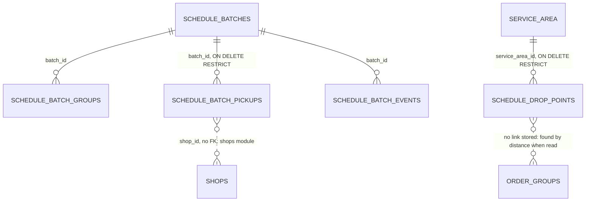

# Schedule 3.4: ops board, remaining slices

Status: **v0.1 DRAFT 2026-11-20** (investigation done, build order proposed, two gates open for Samivan)
Source rows: [schedule-implementation-order.md](schedule-implementation-order.md) Phase 3 row 3.4; lane plan [lanes/lanes-schedule-p3-p4.md](lanes/lanes-schedule-p3-p4.md); batches plan [schedule-batches-3-2-3-3-plan.md](schedule-batches-3-2-3-3-plan.md) (OPS-3, STATE-4, PII-1, EVOL-1, EVOL-7).

## Goal

The ops board at `/admin/ops-board` lets an area manager see a day's Schedule run and act on it. The row 3.4 scope is: slot columns, capacity/cutoff, ticket state, map of group drops, unbatched and late-order warnings, problem queue with pending "can't make" approvals, batch sheet with labels.

## Built so far (slice 3.4a+b, web only, branch `feature/schedule-ops-board`, commit 5347a25, not pushed)

Slot columns, batch cards, unbatched list, add/move/remove/cancel/assign/reassign, warnings from batch data (empty, waiting, drop failed, stale open), no polling (refresh on load, tab focus when data is older than 30 s, after actions, Refresh button). It makes one detail request per batch (finding F6 of the 2026-11-20 judge run).

## What exists on the backend today (investigated 2026-11-20, code and vault only; the live DB was not read)

| Needed by the board | State | Where |
|---|---|---|
| Slot capacity | EXISTS as a number (counts groups, not orders) | `ServiceAreaSlot.capacity` |
| Booked per slot and date | EXISTS as a column, no read | `ServiceAreaSlotDay.reservedGroups`; read only by `ScheduleHoldChecker` and `ScheduleReservationSettler` |
| Cutoff | EXISTS | `ServiceArea.lastCallMinutes`, `pickupLeadMinutes`; frozen instants in `ScheduleSlotFreeze` (`lastCallAt`, `slotStartsAt`, `readyByAt`) |
| Ticket state | EXISTS per shop only | derived by `TicketStatusDeriver` (NOT_STARTED, IN_PROGRESS, READY, CANCELLED); read at `GET /api/shops/{shopId}/orders/schedule/live`; no ops list across shops |
| Group drop coordinates | EXISTS | `BatchMember` and `UnbatchedGroup` carry `deliveryLat`, `deliveryLng` |
| Ready-since per shop | MISSING | no timestamp on the READY transition; readiness is computed by `BatchGroupGate.isReady` without a time |
| Late-order detection | MISSING | inputs exist (`readyByAt`, `slotStartsAt`), nothing compares them |
| Bag count | MISSING as a field | code treats one bag as one order (`BatchRunServiceImpl.everyLiveOrderHasItsBag`) |
| Rider live batch count | PARTIAL | batch state is derived from events; no count-per-rider query |
| "Can't make" approvals | MISSING | only the constant `ScheduleTicketAmendment.CANT_MAKE_APPROVED`; designed as `ticket_issue` in slice **2d.6** (implementation-order line 158), which is not built |
| Drop points (saved places) | MISSING | `schedule_drop_points` deferred to 3.4 by decision D1 |
| Pickup and drop order | MISSING | `schedule_batch_pickups`, `drop_seq` deferred (EVOL-1) |
| Batch sheet / labels | MISSING for batches | the reports module has PDF and XLSX renderers (`ReportPdfRenderer`, `ReportXlsxRenderer`, poi-ooxml and openpdf in `pom.xml`), shop-scoped |

## Proposed build order

Each slice: `/gcp` first, a build by one model and a cross-review by the other (Sonnet 5.5 and Codex gpt-6.2-sol), `/judge` before the PR. A slice that adds a table or column runs `/geld` first and waits for approval before any SQL.

| Slice | What | Needs | Schema |
|---|---|---|---|
| **3.4c** | One read-only board endpoint `GET /api/ops/board?areaId&date`: batches with members and events, unbatched groups per slot, per slot booked/capacity and cutoff instants, derived bag count (live orders per batch), rider live batch count, ops-wide ticket state per slot. The web board switches to it and drops the per-batch detail requests (fixes finding F6). | backend + web | none |
| **3.4d** | Late-order and cutoff warnings on the board (order not READY past `readyByAt`; slot past last call with unbatched groups), computed from 3.4c data. | web, small backend field | none |
| **3.4e** | Ready-since per shop: a timestamp written when an order becomes READY, shown per group in the unbatched list and on batch members (STATE-4). | `/geld`, SQL | 1 column or event table |
| **3.4f** | Drop points, the map of group drops, pickup/drop order, and the batch sheet with labels (PII-1: the sheet carries customer names and addresses outside the app; access and expiry need a decision). | `/geld`, SQL, decision | `schedule_drop_points`, `schedule_batch_pickups`, `drop_seq` (renamed `drop_no`, `pickup_no` by the 3.4f-2 review; f-1 map and sheet are built; the f-2 review is the last section of this page) |
| **3.4g** | Problem queue with "can't make" approvals (approve, reject, choose which orders). **Blocked on 2d.6** (`ticket_issue`, per-order cancellation, partial refund, ticket amendment). Money and state: its own geld and devil's advocate. | 2d.6 first | per 2d.6 |

3.4 is complete only when 3.4g lands, so it can finish only after 2d.6.

## Decisions for Samivan

1. **2d.6 (blocks 3.4g).** Build 2d.6 now as the next backend slice after 3.4e/3.4f, or accept shipping 3.4 without the problem queue and track "can't make" under 2d.6 on its own? Recommended: ship 3.4c to 3.4f, plan 2d.6 next, add the queue (3.4g) when 2d.6 lands.
2. **PII-1 for the batch sheet.** Who may open it and for how long (area manager and ops only, signed link with an expiry, or no shareable link and print from the board only)? Recommended: print from the board only, no shareable link.
3. **ENV-4 (still open).** The batch SQL is not run; the board cannot be exercised against real batch data until Postgres version, backup/PITR and a rehearsal copy are answered.

## Review notes

- 3.4c needs no table, so it needs no `/geld`; it is a new read service in the Schedule module and joins only Schedule data and the rider repository (no cross-domain service call).
- Money and state: 3.4g only. 3.4c to 3.4f are reads and one timestamp.
- The 2026-11-20 focused judge run on the web slice (correctness C+, performance B, ui A-, tests C+) is recorded in the rulebook history; F6 (per-batch requests) is closed by 3.4c.

## 3.4e data model review: ready-since (geld, 2026-11-20)

Status: **APPROVED 2026-11-20 (Samivan chose option A: `orders.ready_at`).** SQL file may be written; it is NOT run until ENV-4 is answered and the SQL is rehearsed. Board shape: per group `readySince` (when the group became ready, null while any live shop is still packing) and per shop `{shopId, shopName, orderCount, readyCount, readySince}` (readySince = latest `ready_at` of that shop's live orders once all are ready, else null).

### What exists (read from the code, 2026-11-20; live DB not read)

- A Schedule order becomes READY in exactly one place: `ScheduleCancelServiceImpl.markMemberReady` (`transition(order, READY)`, line ~127). `OrderServiceImpl.updateOrderStatus` routes Schedule members there (line ~341); Eat Now and POS orders use other paths and are out of scope. `ScheduleMemberTransitions` allows ACCEPTED -> READY and nothing leaves READY, so the first READY is the only READY.
- `orders` has NO status timestamps (only `release_at`). `markMemberReady` already writes an `audit_events` row (`schedule.member_ready`, `occurred_at` epoch ms, immutable by trigger), but every `audit_events` index leads with `shop_id` (`idx_audit_shop_time`, `_root`, `_actor`, `_module`), and a board read spans the several shops of a group.
- Time convention in this codebase: epoch milliseconds as `bigint` (`orders.release_at`, `audit_events.occurred_at`, batch events).

### Finding MODEL-1 (must change before the board can show ready-since)

Ready-since is an operational fact the board needs per order, and the order row is the row that owns it. Deriving it from the audit log (option B) would need a multi-shop lookup on `entity_id` + `action` that no existing index supports, and ties an operational screen to an audit feature's retention and shape. Recommended: store it on the order (option A).

| Option | Design | Cost | Verdict |
|---|---|---|---|
| **A (recommended)** | `orders.ready_at bigint NULL`, set once in `markMemberReady` (only when null), read for free because the board already loads the orders of each group | 1 nullable column, metadata-only `ADD COLUMN` on Postgres (no rewrite, no lock beyond a brief catalog lock), 1 line in the writer, 1 entity field, 1 DTO field, 1 schema-guard entry; no backfill needed (older orders show "-") | recommended |
| B | derive from `audit_events` where `action='schedule.member_ready'` | no schema; needs a new index or a per-shop query loop; couples the board to audit retention | rejected |
| C | a `schedule_order_events` table | a new table for one timestamp; over-built | rejected |

Name and semantics: `ready_at` = "when a Schedule order first reached READY", set only by `markMemberReady`; null for orders that never reached READY and for every non-Schedule order. The column comment in the SQL says so (a half-filled generic column is a trap: EVOL-1). Optional backfill later from `audit_events` for orders readied before the deploy: not required, since only today's board matters.

### Deploy order (MIG-1, the real risk)

`orders` is the hottest entity: once `Order.readyAt` is mapped, every order query fails if the column does not exist in the database. So the SQL runs BEFORE the backend that maps it is deployed, and a `ScheduleSchemaGuard` entry makes the backend refuse to boot without it (same as the batch tables). DO NOT RUN, sketch for review:

```sql
-- DO NOT RUN — sketch for review (3.4e)
ALTER TABLE public.orders ADD COLUMN IF NOT EXISTS ready_at bigint;
COMMENT ON COLUMN public.orders.ready_at IS 'Epoch ms the Schedule order first reached READY (set by markMemberReady); null otherwise';
```

### Shown on the board (after the column exists)

Per group: which shop is not READY yet and since when (per-order `ready_at`, "-" when null); per unbatched group and per batch member: the latest ready-since of its orders and the oldest still-waiting order; feeds the STATE-4 warning.

### Decisions for Samivan

1. **MODEL-1:** store `ready_at` on `orders` (A), derive from audit (B), or defer ready-since? Recommended: A.
2. **ENV-4:** still open (Postgres version, backup/PITR, rehearsal copy). It blocks running this SQL as well as the batch SQL; both can go in one rehearsal.

### 3.4e build notes (2026-11-20)

- Built and committed (backend `feature/schedule-ops-board-read`, web `feature/schedule-ops-board`). `db_manual/schedule-ready-at-migration.sql` is written and NOT run.
- Correction found by the Codex review: the app runs with `spring.jpa.hibernate.ddl-auto=update`, so Hibernate adds a plain nullable `orders.ready_at` itself at boot, before `ScheduleSchemaGuard` runs. An out-of-order deploy therefore still boots; the "every order query fails" risk in MIG-1 above is smaller than written. The SQL file stays the cleaner path (explicit `lock_timeout`, comment, rehearsal), and a column-only guard entry cannot prove the SQL ran. The SqlConsistency test lists this file in its column-only exemption.
- Open from review (Low): a DB test that calls the real `markMemberReady` and checks the stamp survives a retry (the current DB tests seed `readyAt` directly), a DEBUG log when an existing stamp is preserved.

## 3.4f-2 data model review: pickup order, drop order, drop points (geld, 2026-11-21)

### Summary (read this first)

**Verdict:** Design approved with changes once the two owner decisions below are answered; nothing may be released until ENV-4 is answered (same blocker as the batch SQL).
**What changes** (before → after):
- The printed sheet numbers its drops "Stop 1, 2, 3" in the order groups were added to the batch, and lists pickups alphabetically. No one chooses either order. After: the manager sets the pickup order (shops) and the drop order (groups) and the sheet follows it.
- Pickup order is stored in a new small table, one row per shop in a batch. Drop order is one new number on each batch-membership row.
- "Drop points" (saved places such as an office tower, with gate or reception notes) become a new table per service area. A group's drop point is found by its map position when read, never stored on the group.
- Each reorder writes one history event on the batch, so the timeline shows when the order changed.
**Decisions you need to make:**
| # | decision | options | recommended, and why | if you pick the other option |
|---|---|---|---|---|
| 1 | Build order | (a) ordering first, drop points as a later slice; (b) both together | (a): the sheet's order is wrong today, and drop points need a place-creation screen and a notes policy that nothing reads yet | (b): one bigger slice and one rehearsal; the ordering fix waits for the drop-point screen |
| 2 | Who may change the order and the drop points | (a) area manager only; (b) manager and ops | (a): matches the earlier rule that managers shape batches and ops only add groups, and "the manager picks the pickup order" (plan decision 40) | (b): ops can reorder a run the manager built; the history event still records who |
**What geld decided for you:**
- Column and table names use `pickup_no` and `drop_no` (like the existing `batch_no`), not `seq`: in this module `seq` already means "insert order" in the events table.
- A group's drop point is looked up by distance when the board is read: nearest centre inside its radius, ties broken by id. It is not saved on the group, because editing or overlapping drop points would make a stored link go stale (as the 2026-11 design review P6 found).
- Pickup order for a shop that left the batch is ignored when read, and cleaned up on the next reorder, because cancelling an order never writes batch tables (INV-4).
- A reorder lists exactly the live shops or groups of the batch, else the server answers 409 "membership changed, reload".
- Reordering is allowed until the batch is cancelled or completed (the plan is a plan; the real order is recorded by the drop events).
**What must happen before deploy:**
1. ENV-4 answered (Postgres major version, backup / point-in-time restore, rehearsal copy).
2. Batch SQL (`schedule-batch-migration.sql`) edited so the event-type list has the new value, then run; then the new route-order SQL, rehearsed together.
3. Backend deployed after the SQL (a missing column would otherwise be created bare by Hibernate at boot, without the unique rule).
4. Web deployed after the backend.
**Unknowns that could change this:** the real number of drop points per area (assumed 100 or fewer; owner); whether handing a bag to reception needs the customer's consent (owner, open since decision D5 and EVOL-7, not needed for the sheet); whether the lawyer wants personal data kept out of free-text notes (a hint text is added anyway).

**Status:** FINAL (decisions 1 and 2 answered 2026-11-21; SQL file and entities may now be written, SQL is NOT run until ENV-4) · **Verdict:** APPROVED WITH CHANGES · geld default, 2026-11-21 · previous: none
**Target:** PostgreSQL (Neon serverless, major version unknown: ENV-4) · hand-run SQL in `db_manual/` · pooled connections (`-pooler` host) · one Spring Boot server (Hibernate `ddl-auto=update`)
**Lenses run:** 0, 1, 2, 3, 4, 6, 7, 8 · **skipped:** 5 money (no amount, fee or payment is stored) · **reference designs:** skipped (only a manual order is stored; the route-optimisation problem class is not being built)
**Codex second opinion:** not run (default mode)
**Open inputs:** drop points per area 100 or fewer (assumed); reorders per batch about 3 (assumed); a batch holds at most 40 groups (from the 3.2 plan, A2).

### Lens 0: environment (results from the files read this session)
| # | check | result | evidence |
|---|---|---|---|
| 1 | one migration authority | **fail** (project-wide, known) | SQL is hand-run from `db_manual/`; no Flyway or Liquibase |
| 2 | no unreviewed schema writer | **fail** (project-wide, known) | `application.properties:32` `spring.jpa.hibernate.ddl-auto=update` |
| 3 | no default path to production | **fail** (project-wide, known) | `application.properties:6` the datasource URL falls back to the Neon host when `DB_URL` is unset |
| 4 | split credentials | unknown | not read this session |
| 5 | recovery (RPO, RTO, restore) | unknown | ENV-4 |
| 6 | rehearsal on a copy | unknown | ENV-4 |
| 7 | masked copies | not applicable | no copy exists |
| 8 | rollout order | pass | stated in the Rollout section below |
Checks 1 to 3 are existing project conditions already tracked as the environment split (vault `01-Architecture/environment-split-checklist.md`); they are not caused by this slice, but they are why the release gate below exists.

### Design changes
This design makes the run order a stored fact the manager controls, and makes drop points reusable places that are looked up, not stored on groups.
| # | before | after | problem it solves | why it is better | what it costs | alternative considered, why it lost |
|---|---|---|---|---|---|---|
| 1 | Stop numbers follow insertion order; pickups alphabetical | `schedule_batch_groups.drop_no` and `schedule_batch_pickups(batch_id, shop_id, pickup_no)` | TRACE-1: the sheet prints a route no one chose | the rider follows the manager's order; the order survives reprints | 1 column, 1 small table, 1 reorder endpoint | order only in the browser: lost on reload and invisible to the rider app (6.2) |
| 2 | no history of order changes | event type `ROUTE_ORDER_SET` on `schedule_batch_events` | INV-2: membership rows are changed only with an event (plan rule, line 152 of the batches plan); a silent reorder breaks it | "who changed the order and when" is answerable | one value in a CHECK list that is not applied anywhere yet | platform audit only: not visible on the batch timeline; two places to look |
| 3 | no drop points | `schedule_drop_points` per area; a function finds the drop point of a group by distance | PLACE-2: a stored link per group goes stale on edit and double-counts overlapping points | edit or delete never leaves a wrong link | the lookup runs on every board read (one query of 100 rows or fewer, distance in memory) | `drop_point_id` on `order_groups` (later phases only, when a customer picks a place) |
| 4 | `seq` named in the plan | `drop_no`, `pickup_no` | MODEL-1: `seq` already means insert order in events | one word, one meaning | none (not built) | keep `drop_seq`: two meanings for one word |

### Tables
| table | grain (one row = one ...) | purpose | class | owner | phase | state |
|---|---|---|---|---|---|---|
| `schedule_batch_pickups` NEW | one shop's place in one batch's pickup order | the manager's pickup sequence | hot-ish, tiny (rewritten per reorder) | Schedule module (batch services) | 3.4f-2a | planned |
| `schedule_batch_groups.drop_no` NEW column | one group's place in its batch's drop order | the manager's drop sequence | existing table, mutable | Schedule module (batch services) | 3.4f-2a | planned |
| `schedule_drop_points` NEW | one saved drop place in one service area | place name, centre, radius, gate or reception notes | reference, read-mostly | Schedule module | 3.4f-2b | planned |
| `schedule_batch_events` CHANGED | unchanged | one more event type | append-only | unchanged | 3.4f-2a | planned (SQL file not run) |

### Names
| name | what it holds | project word for this concept (grep evidence) | clashes with | verdict |
|---|---|---|---|---|
| `schedule_batch_pickups` | pickup order of shops in a batch | plan words "pickup order", `schedule_batch_pickups` (batches plan line 270) | `deliveries.pickup_address` is an address, not an order | keep |
| `pickup_no` | position, 1 to 99 | `batch_no` ("Batch 2", 1 to 99) | `seq` in events means insert order | use `pickup_no` |
| `drop_no` | position, 1 to 99 | `batch_no`; sheet word "Stop" | `drop_seq` planned name | use `drop_no`, not `drop_seq` |
| `schedule_drop_points` | saved drop place | glossary "Drop point" (`schedule-plan.md:57`); every Schedule table is `schedule_`-prefixed | none; `delivery_label` is the customer's own saved-address label | keep (plan said `drop_points`; add the prefix) |
| `radius_m` | radius in metres | glossary "about 50 m" | none | keep |
| `ROUTE_ORDER_SET` | one reorder happened | existing events `GROUP_ADDED`, `SHOP_HANDOVER` | none | keep |

### Columns on touched hot tables
`schedule_batch_groups` is small (a group is in one batch). Columns by purpose: identity `group_id`, `batch_id`; who and when `added_by`, `added_at`; **ordering (new)** `drop_no`. Read by the board, the sheet, the batch gate and the assign guard. `drop_no` is written by a different event (a reorder) than the row (an add), so it fails question 2 of the five; it stays a column because it shares the row's lifecycle and access, a separate table would need a join on every board read for one small integer, and nothing else per-membership is known to be coming (revisit at 6.2).

### Built vs plan
| element | plan says | in code at | deployed | migration applied | depended on by | drift | source |
|---|---|---|---|---|---|---|---|
| `schedule_drop_points`, `schedule_batch_pickups`, `drop_seq` | deferred to 3.4 (D1, EVOL-1) | not present (search of backend `src` for drop point, pickup order and `drop_seq` found nothing) | no | no | none | none | file search 2026-11-21 |
| sheet stop order and pickup order | n/a | `ops-board.sheet.ts:89-113`: pickups sorted by shop name; stop = index in `card.members`, which the backend returns by `added_at, group_id` (`ScheduleBatchGroupRepository.java:16`) | web branch only, not pushed | n/a | print only | wrong for a real route: insertion order, not chosen | code read |
| batch tables | 3.2 | merged into `feature/schedule` | unknown | **not run** (ENV-4) | batch board | none | focus notes, SQL file header |

### Entity relationships


### Column mapping
`schedule_batch_pickups` (rewritten as a set on each pickup reorder, under the batch lock)
| column | type | null | default | key / FK | constraint | phase | note |
|---|---|---|---|---|---|---|---|
| batch_id | uuid | no | | PK part, FK `schedule_batches` RESTRICT | | 3.4f-2a | |
| shop_id | uuid | no | | PK part | | 3.4f-2a | no FK: shops module (soft reference) |
| pickup_no | integer | no | | | CHECK 1..99; `uq_schedule_batch_pickups_no` UNIQUE (batch_id, pickup_no) DEFERRABLE INITIALLY DEFERRED | 3.4f-2a | a deferrable unique is checked at commit, so swapping two positions in one transaction is allowed |
| set_by | uuid | no | | FK `users` RESTRICT | | 3.4f-2a | |
| set_at | bigint | no | | | | 3.4f-2a | epoch ms (Schedule convention) |
Index: the primary key serves "pickup order of one batch" (leading column `batch_id`). Lifecycle: mutable; history is the `ROUTE_ORDER_SET` event.

`schedule_batch_groups` (change)
| column | type | null | default | key / FK | constraint | phase | note |
|---|---|---|---|---|---|---|---|
| drop_no | integer | yes | | | CHECK `drop_no IS NULL OR drop_no BETWEEN 1 AND 99`; `uq_schedule_batch_groups_drop_no` UNIQUE (batch_id, drop_no) DEFERRABLE INITIALLY DEFERRED | 3.4f-2a | NULL means "the manager has not placed this group" (a group added after the last reorder, or a cancelled group); unique ignores NULLs |

`schedule_drop_points`
| column | type | null | default | key / FK | constraint | phase | note |
|---|---|---|---|---|---|---|---|
| id | uuid | no | generated | PK | | 3.4f-2b | |
| service_area_id | uuid | no | | FK `service_area` RESTRICT | | 3.4f-2b | access scope |
| name | text | no | | | CHECK length 1..80; unique per area ignoring case | 3.4f-2b | |
| lat | double precision | no | | | CHECK -90..90 | 3.4f-2b | same type as `order_groups.delivery_lat` (`order-group-migration.sql:21`) |
| lng | double precision | no | | | CHECK -180..180 | 3.4f-2b | |
| radius_m | integer | no | 50 | | CHECK 10..500 | 3.4f-2b | glossary: about 50 m |
| notes | text | yes | | | CHECK length at most 500 | 3.4f-2b | NULL means no notes; gate, floor or reception instructions |
| created_by | uuid | no | | FK `users` RESTRICT | | 3.4f-2b | |
| created_at | bigint | no | | | | 3.4f-2b | |
| updated_at | bigint | no | | | | 3.4f-2b | optimistic token, as `expectedUpdatedAt` on service areas |
Indexes: `uq_schedule_drop_points_area_name` UNIQUE (service_area_id, lower(name)), which also serves "all drop points of one area". Lifecycle: mutable, hard-deleted (nothing references a drop point). Personal data: none by design; `notes` is free text, so the screen carries the hint "place instructions only, no names or phone numbers", and editing or deleting the row erases it.

### Invariants
| # | invariant | enforced by | concurrent writers? | mechanism | evidence |
|---|---|---|---|---|---|
| INV-1 | within a batch no two groups share a `drop_no`, no two shops share a `pickup_no` | deferrable unique constraints | two managers reorder | batch row `FOR UPDATE` first (INV-4 of the batches plan) serialises them; the constraint is the backstop | plan INV-4 |
| INV-2 | a reorder writes numbers 1..n for the live groups (or shops) and NULL for every other member of the batch | service, same transaction as the event | a cancelled member keeps an old number | without the NULLing, a live group taking number 1 while a cancelled group still holds 1 fails the unique constraint | test required |
| INV-3 | a reorder lists exactly the batch's live groups (or shops), else 409 | service, under the batch lock | a group added or cancelled between the screen load and the save | the 409 tells the manager to reload | |
| INV-4 | reorder refused when the batch is CANCELLED or COMPLETED | `BatchState.of(...)` (the one state reader, INV-8 of the batches plan) | | | `BatchState.java:50-62` |
| INV-5 | every reorder writes one `ROUTE_ORDER_SET` event in the same transaction | service | | event insert in the same transaction as the number update | batches plan line 152 |
| INV-6 | two drop points of one area never share a name | unique index | two managers create "Tower A" | the second insert fails, mapped to 409 | |
| INV-7 | a group's drop point is found by one function: nearest centre within its radius, ties broken by drop point id; no centre in range means none | one backend function and its tests; the web renders what it gets | | pure function of (area, lat, lng), same answer on every read | |

### Scenarios, access patterns, sizing
Scenarios: (1) the manager of a 6-group batch moves one group to stop 1 and a shop to pickup 1, saves, and the sheet prints in that order (p95 save under 300 ms). (2) Two managers reorder the same batch at once: they run one after the other; the second gets 409 only if the membership changed in between, otherwise it overwrites (last write wins, both are in the timeline). (3) A drop point edit takes effect on the next read of every group inside it, with no rewrite of any group. (4) Adding the rider batch card (6.2) needs only reads of these columns.
| # | actor | r/w | endpoint or screen | filter | sort | limit | peak/min | serving index | rows |
|---|---|---|---|---|---|---|---|---|---|
| A1 | manager | w | reorder a batch | batch id | | at most 40 groups | 1 | primary keys; batch row lock | 3 to 40 |
| A2 | ops | r | board read (members with `drop_no`; the batch's pickups) | batch ids of an area and date | `drop_no` nulls last, `added_at`, group id | board bound (3.4c) | 4 | `idx_schedule_batch_groups_batch`; pickups primary key | about 10 batches |
| A3 | ops | r | board read: area's drop points | `service_area_id` | | 100 or fewer | 4 | `uq_schedule_drop_points_area_name` | under 100 |
| A4 | manager | w | create, edit, delete a drop point | id, area | | | under 1 | primary key | 1 |
Sizing (assumptions): batches per day 8 / 80 / 800 (launch, 10x, 100x); pickup rows about 3 per batch = 24 / 240 / 2,400 per day at about 60 bytes = under 55 MB per year at 100x; drop points 20 / 100 / 500 per area, about 200 bytes each: negligible; the distance lookup is 100 or fewer distance calculations per group, so 5,000 per board read at 100x of groups: under 1 ms in memory. No partitioning or retention rule needed.

### Findings
#### Must change before the next affected deploy
**PLACE-1 · risk · MUST** — pickup order is a set keyed by (batch, shop), and the shops of a batch change without the batch tables being written.
- Evidence: the cancel path never writes batch tables (batches plan INV-4); the sheet derives the shops from live member orders (`ops-board.sheet.ts:89-103`). (fact)
- Failure: a group is cancelled, its shop has no other order in the batch; the stored pickup row stays, and a reader that lists stored rows prints a pickup of a shop that has no bags.
- Change: the reader starts from the live shops and looks up their numbers; unmatched stored rows are ignored; unnumbered live shops follow, by name; the next reorder deletes the unmatched rows.
- Cost to change now: free (not built).
**INV-1 · risk · MUST** — the unique rule on positions must survive a swap, and cancelled members must not hold positions.
- Evidence: Postgres checks a plain unique constraint row by row inside one UPDATE; the batches plan makes cancelled members stay in `schedule_batch_groups`. (inference from Postgres behaviour, to confirm in the test on the rehearsal copy)
- Failure: swapping stops 1 and 2 fails halfway; or a cancelled group keeps `drop_no = 1`, so the reorder that gives stop 1 to a live group fails.
- Change: `DEFERRABLE INITIALLY DEFERRED` unique constraints; the reorder sets NULL on every non-live member in the same transaction (INV-2).
- Cost to change now: free.
**INV-2 · risk · MUST** — a plan rule says membership rows change only together with an event; a reorder changes the row without one.
- Evidence: batches plan line 152 ("every change written with its event in the same transaction"). (fact)
- Failure: the rider says "the order was changed after I left"; the timeline has nothing.
- Change: event type `ROUTE_ORDER_SET` (no group, shop or rider id; the actor is the manager). Add it to `chk_batch_events_type` in `schedule-batch-migration.sql` (not run anywhere, so an edit in place) and to the Java `BatchEventType`; `BatchState` ignores types it does not test, so no state changes (`BatchState.java:25-62`).
- Cost to change now: cheap (SQL file unapplied; enum not yet in code). If the batch SQL is run first, the change becomes `DROP CONSTRAINT` then `ADD CONSTRAINT` on a small table.
**PLACE-2 · risk · MUST** — a group's drop point is a selection rule ("the place this group is in"); it needs a fixed key and tie-break.
- Evidence: design review P6 (`schedule-design-review.md:141,146`); two overlapping 50 m circles are expected at office towers. (fact)
- Failure: a group inside two circles shows one drop point on one read and the other on the next, so the sheet's gate note changes between prints.
- Change: nearest centre first, then lowest id; one backend function (INV-7); the web never recomputes it.
- Cost to change now: free.
**MODEL-1 · risk · DEFAULT** — `seq` has two meanings.
- Evidence: `schedule_batch_events.seq` is insert order (`schedule-batch-migration.sql:82`); the plan's `drop_seq` would be a planned position. (fact)
- Change: `drop_no` and `pickup_no`.
- Cost to change now: free.
**ISO-1 · risk · MUST** — access for the new endpoints.
- Evidence: `AreaAccessService` derives the area from the resource and keeps `requireForArea` for area-addressed calls only (`AreaAccessService.java:15-29`). (fact)
- Failure: a manager of area A reorders or edits a resource of area B by sending B's id.
- Change: reorder uses `requireForBatch(batchId, MANAGER)`; editing or deleting a drop point loads the row and checks its area; creating one is area-addressed, so `requireForArea(areaId, MANAGER)`. Every mutation carries `@PlatformAuditedEndpoint` and a `PlatformAuditAction` (project rule for `/api/ops` mutations).
- Cost to change now: free.
**API-1 · risk · DEFAULT** — reorder is a full replace, idempotent by state: the body is the ordered list of live ids; sending the same list twice changes nothing (the second write may skip the event when nothing differs).
- Cost to change now: free.

#### Fine now, revisit at <phase or trigger>
- **TIME-1** revisit at 6.2: drop point notes are read live. When the rider app records a handover or a drop, snapshot the drop point id, name and notes into that event (EVOL-7). Without it a later edit rewrites what the rider was told.
- **EVOL-1** revisit at Phase 8: "customer picks a drop point" and "auto-grouping by drop point" add a stored link (a nullable `drop_point_id` on `order_groups`, or a join table) for the customer's own choice; it is a different fact from the derived lookup here and fits as an addition.
- **PERF-1** revisit at more than 500 drop points in one area, or when grouping needs spatial queries: then consider a spatial index; today the distance is computed in memory over one small query.
- **PII-1** revisit if notes are found to carry names or phone numbers: add a retention rule and a check at save.
- **EVOL-7 consent** the sheet shows the drop point as the place, and the customer's own address stays on the sheet; a drop point is never read as the customer's consent to a reception handover. The consent question stays with decision D5 (6.2).
- **TRACE-2** two small screens are needed (reorder controls, drop point create and edit); the "save as drop point" button on the map is the first creator.

#### Keep (good decisions)
- A group is the batching unit and `group_id` the membership key; one batch per group.
- Batch history append-only with a trigger; state derived from events by one reader.
- Drop points not stored on groups (P6): an edit can never leave a wrong link.
- Drop point `notes` live-read now, no copy anywhere that could go stale.

### Devil's advocate trace
| DA point | outcome |
|---|---|
| design review P6: drop point membership stored on the order goes stale; overlapping points group twice | absorbed: PLACE-2, INV-7 (derived, tie-broken) |
| design review P6: snapshot the drop point name into the batch event | deferred to 6.2: TIME-1 (nothing records handovers yet) |
| batches plan EVOL-1: `schedule_batch_pickups` and `drop_seq` as additions | absorbed with the rename: MODEL-1, PLACE-1 |
| batches plan EVOL-7: drop point is not consent; snapshot the destination | absorbed: sheet keeps the customer's address; TIME-1 |
| batches plan TRACE-1: `drop_points` waits for its first screen | resolved: its first screen is "save as drop point" (decision 1 splits it into 3.4f-2b) |

### Future phases
| phase | new tables it adds | change forced on this design (none = fits) |
|---|---|---|
| 3.4f-2b drop points | `schedule_drop_points` | none |
| 6.2 rider batch APIs | none | reads `pickup_no`, `drop_no`; writes handover events; snapshots the drop point (TIME-1) |
| 8 auto-grouping, customer-chosen drop point | possibly a link column or table | additive (EVOL-1) |

### Rollout
| change | phase | slot | lock and rewrite | works with app N-1? | rollback | precondition |
|---|---|---|---|---|---|---|
| edit the event-type CHECK in the batch SQL | expand | with the batch SQL | table not created yet | yes | roll forward | ENV-4 |
| `CREATE TABLE schedule_batch_pickups`, `schedule_drop_points` | expand | after the batch SQL, same rehearsal | new tables, no lock on existing ones | yes (not read by old code) | roll back the backend; keep the tables | ENV-4, `lock_timeout` set |
| `ALTER TABLE schedule_batch_groups ADD COLUMN drop_no integer`, add the CHECK and the deferrable unique | expand | after the batch SQL | adding a nullable column is metadata-only; the unique builds on an empty or tiny table | yes (old code ignores it) | roll back the backend; keep the column | the batch SQL has run |
| backend with the new mapping | | after all SQL | | the sheet and board stay compatible: `dropNo` and `pickupOrder` are new fields | redeploy previous | a `ScheduleSchemaGuard` entry for each new table so the backend refuses to start without them |
Lens 0 result: checks 1 to 3 fail as project conditions, 4 to 6 unknown, 8 pass. Release is blocked until ENV-4; design approval is not.
DO NOT RUN, sketch for review (3.4f-2a, 3.4f-2b; no file is written until the decisions are answered):
```sql
-- DO NOT RUN: sketch for review
ALTER TABLE public.schedule_batch_groups ADD COLUMN IF NOT EXISTS drop_no integer;
ALTER TABLE public.schedule_batch_groups ADD CONSTRAINT chk_schedule_batch_groups_drop_no CHECK (drop_no IS NULL OR drop_no BETWEEN 1 AND 99);
ALTER TABLE public.schedule_batch_groups ADD CONSTRAINT uq_schedule_batch_groups_drop_no UNIQUE (batch_id, drop_no) DEFERRABLE INITIALLY DEFERRED;
```

### Design versions
| version | phase | date | what changed | why |
|---|---|---|---|---|
| v0.1 | 3.4f-2 | 2026-11-21 | first review | plan row 3.4f listed three names with no design |

### Locked decisions (handoff to /gcp and /judge)
| id | decision | enforced where | code paths that must honour it |
|---|---|---|---|
| L1 | slice 3.4f-2a (ordering) is built first; 3.4f-2b (drop points) is a later slice | plan | build order |
| L2 | only AREA_MANAGER and above reorder or edit drop points; ops read and print | service (`AreaAccessService`, ISO-1) | reorder endpoint, drop point endpoints |
| L3 | names `pickup_no`, `drop_no`; table `schedule_batch_pickups` (3.4f-2a), `schedule_drop_points` (3.4f-2b) | SQL + entities | SQL file, entities, DTOs, web types |
| L4 | deferrable unique on (batch_id, drop_no) and (batch_id, pickup_no); reorder writes 1..n for live members and NULL for the rest | constraint + service | reorder service, `BatchRepository` queries |
| L5 (amended 2026-11-22, as built) | reorder = full replace of the live set, else 409 `ORDER_STALE` (a repeated id is 400 `ORDER_DUPLICATE`, an empty list is valid); the pickup order is allowed only while the batch is OPEN or ASSIGNED, the drop order also while IN_PROGRESS, both refused when COMPLETED or CANCELLED; a change that alters the order writes one event in the same transaction, `PICKUP_ORDER_SET` or `DROP_ORDER_SET` (two types, not one `ROUTE_ORDER_SET`), and the same order saved twice writes none | service | `BatchOrderServiceImpl`, `BatchEventType`, `chk_batch_events_type`, web permissions `ops-board.permissions.ts` |
| L6 | board returns members already in display order (`drop_no` nulls last, `added_at`, group id) and a `pickupOrder` list; the web does not re-sort | backend assembler | `BatchViewAssembler`, `ops-board.sheet.ts` (remove the name sort) |
| L7 | drop point of a group found by distance, nearest then lowest id; never stored on the group | one backend function | 3.4f-2b only |

### Approval record
| finding or decision | option chosen | by | date |
|---|---|---|---|
| decision 1: build order | ordering first, drop points later | Samivan | 2026-11-21 |
| decision 2: who edits | area manager only | Samivan | 2026-11-21 |
| PLACE-1, INV-1, INV-2, PLACE-2, ISO-1, MODEL-1, API-1 | geld recommendation, no owner decision needed | geld | 2026-11-21 |
