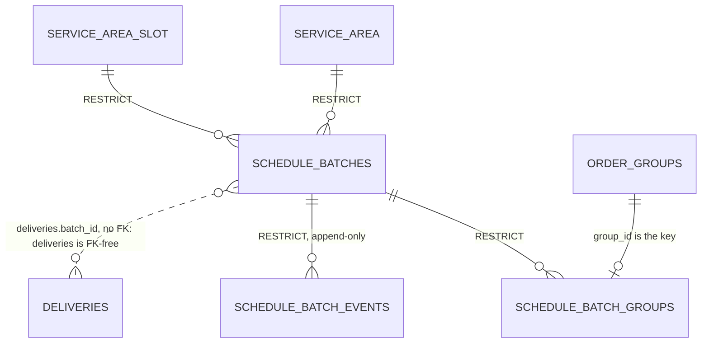
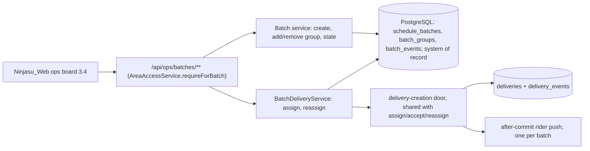

# Schedule 3.2 + 3.3: batches and batch rider assignment

Status: **v0.3 FINAL 2026-11-18** (ready gate L21 verified against the code, stress-tested on a real scenario, geld delta run once: see "v0.3 verification, stress test and geld delta") · v0.1 FINAL 2026-11-18 (D1-D4 and the environment deferral answered); v0.2 refinements FINAL 2026-11-18 after an HSR simulation, a devil's advocate check and a blind Codex review (see "v0.2 refinements" in the Summary) · geld default run 2026-11-18 (OD4) · verdict APPROVED WITH CHANGES · the v0.2 decisions D3', D5 and D6 are answered, so SQL may be written from this page; the SQL file is not run until the ENV-4 unknowns are answered.
Source rows: [schedule-implementation-order.md](schedule-implementation-order.md) Phase 3 rows 3.2 and 3.3; lane plan [lanes/lanes-schedule-p3-p4.md](lanes/lanes-schedule-p3-p4.md) (OD4). Product rules: [schedule-plan.md](schedule-plan.md) decisions 4, 5, 7, 38, 40, 42. Cash rules: [schedule-2d7-cash-due-plan.md](schedule-2d7-cash-due-plan.md).

## Goal

A manager groups paid Schedule order groups (drops) of one area, date and slot into a batch (one rider run), assigns one rider to the whole batch, and the board and rider app read what happened. 3.2 is the batch tables and the membership rules. 3.3 is the rider assignment: one delivery per member order, all on the batch, in one transaction.

## Data model review

### Summary (read this first)
**Verdict:** the design is approved with 9 changes; release is blocked on 3 environment items (lens 0) until you fix or defer them in writing.
**What changes** (before → after):
- The plan's four new tables become three now: `schedule_batches`, `schedule_batch_groups`, `schedule_batch_events`. `drop_points` waits for the slice that first uses it (3.4).
- The batch does not store its rider or its status. The rider lives on the deliveries (their existing owner) and the status is derived from the events, as the plan decided.
- `deliveries` gets one nullable column, `batch_id`, written once when the delivery is created.
- Deliveries are created through one shared "door" in the delivery code, so a batch assignment cannot skip the checks single assignment already has.
- A batch delivery can only be completed or reassigned as part of its batch (today only assign, accept and reassign refuse a Schedule order).
**Decisions you need to make:**
| # | decision | options | recommended, and why | if you pick the other option |
|---|---|---|---|---|
| D1 | `drop_points` table | build in 3.2 / build in 3.4 | 3.4: nothing in 3.2 or 3.3 reads or writes it; the board's "save as drop point" is its first user | an unused table is built and tested now; its shape is guessed before the board screen exists |
| D2 | May one batch mix slots (12:30 and 1:00)? | one slot per batch / mixed | one slot: the customer was promised that slot; a rider does the 12:30 run, then a separate 1:00 run | batches need a time range, capacity checks and late/early drop rules |
| D3 | Changes after a rider is assigned (late group added, group removed, rider swapped) | handle in 3.3 / later | in 3.3: a late order after the batch started is certain in the pilot, and per-order reassign is already refused for Schedule orders, so without this the manager has no safe move | the manager must cancel the whole batch and rebuild it; every rider swap loses the batch history |
| D4 | Until the rider app's group-drop completion exists (Phase 6.2): how may a batch delivery be completed? | staff force-complete only / rider completes per order / **staff group drop and shop handover (v0.4)** | **v0.4: staff group drop and shop handover, area-scoped, the same two operations 6.2 gives the rider.** The v0.1 answer (staff force-complete) cannot work: `forceCompleteDelivery` needs OUT_FOR_DELIVERY, which a batch delivery can never reach before 6.2, it is shop-scoped (area ops hold no shop permission) and it completes one bag alone, against decision 40 | rider per-order completion works now and must be removed in 6.2 |
**What geld decided for you:**
- The membership table's key is `group_id` itself: a group cannot be in two batches, and the database refuses it.
- Table names get the `schedule_` prefix like every other Schedule table (`schedule_batch_events`, not `batch_events`).
- Times are epoch-millisecond `BIGINT` columns, like the other Schedule tables.
- A cancelled group is never removed from a batch by the cancel code (lock order, INV-4); a batch just shows it as cancelled and skips it.
- The rider must cover every shop in the batch with the existing per-shop rule; a restaurant-fleet rider cannot take a multi-shop batch.
**What must happen before deploy** (in order):
1. Decisions D1 to D4 and the environment answers below.
2. `db_manual/schedule-batch-migration.sql` written from this page, reviewed, then run by you, one block at a time, before the backend that uses it boots.
3. `ScheduleSchemaGuard` entries for every new table, constraint, trigger and index.
4. Backend deploy (3.2, then 3.3), then the web board (3.4).
**Unknowns that could change this:**
- Neon's PostgreSQL major version (you): `CREATE INDEX CONCURRENTLY` and the lock notes assume 15 or newer.
- Backup retention, point-in-time restore and whether a rehearsal copy exists (you).
- Volumes are assumed (below): about 50 groups and 8 batches a day at launch.

### v0.2 refinements (FINAL 2026-11-18; D3', D5, D6 answered, see the Approval record)
Source: an HSR lunch simulation ("Real-world test" below), the devil's advocate check (trace below) and a blind Codex review. Two of my own v0.1 follow-up ideas did not survive and are withdrawn.
**What changes** (plain before → after):
- **Rider swap:** reassign only while every live delivery of the batch is still ASSIGNED. Swapping after the rider already has bags is withdrawn: `reassignDelivery` ends the old delivery and creates a fresh ASSIGNED one and clears the OTP (`DeliveryServiceImpl.java:702-725`), so the new rider would be sent to collect food that has already left the restaurant. The rescue flow is designed in Phase 6 from pilot evidence. (This narrows D3.)
- **Late restaurant:** no `SHOP_SKIPPED` event. A skipped bag needs a follow-up run, which either puts one group in two batches (the group-id key refuses) or gives the batch two riders. The manager waits, or uses the existing "can't make" path (cancel that order, partial refund).
- **Failed drop:** one new event, `GROUP_DROP_FAILED`, with a required reason code; its member deliveries move to FAILED through the single status writer.
- **Batch state** is read from the events plus the live status of the member groups, so a cancelled member counts as finished (otherwise the batch never completes). Cancel and the delivery-to-order status projection run after commit and only log a failure (`OrderCancellationDeliveryListener.java:36-49`, `DeliveryOrderSyncListener.java:38-77`), so the board also needs a mismatch read: a live delivery whose order is cancelled or declined, and a delivered delivery whose order is not DELIVERED.
- **Locks and writers:** moving a group locks both batches in id order; delivery rows are locked after orders and re-read. Append-only also blocks TRUNCATE. Every public delivery writer gets a batch guard (list in STATE-2) with one source-scanning test.
- **Order of work:** the delivery-creation door is extracted in its own behaviour-preserving PR before 3.3.
- **Pilot timing:** the plan's defaults (last call 30, ready-by 15, grace 15, slots 30 minutes apart) only fit a single-drop run. The simulation and Codex agree. A validator rule ties last call to ready-by.
**Decisions you need to make:**
| # | decision | options | recommended, and why | if you pick the other option |
|---|---|---|---|---|
| D3' | Rider swap scope (narrows D3) | before pickup only / also after pickup | before pickup only: after pickup the bags are physically with rider A and the system has no rider-to-rider handover | the new rider's delivery must start as PICKED_UP with the old OTP, and a custody-transfer event is designed now without pilot data |
| D5 | Prepaid failed drop (customer unreachable, entry denied, wrong address): default refund | no automatic refund, ops decides / automatic full refund | ops decides: the food is made and the rider has waited; a blanket refund pays for every unreachable customer | every failed drop refunds and costs the payment-gateway fee plus the food |
| D6 | Pilot timing | keep defaults / pilot values: ready-by 35 min, last call 50, slots 45-60 min apart, cart limit 2 shops | pilot values as a hypothesis (settings on the Service areas page, no code): at 24 groups a day and 4 riders, 89% of drops arrive within slot + 15 minutes, against 50% with the defaults | customers get a 30-minute slot promise that most multi-stop runs miss |
**What geld decided for you (v0.2):** the validator rule (last call minus ready-by lead at least a minimum prep gap, 15 minutes to start); a global soft bag cap and one backend run-time estimate function (straight-line distance times a road factor, not the routing client) in 3.4; every Schedule shop must be in a rider group before the pilot (`requireRiderCoversShop`, `DeliveryServiceImpl.java:909-923`); no foreign key on `deliveries.batch_id` (Codex wanted one; see the Codex section).

**Status:** FINAL (v0.1 and v0.2) · **Verdict:** APPROVED WITH CHANGES (ENV-1 to ENV-3 deferred by Samivan 2026-11-18) · geld default, 2026-11-18 · previous: none
**Target:** PostgreSQL on Neon (major version unconfirmed), pooled endpoint (PgBouncer, transaction mode) · hand-run SQL files in `ninja delivery service java/db_manual/` plus `ScheduleSchemaGuard`, no migration tool, no wrapping transaction (each file is run block by block) · Spring Boot 4.0.3 / Java 21 / JPA, one long-running server · single tenant per deployment, ops access scoped by service area.
**Lenses run:** 0, 1, 2, 3, 4, 6, 7, 8 · **skipped:** 5 money (no amount is stored or computed; `CashDue` returns 0 for online-paid Schedule orders; rider payout stays null, `DeliveryServiceImpl.java:546,803`) · **reference designs:** skipped (not core product data, easy to evolve, small tables).
**Codex second opinion:** blind, read-only, 2026-11-18 (see "Codex second opinion" below): agreed 14, Codex-only and verified 4, disagreements 2.
**Open inputs:** Postgres major version; backup/PITR retention; the volumes in "Sizing".

### Design changes
This design removes three duplications before they exist: a rider stored on both batch and deliveries, a status stored beside the events, and a second way to create deliveries.
| # | before | after | problem it solves (findings) | why it is better | what it costs | alternative considered, why it lost |
|---|---|---|---|---|---|---|
| 1 | plan: batch implied to hold the rider | rider only on `deliveries`; batch has no rider column | PLACE-1: a rider on two tables can disagree after a swap | one writer, nothing to reconcile | board derives the rider from live deliveries (one indexed query per batch) | `batch.rider_id` plus a composite FK: needs a cross-domain FK, and `deliveries` is FK-free by decision |
| 2 | plan: `batch_events`, `drop_points`, `schedule_batches`, `schedule_batch_groups` | three tables now, `drop_points` in 3.4 | TRACE-1: a table nobody reads in 3.2/3.3 | shape designed with its first screen | none | build all four now (D1) |
| 3 | `buildDeliveryShell` is private to `DeliveryServiceImpl`; `assignBatch` would need its checks | one delivery-creation door used by assign, accept, reassign and batch | OWN-1: two writers of `deliveries`, one skipping a check | a new check lands once | a refactor of `DeliveryServiceImpl` before 3.3, covered by its existing tests | copy the checks into `BatchDeliveryService`: drifts the first time one changes |
| 4 | completion and force-complete accept any delivery | refuse batch deliveries on the rider path; allow staff force-complete (D4) | STATE-1 | "a member order is never completed alone" holds from the first deploy | two guards plus tests | wait for 6.2: a rider could close one bag of a group |
| 5 | none | lock order batch → group → orders by id; cancel never writes batch tables | INV-4: deadlock between batch edit and group cancel | no lock cycle | cancelled members are read-time state on the board | cancel removes the group from its batch: reverses the lock order |
| 6 | events "append-only" in prose | trigger like the ticket tables | MODEL-3 | the database refuses update and delete | one function reused (`schedule_ticket_immutable` pattern) | service-only discipline: nothing stops a later writer |



### Tables
| table | grain (one row = one ...) | purpose | class | owner | phase | state |
|---|---|---|---|---|---|---|
| `schedule_batches` | one rider run for one area, date and slot | identity and scope of a batch; the lock target | reference-like, never updated | Schedule module (ops) | 3.2 | planned |
| `schedule_batch_groups` | one order group's current batch | current membership; the "one batch per group" rule | hot-ish, small (insert, delete, move) | Schedule module | 3.2 | planned |
| `schedule_batch_events` | one thing that happened to a batch | history: created, group added, removed, rider assigned or changed, shop handover, group dropped, cancelled | append-only | Schedule module (writers: ops service now; rider service in 6.2) | 3.2 | planned |
| `deliveries.batch_id` | column on an existing table | the batch a delivery was created for (a version pin, never refreshed) | hot table | Delivery module | 3.3 | planned |
| `schedule_drop_points` | one saved drop place | cluster notes | reference | Schedule module | 3.4 (D1) | deferred |

### Names
| name | what it holds | project word (grep evidence) | clashes with | verdict |
|---|---|---|---|---|
| `schedule_batches` | a rider run | "Batch: orders a manager groups into one rider run" (`schedule-plan.md` glossary) | "a 2c batch figure" (payout, `schedule-plan.md` Phase 8 text) is a settlement batch | keep; the prefix separates it; entity `ScheduleBatch`, never plain `Batch` |
| `schedule_batch_groups` | membership | "batching unit is the group" (decision 31) | none | keep |
| `schedule_batch_events` | batch history | plan says `batch_events`; every Schedule table is `schedule_`-prefixed (`schedule_slot_freeze`, `schedule_ticket_*`) | `delivery_events` is the per-delivery table | rename to `schedule_batch_events` |
| `batch_no` | 1, 2, 3 within area and date | "Batch 2" on the board and the sheet | none | keep |
| `event_type` values | BATCH_CREATED, GROUP_ADDED, GROUP_REMOVED, RIDER_ASSIGNED, RIDER_CHANGED, SHOP_HANDOVER, GROUP_DROPPED, GROUP_DROP_FAILED, BATCH_CANCELLED | "handover" is the plan's word for the shop giving bags to the rider (decision 42, 6.2); "drop" for the customer end | `DeliveryEventType.PICKED_UP` means the delivery status, not this | keep; document that SHOP_HANDOVER is not a delivery status |
| `occurred_at`, `created_at` | BIGINT epoch ms | `DeliveryEvent.occurredAt`, `OrderGroup.createdAt` | `delivery_events.occurred_at` is `timestamp` | keep `BIGINT` (Schedule convention) |

### Columns on touched hot tables
`deliveries` (read by the rider app, dispatch, cash recording, reports):
| group | columns | read by |
|---|---|---|
| identity and ownership | `id`, `shop_id`, `rider_id`, `order_id` | all flows |
| customer snapshot | `customer_name`, `customer_phone`, `pickup_address`, `dropoff_address` | rider card, ops |
| status | `status`, `terminal_reason`, `delivered_at` | completion, board |
| assignment | `created_by_staff_id`, `assignment_type` | reporting |
| money | `rider_payout_amount` (null today) | later payout slice |
| audit | `created_at`, `updated_at` | reporting |
| **grouping (new)** | `batch_id` | board, rider batch card, completion guards |
`batch_id` against the five questions: same thing and lifecycle (yes), written at the same moment as the row (yes, at insert), same access (yes), a growing family (no: pickup order and drop order are batch facts), present on most rows (no: Schedule only). It fails only question 5, so it stays a column.

### Built vs plan
| element | plan says | in code at | deployed | migration applied | depended on by | drift | source |
|---|---|---|---|---|---|---|---|
| batch tables, `batch_id`, `assignBatch` | rows 3.2 and 3.3 | not present (no `*Batch*` file under `service/`, no `ScheduleBatch*` entity) | no | no | none | none | file search 2026-11-18 |
| `CashDue`, `cashDue` in the delivery DTO, no `Delivery.codAmount` | 2d.7a | `service/delivery/CashDue.java`; `DeliveryServiceImpl.java:284,491,788,958` | per your 2d.7 notes (merged, PR #76); deploy status unknown | `cod_amount` drop (2d.7d) unknown | rider app | none | code read; deploy and SQL state: unknown, ask |
| per-order refusal for Schedule orders | 2d.5/plan | `ScheduleMember.refuseDispatch` at `DeliveryServiceImpl.java:164,277,684` | with `feature/schedule` | n/a | dispatch | completion paths (`:491,788`) lack it: STATE-1 | code read |

### Entity relationships
See the diagram above. Schedule tables reference other Schedule tables, `users`, `service_area` and `service_area_slot` with a real FK and `ON DELETE RESTRICT` (as `order_groups` does: `order-group-migration.sql:15-20`). `deliveries.batch_id` and `schedule_batch_events.shop_id`/`rider_id` are deliberate soft references ("no FK: deliveries and shops are other modules, FK-free by decision; `Delivery.java:18-19`"); batches are never deleted, so no orphan can appear from this side.

### Column mapping
`schedule_batches` (never updated after insert)
| column | type | null | default | key / FK | constraint | phase | note |
|---|---|---|---|---|---|---|---|
| id | uuid | no | generated | PK | | 3.2 | |
| service_area_id | uuid | no | | FK service_area RESTRICT | | 3.2 | access scope |
| service_date | date | no | | | | 3.2 | the area's local date, as on `order_groups` |
| slot_id | uuid | no | | FK service_area_slot RESTRICT | | 3.2 | one slot per batch (D2) |
| batch_no | integer | no | | | CHECK 1..99 | 3.2 | allocated max+1, retry on conflict |
| created_by | uuid | no | | FK users RESTRICT | | 3.2 | |
| created_at | bigint | no | | | | 3.2 | |
Unique `uq_schedule_batches_area_date_no (service_area_id, service_date, batch_no)`: serves the board list for one area and date, and the batch number rule. Lifecycle: insert only.

`schedule_batch_groups`
| column | type | null | default | key / FK | constraint | phase | note |
|---|---|---|---|---|---|---|---|
| group_id | uuid | no | | PK, FK order_groups RESTRICT | | 3.2 | one batch per group |
| batch_id | uuid | no | | FK schedule_batches RESTRICT | | 3.2 | |
| added_by | uuid | no | | FK users RESTRICT | | 3.2 | |
| added_at | bigint | no | | | | 3.2 | moved groups get the new time; history is in the events |
Index `idx_schedule_batch_groups_batch (batch_id)`: a batch's members. Lifecycle: mutable (insert, move, delete), every change written with its event in the same transaction.

`schedule_batch_events`
| column | type | null | default | key / FK | constraint | phase | note |
|---|---|---|---|---|---|---|---|
| id | uuid | no | generated | PK | | 3.2 | |
| batch_id | uuid | no | | FK schedule_batches RESTRICT | | 3.2 | |
| event_type | text | no | | | CHECK in the 9 values (v0.2 adds GROUP_DROP_FAILED) | 3.2 | |
| group_id | uuid | yes | | | required for GROUP_*; null otherwise | 3.2 | soft reference, no FK (a group is never deleted) |
| shop_id | uuid | yes | | | required for SHOP_HANDOVER | 3.2 | no FK: shops module |
| rider_id | uuid | yes | | | required for RIDER_* | 3.2 | no FK: riders module |
| from_batch_id | uuid | yes | | | GROUP_ADDED only (a move) | 3.2 | |
| actor_type | text | no | | | CHECK STAFF / RIDER / SYSTEM | 3.2 | same values as `DeliveryActor` |
| actor_id | uuid | yes | | | null if and only if SYSTEM | 3.2 | |
| reason_code | text | yes | | | required for GROUP_DROP_FAILED (CUSTOMER_UNREACHABLE, ENTRY_DENIED, ADDRESS_WRONG, OTHER); null otherwise (v0.2) | 3.2 | |
| note | text | yes | | | CHECK length ≤ 255 | 3.2 | |
| occurred_at | bigint | no | | | | 3.2 | when it happened, writer-supplied (as `DeliveryEvent`) |
Column `seq BIGINT GENERATED ALWAYS AS IDENTITY` (added in the 3.2 build, code review 2026-11-19): the history order is insert order, because `occurred_at` can tie within a millisecond and the id is random. Indexes: `idx_schedule_batch_events_batch_seq (batch_id, seq)` (timeline; replaces the `(batch_id, occurred_at, id)` index); partial unique `uq_batch_events_shop_handover (batch_id, shop_id) WHERE event_type='SHOP_HANDOVER'` and `uq_batch_events_group_dropped (batch_id, group_id) WHERE event_type='GROUP_DROPPED'` (a retried tap never records twice). Lifecycle: append-only, trigger refuses update and delete. Personal data: none (ids only).

`deliveries` (3.3): `batch_id uuid NULL`, no default, no FK; partial index `idx_deliveries_batch (batch_id) WHERE batch_id IS NOT NULL`.

### Invariants
| # | invariant | enforced by | concurrent writers? | mechanism | evidence |
|---|---|---|---|---|---|
| INV-1 | a group is in at most one batch | `schedule_batch_groups.group_id` primary key | two managers add the same group | the second insert fails, mapped to 409 | T3-01 |
| INV-2 | a batch's groups share its area, date and slot | service check at add time under the batch lock | no: the group's area, date and slot are immutable (`OrderGroup.java:37-44`, `updatable=false`) | the value cannot change after the check | |
| INV-3 | only paid groups are added, and only when every member order is `READY`, `CANCELLED` or `DECLINED` with at least one `READY` (packed; v0.3, L21). A member in any other status (`SCHEDULED`, `PLACED`, `ACCEPTED`, `PREPARING`, `OUT_FOR_DELIVERY`, `DELIVERED`) refuses the add | service under the group lock | cancel vs add | group row `FOR UPDATE` first (`ScheduleGroupAccess.java:24`) | |
| INV-4 | lock order is batch rows by id (a move locks both batches in id order) → group rows by id → member orders by id → delivery rows by id, each re-read after locking; the cancel and refund code never writes batch tables | code rule plus a test that fails if a batch repository is used outside the batch services | cancel locks group then orders (`ScheduleGroupAccess.java:24-36`, `GroupPaymentSettlement.java:45`) | one global order, no cycle | |
| INV-5 | all live deliveries of a batch have the same rider | `assignBatch` and `reassignBatch` under the batch lock; per-order reassign is already refused for Schedule orders (`DeliveryServiceImpl.java:684`) | batch swap vs add-group | batch row `FOR UPDATE` | |
| INV-6 | one live delivery per order | partial unique index on `deliveries(order_id)` for non-terminal rows (`DeliveryOrderUniqueIndexRunner`) | double assign | the second insert fails, the whole batch transaction rolls back | T3-03 |
| INV-7 | batch events are never updated, deleted or truncated | trigger | any writer | `BEFORE UPDATE OR DELETE` row trigger and `BEFORE TRUNCATE` statement trigger raise (both exist on every ticket table, `schedule-ticket-migration.sql:200-249`) | `schedule-ticket-migration.sql:195-242` |
| INV-8 | batch state is read through one function, never recomputed in a query or a screen | `BatchState.of(events, member group status)` plus its tests; a cancelled member counts as finished, so a batch whose last open group is cancelled still completes; a batch with no rider assigned never completes, so a manager can still cancel it | board vs assign guard | one owner | decision 5 |
| INV-9 | a batch delivery is completed only by the batch group drop (v0.4: staff in 3.3, the rider as well in 6.2; per-delivery force-complete is refused for a batch delivery) | a guard in every public delivery writer (STATE-2 table) and one source-scanning test that fails when a writer has no batch handling | | service | STATE-1 |

### Scenarios, access patterns, sizing
Scenarios: (1) at 11:55 a manager builds two batches of five groups and assigns a rider to each; the board answers in p95 < 300 ms. (2) A late group is added to an assigned batch: it gets deliveries for the same rider in the same transaction, or nothing changes. (3) Two managers add the same group at once: one wins, the other gets a clear 409 and nothing is half-written. (4) A rider is swapped: old live deliveries end as FAILED with a reason, new ones are created, the batch history shows both. (5) Adding "pickup order" and "drop order" later needs new columns or a table, not a rewrite.
| # | actor | r/w | endpoint | filter | sort | limit | peak/min | serving index | rows |
|---|---|---|---|---|---|---|---|---|---|
| A1 | ops | r | list batches | area, date (slot optional) | batch_no | ≤ 30 by area and date | 4 | `uq_schedule_batches_area_date_no` | ~10 |
| A2 | ops | r | batch detail, members | batch_id | | ≤ 40 | 10 | `idx_schedule_batch_groups_batch` | ~10 |
| A3 | ops | r | events timeline | batch_id | occurred_at, id | ≤ 200 | 4 | `idx_schedule_batch_events_batch_time` | ~15 |
| A4 | ops | r | unbatched groups for a slot | area, date, slot, not in batch_groups | | ≤ 100 | 4 | `order_groups (service_date, slot_id)` (`schedule-shop-tab-indexes.sql`) then PK of batch_groups | ~50 |
| A5 | ops | w | assign batch | batch_id, rider | | ≤ 40 deliveries | 2 | PKs, `deliveries(order_id)` unique | ~15 |
| A6 | system | r | batch's live deliveries (rider, derived state) | batch_id | | ≤ 40 | 10 | `idx_deliveries_batch` | ~15 |
Sizing (assumptions, launch; 10x; 100x): groups/day 50 / 500 / 5,000; batches/day 8 / 80 / 800; events/day about 15 per batch = 120 / 1,200 / 12,000; per row about 130 bytes → events 6 MB/year at launch, 60 MB at 10x, 600 MB at 100x. No partitioning, no retention rule needed before 100x. Peak QPS at 100x: under 1 per second.

### Findings
#### Must change before the next affected deploy
**OWN-1 · risk · MUST** — one door for creating deliveries.
- Evidence: `buildDeliveryShell` is private and calls `ScheduleMember.refuseDispatch` (`DeliveryServiceImpl.java:273-292`); `transitionTo` is documented as the only status writer (`:314-323`). `assignBatch` cannot call the shell (it would refuse), and copying its checks creates a second writer. (fact)
- Failure: someone adds a check to single assignment (for example a new payment rule); batch assignment lacks it, and a prepaid-only or cancelled order gets a delivery through the batch path.
- Change: extract the order checks (live order, not `SCHEDULED_ONLY`, `CashDue.requireCanAssign`, OTP reset) and the row creation with its CREATED event into one package-level collaborator in the delivery module; assign, accept, reassign and `assignBatch` call it; `refuseDispatch` stays in the three per-order callers. `BatchDeliveryService` lives with the delivery code and reads the batch tables through a repository (no service-to-service call across modules).
- Cost to change now: free (3.3 not started).

**STATE-1 · risk · MUST** — writers of a delivery's end must know about batches.
- Evidence: `refuseDispatch` is called only on accept, assign and reassign (`:164,277,684`); rider completion (`:491`) and staff force-complete (`:788`) do not check for a group or batch. (fact)
- Failure: once 3.3 creates batch deliveries, a rider (or an old client) completes one bag of a group alone; or the cancel path ends one delivery of a batch and nobody records it on the batch.
- Change: rider completion refuses a delivery with `batch_id`; staff force-complete stays (with its reason); every end of a batch delivery (complete, cancel, fail) appends nothing to batch tables (INV-4) but is visible through the delivery events. List each writer in the 3.3 brief.
- Cost to change now: free.

**INV-4 · risk · MUST** — lock order and the cancel boundary (see invariants).
- Failure: `assignBatch` locks batch then orders while a group cancel locks group then orders then tries to drop the batch membership: a deadlock, or an assigned batch with a dead group.
- Change: write the order into the code comments and a test; cancel never writes batch tables; assign and add skip or refuse groups with no live order.
- Cost: free.

**MODEL-3 · risk · DEFAULT** — enforce append-only in the database for `schedule_batch_events` with the same trigger shape as the ticket tables. Cost: free.

**PLACE-1 · trade-off · DEFAULT** — rider on deliveries only, no `batch.rider_id`, status derived (design change 1). Decided by geld; reopen only if the board needs a rider before any delivery exists.

**TRACE-2 · gap · MUST** — the plan has no path for a rider swap, a late group on an assigned batch, or an unassign (D3). Change: `reassignBatch` (cancel live deliveries as FAILED with a reason, create new ones, one transaction, one RIDER_CHANGED event), add-group and remove-group keep deliveries in step until the first SHOP_HANDOVER. Cost: free.

**ISO-1 · risk · MUST** — `AreaAccessService` has no batch resource.
- Evidence: methods are `requireForGroup`, `requireForOrder`, `requireForSlot`, `requireForArea` (`AreaAccessService.java`). (fact)
- Change: add `requireForBatch(batchId, minimum)` reading the area from the loaded batch; every `/api/ops/batches/**` handler loads the batch first and never trusts a client area id; add-group also loads the group and compares areas (INV-2).
- Cost: free.

**API-1 · risk · DEFAULT** — assign must be safe to retry. Assign when the batch already has live deliveries for the same rider returns the current state (no new rows); for a different rider it is a 409 that points to reassign. Lists take area and date as required parameters (bounded). Cost: free.

**MIG-1 · risk · MUST** — rollout path (see Rollout). The new SQL file must exist and run before the backend boots, and the guard must name each object; otherwise `ddl-auto=update` creates bare tables with no constraints, trigger or index (the guard's own header says so).

**ENV-1 · risk · fail (blocker)** — schema authority is hand-run SQL with no history table; `application.properties:32` sets `ddl-auto=update`. The guard reduces the harm but does not remove it.
**ENV-2 · risk · fail (blocker)** — `application.properties:6-8` default the datasource to the production Neon host and a committed fallback credential; a local run with no `DB_URL` writes to production (`feedback_one_neon_db_is_prod`, security finding 2026-10-13).
**ENV-3 · risk · fail (blocker)** — the app connects as the owner role, so the application role can run DDL (check 4); no split credentials.
**ENV-4 · unknown** — backup retention, point-in-time restore tested for a bad migration (check 5); rehearsal copy (check 6); masked copies (check 7).
Evidence for 1-3 is the config file lines above; the environment split is already scheduled (`environment-split-checklist.md`). These are pre-existing and shared by every Schedule table; they block approval of this release only as far as you have not deferred them.

#### Added in v0.2 (devil's advocate, Codex, simulation)
**STATE-2 · risk · MUST** — every public delivery writer needs batch handling, not only completion (STATE-1 listed two). Evidence (fact, `DeliveryServiceImpl.java`): `assignDelivery` :114 (refuses Schedule members), `acceptDelivery` :156 (refuses), `reassignDelivery` :679 (refuses), `updateMyDeliveryStatus` :425 (rider PICKED_UP / OUT_FOR_DELIVERY, unguarded, also creates the OTP), `completeDelivery` :470 (unguarded), `forceCompleteDelivery` :776 (unguarded), `cancelDelivery` :737 (unguarded), `cancelDeliveriesForOrder` :760 (system, fine). Failure: a rider or an ops user moves or cancels one bag of a group; the batch and the group then disagree. Change:
| writer | batch delivery behaviour |
|---|---|
| assign, accept, reassign (per order) | refused (already) |
| `updateMyDeliveryStatus` | refused until 6.2; in 6.2 the shop-handover tap moves its deliveries to PICKED_UP and writes SHOP_HANDOVER in one transaction |
| `completeDelivery` (rider) | refused until 6.2; then group drop only |
| `forceCompleteDelivery` (staff) | v0.4: refused for a batch delivery (it needs OUT_FOR_DELIVERY, which a batch delivery cannot reach, and it would complete one bag alone); the staff group drop replaces it (see "v0.4: staff run") |
| `cancelDelivery` (staff, one delivery) | allowed only through the batch services, which write the matching batch event; a bare per-delivery cancel is refused for a batch delivery |
| `cancelDeliveriesForOrder` (system, after an order cancel or decline) | allowed; the board shows it through the mismatch read (STATE-3) |
Cost to change now: free.
**STATE-3 · risk · MUST** — cancel and the delivery-to-order projection are eventually consistent. Evidence (fact): both listeners run `AFTER_COMMIT` in their own transaction and only log a failure (`OrderCancellationDeliveryListener.java:36-49`, `DeliveryOrderSyncListener.java:38-77`). Failure: an order is cancelled but its delivery stays live (the rider drives to a dead order), or a group drop marks 3 deliveries DELIVERED and one order projection fails, leaving an order not DELIVERED. Change: the board (3.4) and the batch detail read a mismatch list: live delivery whose order is CANCELLED or DECLINED, and DELIVERED delivery whose order is not DELIVERED; each row is a problem-queue item. No new store. Cost: free (a read).
**TRACE-3 · gap · MUST** — GROUP_DROP_FAILED with a reason code (v0.2 refinement; refund default is D5). Change: one event type, one `reason_code` column; member deliveries go to FAILED through the single status writer with the same reason. Cost: free.
**MIG-2 · risk · MUST** — extract the delivery-creation door (OWN-1) as its own behaviour-preserving PR before 3.3: `DeliveryServiceImpl` is the live Eat Now delivery path and its phone device test is still pending (`schedule-plan.md` section 6). Existing delivery tests unedited are the proof. Cost: free.
**OPS-1 · risk · MUST** — `ServiceAreaValidator` checks last call and ready-by lead only against a maximum each (`ServiceAreaValidator.java:103,106`). Change: add `last_call_minutes - pickup_lead_minutes >= 15` (the restaurant's minimum prep gap; the same minutes are the manager's batching window). Cost: free (3.1b page shows the error; confirm the message there).
**OPS-2 · risk · MUST** — the pilot checklist gets: every Schedule shop in an active rider group (`requireRiderCoversShop`, `DeliveryServiceImpl.java:909-923`), otherwise the first `assignBatch` of the pilot fails.
**OPS-3 · risk · DEFAULT** — timing: see "Real-world test". The 3.4 board shows a bag count and a run-time estimate per batch (one backend function; the bag cap is a global soft setting). Cost: free.

**OPS-4 · gap · MUST (own slice, before the pilot; not 3.2 or 3.3)** — preparation time is not modelled (Samivan, 2026-11-18).
- Evidence (fact, `schedule-plan.md` decision 15 and 2b.2): ready-by is one area-wide number (slot start minus `pickup_lead_minutes`); a dish's order-by is one clock time for every slot.
- Failure: a dish that takes 40 minutes to make can be ordered for the 13:30 slot at 12:35, still before last call, but the kitchen cannot have it ready by 13:25; the shop is late, and one late shop stalls the whole batch (the simulation shows shop lateness adding minutes to every group in the run).
- Change: a preparation time in minutes (a default per shop, optional per dish) and one availability rule: a dish is orderable for a slot until the earliest of the area's last call, slot start minus the ready-by lead minus the preparation time, and the dish's own order-by. OPS-1's minimum gap stays as a floor. The reason shown to the customer reuses ORDER_BY_PASSED. This is a new nullable column on the Schedule menu settings, so it gets its own `/geld` and `/devils-advocate` when picked up. Until then restaurants set an earlier order-by on slow dishes.
- Cost to change now: free (not built).

**OPS-5 · gap · MUST (own slice, before the pilot; not 3.2 or 3.3)** — the ops role can raise and finish a failed-drop refund (D5, Samivan 2026-11-18). Today refunds are admin-approved by Samivan's 2026-10-28 rule and area staff have no refund endpoint (`AdminRefundController`, `/api/admin/refunds`: list, approve, reject, retry).
- Decision: AREA_OPS raises a refund request from the batch screen with the drop-failed reason; AREA_MANAGER approves and issues it for their own area (authorised through `AreaAccessService` from the group's area, never a client area id); platform admin keeps the existing queue for everything else.
- Failure if left out: a failed drop has no event-to-refund path; ops phones an admin for each case, or a refund is issued by hand outside the app.
- Change: an `/api/ops/**` endpoint pair on top of the existing refund request and approval core (no new money path), plus an audit record with the area-staff actor; the refund-approval rules (`refund-approval-plan.md`) get one stated exception for area managers on failed-drop refunds. This touches money: it gets its own `/devils-advocate`, a mutation check and a read-only Codex review when it is picked up.
- Cost to change now: free (not built). 3.2 only records `GROUP_DROP_FAILED` and its reason code.

#### Fine now, revisit at <phase or trigger>
- **TRACE-1 · drop_points** table: revisit at 3.4 (D1).
- **EVOL-1** pickup order (shops) and drop order (groups): a new `schedule_batch_pickups(batch_id, shop_id, seq)` table and a nullable `drop_seq` column on `schedule_batch_groups` at 3.4/6.2; fits as an addition.
- **EVOL-2** a wrong "handover" or "dropped" tap needs a correcting event type and the partial unique indexes then exclude voided rows: design at 6.2.
- **EVOL-3** rider payout must be computed per batch or per drop, never per delivery (one group of three restaurants makes three deliveries with the same drop): decide at the payout slice; `batch_id` and `group_id` make the grouping possible.
- **COST-1** the board (3.4) polls: choose an interval and read the light queries A1/A2/A6 only; no new scheduler or cache is added by 3.2 or 3.3. Neon compute stays awake while a board is open.
- **PII-1** the shareable batch sheet (3.4) carries customer names and addresses outside the app: decide access and expiry then.
- **EVOL-4** (6.2) custody transfer after pickup (rider breakdown): who holds which bags, old and new rider, time, location, OTP and proof continuity. Needs pilot evidence; not designed now (D3').
- **EVOL-5** (6.2) the shop-handover event and the per-bag delivery changes must be written in one transaction, and a handover must say which orders it covered (an `order_count` column or a link to the delivery events); a correction event is needed for a wrong tap (EVOL-2).
- **EVOL-6** (6.2, plan decision D5 still open, `schedule-plan.md:157`) one proof per group drop versus the per-order OTP the code creates at pickup (`DeliveryServiceImpl.java:450-456`): a customer with a 3-restaurant group would otherwise be asked for 3 codes at one door. 3.3 creates no OTP (it is made at PICKED_UP), so nothing is locked in.
- **EVOL-7** (3.4) drop points are reusable places, not proof of the customer's consent to a reception handover; the destination and its instructions are snapshotted per group and per delivery (`order_groups.delivery_*` is `updatable=false`, so the 2d.5 address correction must be refused once a group is in a batch).
- **PERF-1** `batch_no` allocation by max+1 with a retry on the unique constraint is fine at under 100 batches a day.

#### Keep (good decisions)
- Batch status derived from events, not stored (decision 5): one source of truth.
- A group is the batching unit and `group_id` is the membership key.
- `deliveries.batch_id` as a version pin (a swap or removal does not rewrite which batch a delivery was created for).
- Per-order Schedule dispatch already refused at assign, accept, reassign.
- FKs with `ON DELETE RESTRICT` inside the Schedule module; no FK from `deliveries`.
- `CashDue` makes a batch delivery owe 0 cash; no cash amount is written by 3.3.

### Devil's advocate trace
Run 2026-11-18 on L1-L12 and the proposed refinements.
| DA point | outcome |
|---|---|
| 1. batch state from events only (L8) vs cancel never writes batch tables (L4): a cancelled member keeps the batch open forever | absorbed: INV-8 reads member group status; STATE-3 |
| 2. reassign after pickup creates a fresh ASSIGNED delivery and clears the OTP | absorbed: D3' narrows reassign to before pickup; EVOL-4 |
| 3. `SHOP_SKIPPED` breaks the group-id key and one rider per batch | absorbed: dropped from the design |
| 4. `GROUP_DROP_FAILED` decides nothing about deliveries or refund | absorbed: TRACE-3, D5 |
| 5. STATE-1 writer list incomplete (`updateMyDeliveryStatus`, `cancelDelivery`) | absorbed: STATE-2 |
| 6. door extraction inside the Schedule PR touches the live Eat Now path | absorbed: MIG-2 |
| 7. ready-by 35 and last call 50 with no rule relating them | absorbed: OPS-1, D6 |
| 8. slot spacing and cart limit | already handled: existing settings (`ServiceArea.java:84`, slot rows); config only |
| 9. soft bag cap and estimate via the routing client | absorbed: global setting, one estimate function (OPS-3) |
| 10. rider coverage fails the first assign | absorbed: OPS-2 |
| no failure found: L1, L9, L10, L5, L12 (condition: 6.2 before the pilot) | already handled |

### Codex second opinion (blind, read-only, 2026-11-18)
Given the source docs and code and five questions, not this page and not my numbers. Result: agreed 14, Codex-only and verified 4, disagreements 2.
- **Agreed:** current-state membership plus immutable move events; validation under lock (paid, same area, date and slot; never a client area id); only live members get deliveries; one global lock order and real concurrent-transaction tests; per-delivery writers can split a group; no parallel stored cash or status; derive batch progress; a 3-shop run cannot reliably reach the first customer by slot start (its own estimate: first drop 12:43-12:50 for a 12:30 slot, no buffer); breakdown after pickup needs a custody model; late-restaurant, unreachable-customer and en-route-cancel paths need defined actions; rain, traffic and overlapping runs exceed two riders; the pilot should run on a simple manager run sheet.
- **Codex-only, verified (adopted):** (1) append-only needs a `BEFORE TRUNCATE` trigger as well; the ticket tables already have one (`schedule-ticket-migration.sql:207,221,235,249`); (2) cancel and the delivery-to-order projection are after-commit and log failures (STATE-3, verified in both listeners); (3) a group move needs two batch locks in id order, and delivery rows are locked after orders (INV-4); (4) the 2d.7 row in `schedule-implementation-order.md:157` still says "set `codAmount = 0`" while the detailed plan rejected that: a pointer to the detailed plan was added to that row.
- **Disagreements, decided on evidence:** (a) Codex wants a nullable FK on `deliveries.batch_id`. Kept without a FK: `Delivery.java:18-19` documents the FK-free delivery convention, the batch tables are never deleted (every FK is RESTRICT), and the rule "a delivery's order belongs to a group in that batch" cannot be a database constraint across modules, so it is a service rule plus a test. (b) Codex wants an idempotent retry key on assign. Kept idempotent by state (API-1): assigning the same rider again returns the current state, backed by the unique live-delivery index (INV-6), so no key table is needed.
- **Codex points left as 6.2 design items:** proof and pickup granularity (EVOL-5, EVOL-6), custody transfer (EVOL-4), drop-point consent and address snapshot (EVOL-7).

### Real-world test (HSR simulation, 2026-11-18)
A model, not pilot data: direction is reliable, absolute numbers could be off by half either way. Setup: HSR 3 km radius, 8 restaurants within 1 km of the centre, 60% of customers in two office clusters, 18 km/h on road distance 1.35 times straight-line, 8 bags per trip, 5 minutes at an office tower and 3 at a house, shops late by 5-15 minutes 15% of the time, slots 12:30, 13:00, 13:30, rider shift ₹450 for 2.5 hours (an assumption). "Within grace" = delivered by slot + 15 minutes (the plan's late-cancel point).
| | 2 riders | 3 riders | 4 riders |
|---|---|---|---|
| ready-by 15 min before slot (default), 24 groups a day, best batching | 17% | 34% | 50% |
| ready-by 25 min | 27% | 51% | 76% |
| ready-by 35 min | 39% | 67% | 89% |
| ready-by 45 min | 52% | 81% | 98% |
Other results: at the default timing and 2 riders, 12 groups a day gets 24% within grace with simple batching and 56% with the best possible batching (smarter batching shrinks batches to 1.7-3 groups); rain at 10 km/h leaves 69% of drops more than 30 minutes late; restaurants spread over 2 km instead of 0.5 km cut within-grace from 37% to 5%; office-tower clustering adds about 13 points. Rule of thumb: one rider serves about 2 groups per 30-minute slot and stays on time; at that quality rider cost is about ₹75 per group against about ₹12-40 revenue per group (D22 is open). This is why D6 proposes pilot timing values and why the board needs a bag count and run-time estimate.

### Future phases
| phase | new tables it adds | change forced on this design |
|---|---|---|
| 3.4 board | `schedule_drop_points`, `schedule_batch_pickups` | none (additions); `AreaAccessService.requireForBatch` already added |
| 3.5 settlement export | none | none: reads `SettlementReadService` |
| 6.2 rider batch APIs | none | new writer for SHOP_HANDOVER and GROUP_DROPPED (a second event writer: the same append-only door); completion guard lifts for the group drop (INV-9) |
| 8 numbers | none | reads events and deliveries by `batch_id`; fits |

### Rollout
| change | phase | release slot | lock and rewrite | works with app N-1? | rollback | precondition |
|---|---|---|---|---|---|---|
| three new tables with constraints and trigger | expand | SQL before the 3.2 deploy | none (new tables) | yes (nothing reads them) | roll back the backend; keep the tables | file reviewed; `lock_timeout` set |
| `ALTER TABLE deliveries ADD COLUMN batch_id UUID NULL` | expand | with the 3.3 SQL, before the 3.3 deploy | ACCESS EXCLUSIVE, metadata only; use `SET lock_timeout='3s'` and retry | yes (old code ignores it) | roll back the backend; keep the column | none |
| `CREATE INDEX CONCURRENTLY idx_deliveries_batch ... WHERE batch_id IS NOT NULL` | expand | same file, its own statement, outside any transaction | SHARE UPDATE EXCLUSIVE, no write block | yes | `DROP INDEX CONCURRENTLY` | deliveries table size and longest transaction (you to confirm) |
| guard entries (tables, constraints, trigger, indexes, column) | expand | with the backend | none | n/a | remove the entries | |
Lens 0 result: see ENV-1 to ENV-4. SQL below is a sketch.

```
-- DO NOT RUN: sketch for review (file db_manual/schedule-batch-migration.sql, written only after approval)
-- 3.2: CREATE TABLE IF NOT EXISTS public.schedule_batches (...), public.schedule_batch_groups (...), public.schedule_batch_events (...);
--      constraints, partial unique indexes and the immutability trigger as in "Column mapping".
-- 3.3 (DO NOT RUN NOW: after the 3.2 file and the 3.3 backend are approved):
--      ALTER TABLE public.deliveries ADD COLUMN IF NOT EXISTS batch_id UUID;
--      CREATE INDEX CONCURRENTLY IF NOT EXISTS idx_deliveries_batch ON public.deliveries (batch_id) WHERE batch_id IS NOT NULL;
```

### v0.3 verification, stress test and geld delta (2026-11-18)
One pass, by Claude: code read-only, no database, no SQL. Codex was not run: v0.2 had a blind Codex review, and v0.3 adds one rule and no table or column. Lenses run on the delta: 1 (access), 4 (invariants), 6 (state, concurrency), 8 (API), 0 (unchanged). Lens 5 money skipped (no amount touched).

#### Code verification (every claim the ready gate and the door rely on)
| claim | result | evidence |
|---|---|---|
| the delivery-creation door exists | confirmed | `service/delivery/DeliveryCreation.java` (132 lines: `lockLiveOrder`, `requireAssignable`, `requireAssignableRider`, `newShell`, `recordCreation`); `DeliveryServiceImpl` is now `service/impl/DeliveryServiceImpl.java`, 879 lines |
| the validator rule OPS-1 is still unbuilt | confirmed | `ServiceAreaValidator.java:103,106` check only a maximum each |
| a shop can mark a Schedule member READY | confirmed | `ScheduleCancelServiceImpl.markMemberReady` (ACCEPTED to READY; takes the group lock, then members by id); `ScheduleMemberTransitions` has no move out of READY for the shop |
| READY only ends by cancel or decline, so an add-time gate stays true | confirmed | `ScheduleMemberTransitions` (no `READY` case); customer late cancel and ops cancel are the only exits |
| a READY Schedule member does not ring the riders | confirmed | `DeliveryDispatchListener.java:121` refuses a Schedule member before any push |
| the shop's READY path and the batch path cannot deadlock | confirmed | both take group row then members by id (`OrderRepository.findByGroupIdForUpdateOrderById`, whose comment names the deadlock); the shop path never takes a batch lock |
| cancel and the delivery-to-order projection run after commit and only log | confirmed | `OrderCancellationDeliveryListener.java:36`, `DeliveryOrderSyncListener.java:38` (STATE-3 stands) |
| the unbatched-groups read (A4) with a ready flag is served by an index | confirmed | `orders (group_id, shop_id) WHERE group_id IS NOT NULL`, `order-group-migration.sql:114` |
| `AreaAccessService` has no batch resource yet | confirmed | interface lists group, order, slot, area (ISO-1 stands) |
| a batch service can reuse the group-lock helper | **no** | `ScheduleGroupAccess` is package-private in `service.schedule.cancel`; see OWN-2 |
| the door's per-order checks do not require READY | confirmed | `requireAssignable` checks shop, not SCHEDULED_ONLY, cash rule; so the READY gate must live in add-group |
| no rule stops one rider holding two overlapping batches | confirmed | `requireAssignableRider` checks active, online, shop coverage only |

Line numbers in this page that cite `DeliveryServiceImpl.java` were written before the door extraction (963 to 879 lines). Use this table (file `service/impl/DeliveryServiceImpl.java`):
| method | now | page said |
|---|---|---|
| `assignDelivery` | :116 | :114 |
| `acceptDelivery` | :150 | :156 |
| `reassignDelivery` | :636 | :679 / :684 |
| `updateMyDeliveryStatus` | :382 | :425 |
| `completeDelivery` | :427 | :470 / :491 |
| `cancelDelivery` | :680 | :737 |
| `cancelDeliveriesForOrder` | :703 | :760 |
| `forceCompleteDelivery` | :719 | :776 / :788 |
| `ScheduleMember.refuseDispatch` calls | :158 (accept), :265 (shell, used by assign), :641 (reassign) | :164, :277, :684 |
| `buildDeliveryShell` / `transitionTo` | :261 / :293 | :273 / :314 |
| rider coverage check `requireRiderCoversShop` | `DeliveryCreation.java` (moved) | `DeliveryServiceImpl.java:909-923` |
| rider payout stays null | :503 | :546 / :803 |

#### Stress test (a real case: one slot, many orders, rolling dispatch)
Case: HSR lunch, one 13:00 slot, Samivan's example of 100 orders. Assume 1.6 orders per group (about 60 groups), pilot timing (ready-by 35 min, last call 50), 4 riders. Capacity numbers use the HSR simulation's rule of thumb (one rider on time for about 2 groups per 30 minutes); a model, not pilot data.
| # | what happens | how the design behaves | result |
|---|---|---|---|
| S1 | shops pack at different times; manager sends batches as groups become ready | many batches per slot; A4 lists unbatched groups with a ready flag; the gate lets only packed groups in, so assign never waits on a kitchen | passes; needs bulk create (API-2) |
| S2 | manager builds a batch of 10 ready groups | 10 single adds are 10 requests and a half-built batch if one fails | **fix: API-2** (create with an initial group list, all or nothing) |
| S3 | two managers add the same ready group | `group_id` primary key refuses the second (INV-1), mapped to 409 | passes |
| S4 | shop taps READY while a manager adds the group | both lock group, then members by id; the add re-reads statuses under the lock | passes |
| S5 | a 3-shop group where one shop never taps READY | the group stays out of every batch; the other two bags wait at the pass | passes by design, but the manager must see who is holding it: 3.4 shows ready state and ready-since per shop (STATE-4) |
| S6 | a customer late-cancels one READY member after the group is batched, before assign | cancelled member gets no delivery (assign skips it); the batch still completes (INV-8) | passes |
| S7 | same cancel after assign | the delivery is cancelled after commit and only logged on failure; the mismatch read shows it (STATE-3) | passes with the mismatch read |
| S8 | a group becomes READY after its slot's batch already has a rider | add is allowed only until the first shop handover (L11); after that the manager makes a new batch and assigns another rider | passes; the add window is short on purpose |
| S9 | the manager assigns the same rider to a second batch while he holds the first | nothing refuses it (verified); one rider could hold 20 bags | accepted for the pilot: show live batch count at assign in 3.4 (STATE-4); revisit with pilot data |
| S10 | 60 groups, 4 riders | model: 4 riders clear about 8 groups per 30 minutes, so the last batches go out 3 to 4 hours after the slot; about 30 riders would be on time. The gate does not cause this; it makes it visible, because ready bags queue at the shop | an operations fact; the board's bag count, ready-since and run-time estimate (3.4) are the controls |
| S11 | assign is retried after a timeout | same rider returns the current state; another rider is a 409 pointing to reassign (API-1) | passes |
| S12 | a member of the group is `SCHEDULED` (not yet accepted) | with "live order" read as `Group.LIVE` it would be ignored and the group would pass; the wording was ambiguous | **fix: INV-3 and L21 reworded** (every member READY, CANCELLED or DECLINED, one READY at least) |

#### Findings from this pass (geld delta)
**INV-3 / L21 wording · risk · MUST (fixed in this version)** (S12). `OrderStatus.Group.LIVE` is PLACED, ACCEPTED, PREPARING, READY, OUT_FOR_DELIVERY; `SCHEDULED` is in a different group. "Every live order is READY" would pass a group with an unaccepted member. The rule is now stated by explicit statuses. Cost: free.
**API-2 · risk · MUST** (S2). Create batch accepts an initial list of group ids (up to 40) and applies the gate and the lock order to all of them in one transaction, all or nothing; add, remove and move stay single-group. Cost: free (not built).
**OWN-2 · risk · MUST** (verification). `ScheduleGroupAccess` (group lock, members by id) is package-private to `service.schedule.cancel`. The batch services must call one shared public collaborator for the group lock and member read; copying the locking is what drifts. Decide the home in `/gcp` (a public type in `service.schedule`, with `ScheduleGroupAccess` delegating to it). Cost: free.
**STATE-4 · gap · revisit at 3.4** (S5, S9, S10). The board shows, per group, which shop is not yet READY and since when; per batch the bag count, the run-time estimate and the rider's live batch count (a warning, no block). Revisit a hard limit with pilot data. Cost: free (a read).
No new table, column, index or SQL: the ready read uses the existing `orders (group_id, shop_id)` index.

**Verdict:** APPROVED WITH CHANGES, unchanged. All must-changes (the v0.1 and v0.2 lists plus INV-3 wording, API-2, OWN-2) are agreed by the geld default (no owner choice needed). ENV-1 to ENV-3 stay deferred by Samivan; ENV-4 stays open and blocks running the SQL, not writing it. Plan v0.3 is FINAL.

### 3.2 build notes (2026-11-18, where the code differs from the text above)
Built on backend branch `feature/schedule-delivery-creation-door`; SQL file `db_manual/schedule-batch-migration.sql` written, NOT run (ENV-4 open).
| item | plan said | built | why |
|---|---|---|---|
| batch number | `max + 1`, retry on the unique conflict | `max + 1` under a transaction advisory lock keyed by area and date (`OrderRepository.lockByKey`, the mechanism checkout already uses) | a unique violation aborts the Postgres transaction, so a retry inside it is impossible; the lock serialises creation with no retry |
| immutable trigger function | reuse `schedule_ticket_immutable()` | new `schedule_batch_events_immutable()` | the ticket function's error text says "schedule ticket records"; same shape, accurate message |
| validator rule OPS-1 | last call minus ready-by at least 15 | same, `LAST_CALL_TOO_CLOSE_TO_READY_BY`, constant `MIN_PREP_GAP_MINUTES`, applied only while Schedule is on | Schedule-off areas keep their stored values; the other minute rules are unconditional and unchanged |
| which batches change | OPEN and ASSIGNED | OPEN only in 3.2 | no rider exists before 3.3; 3.3 relaxes it with the delivery follow-up |
| coded refusals | stable codes | `BatchRefusal` codes carried by `ScheduleMenuException` (status, code, message) | the existing coded-refusal shape; no new exception class or handler |
| cancel | cancelled batch keeps its groups | cancel removes every membership row (a GROUP_REMOVED event each) then writes BATCH_CANCELLED | the group id is the primary key, so a cancelled batch would otherwise trap its groups |
| roles (L22) | not in plan | create, cancel, remove, move: AREA_MANAGER; add, reads: AREA_OPS | Samivan 2026-11-18 |
| platform audit | not in plan | every staff change (create, add, remove, move, cancel) is written to the platform audit log through `recordAreaAction` in the same transaction; five `PlatformAuditAction` entries, `@PlatformAuditedEndpoint` on each endpoint | the repo's ratchet tests (`OpsEndpointGuardTest`, `AuditEndpointDeclarationTest`) require every `/api/ops` mutation to be audited |
| unbatched list | up to 100 | pages of 100, oldest first (`page` parameter) | a 101st group was otherwise unreachable (Codex review) |
| batch state | complete when every member is finished | completes only after a rider was assigned | a batch whose only group was cancelled became "completed" and could neither be cancelled nor emptied (Codex review) |
| group moves | lock both batches, then group | the origin batch id is read as an id only (never a cached row) and the membership is re-read after the locks | two managers moving one group at once both succeeded and the history named the wrong origin; found by a read-only Codex review, reproduced by a failing race test, fixed |
| history order | `occurred_at`, then id | the new `seq` identity column (insert order) | events written in one millisecond showed in a random order (code review); the SQL was not run yet, so the column costs nothing to add |
| retried add | gate first | the "already in this batch" no-op is checked before the ready gate | a retry after an order left READY got `GROUP_NOT_READY` instead of a no-op (code review) |
| unbatched list | every paid group not in a batch | only groups with at least one live order | fully cancelled groups cluttered the list (code review) |
| validator rule rollout | not in plan | run once on Neon before deploy: `SELECT id, name, last_call_minutes, pickup_lead_minutes FROM service_area WHERE schedule_enabled AND last_call_minutes - pickup_lead_minutes < 15;` an area it returns fails any save until its two numbers are fixed | code review: no grandfathering |
| retried create | idempotent by state | a retried create returns 409 `GROUP_ALREADY_BATCHED` (the batch already exists and shows in the list); no 500 on the normal paths because the advisory lock and the group lock serialise writers | accepted for v1; return-the-original-batch is a later nicety |
Checks run: schema file on real PostgreSQL over Hibernate-built tables (32 cases), service operations (12), real-thread races (3 x 10: one group two batches, opposite moves, add vs cancel), ready-gate table (23), state table (7), validator boundaries, source-scan test that only the batch services and the access check use the batch repositories (INV-4).

### 3.3 build notes (2026-11-20, where the code differs from the text above)
Built on backend branch `feature/schedule-batch-assign-3-3` (stacked on PR #97, target `feature/schedule`); SQL file `db_manual/schedule-batch-assign-migration.sql` written, NOT run (ENV-4 open). **MERGED 2026-11-20:** #97 (door + 3.2) first, then #98 (3.3) after a sync with the new target; `origin/feature/schedule` = be0411d. Full suite 2883 green on the merged tree (context-load test excluded).
| item | plan said | built | why |
|---|---|---|---|
| status door | extract `transitionTo` | public `DeliveryStatusWriter` (`service/delivery`); `DeliveryServiceImpl` keeps two thin delegates; its 100 tests pass unedited except the shared test helper wiring | batch services call the same single writer |
| per-delivery guard | STATE-2 table | `BatchDelivery.refusePerDelivery` in `updateMyDeliveryStatus`, `completeDelivery`, `reassignDelivery`, `cancelDelivery`, `forceCompleteDelivery`; `BatchDeliveryWriterGuardTest` fails when a `DeliveryService` method is neither guarded nor classified | one owner of "is a batch delivery" |
| services | `BatchDeliveryService` | `BatchRiderService` (assign, reassign) and `BatchRunService` (handover, drop, dropFailed) in `service/schedule/batch/dispatch/`; shared `BatchDeliveries` stays in the batch package (add/remove/cancel on an ASSIGNED batch call it) | sub-folder per decision 2; five batch types became public |
| roles | decided in 3.3 | assign/reassign AREA_MANAGER; handover, drop, failed drop AREA_OPS | decision 3 (ops run the phone with the rider) |
| add/remove/cancel on an ASSIGNED batch | add and remove until the first handover | add creates deliveries for the batch's rider, remove cancels that group's deliveries, cancel cancels all; a move still needs both batches OPEN; nothing changes after the first handover | a move across assigned batches is exotic; remove + add covers it |
| drop prechecks | not in plan | every live bag of the group must be PICKED_UP (a missing bag refuses), a member order owing cash is refused (`CashDue.of != 0`), outcome recorded once (retry is a no-op, the other outcome is `GROUP_ALREADY_FINISHED`) | a group is never closed bag by bag; no cash is silently skipped |
| OTP | open (EVOL-6) | the staff path never creates or checks an OTP; the drop records the override reason on each delivery | EVOL-6 stays a 6.2 item |
| rider push | batch-level push open | one `DeliveryAssignedEvent` per delivery (3 bags = 3 pushes) | decision 1; one batch push at 6.2 |
| delivery locks | rows locked after orders | `findLiveByBatchIdForUpdate` / `...AndOrderIdInForUpdate` (id order) after the batch, groups and orders | INV-4 |
Endpoints (`/api/ops`, platform-audited): `POST /batches/{id}/assign`, `/reassign`, `/shops/{shopId}/handover`, `/groups/{groupId}/drop`, `/groups/{groupId}/drop-failed`.
Checks run: 18 real-PostgreSQL cases (`BatchDispatchDbTest`, incl. a two-manager race), the assign SQL run twice statement by statement (`BatchAssignSchemaTest`), the writer guard scan and behaviour tests. 
Review fixes (2026-11-20): a rider-coverage guard removed by mistake from `createFor` was restored; rider eligibility on assign, on a late group and on reassign now has its own `BatchRiderAssignDbTest` (7 cases: not covering, unknown, inactive, offline, late group, reassign to a non-covering rider, reassign to an offline rider) over a shared `BatchDispatchDbSupport`; `BatchDispatchDbTest` is 20 cases, 347 lines. Mutating each coverage guard fails the new tests (assign guard: 5 of 7; reassign guard: 2 of 7). `/judge full --uncommitted` on that change (tests and conventions on Claude, correctness and reuse on Codex): file size High fixed by the split, reassign-guard gap fixed.
Not covered by a mutant: the group and order lock in drop and handover (needs a concurrent race). Mutation check on the dispatch rules: run 2026-11-20 with a harness that proves each run real (green baseline, 15 s minimum, named failing test); result below when it finishes. `/judge` on the whole 3.3 diff: not run.

### Design versions
| version | phase | date | what changed | why |
|---|---|---|---|---|
| 0.1 | 3.2, 3.3 | 2026-11-18 | first proposal from the plan rows | OD4 |
| 0.3 | 3.2 | 2026-11-18 | ready gate (L21, INV-3 stated by explicit statuses); door ships with 3.2 (L13); API-2 bulk create, OWN-2 shared group-lock collaborator, STATE-4 board visibility; code line references refreshed | rolling dispatch (send batches as orders are packed); verification and stress test against the code |
| 0.2 | 3.2, 3.3 | 2026-11-18 | reassign before pickup only; GROUP_DROP_FAILED added; SHOP_SKIPPED not added; batch state reads member status; TRUNCATE trigger; lock order extended; STATE-2 writer table; STATE-3 mismatch read; door extraction first; validator rule; pilot timing (D6) | HSR simulation, devil's advocate, blind Codex review |

### Locked decisions (handoff to /gcp and /judge)
Approved 2026-11-18. L1 membership key = `group_id`; L2 rider only on deliveries; L3 lock order batch → group → orders by id; L4 cancel never writes batch tables; L5 one delivery-creation door; L6 batch deliveries are not completed by the rider per order; L7 append-only trigger; L8 `BatchState.of(events)` is the only derivation; L9 one slot per batch (D2); L10 `drop_points` is built in 3.4 (D1); L11 3.3 includes reassignBatch and add/remove on an assigned batch (D3); L12 batch deliveries: completed only by the batch group drop; v0.4 (2026-11-20) revises D4: staff record shop handover and group drop in 3.3, the rider in 6.2, same service; per-delivery force-complete is refused for a batch delivery.
v0.2 APPROVED 2026-11-18 (D3', D5, D6 answered): L3 extended (batch rows by id, a move locks both, then groups, orders, delivery rows, each re-read); L8 revised (`BatchState.of(events, member group status)`); L11 narrowed (reassign only while every live delivery is ASSIGNED; add/remove until the first handover; D3'); L13 the delivery-creation door is a behaviour-preserving extraction, already built (`service/delivery/DeliveryCreation.java`, branch `feature/schedule-delivery-creation-door`, existing tests unedited) and, by Samivan's decision of 2026-11-18, ships in ONE PR together with 3.2 (so MIG-2's "own PR" is replaced by "own commits, reviewed before 3.2 code starts"); L14 append-only includes a TRUNCATE trigger; L15 every public delivery writer has batch handling (STATE-2 table) and one source-scanning test; L16 GROUP_DROP_FAILED with `reason_code`, no SHOP_SKIPPED; L17 the board reads the mismatch list (STATE-3); L18 validator rule last call minus ready-by at least 15 minutes (OPS-1); L19 bag cap is a global soft setting and the run-time estimate is one backend function (3.4); L20 `deliveries.batch_id` has no FK.
v0.3 (Samivan, 2026-11-18, rolling dispatch): L21 a group joins a batch (add, or a move into a batch) only when every member order is `READY`, `CANCELLED` or `DECLINED` with at least one `READY` (INV-3; "live" is not used here because `OrderStatus.Group.LIVE` leaves out `SCHEDULED`); the check runs under the group lock (INV-3), so a batch holds only packed groups and `assignBatch` never waits on a kitchen. A cancelled or declined member is skipped. Batches are built as groups become ready (many batches per slot, no need to wait for the whole slot). A4 (unbatched groups) returns the ready flag per group so the manager picks from the ready ones. Refusal reason code to be named in the 3.2 brief.

### v0.4: staff run (2026-11-20, verified against the code and the web)
**Problem found:** D4 said "staff force-complete only", but `forceCompleteDelivery` (`DeliveryServiceImpl.java:722`) needs OUT_FOR_DELIVERY; a delivery only gets there through `updateMyDeliveryStatus` (:395-396), which STATE-2 refuses for batch deliveries until 6.2; the endpoint is shop-scoped (`ShopDeliveryController`, `/api/shops/{shopId}/deliveries/{id}/force-complete`, needs `ONLINE_ORDERS_MANAGE` on that shop) so area ops cannot call it; the web has no delivery-level completion UI. A batch could be assigned and never finished.
**Decision (Samivan 2026-11-20):** 3.3 adds two area-scoped staff operations, the same two the rider calls in 6.2 (one writer, two callers): (1) **record shop handover (batch, shop)**: that shop's live deliveries in the batch move to PICKED_UP through `transitionTo`, SHOP_HANDOVER is appended, one transaction; the first handover closes add and remove (L11). (2) **record group drop (batch, group)**: every live member delivery of the group moves to DELIVERED together through `transitionTo`, GROUP_DROPPED is appended, one transaction; OTP bypassed with a required reason (as force-complete does), guarded by `CashDue.requireCanComplete`; a member delivery is never completed alone. GROUP_DROP_FAILED (reason code) follows the same shape. Roles: AREA_MANAGER, same as assign.
**Scope kept small (Samivan):** at first a staff member may collect from both restaurants and assign the whole batch to one rider; a rider fetching from each shop is the later single-order case. Do not solve cases the pilot has not shown. The rider marking a drop delivered is 6.2 (it calls the same group-drop service). The rider's `updateMyDeliveryStatus` and `completeDelivery` stay refused for batch deliveries until 6.2.
**Open, not decided now:** EVOL-6 (one proof per group drop vs per-order OTP) stays a 6.2 item; the staff path bypasses the OTP with a reason. A batch-level push event (the code publishes one `DeliveryAssignedEvent` per delivery, `DeliveryServiceImpl.java:673`): decide at `/gcp`.

### Approval record
| finding or decision | option chosen | by | date |
|---|---|---|---|
| v0.4: D4 revised | staff group drop and shop handover (area-scoped) replace "staff force-complete only"; rider path stays refused until 6.2 | Samivan | 2026-11-20 |
| D1 drop_points | build in 3.4 | Samivan | 2026-11-18 |
| D2 batch slots | one slot per batch | Samivan | 2026-11-18 |
| D3 changes after assign | handle in 3.3 (reassignBatch, add/remove on an assigned batch) | Samivan | 2026-11-18 |
| D4 completion until 6.2 | staff force-complete only; rider path refuses a delivery with a batch_id | Samivan | 2026-11-18 |
| ENV-1 to ENV-3 | deferred to the environment split for the 3.2/3.3 release; stay on `environment-split-checklist.md` | Samivan | 2026-11-18 |
| must-change findings OWN-1, STATE-1, INV-4, TRACE-2, ISO-1, MIG-1 | accepted as written, via the approvals above (geld recommended, no owner choice needed) | Samivan | 2026-11-18 |
| ENV-4 unknowns (Postgres major version, backup/PITR, rehearsal copy) | still open: answer before the SQL file is run, not before it is written | | |
| v0.2: D3' rider swap scope | before pickup only. Small team: build what is needed now and add the rest as pilot use shows it | Samivan | 2026-11-18 |
| v0.2: D5 failed-drop refund default | no automatic refund; ops decides, and the ops role must be able to issue the refund. Answered: AREA_OPS raises the refund request, AREA_MANAGER approves and issues it for their own area (refunds are otherwise admin-approved, 2026-10-28, and area staff have no refund endpoint today: `AdminRefundController`, `/api/admin/refunds`); see OPS-5 | Samivan | 2026-11-18 |
| v0.2: D6 pilot timing | pilot values (ready-by 35, last call 50, slots 45-60 min apart, 2 shops per cart) and consider preparation time so delivery lands inside the slot: new item OPS-4 | Samivan | 2026-11-18 |
| v0.3: ready gate (L21) | a group joins a batch only when every member is READY, CANCELLED or DECLINED with at least one READY (packed); batches are sent as groups pack, not after the whole slot | Samivan | 2026-11-18 |
| v0.3 /gcp: who may do what (L22) | v1 kept plain. AREA_MANAGER: create a batch, cancel a batch, remove or move a group, read. AREA_OPS: add a ready group to an existing batch, read; ops cannot add anything that is not an app-placed, paid, ready Schedule group (the gate already refuses the rest). Remove and move are manager-only (reading of "ops can only add"); loosening it later is one constant. Rider assign and reassign roles are decided in 3.3 | Samivan | 2026-11-18 |
| v0.3 /gcp: OWN-2 home | new public `OrderGroupLocks` (group lock and members by id) in `service/schedule/access`; `ScheduleGroupAccess` delegates to it | Samivan | 2026-11-18 |
| v0.3 /gcp: F2 layer test | no ArchUnit; INV-4 is enforced by a source-scanning JUnit test | Samivan | 2026-11-18 |
| v0.3: INV-3 wording, API-2, OWN-2 (and STATE-4 revisit at 3.4) | geld recommended, no owner choice needed; Samivan asked for the review and to finalise | Samivan | 2026-11-18 |
| v0.2: STATE-2, STATE-3, TRACE-3, MIG-2, OPS-1, OPS-2, OPS-3 | geld recommended, no owner choice needed: take effect when the three decisions above are answered | | |

## System design

### Components

No cache, queue, search or object store is added.

### Main flows
Assign a rider to a batch (one transaction):
```mermaid
sequenceDiagram
  participant M as Manager
  participant S as BatchDeliveryService
  participant DB as PostgreSQL
  M->>S: assign(batchId, riderId)
  S->>DB: requireForBatch (area from the batch)
  S->>DB: lock batch row
  S->>DB: read members; lock groups by id; lock live orders by id
  S->>S: rider active, online, covers every shop; BatchState allows assign
  loop each live member order
    S->>DB: create delivery (batch_id, rider) + CREATED event via the one door
  end
  S->>DB: append RIDER_ASSIGNED
  S-->>M: current batch state
  S-)Push: after commit, one push per batch
```
Any failure (cash rule, coverage, unique violation) rolls the whole transaction back. Add, remove and move of a group, reassign and cancel follow the same lock order and write the matching event in the same transaction.

### Decisions
| decision | options | chosen | negative consequence | revisit when |
|---|---|---|---|---|
| where the rider lives | on batch, on deliveries | deliveries | the rider of a batch with no deliveries is unknown | the board needs a rider before assignment |
| batch status | stored, derived | derived (plan decision) | one function must own it | the board needs state across hundreds of batches |
| membership | table with unique key, derive from latest event | table | a second representation beside the events | events and table ever disagree in a test |
| delivery per member order | one delivery per order, one per group | per order (plan, T3-03) | rider payout must not count per delivery | the payout slice |

### Isolation, tenancy, API
Single tenant per deployment; access scoped by service area through `AreaAccessService` (area read from the batch, never from the request). API shape (to be frozen in the 3.2/3.3 brief): create batch, add group, remove or move group, assign rider, reassign rider, cancel batch, list batches (area and date required), batch detail with members and events. Assign and reassign are idempotent by state (API-1). Money is not in these APIs. Enum values for event types are additive.
