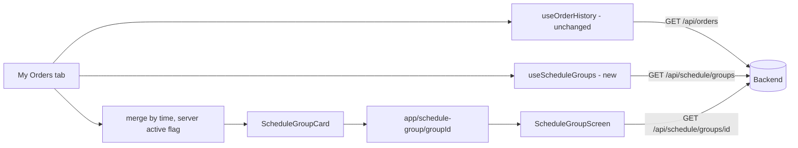

# Schedule: customer app, Schedule groups in My Orders

Follows the backend PR 5 ([schedule-pr5-customer-tracking-plan.md](schedule-pr5-customer-tracking-plan.md), locked decision L8). Branching: customer app branch from `feature/schedule` (it exists in Food-Ninja-Frontend), PR into `feature/schedule` ([schedule-branching-policy](schedule-branching-policy.md)). Decided by Samivan (2026-11-02): Schedule groups appear in the same My Orders list as regular orders (D5), merged by the app, two separate backend reads.

## Goal
A signed-in customer opens My Orders and sees their Schedule groups next to their regular orders: live groups under Active, finished ones under Past, each with one status per shop. Tapping a group opens a group screen with items, per-shop status, delivery time slot, totals and any refund.

## Backend contract available (merged, PR #73)
- `GET /api/schedule/groups?page&size` returns `{ groups[], page, totalPages, totalElements }`. A summary has: groupId, groupCode, serviceDate, slotStartLocalTime, currencyCode, payableTotal, paymentStatus, active, hasRefund, createdAt (epoch ms), members[{ orderId, orderCode, shopName, status, total }].
- `GET /api/schedule/groups/{id}` returns the summary fields plus fees, delivery label and address, holdExpiresAtMs, cancelUntilAt, lateCancelFromAt, canCancel, members[{ ..., declineReason, canLateCancel, items[{ name, quantity, lineTotal, addons[] }] }], refunds[{ orderId|null, state PENDING|ON_ITS_WAY|REFUNDED|REJECTED, amount, currencyCode, reason, requestedAt, processedAt }].
- Cancel: `POST /api/schedule/groups/{id}/cancel`; late cancel `POST /api/schedule/orders/{id}/late-cancel` (flag OFF in production). Both return the older `ScheduleGroupView`.
- Every `OrderStatus` value can appear as a member status (SCHEDULED, PLACED, ACCEPTED, PREPARING, READY, OUT_FOR_DELIVERY, DELIVERED, DECLINED, CANCELLED, PAYMENT_FAILED, others), so the app must render an unknown value neutrally.

## Today (customer app facts)
- `app/(tabs)/orders.tsx` (544 lines) renders regular orders from `useOrderHistory`, which loads page 0, size 20 once on mount and when guest state changes, with no load-more and no refresh on focus. It splits Active and Past with `isTerminal` and has vertical filter chips (`distinctVerticals`).
- `src/features/orders/types.ts` has no `SCHEDULED` status. `STATUS_LABEL` and `STATUS_COLOR` in orders.tsx are `Record<OrderStatus, string>`, so adding a status forces every such record to be updated at compile time.
- The order detail route is `app/order/[id].tsx` with `OrderTrackingScreen`, `OrderStatusStepper` (assumes PLACED, PREPARING) and `useOrderPolling` (12 s while focused, one order).
- Refunds for regular orders use `IRefundSummary` (`INITIATED`, `REFUNDED`, `NOT_APPROVED`, with the admin note on `NOT_APPROVED`) and `refundCopy.ts`; the backend source is `RefundSummaryDto` built in `PaymentRefundQueryServiceImpl`.
- The app has no consumer of any `/api/schedule/groups` endpoint yet.

## Proposed design (before review)
1. Types and service in `src/features/orders` (same feature, no cross-feature import): group types mirroring the backend records, `getScheduleGroups(page, size)`, `getScheduleGroup(id)`; `SCHEDULED` added to `OrderStatus`.
2. `useScheduleGroups` hook with its own loading, error and empty state; `useOrderHistory` unchanged; My Orders merges the two lists into one discriminated list item (`order` or `group`) sorted by time, newest first (`placedOn` for orders, `createdAt` for groups).
3. Active versus Past for a group comes from the server `active` flag; the app compares no clock and no status for groups.
4. New `ScheduleGroupCard` (one card, one line per shop with its status) and a new route `app/schedule-group/[groupId].tsx` with a group screen; the single-order card, stepper and tracking screen are not reused.
5. Refresh on screen focus and pull-to-refresh for both sources; an interval of 60 s only while a visible group is active.
6. Guests make no group request. One failing source never shows "No orders yet" for the other.
7. Group refund lines render with their own copy for the four states the backend sends.
8. Cancel: the group screen shows a Cancel action only when `canCancel` is true.

## Open questions
- Refund vocabulary: group refund lines use a four-state vocabulary, the existing orders use three states plus the admin note. One vocabulary or two?
- Is Cancel part of this PR or a follow-up?
- Does a Schedule vertical chip belong on the filter row?

## Data model review

### Summary (read this first)
**Verdict:** Design approved with changes; nothing in the environment blocks it (no table, column or migration is added).
**What changes** (before → after):
- The app gets its first Schedule screens: a group card inside My Orders and a group screen. The app has no Schedule code today, so this is the first of several customer Schedule slices.
- One backend follow-up first (B1): group refund lines use the same customer refund contract regular orders already use (Refund initiated, Refunded on a date, Refund not approved with the admin's note), through one shared mapper. The merged PR 5 invented its own four states and withheld the note. The app then reuses its existing refund wording.
- Schedule member statuses get their own type with labels and a safe fallback instead of widening the app's `OrderStatus`, which would force edits in the shop and POS screens.
- Dates and times are shown exactly as sent (service-area local wall clock); money is formatted with the currency the backend sends.
**Decisions you need to make:**
| # | decision | options | recommended, and why | if you pick the other option |
|---|---|---|---|---|
| A1 | Refund wording and the admin note | (1) keep the four states approved for PR 5 and add the note · (2) use the contract regular orders already use (initiated, refunded, not approved + note) | **Answered 2026-11-02: Samivan delegated it ("what most apps do, nothing new, clear, no misunderstanding"); geld chose (2).** Customers already see "Refund initiated", "Refunded on <date>", "Refund not approved: <note>" on regular orders; one vocabulary everywhere, no new copy, and the locked refund plan (OD3, L-10) already says so. "On its way" is dropped (it supersedes the D2 wording from the PR 5 review). | (1) keeps a second refund vocabulary the app must carry forever |
| A2 | Cancel button in this PR | in this PR · follow-up | **Answered: follow-up** (Samivan): it moves money, needs confirm, duplicate-tap and "did it go through" handling, and the refund screen | cancel waits; `canCancel` is already returned and ignored meanwhile |
| A3 | Build order | this slice first, tested with a group created through the API · after the customer Schedule creation flow (slot, menu, cart, checkout) | **Answered: My Orders first** (Samivan) | the creation flow lands first; My Orders waits, nothing else changes |
**What geld decided for you:**
- Groups appear under "All" and the Food chip (a Schedule group is FOOD, `CartType.SCHEDULE` maps to FOOD); no new chip.
- The list refreshes on focus and pull, plus a 60 s interval only while a visible group is active and the screen is in the foreground (the same cost the backend plan accepted).
- A group is never opened in the single-order screen; its own screen shows items, shop statuses, slot, totals and refunds.
- All code stays in `src/features/orders`; the routes are thin files.
**What must happen before build:** (1) A1 to A3 answered; (2) backend follow-up for the refund note (small PR into `feature/schedule`); (3) `/gcp` for the app PR; (4) app branch from `feature/schedule`.
**Unknowns that could change this:** whether pilot customers expect a push when a shop declines (2d); real group counts per customer (assumed tens a year).

**Status:** FINAL · **Verdict:** APPROVED WITH CHANGES (all must-changes agreed) · geld deep, 2026-11-02 · previous: none
**Target:** React Native (Expo) app on Expo Router; backend Spring Boot on Neon (scale-to-zero); no migration
**Lenses run:** 0, 1, 3, 4, 5, 6, 7, 8 · **skipped:** 2 (no table, column or constraint is added) · **reference designs:** skipped (not a core data design)
**Codex second opinion:** deep, blind: agreed 7, Codex-only verified 2, Codex claim refuted 1, disagreements 1 (see reconciliation)
**Open inputs:** group counts per customer (assumed tens a year); concurrent open My Orders screens at lunch (assumed 100)

### Lens 0 (environment)
No schema change, no SQL, no migration. The backend refund-note change is code only. Checks 1 to 4 (migration authority, auto-DDL, default production path, credentials) are the repository-wide fails already accepted for PR 5 under D4 and are not worsened here.

### Built vs plan
| element | plan says | in code at | deployed | depended on by |
|---|---|---|---|---|
| `GET /api/schedule/groups`, `GET /api/schedule/groups/{id}` | consumed by the app | backend `feature/schedule` d5fd539 (PR #73) | no (not on `main`) | no app consumer (searched `app/` and `src/` for "schedule": no match) |
| group refund lines | consumed | `RefundLine` with four states, no note | no | none |
| app Schedule screens | planned | none | no | none |
| regular history excludes members | relied on | `OrderRepository.java:73` `o.groupId IS NULL` in the query that `getOrderHistory` calls (`OrderServiceImpl.java:188`) | n/a | verified, before paging |

### Design changes
This plan makes a customer's Schedule groups visible next to their regular orders without disturbing the regular order flow.
| # | before | after | problem it solves | why it is better | what it costs | alternative, why it lost |
|---|---|---|---|---|---|---|
| 1 | group refund lines have their own four states, number amounts and no note | group lines use the regular-order refund contract through one shared mapper | API-1: locked decision OD3 and L-10 say the customer sees "Refund not approved: <note>"; external refunds would show; two vocabularies | one rule and one wording for every refund; the app reuses `refundCopy.ts` | extract one mapper, change `RefundLine`, adjust PR 5 tests, app type | keep four states plus a note (A1 option 1): a second vocabulary to carry |
| 2 | one `OrderStatus` for everything | `ScheduleMemberStatus` (string union plus unknown) with its own labels | API-2: adding `SCHEDULED` to `OrderStatus` breaks `Record<OrderStatus, ...>` in `ShopOrdersScreen` and `CheckDetailScreen` (shop and POS screens that can never see it) | no ripple into unrelated features; unknown values render neutrally | one small file | widen `OrderStatus`: couples the shop and POS screens to a customer-only status |
| 3 | one list source | two independent sources merged for display | STATE-1: one failing request must not blank the other | partial data stays usable | a view model and per-source state | one backend endpoint over both: breaks the coupling guard and reopens the isolation work |

### Names
No table or column. New app names: `ScheduleMemberStatus`, `IScheduleGroupSummary`, `IScheduleGroupDetail`, `useScheduleGroups`, `ScheduleGroupCard`, route `app/schedule-group/[groupId].tsx`. Vocabulary check: the app already says "order" for a single shop order, `IOrderResponse`; `group` matches the backend word (`groupId`, `groupCode`); no clash found in `src/features/orders`.

### Invariants
| # | invariant | enforced by | evidence |
|---|---|---|---|
| 1 | a Schedule member never opens the single-order screen | group cards route only to the group screen; no link from the group screen to `/order/[id]` | `GET /api/orders/{id}` still returns an owned member (no group guard), so the guard is in the app routes |
| 2 | regular history never contains a member | backend query | `OrderRepository.java:73` |
| 3 | active versus past for a group comes from the server | app reads `active`, compares nothing | backend plan L6 |
| 4 | an unknown member status never crashes a screen | `ScheduleMemberStatus` fallback label and tone | jest test over every backend `OrderStatus` value |
| 5 | a date or time from the backend is never passed through `new Date()` | helpers split the strings | jest test |
| 6 | no money arithmetic in the app | formatting only | review rule |

### Scenarios, access patterns, sizing
Scenarios: (1) at lunch, 100 customers have My Orders open; the screen shows data within 2 s of focus and each refresh costs one group-list request; (2) one source failing keeps the other visible with a retry on the failed part; (3) a shop declines and the customer sees the status and the shop's reason within one refresh; (4) a rejected refund shows its note.
| # | actor | read | endpoint | trigger | rate | cost |
|---|---|---|---|---|---|---|
| A1 | customer app | list | `GET /api/schedule/groups?page=0&size=20` | focus, pull, 60 s while an active group is visible | 1 request per screen per minute while active | about 3 to 5 queries each (backend plan A1) |
| A2 | customer app | detail | `GET /api/schedule/groups/{id}` | open, pull, 60 s while the group is active | 1 per open detail screen per minute | about 5 queries |
Sizing: 100 open screens is about 100 list requests a minute during the lunch window, nothing outside it. No new storage. Measure at the pilot; the cheaper alternative is focus and pull only.

### Findings
#### Must change before build
**API-1 · risk · MUST** — group refunds must use the customer refund contract regular orders already use.
- Evidence: refund plan OD3, L-10 and line 327 ("Customer order and group responses gain a refunds list ... money as decimal strings") (`refund-approval-plan.md:119,287,327`); the existing builder `PaymentRefundQueryServiceImpl.java:53-100` maps PROCESSED to REFUNDED, REJECTED to NOT_APPROVED and REQUESTED, SUBMITTING, ISSUED and FAILED to INITIATED; hides refunds raised externally and a FAILED refund that has a retry; sends the amount as a plain string, a plain-words reason, the admin note only when not approved, and a per-state `occurredAt`; `refundCopy.ts:14-26` renders it. `CustomerRefundView.java` instead sends four states and number amounts, reads no note, shows external refunds, and `ScheduleCustomerSourceInvariantTest` forbids `getDecisionNote` (fact).
- Failure: an admin rejects a group refund with the required note and the customer sees no reason; an admin-issued external refund appears as a customer refund line; the same refund reads "Refund initiated" on an order and "on its way" on a group; the app carries two refund vocabularies.
- Change (backend follow-up B1): extract the row mapping and the visibility filter of `PaymentRefundQueryServiceImpl` into one pure public class `service/refund/RefundSummaryMapper` used by both the per-order summaries and the group lines; `RefundLine` becomes `{ orderId | null, status INITIATED | REFUNDED | NOT_APPROVED, amount (decimal string; allocation sum for a member line), currencyCode, reason (plain words), note (only NOT_APPROVED), occurredAt }`; `CustomerRefundView` expands each visible refund into one line per allocated order plus one group-level line; the source-scan test allows `getDecisionNote` only inside `RefundSummaryMapper`. The app type is `IRefundSummary` plus `orderId: string | null`, rendered by the existing `refundCopy.ts`.
- Cost to change now: cheap (PR #73 is merged only into `feature/schedule`, not deployed, no app consumer; regular order summaries keep their behaviour and tests).
**API-2 · risk · MUST** — do not widen `OrderStatus`; add `ScheduleMemberStatus`.
- Evidence: `Record<OrderStatus, ...>` in `orders.tsx`, `ShopOrdersScreen.tsx` and `CheckDetailScreen.tsx` (searched); the backend can send every `OrderStatus` value for a member (backend plan STATE-1).
- Failure: adding `SCHEDULED` to the shared union breaks the shop and POS screens at compile time; an unmapped value crashes or shows a blank label.
- Change: string union of the values the group screens expect plus an unknown fallback with a neutral label; a jest test iterates the backend value list; payment-failed members show "Not placed, refunded".
- Cost to change now: free.
**TIME-1 · risk · MUST** — show service date and slot time as sent.
- Evidence: Jackson writes `LocalDate` as `"2026-11-03"` and `LocalTime` as an ISO time without offset (`JacksonConfig.java:12-16`); the DTO carries no timezone (fact).
- Failure: `new Date("2026-11-03")` parses as UTC and can show the previous day on a device in a west-of-UTC timezone; `"12:30:00"` passed to `Date` is invalid.
- Change: helpers split the strings (`YYYY-MM-DD`, `HH:mm`) and format with a fixed month and weekday table; no timezone label for the single service area (HSR); a jest test at `00:00` and `23:59`.
- Cost to change now: free.
**STATE-1 · risk · MUST** — two-source state is safe and honest.
- Evidence: `useOrderHistory.ts` has no cancellation, no stale-response guard and no clearing on logout (fact).
- Failure: a customer logs out and another logs in; a slow response from the first account fills the second account's list; or the group request fails and the screen says "No orders yet".
- Change: per-source `{ data, loading, error, stale }`; a request token ignored when the user or the call changed; both sources cleared when the token changes; a global empty state only when both succeeded empty; guests make no group request; deduplicate overlapping refreshes.
- Cost to change now: free.
**TRACE-1 · risk · MUST** — the contract section of this plan was wrong.
- Evidence: `ScheduleCustomerDtos.java:20,42`: the detail record has no `createdAt` or `hasRefund`, and the address field is `deliveryFormattedAddress`; money fields are JSON numbers while `IRefundSummary.amount` is a string.
- Change: the app types mirror the records exactly; a separate money formatter takes `(amount: number, currencyCode)`; group money never reuses `IRefundSummary`.
- Cost to change now: free.
**TRACE-2 · risk · MUST (scope)** — the customer app has no Schedule creation flow.
- Evidence: no "schedule" match in `app/` or `src/`; backend slot, menu, cart, checkout and payment endpoints exist.
- Failure: shipping My Orders alone leaves nothing a customer can order; QA needs groups created through the API.
- Change: record the phases below; this plan is C5; the pilot gate includes C1 to C4.
- Cost to change now: free.
#### Fine now, revisit at <trigger>
- **COST-1 · revisit at pilot:** 60 s polling while an active group is visible; switch to focus and pull only, or a push-triggered refresh (2d), if the database stays awake outside lunch.
- **PERF-1 · revisit when a customer has over 20 groups:** the app loads page 0 of 20 only; load-more arrives with the regular orders list.
- **TIME-2 · revisit at the first service area outside Asia/Kolkata:** add a timezone label to the contract.
- **PLACE-1 · cancel:** deferred (A2); when built it needs confirm, a disabled button while pending, a re-fetch after success or an unclear failure, and the refund line afterwards.
- **OWN-1 · keep:** all code in `src/features/orders`, thin routes, `fetchFn` through the orders service, `AppText` variants and no `fontFamily` in styles, skeleton loaders for the list and the group screen, safe-area footer, no import from another feature.
#### Keep (good decisions)
- A separate group card and screen: the single-order card assumes one shop, a rider, an ETA and a stepper that do not exist for a group.
- The server owns `active` and `canCancel`.
- Two independent reads, merged only for display.
- Regular history already excludes members before paging (verified at `OrderRepository.java:73`, called from `OrderServiceImpl.java:188`).

### Codex reconciliation (blind, read-only)
| point | Codex | geld | outcome |
|---|---|---|---|
| Jackson formats, dates as ISO strings, money as numbers | yes | verified (`JacksonConfig.java`) | agreed |
| detail record lacks `createdAt` and `hasRefund`; address field name | yes | verified (`ScheduleCustomerDtos.java`) | Codex-only, applied (TRACE-1) |
| unknown statuses need a neutral label and tone | yes | API-2 | agreed |
| independent refresh, logout clearing, stale responses | yes | STATE-1 | agreed |
| thin route, ID only, same-feature code | yes | OWN-1 | agreed |
| cancel as a follow-up | yes | A2 | agreed |
| show service-area local date and time, no device conversion | yes | TIME-1 | agreed |
| Schedule is a fulfilment mode, not a vertical | yes | groups under All and Food, no chip | agreed |
| "regular history includes Schedule members" (called a blocker) | claims `OrderServiceImpl.java:184` and `OrderRepository.java:74` lack a group filter | refuted: `OrderRepository.java:73-74` is `... and o.groupId IS NULL order by ...` and `getOrderHistory` calls that method (`OrderServiceImpl.java:188`) | Codex claim refuted; no backend or rollout change |
| refund vocabulary | adapt in the app, no backend change | the locked refund plan (OD3, L-10) says the customer sees the admin note on rejection, and the existing builder hides external and retried refunds | disagreement decided on evidence: one shared backend mapper, regular-order contract (API-1, A1 answered) |
| `GET /api/orders/{id}` returns an owned member | yes | verified earlier | invariant 1: guard in the app routes |

### Devil's advocate trace
| DA point | outcome |
|---|---|
| A merged list duplicates or leaks members | refuted by `OrderRepository.java:73`; kept as invariant 2 |
| Widening `OrderStatus` ripples into shop and POS screens | absorbed (API-2) |
| An unknown or unmapped status crashes a screen | absorbed (API-2, invariant 4) |
| Slot time shifted by the device timezone | absorbed (TIME-1) |
| A stale response fills the next user's list | absorbed (STATE-1) |
| A rejected refund shows no reason | absorbed (API-1) |
| Cancel double tap or an unclear failure | deferred with its requirements (PLACE-1, A2) |
| The stated goal is the mobile Schedule UI; this plan delivers only My Orders (check 9) | absorbed (TRACE-2, Future phases); a pilot gate, not a footnote |
| Polling keeps a scale-to-zero database awake | accepted with a trigger (COST-1) |
| "No app consumer exists" claim | verified by search of `app/` and `src/` for "schedule" (no match), not by a guessed name |

### Future phases
| phase | new tables | change forced on this design |
|---|---|---|
| C1 slot and area picker | none | none |
| C2 Schedule menu | none | none |
| C3 Schedule cart | none | none |
| C4 checkout and group payment | none | the route after payment goes to the group screen (`replace`, with a My Orders fallback) |
| C5 My Orders groups (this plan) | none | none |
| C6 group cancel | none | adds the cancel action to the group screen |
| push on shop decline (2d) | device or event store | none to these reads |
| STATE-4 bulk delivery | none | none (OUT_FOR_DELIVERY and DELIVERED already render) |

### Rollout
App ships after the backend note change. N-1: older app versions never call the group endpoints, so they are unaffected by the merged backend; a new app against a backend without the group endpoints shows a source-specific "could not load Schedule orders" and keeps regular orders. Order: backend note PR into `feature/schedule`, then the app PR into the app's `feature/schedule`. Nothing goes to `main` without asking.

Device check (open gate, Samivan will test later, 2026-11-03): layout, safe-area footer, long shop lists and polling behaviour on a physical Android phone are NOT verified by the app PR; jest and tsc only prove the logic. Test with a group created through the API (shop declined, shop accepted, refund rejected with a note, payment-failed group, a group with two shops).

### Design versions
| version | phase | date | what changed | why |
|---|---|---|---|---|
| 0.1 | C5 | 2026-11-02 | first review | /geld deep |

### Locked decisions (handoff to /gcp and /judge)
Locked 2026-11-02 after A1 to A3. Ids: M1 one `RefundSummaryMapper` (backend) builds order and group refund lines; `RefundLine` is `IRefundSummary` plus `orderId`; external refunds and retried FAILED rows hidden; `getDecisionNote` read only in the mapper; M2 `ScheduleMemberStatus` with unknown fallback; M3 date and time helpers without `Date`; M4 per-source state with request token and logout clearing; M5 groups under All and Food, no chip; M6 group screen never links to `/order/[id]`; M7 60 s poll only while an active group is visible; M8 money formatter `(number, currencyCode)`.

### Approval record
| finding or decision | option chosen | by | date |
|---|---|---|---|
| A1 refund wording and note | delegated by Samivan ("what most apps do, nothing new"); geld chose the existing regular-order contract through one shared mapper; supersedes the PR 5 four-state wording | Samivan, geld | 2026-11-02 |
| A2 cancel | follow-up PR | Samivan | 2026-11-02 |
| A3 build order | My Orders first | Samivan | 2026-11-02 |
| API-1, API-2, TIME-1, STATE-1, TRACE-1, TRACE-2 | accepted as the must-change set | Samivan (via A1 to A3), geld | 2026-11-02 |

## System design

### Components

Stores: the backend database is the system of record; the app holds a derived in-memory copy per source, cleared on logout.

### Main flows
Open My Orders: both hooks fetch independently; each shows skeleton, data, stale data with a retry, or an error; the merged list sorts newest first by `placedOn` or `createdAt`, ties broken by type then id. Open a group: the route passes the id; the screen fetches the detail and polls every 60 s while the group is active and the screen is focused.

### Decisions
| decision | options | chosen | negative consequence | revisit when |
|---|---|---|---|---|
| status typing | widen `OrderStatus` / own type | own type | one more label table | never |
| merge | app / one backend endpoint | app | two requests | volume or tomorrow-ordering |
| refund copy | three states / four states plus note | three states plus note, one shared mapper (A1) | "on its way" is not shown | a customer asks where the money is |
| refresh | poll / pull only | 60 s while active | database awake at lunch | pilot cost check |

### Isolation, tenancy, API
Owner module: orders feature in the app; schedule module in the backend. The customer is identified by the token. Lists are bounded (page 0, size 20). Money is amount plus currency code. The app must render an unknown status or refund state neutrally.
