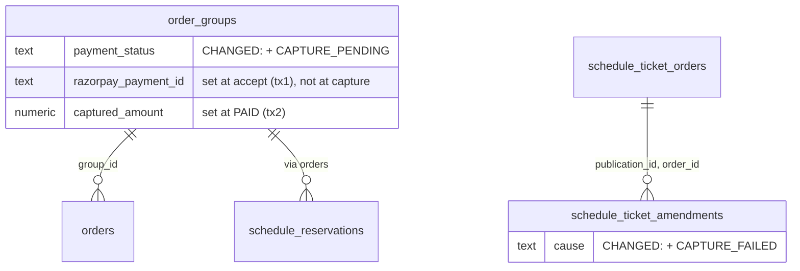
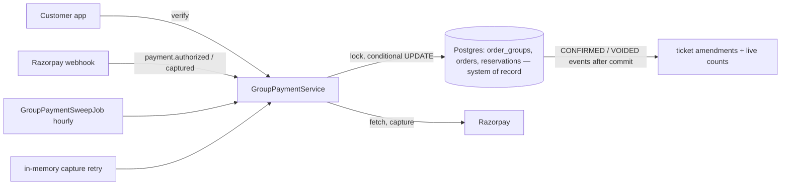

# Schedule group payment: in-flight sweep fix and manual capture

Two fixes to the Schedule group payment path (backend `service/schedule/payment/`), raised by the Codex review of
slice 4.0 (PR #81, 2026-11-11).

- **Part S — stale sweep (no schema).** The hourly sweep fails a CREATED group even when Razorpay shows a payment
  still in progress, so a UPI payment mid-approval is cancelled and then refunded.
- **Part B — cancel race (manual capture).** Cancel reads the gateway, then cancels; a payment that starts in
  between is captured and refunded. Razorpay cannot close an Order, so only manual capture closes it.

## Phases

| # | Phase | Repo | Branch | Base | Notes |
|---|---|---|---|---|---|
| S | In-flight ceiling for sweep + resolve | ninja delivery service java | feature/schedule-sweep-inflight | feature/schedule | no schema |
| B0 | Razorpay test-mode spike (manual capture, UPI, capture_options) | ninja delivery service java | - | feature/schedule | gates B1 |
| B1 | Manual capture: CAPTURE_PENDING, capture after confirm, retries | ninja delivery service java | feature/schedule-manual-capture | feature/schedule | BUILT 2026-11-12, merged into backend `feature/schedule` (PR #84, 2026-11-13), see "B1 build record"; SQL `db_manual/schedule-manual-capture-migration.sql` RUN by Samivan 2026-11-13; webhook `payment.authorized` subscribed |

## Razorpay facts (official docs, read 2026-11-11)

| Fact | Source |
|---|---|
| No API cancels or expires a standard Order (endpoints: create, fetch, fetch payments, PATCH notes) | razorpay.com/docs/api/orders/ |
| A payment with no bank response stays `created` ~10 min, then `failed` | razorpay.com/docs/payments/payments/late-authorisation/ |
| Late authorisation: bank polled for 3 days (one page says 5); automatic capture captures it | late-authorisation/, capture-settings/ |
| `capture_options.automatic_expiry_period` minutes, min 12, "mandatory if capture = automatic" | capture-settings/api |
| `manual_expiry_period` minutes, default and max 7200; authorised payments past it are auto-refunded | capture-settings/api |
| Order create has no expiry field | api/orders/create/ |
| `authorized` = money already deducted from the customer's account and held by Razorpay | razorpay.com/docs/payments/payments/ |
| An authorised payment not captured before expiry is auto-refunded, always at normal speed (5-7 working days) | payments/, refunds/auto-refunds |
| No API releases or refunds an uncaptured payment early | capture/, payments/ (read 2026-11-12) |
| Order-level capture setting overrides the Dashboard setting; manual capture excluded only for bank transfer | capture-settings/ |
| Capturing twice returns 400 "This payment has already been captured" | api/payments/capture/ |

**B0 spike results (2026-11-12, Razorpay TEST mode, Dashboard capture = Automatic 12 min, script `schedule-b0-spike/b0-spike.mjs`):**

| Premise | Result |
|---|---|
| P1 order accepts `payment.capture: manual` + `capture_options.manual_expiry_period: 120` | CONFIRMED (3 runs) |
| P1b `capture: manual` without `capture_options` | REJECTED 400 "Config Manual duration should be set when capture is manual": `manual_expiry_period` is REQUIRED, never omit it (docs' "default 7200" is wrong for orders) |
| P3 order-level manual overrides the Dashboard Automatic setting | CONFIRMED (card payment stayed `authorized`) |
| P5 capture of an authorized payment | CONFIRMED (200, `captured`) |
| P6 second capture | CONFIRMED (400 "This payment has already been captured") |
| P4 manual capture works for UPI | NOT TESTED: test-mode UPI QR cannot be paid from a real app; direct server-to-server payment API not enabled (404); UPI-ID entry not yet tried. Tested with an Indian test card only. Carry to the real-payment round |
| P7 a failed payment shows `failed` on fetch-order-payments | CONFIRMED (card, bank-page Failure; BAD_REQUEST_ERROR "Payment failed") |
| P8 a failed payment cannot be captured (R3 premise) | CONFIRMED: 400 "Only payments which have been authorized and not yet captured can be captured". Not tested: capturing an auto-REFUNDED payment (expiry); the same message is expected for any non-authorized state, assert it in the first real run |

TODO (live phone round, Samivan 2026-11-12: skip for now, not a B1 blocker): (1) UPI manual capture (P4): pay a real UPI order, expect `authorized` then capture OK; (2) capture an auto-REFUNDED payment after the 120 min expiry, expect 400. R3 premise (failed payment cannot be captured) holds, so the compensate-only-after-fetch design stands.

## Part S — design (APPROVED by devil's advocate 2026-11-11)

- One classifier for gateway payments: CAPTURED (any captured), IN_FLIGHT (any `created`/`authorized`, none
  captured), NONE.
- IN_FLIGHT blocks closing a group only while `now < hold_expires_at + 15 min` (180 s hold + Razorpay's ~10 min
  `created` timeout + margin). Past it the group closes as today; a later capture goes through the refund net
  (`GroupPaymentSettlement.capture`, PAYMENT_AFTER_FAILURE, tested in `GroupPaymentSettlementTest`).
- `sweepStale`: CAPTURED → settle; IN_FLIGHT inside the ceiling → skip, log, retried next run; else `failStale`.
- `resolveOpenCheckout` / `cancelCheckout`: same rule, so a stuck in-flight payment cannot lock the cart forever.
- Every captured payment is still passed to settlement (never "pick one"): settlement ignores the same payment id
  and refunds a second capture (`GroupPaymentSettlement.java:44-51`). (Codex)
- Tests set `holdExpiresAt` explicitly and assert both sides of the ceiling; today's in-flight tests leave it null,
  and a null inside the sweep's `try` would be swallowed and pass silently. (Codex, verified
  `GroupPaymentServiceImplTest.java:27-28`)
- The 15 minutes is a policy, not a safety bound: with the hourly sweep a group closes up to ~60 min after it; Part S
  narrows refunds, Part B removes them.
- Condition (DA S-1): app 4.3 sets the Razorpay sheet `timeout` to the hold's remaining seconds.
- Writers that close a CREATED group, checked (DA S-3): sweep no-order branch (no payment possible), sweep
  `failStale` (fixed), resolve/cancel (fixed), checkout gateway failure `ScheduleCheckoutServiceImpl.java:60` (app never
  got the order id), hold-lapse void at capture `ScheduleReservationSettler.java:35-51` (already captured: refund;
  removed by Part B).

## Part B — proposed design

```mermaid
sequenceDiagram
    participant App
    participant API as GroupPaymentService
    participant DB as order_groups / reservations
    participant RP as Razorpay
    App->>RP: pay (order created with capture=manual)
    RP-->>App: handler(payment_id, signature) on AUTHORIZATION
    App->>API: verify
    API->>RP: fetch payment (status authorized, amount, currency)
    API->>DB: tx1 lock cart+group: CREATED? validate amount; confirm reservations (slot-day lock)
    alt stock gone / mismatch / group not CREATED
        API->>DB: group FAILED / CAPTURE_MISMATCH / stays CANCELLED; NO capture
        Note over RP: Razorpay auto-releases the authorisation after manual_expiry_period
    else confirmed
        API->>DB: group CAPTURE_PENDING (commit)
        API->>RP: capture(payment_id, amount, currency)
        API->>DB: tx2 lock group: CAPTURE_PENDING -> PAID, members SCHEDULED (finishPaid)
    end
    Note over API,DB: capture error: in-memory retry 1/2/5/10 min, hourly sweep, freeze-time resolve
```

- Cancel, sweep fail and hold-lapse void run under the same group lock and require CREATED; once committed, an
  authorisation arriving later is never captured. This closes the race (DA point R).
- `payment.authorized` webhook joins `payment.captured`/`order.paid` in `PaymentServiceImpl.processWebhook`
  (`PaymentServiceImpl.java:478`) for group orders; Razorpay dashboard subscription is an ops step.
- Capture permanently refused (authorisation expired, voided by bank): tx under locks voids the CONFIRMED
  reservations (reason `CAPTURE_FAILED`), group FAILED, members PAYMENT_FAILED, cart back to ACTIVE.
- Capture "already captured" error: fetch payment; captured → tx2 as normal (idempotent retry).
- Any ambiguous capture outcome (timeout, 5xx) is reconciled by fetching the payment before a retry or a
  compensation; only a definitive refusal (payment `failed`/expired) releases the confirmed stock. (Codex)
- The sweep gets a second query for CAPTURE_PENDING groups (today's `findStaleCreated` reads CREATED only,
  `OrderGroupRepository.java:70`). (Codex)
- Ops rule: Schedule payments are never captured from the Razorpay dashboard; only this path captures. (Codex)
- Eat Now is untouched: its orders keep `capture: automatic`.

### B1 state machine (`order_groups.payment_status`)
Every transition is a conditional UPDATE on the expected status (pattern of `OrderGroupRepository.java:40-66`), under
the existing lock order cart → group → members (`GroupPaymentSettlement.java:41-43`).

| from | to | writer | guard | side effects |
|---|---|---|---|---|
| CREATED | CAPTURE_PENDING | accept (verify, webhook `payment.authorized`, sweep, resolve) | `status='CREATED' AND razorpay_payment_id IS NULL`; amount and currency match; reservations confirmed in the same tx | `razorpay_payment_id` = P, `captured_amount` NULL |
| CREATED | CAPTURE_MISMATCH | accept, validator fails | same | payment id set, `captured_amount` NULL, reservations voided, members PAYMENT_FAILED; no capture, no refund |
| CREATED | FAILED | accept, hold lapsed and stock gone (`ScheduleReservationSettler.java:35-51`) | existing `markFailed` | no capture, no refund (today: capture + refund) |
| CREATED | FAILED / CANCELLED | sweep `failStale` / cancel, resolve | Part S rule; no authorised or captured payment | unchanged |
| CAPTURE_PENDING | PAID | capture confirmed: capture API 200; 400 "already captured" + fetch = captured; webhook `payment.captured`; sweep fetch = captured | `status='CAPTURE_PENDING' AND razorpay_payment_id = P` | `captured_amount` set; `finishPaid` (members SCHEDULED, cart COMPLETED) |
| CAPTURE_PENDING | FAILED | capture definitively refused: fetch shows `failed` or `refunded` (expired) | same guard | reservations CONFIRMED → VOIDED (reason `CAPTURE_FAILED`); members PAYMENT_FAILED; ticket amendment `CAPTURE_FAILED` when published; cart ACTIVE |

No writer moves a group out of PAID, FAILED, CANCELLED or CAPTURE_MISMATCH (unchanged). Customer cancel already
requires PAID (`CancelEligibility.java:19`, `ScheduleCancelServiceImpl.java:51`) and checkout cancel requires CREATED
(`GroupPaymentSettlement.java:98-99`), so a CAPTURE_PENDING group cannot be cancelled by either path (D3 is the
existing behaviour).

### Path matrix: what each payment event does, by group status
| group status | authorised payment P seen | captured payment P seen |
|---|---|---|
| CREATED | accept P → CAPTURE_PENDING → capture | captured outside our decision (dashboard, ignored setting): today's `settlement.capture` path (confirm → PAID, or void → refund) |
| CAPTURE_PENDING, P is the group's | retry capture | → PAID |
| CAPTURE_PENDING or PAID, P is another payment | ignore, log; Razorpay auto-refunds at expiry | extra-capture refund (existing, `ExtraCaptureRefundServiceImpl.java:35`) |
| PAID, P is the group's | nothing | nothing (idempotent, `GroupPaymentSettlement.java:44`) |
| FAILED, CANCELLED, CAPTURE_MISMATCH | ignore, log; Razorpay auto-refunds at expiry | orphan refund (existing) |

When an order has several payments, the order of preference is captured > authorised > created; the first accept to
win the conditional UPDATE owns the group, every other authorisation is never captured.

### Crash and ambiguity recovery
| process dies or call is ambiguous after | state | recovered by | idempotent because |
|---|---|---|---|
| tx1 commit, before the capture call | CAPTURE_PENDING, Razorpay `authorized` | in-memory retry; after a restart the sweep's CAPTURE_PENDING query | capture is keyed on P; guard `status='CAPTURE_PENDING' AND payment id = P` |
| capture call sent, before tx2 | CAPTURE_PENDING, Razorpay `captured` | webhook `payment.captured` → tx2; sweep fetch → tx2 | tx2 guard; a second tx2 updates 0 rows and returns the view |
| capture call times out or 5xx | unknown | fetch P first: captured → tx2; authorized → capture again; failed/refunded → void | never compensates without a fetch |

### Part S changes when B1 lands
`authorized` stops being "in flight" and becomes actionable: sweep and resolve run accept on it. Only `created` stays
in flight under the 15-minute ceiling. The classifier becomes CAPTURED > AUTHORIZED > IN_FLIGHT (`created`) > NONE.

### Column meaning after B1
- `razorpay_payment_id`: the payment this group's decision was about (accepted, or rejected as a mismatch). Set once.
- `captured_amount`: non-null only when Razorpay confirmed the capture. Refunds already refuse a group without it
  (`GroupRefundServiceImpl.java:107-109`), so no refund can be raised against an uncaptured payment.

### v0.2 changes from the second pass (DA + blind Codex, 2026-11-12)
- **R1. Two handlers, not one.** `onAuthorized` and `onCaptured` stay separate; an authorisation never enters the
  refund branches (mismatch, orphan, extra capture), which all assume money was captured
  (`GroupPaymentSettlement.java:49-89`, `ExtraCaptureRefundServiceImpl.java:32`).
- **R2. Same-id branch.** `GroupPaymentSettlement.capture` returns early when the payment id equals the group's
  (`:44`). With the id now stored at accept, that line branches on status: CAPTURE_PENDING → tx2 (PAID); PAID → no-op;
  FAILED or CAPTURE_MISMATCH with the group's own id → record `captured_amount` and raise a full refund (orphan path
  extended to the stored id; `recordOrphanCapture` requires a null id today, `OrderGroupRepository.java:66`).
- **R3. Fencing across the capture call.** No durable claim row is added. The fence is Razorpay's own payment state:
  we compensate (CAPTURE_PENDING → FAILED) only after a fetch shows `failed` or `refunded`, states from which our
  capture call cannot succeed; concurrent capture calls are safe because a second capture returns 400 "already
  captured", which we resolve by fetching. If a fetch fails, nothing is compensated and stock stays confirmed.
  B0 must confirm both premises (a `failed` or auto-refunded payment cannot be captured). Codex proposed a durable
  per-group claim; rejected because it would duplicate a fence the gateway already provides, unless B0 disproves it.
- **R4. Outage beyond the expiry.** If capture cannot complete for 120 min (Razorpay down), Razorpay auto-refunds and
  the sweep's fetch sees `refunded` → FAILED, stock released, ticket amendment `CAPTURE_FAILED`. The kitchen may
  already have the order on its ticket (stock was confirmed). Ops runbook line: a CAPTURE_PENDING alert at a slot's
  last call is checked by hand.
- **R5. My Orders list.** `findCapturedByCustomer` filters `razorpay_payment_id IS NOT NULL`
  (`OrderGroupRepository.java:19-20`); with the id stored at accept, uncaptured mismatch rows would appear. New
  predicate: `captured_amount IS NOT NULL OR payment_status = 'CAPTURE_PENDING'` (a just-paid group shows as
  "Confirming payment").
- **R6. Checkout replay while pending.** The writer finds only CREATED groups and the service rejects non-CREATED
  (`ScheduleCheckoutWriter.java:51-54`, `ScheduleCheckoutServiceImpl.java:86-108`). A replayed key on a
  CAPTURE_PENDING group returns that group's view; the open-group check reports `paymentInProgress=true`; no second
  checkout can start.
- **R7. Lock order (revisit, pre-existing).** The gateway-failure path takes the group row before the cart
  (`ScheduleCheckoutServiceImpl.java:59-68`); settlement takes cart then group. They do not overlap in time today
  (the sweep only sees groups 2 min past the hold); B1 makes every new writer use cart → group → members → slot-day.

### Test plan (B1)
1. Unit: one test per state-machine row and per path-matrix cell, plus the three recovery rows.
2. Mutation: remove each guard (status guard, payment-id guard, amount check, fetch-before-compensate) and name the
   test that fails; a mutation run proves it ran (green baseline first).
3. Database race tests on a Neon branch, never production: cancel vs accept on one group (50 runs: exactly one wins,
   no capture call after CANCELLED); two accepts with different payments (one wins); webhook `payment.captured` vs
   tx2 (one PAID, no error).
4. Razorpay test mode end to end (B2): normal UPI; cancel then pay; pay after the hold with stock gone; stop the
   backend between tx1 and the capture call, restart, sweep completes it.
5. Alert check: a CAPTURE_PENDING group older than 10 minutes logs at ERROR once per sweep.

### Migration sketch (DO NOT RUN — sketch for review; written as `db_manual/schedule-manual-capture-migration.sql` after FINAL)
```sql
-- Preflight: must return 0 before adding chk_order_groups_paid_captured.
SELECT count(*) FROM public.order_groups WHERE payment_status = 'PAID' AND captured_amount IS NULL;
SET lock_timeout = '3s';
ALTER TABLE public.order_groups DROP CONSTRAINT chk_order_groups_payment_status,
  ADD CONSTRAINT chk_order_groups_payment_status CHECK (payment_status IN
    ('CREATED','CAPTURE_PENDING','PAID','FAILED','CAPTURE_MISMATCH','CANCELLED'));
ALTER TABLE public.order_groups ADD CONSTRAINT chk_order_groups_pending_shape
  CHECK (payment_status <> 'CAPTURE_PENDING' OR (razorpay_payment_id IS NOT NULL AND captured_amount IS NULL));
ALTER TABLE public.order_groups ADD CONSTRAINT chk_order_groups_paid_captured
  CHECK (payment_status <> 'PAID' OR captured_amount IS NOT NULL);
ALTER TABLE public.schedule_ticket_amendments DROP CONSTRAINT chk_ticket_amendments_cause,
  ADD CONSTRAINT chk_ticket_amendments_cause CHECK (cause IN ('PAID_AFTER_FREEZE','CUSTOMER_CANCELLED',
    'RESTAURANT_DECLINED','OPS_CANCELLED','CANT_MAKE_APPROVED','CAPTURE_FAILED'));
```
Both tables are small (pilot volume); the brief ACCESS EXCLUSIVE lock of each ALTER is accepted.

Code that must change with this SQL (CHECK constraints are not deferrable):
- `markPaid` then `markPaidWithCapture` (`OrderGroupRepository.java:40,52`) writes PAID with `captured_amount` NULL
  for one statement; it is replaced by one UPDATE that sets PAID, payment id and amount together, in every path
  (including the "captured outside our decision" cell), before `chk_order_groups_paid_captured` is added.
- `markCaptureMismatch` (`:61`) stops writing `captured_amount` on the manual path.
- Once the dashboard subscribes `payment.authorized`, Razorpay sends it for Eat Now payments too: the webhook routes it
  only when `groupPayments.owns(orderId)`, and logs and ignores it for Eat Now (`PaymentServiceImpl.java:477-499`).

## B1 build record (2026-11-12, backend branch `feature/schedule-manual-capture`)

Built as designed (v0.2). Where the code is, and what was decided while building:

| Piece | Where |
|---|---|
| Orders created `capture: manual` + `manual_expiry_period: 120`; `capture(paymentId, amount, currency)` | `service/schedule/payment/RazorpayGroupPaymentGateway.java`, `GroupPaymentGateway.java` |
| tx1 accept / complete / compensate | `GroupCaptureSettlement.java` (no Razorpay call inside any transaction) |
| Sequencing: accept -> capture call -> complete; fetch-before-compensate | `GroupCapturer.java` |
| In-memory retries 1/2/5/10 min, one per group | `GroupCaptureRetry.java`; hourly sweep resumes CAPTURE_PENDING (`GroupCapturer.resumePending`, alert at 10 min) |
| Confirm moves the group to PAID (captured) or CAPTURE_PENDING (authorised) in one statement | `ScheduleReservationSettler.confirm(groupId, PaymentAcceptance)`; `PaymentAcceptance.java` |
| Captured event decided under the group lock (same-id branch, R2) | `GroupPaymentSettlement.capture` / `ownPaymentCaptured`; `GroupCaptureSettlement.complete` only delegates |
| Webhook `payment.authorized` for group orders; Eat Now ignored | `PaymentServiceImpl.processWebhook` |
| New transitions (each a conditional UPDATE) | `OrderGroupRepository`: `markCaptureAccepted`, `markPaidCaptured`, `markPaidFromCreated`, `markCaptureFailed`, `markUncapturedMismatch`, `recordCaptureOfOwnPayment`, `findCapturePending`; `markPaid` and `markPaidWithCapture` removed |
| Readers (EVOL-1) | checkout writer/service (replay and open-group treat CAPTURE_PENDING as open, `paymentInProgress=true`), My Orders (R5 predicate, pending shown active), controller messages by status, `CAPTURE_FAILED` ticket cause |
| SQL + guard | `db_manual/schedule-manual-capture-migration.sql`; `ScheduleSchemaGuard` MANUAL_CAPTURE entries |

Decisions made while building (not in v0.2):
- The authorised-payment accept rejects a wrong amount/currency/order as `CAPTURE_MISMATCH` with no capture and no refund, and reopens the cart; a lapsed hold with stock gone fails the group with no capture and no refund, and reopens the cart. (Codex review finding.)
- A pending group is shown as active in My Orders. A rejected or failed verify returns an honest message instead of "waiting for capture".
- The open-checkout unique index `uq_order_groups_open_checkout` still covers CREATED only; the one-open-checkout rule for a CAPTURE_PENDING group is enforced by the checkout writer under the cart lock. Extending the index is optional and not done.
- An uncaptured CAPTURE_MISMATCH group still raises the settlement exception flag (null captured amount counts as zero).

Not covered by tests, run in the real-payment round (B2): UPI manual capture; capture after Razorpay's auto-refund at expiry; the sheet `timeout` condition in app 4.3; stop the backend between tx1 and the capture call, restart, sweep completes it; cancel-vs-accept through the full service (tests prove the conditional UPDATEs and row lock on PostgreSQL 17.11, not the whole service stack).

Deploy order unchanged: run the SQL, subscribe the Razorpay webhook to `payment.authorized`, deploy the backend, app 4.3 shows "Confirming payment".

## Quality brief (/gcp, 2026-11-12, for the B1 build)

```
BRIEF - Part B manual capture (backend), base feature/schedule be4b2dc; build after B0 passes
Stacks: spring, sql-postgres, testing (rulebook INDEX.md reported stale; card rules used)
Rules that apply:
- SB-TX-02 / SQL-TX-03 [DEFAULT] no Razorpay call inside a transaction: tx1 commit -> capture -> tx2
- CORE-INT-01 [MUST] never retry a capture that may have gone out without fetching P first (R3)
- CORE-INT-02 [DEFAULT] classify Razorpay errors once: 400 "already captured" -> fetch; 5xx/timeout -> unknown
- CORE-INT-03 [DEFAULT] hard timeout on capture and fetch calls
- SQL-TX-01 / SQL-TX-04 [MUST/DEFAULT] every transition is a conditional UPDATE; check the row count
- SQL-TX-05 [DEFAULT] one lock order: cart -> group -> members -> slot-day (R7)
- SB-TX-01 [MUST] never save state then throw in the same tx (compensation commits before any error)
- CORE-ARCH-01 [MUST] one accept operation called by verify, webhook, sweep and resolve
- SQL-SCHEMA-02 [DEFAULT] pending/paid shape in CHECKs, not only in code
- CORE-JOB-03 [DEFAULT] sweep isolates failure per group (already does)
Reuse map:
- delayed retry -> TaskScheduler pattern in service/schedule/ticket/outbox/TicketOutboxRelay.java:86
- CHECK presence at boot -> ScheduleSchemaGuard CONSTRAINT_ALLOWS + ScheduleTicketRequiredObjects.java:35
- amount/currency check -> GroupCaptureValidator (run it on the authorised payment)
- lock helpers -> GroupPaymentSettlement.lockCart/locked; findByIdForUpdate (OrderGroupRepository:33)
- gateway capture call -> nothing found (searched "payments.capture", ".capture(" in src/main): new method on
  GroupPaymentGateway + RazorpayGroupPaymentGateway, mapped like fetchPayment
Low-impact reminders: SB-JPA-06 lock with timeout; SB-TX-07 no REQUIRES_NEW unless independent;
  CORE-STRUCT-05 rules in pure functions (classifier, path matrix); CORE-STRUCT-06 new webhook event = decision;
  CORE-JOB-05 jobs visible; CORE-READ-01 no dense one-liners; TEST-MAINT-04 one helper home; CORE-ERR-06 undo
  scoped to what the action created (void only this group's reservations)
Tests to write: one per state-machine row, per path-matrix cell, per recovery row (plan "Test plan");
  boundary: amount exactly equal vs 1 paise off, currency mismatch; failure: capture 5xx, fetch fails, 400
  already-captured; extend GroupPaymentServiceImplTest / GroupPaymentSettlementTest; new GroupCaptureSettlementTest.
  Needs a real database (TEST-DB-06): the three race tests (cancel vs accept, two accepts, webhook vs tx2)
Copy check: tx2 reuses finishPaid (one copy, no extraction); refund branches are extended, not copied
Size budget: GroupPaymentSettlement.java 199 lines -> would pass 250; split accept/complete/compensate into
  GroupCaptureSettlement.java; GroupPaymentServiceImpl.java 142 -> keep under 250 by moving retry into
  GroupCaptureRetry.java; GroupPaymentServiceImplTest.java 222 -> add GroupCaptureSettlementTest instead
Folder shape: service/schedule/payment has 8 files, one service (GroupPaymentService) + components; adding two
  components keeps one service; tests mirror under src/test (Java convention; project rule wins over __tests__)
Decisions for you: (1) real-database race tests: there is no DB test setup in the repo (no Testcontainers, F18
  open) - run them by hand on a Neon branch, or add Testcontainers (new dependency); (2) Razorpay webhook
  subscription to payment.authorized (dashboard, ops)
Cannot run here: B0 test-mode spike (your keys); race tests on a Neon branch; device run of the app sheet
Done means: mvnw test (contextLoads excluded) green + named mutation run + /judge full + Codex diff review
```

## Data model review

### Summary (read this first)
**Verdict:** Part S is approved as designed (no schema). Part B is sound with 6 changes, and it is blocked until a
Razorpay test-mode spike (B0) confirms that manual capture works for UPI on our account; release stays blocked on
the inherited environment items ENV-1 to ENV-3, which you deferred to pre-launch.

**What changes** (before → after):
- Razorpay orders for Schedule: automatic capture → manual capture; we capture only after the stock is confirmed.
- `order_groups.payment_status` gains `CAPTURE_PENDING` (stock confirmed, money being captured; seconds long).
- A payment authorised after a cancel, a failed sweep, a sold-out void or an amount mismatch is never captured;
  Razorpay returns the money by itself. Today each of these is captured and then refunded by us.
- Kitchen-ticket amendments gain the cause `CAPTURE_FAILED` (the rare capture that is refused after confirm).
- The sweep and cancel stop failing a group whose payment is still in progress (Part S).

**Decisions you need to make:**
| # | decision | options | recommended, and why | if you pick the other option |
|---|---|---|---|---|
| D1 | Build Part B (manual capture) now | (a) yes, after the B0 spike passes · (b) no, keep automatic capture and the refund net (R-A) | (a): the real-payment round has not run yet, so the flow is tested once in its final form; it also removes refunds for sold-out-after-hold, mismatch and 3-day late authorisations | the cancel race and those refunds stay; the 4.4 app contract (cancel only after the sheet closes) is the only guard |
| D2 | How long an uncaptured authorisation lives (`manual_expiry_period`) | 120 min · 7200 min (Razorpay default) · per order until last call | 120 min: twice the hourly sweep, so a failed capture is retried at least once before expiry; a cancelled customer's money is released within hours, not 5 days | 7200: safest for retries, but a cancelled or sold-out customer waits up to 5 days for the money to come back |
| D3 | May a customer cancel while a group is CAPTURE_PENDING | refuse with "payment confirming, try again in a moment" · allow | refuse: the state lasts seconds, and cancelling a confirmed-but-uncaptured group adds a refund path that cannot happen today | a cancel during capture needs its own void-before-capture branch and tests |

**What geld decided for you:**
- One new status value, not a boolean or a second column: payment is one lifecycle (STATE-1).
- Confirm stock first, then capture (never capture first): capture-first brings back today's capture-then-refund.
- No per-minute database job: retries are in memory (one backend instance, as 2d.1 already assumes), the hourly
  sweep is the backstop, so Neon is not woken every minute (COST-1).
- `CAPTURE_FAILED` added to the ticket amendment cause list rather than reusing `OPS_CANCELLED`, which would lie.

**What must happen before deploy:**
1. B0 spike on Razorpay test mode passes (UPI manual capture, order-level override, `capture_options` with manual).
2. Run `db_manual/schedule-manual-capture-migration.sql` (to be written after approval): extend
   `chk_order_groups_payment_status` and `chk_ticket_amendments_cause`; add `ScheduleSchemaGuard` entries.
3. Subscribe the Razorpay webhook to `payment.authorized`.
4. Deploy backend; app 4.3 shows `CAPTURE_PENDING` as "Confirming payment".

**Unknowns that could change this:**
- Whether manual capture works for UPI and overrides the account setting (B0 spike, you run it with test keys).
- Whether `ScheduleFreezeTick` (every 30 s) already reaches Postgres; if it does, a per-minute retry query costs
  nothing extra and COST-1 relaxes (measure: Neon compute graph).

**Status:** v0.2 — D1-D3 decided; becomes FINAL when the B0 spike confirms OI-2 and the R3 premises · **Verdict:** APPROVED WITH CHANGES (all must-changes agreed; B0 is the remaining deciding input) · geld deep, 2026-11-12 · previous: APPROVED WITH CHANGES pending D1-D3, 2026-11-11
**Target:** PostgreSQL on Neon (version unknown, OI-1) · hand-run SQL in `db_manual/`, Hibernate `ddl-auto=update` also on · pooled connection · one EC2 backend instance
**Lenses run:** 0, 1, 2, 3, 4, 5, 6, 7, 8 (payment state change touches all) · **skipped:** none · **reference designs:** skipped (well-known authorise/capture pattern; Razorpay's own capture model is the reference)
**Codex second opinion (v0.2, blind, 2026-11-12):** 12 points; agreed 10 (absorbed as R1, R2, R4-R7, the state machine and path matrix, STATE-3 correction, Eat Now webhook routing), disagreement 1 (durable capture claim → R3), hypothesis 1 kept as revisit (lock order, R7).
**Codex (v0.1), read-only design review 2026-11-11: agreed 5 (race not closable with auto-capture; S narrows only; every capture processed; CAPTURE_PENDING must block cancel/void; confirm-first needs reconcile-then-compensate), Codex-only verified 3 (null `holdExpiresAt` in tests, sweep has no CAPTURE_PENDING query, dashboard-capture bypass), disagreements 1 (Codex: a persistent gateway error leaves a group open — kept: closing blind during a Razorpay outage would refund customers who paid)
**Open inputs:** OI-1 Neon version; OI-2 B0 spike results; OI-3 whether the freeze tick hits Postgres

### Design changes
Overall: the payment decision moves inside our database lock, so our state and Razorpay's capture can no longer disagree.

| # | before | after | problem it solves | why it is better | what it costs | alternative considered, why it lost |
|---|---|---|---|---|---|---|
| 1 | orders `capture: automatic`, capture before we decide | `capture: manual`, capture after confirm | STATE-2 race; MONEY-1 refunds after void/mismatch/late auth | money moves only for confirmed groups | gateway capture call, retry, webhook event | keep automatic + refund net (R-A): race stays |
| 2 | `payment_status` 5 values | + `CAPTURE_PENDING` | STATE-1: confirmed-not-captured needs a name | one lifecycle, one column, CHECK-enforced | CHECK change; 22 reader files reviewed (EVOL-1) | `capture_requested_at` column: two facts for one lifecycle |
| 3 | amendment causes 5 values | + `CAPTURE_FAILED` | STATE-3: void after confirm has no honest cause | kitchen sees the true reason | CHECK change on an empty table | reuse `OPS_CANCELLED`: lies to ops |
| 4 | hourly sweep only | in-memory retry 1/2/5/10 min + hourly sweep + freeze-time resolve | INV-2 capture must finish before expiry and last call | retries inside D2's expiry without a per-minute DB job | in-memory queue lost on restart (sweep recovers) | per-minute DB job: wakes Neon (COST-1) |



### Tables
| table | grain | purpose | class | owner | phase | state |
|---|---|---|---|---|---|---|
| order_groups | one row = one Schedule checkout (one payment) | payment lifecycle of a group | hot (a few updates per row) | schedule payment | 2b.4, changed in B1 | built; SQL run on Neon |
| schedule_ticket_amendments | one row = one change to a fired kitchen ticket | append-only ticket history | append-only | schedule ticket | 2d.1, changed in B1 | built; SQL run 2026-11-11 |

### Names
| name | what it holds | project word | clashes with | verdict |
|---|---|---|---|---|
| `CAPTURE_PENDING` | stock confirmed, capture not yet confirmed | `CAPTURE_MISMATCH` already uses "CAPTURE"; Razorpay word "capture" | none (grep `CAPTURE_PENDING\|CAPTURING`: no hits) | keep |
| `CAPTURE_FAILED` (amendment cause) | order removed from the ticket because the money could not be captured | causes are past-tense events (`RESTAURANT_DECLINED`) | none | keep |

### Built vs plan
| element | plan says | in code at | deployed | migration applied | depended on by | drift | source |
|---|---|---|---|---|---|---|---|
| `chk_order_groups_payment_status` | + CAPTURE_PENDING | `db_manual/order-group-migration.sql:45` (5 values) | feature/schedule only, not on main | run on Neon (schedule test sprint) | app My Orders, settlement 2c | change needed | git + memory |
| `chk_ticket_amendments_cause` | + CAPTURE_FAILED | `db_manual/schedule-ticket-migration.sql:146` | not deployed | run on Neon 2026-11-11 (Samivan) | none yet (table empty) | change needed | git + Samivan |
| capture mode | manual | `RazorpayGroupPaymentGateway.java:28` automatic | not deployed | n/a | real-payment round (not run) | change needed | git |

### Invariants
| # | invariant | enforced by | evidence |
|---|---|---|---|
| INV-1 | a payment is captured only for a group in CAPTURE_PENDING whose reservations are CONFIRMED | service under group row lock + conditional UPDATE `WHERE payment_status='CREATED'` / `'CAPTURE_PENDING'` | pattern of `OrderGroupRepository.java:40-66` |
| INV-2 | a CAPTURE_PENDING group reaches PAID or FAILED, normally within seconds; it is never left unseen | in-memory retry + hourly sweep (durable: scans CAPTURE_PENDING) + ERROR alert after 10 min; no guarantee during a Razorpay outage longer than the expiry (see v0.2 R4) | new |
| INV-3 | cancel, sweep fail and void never move a CAPTURE_PENDING group or release its stock while a capture can still run | conditional UPDATEs require CREATED; customer cancel requires PAID; hold-lapse void requires CREATED | `OrderGroupRepository.java:44,57`, `ScheduleCancelServiceImpl.java:51`, `ScheduleReservationSettler.java:26` |
| INV-4 | at most one payment id per group; extra authorisations are never captured | `uq_order_groups_razorpay_payment` + service | `order-group-migration.sql:55` |

### Scenarios, access patterns, sizing
- Correctness: a cancel that commits before an authorisation arrives never leads to a capture.
- Correctness: a capture call that times out is retried and ends PAID exactly once (idempotent on "already captured").
- Load: pilot volume is tens of groups per day; the sweep's CAPTURE_PENDING scan reads a small table (scan accepted).
- Sizing: no new table; `order_groups` row count unchanged.

### Findings
#### Must change before the next affected deploy
**STATE-1 · risk · MUST** — a confirmed-but-uncaptured group has no status today.
- Evidence: `chk_order_groups_payment_status` (5 values); `finishPaid` sets PAID with the capture.
- Failure: storing PAID before capture tells settlement 2c and My Orders that money arrived when it may not.
- Change: add `CAPTURE_PENDING`; tx1 sets it with `razorpay_payment_id`; tx2 sets PAID with `captured_amount`.
- Cost to change now: cheap (CHECK change; no live clients).

**STATE-2 · risk · MUST** — cancel decides outside our lock against an Order that cannot be closed.
- Evidence: `GroupPaymentServiceImpl.java:74-86`; Razorpay orders API has no cancel.
- Failure: no payment at the read → customer pays → cancel commits → capture → refund.
- Change: manual capture (design change 1).
- Cost to change now: cheap.

**STATE-3 · risk · MUST** — a new terminal path (capture refused after confirm) must list its reactors.
- Evidence: confirm publishes `ScheduleMemberChangedEvent.CONFIRMED` (`ScheduleReservationSettler.java:70`) → ticket
  amendment `PAID_AFTER_FREEZE` (`TicketAmendmentRecorder.java:43-59`) and 2d.3 live counts; a void publishes VOIDED.
- Failure: the recorder maps every unknown void reason to `OPS_CANCELLED` (`TicketAmendmentRecorder.java:66-68`), so
  the kitchen is told ops cancelled an order that was really unpaid. (v0.1 said the insert would violate the CHECK;
  corrected in v0.2 after Codex.)
- Change: add `CAPTURE_FAILED` to the CHECK and an explicit mapping in the recorder; reactors: ticket amendment (new cause), live counts (VOIDED already handled),
  member pushes (none for Schedule per 2d.2 H1), settlement (FAILED groups excluded).
- Cost to change now: cheap (table empty).

**EVOL-1 · risk · MUST** — every reader of `order_groups.payment_status` must handle the new value.
- Evidence: 22 files; key ones: `ScheduleCheckoutWriter.java:54` (replay of a non-CREATED key throws "terminal"),
  `ScheduleCheckoutServiceImpl.java:77,89,104-108` (open-group check, `paymentInProgress`),
  `CancelEligibility.java:19,24`, `ScheduleCancelServiceImpl.java:51,200`, `GroupRefundServiceImpl.java:66,108`,
  `ScheduleCustomerGroupMapper.java:22`, `SettlementReadService.java:106`, `SchedulePaymentController.java:31`.
- Failure: a replayed checkout during capture gets "Checkout key is terminal"; the open-group check reports
  `paymentInProgress=false` and the app offers a new checkout.
- Change: CAPTURE_PENDING counts as in progress (open-group, replay returns the view), not cancellable (D3), not
  refundable, not settleable; the 2c predicate keeps requiring PAID.
- Cost to change now: cheap.

**MONEY-1 · risk · MUST** — amount and currency are validated on the authorised payment before tx1.
- Evidence: `GroupCaptureValidator` runs on captured payments only (`GroupPaymentServiceImpl.java:53-57`).
- Failure: an authorisation for the wrong amount is confirmed and captured.
- Change: run the validator on the authorised payment; mismatch → CAPTURE_MISMATCH without capture (no refund).
- Cost to change now: cheap.

**API-1 · risk · MUST** — clients see a new enum value.
- Evidence: `ScheduleGroupViewAssembler.java:14` exposes `paymentStatus`; the app's 4.3 is not built.
- Failure: an app that switches on known values shows nothing during capture.
- Change: document `CAPTURE_PENDING` in the Schedule contracts; 4.3 shows "Confirming payment" and polls the view.
- Cost to change now: free (app not built).

#### Fine now, revisit at a second backend instance
**COST-1 · trade-off · CONSIDER** — in-memory retries assume one instance (as 2d.1 already does); a second
instance needs the retry claimed through the database.

#### Keep
- **keep:** conditional UPDATEs on expected status (`OrderGroupRepository.java:40-66`) — they already make every
  writer refuse a state it did not expect; CAPTURE_PENDING reuses the pattern.
- **keep:** Razorpay owns balances; we store provider ids and amounts (no own ledger needed, lens 5 gate: no).
- **keep:** the refund net for captures on FAILED/CANCELLED groups stays for any automatic capture that slips
  through (for example if B0 shows the order-level setting is ignored).

### Devil's advocate trace
| DA point | outcome |
|---|---|
| S-1 ceiling anchored on the hold | absorbed: app 4.3 sheet timeout condition (Part S) |
| S-2 one rule | absorbed: Part S classifier |
| S-3 writers closing CREATED | absorbed: Part S list |
| S-4 gateway outage keeps group open | rejected: closing without the gateway is the bug |
| B-1 capture fails after confirm | absorbed: INV-2, STATE-3, design change 4 |
| B-2 expiry vs retry tension | absorbed: D2 |
| B-3 manual capture for UPI / override unverified | absorbed: B0 spike, OI-2 |
| B-4 new status readers | absorbed: EVOL-1, API-1 |
| B-5 `payment.authorized` webhook | absorbed: design (webhook) + deploy step 3 |

### Future phases
| phase | new tables | change forced on this design |
|---|---|---|
| 3.x batches/dispatch | batch tables | none: dispatch reads PAID groups |
| 2c.4 payout | payout rows | none: settlement keeps requiring PAID |
| second backend instance | none | COST-1: DB-claimed retry |

### Rollout
| change | phase | slot | lock and rewrite | works with app N-1? | rollback | precondition |
|---|---|---|---|---|---|---|
| CHECK + CAPTURE_PENDING | expand | before B1 deploy | `DROP CONSTRAINT` + `ADD ... NOT VALID` then `VALIDATE` (small table) | yes: old code never writes it | keep the wider CHECK | B0 passed |
| CHECK + CAPTURE_FAILED | expand | before B1 deploy | same, empty table | yes | keep | — |

Lens 0: ENV-1 fail, ENV-2 fail, ENV-3 fail (inherited, deferred to pre-launch by Samivan 2026-10-21);
ENV-4 unknown (restore retention); rehearsal on a Neon branch; order of rollout above.

### Design versions
| version | phase | date | what changed | why |
|---|---|---|---|---|
| 0.1 | S, B0, B1 | 2026-11-11 | first draft | Codex review of 4.0 |
| 0.2 | B1 | 2026-11-12 | state machine, path matrix, crash recovery, column meaning, R1-R7, test plan, migration sketch; STATE-3 evidence corrected | second DA + geld deep (blind Codex) |

### Locked decisions (handoff to /gcp and /judge)
| id | decision | enforced where | code paths that must honour it |
|---|---|---|---|
| L1 | Part S ceiling = `hold_expires_at + 15 min`, one classifier | service | `sweepStale`, `resolveOpenCheckout`, `cancelCheckout` |
| L2 | (pending D1) capture only after confirm, under the group lock | service + conditional UPDATE | `GroupPaymentSettlement`, verify, webhook, sweep |

### Approval record
| finding or decision | option chosen | by | date |
|---|---|---|---|
| Part S | approved (DA + Codex, test-boundary condition added) | — | 2026-11-11 |
| D1 build manual capture | yes, after the B0 spike passes; protected by DB guards, tests on both failure directions, mutation checks, test-mode end-to-end and an alert | Samivan | 2026-11-12 |
| D3 cancel while CAPTURE_PENDING | refused: already the behaviour of both cancel paths (requires PAID / CREATED); app hides Cancel and shows "Confirming payment" | existing code, confirmed in v0.2 | 2026-11-12 |
| Codex durable capture claim | rejected (R3): Razorpay payment state fences; revisit if B0 shows a failed/refunded payment can be captured | Claude | 2026-11-12 |
| D2 expiry | 120 min: the customer's wait is set by Razorpay's 5-7 working-day auto-refund, so a shorter expiry gains hours at most; 120 min keeps two hourly sweeps (the only retry that survives a restart) inside the window; 7200 adds 5 days | Claude, delegated by Samivan | 2026-11-12 |

## System design

### Components


### Decisions
- **Capture mode.** Options: automatic + refund net (R-A); manual capture (R-B). Chosen: pending D1.
  Negative: a second gateway call per payment and a seconds-long intermediate state. Revisit if B0 fails.
- **Order of confirm and capture.** Options: capture first; confirm first. Chosen: confirm first. Negative: a
  rare capture failure after confirm removes an order from a fired ticket (STATE-3).
- **Retry store.** Options: per-minute DB job; in-memory retry + hourly sweep. Chosen: in-memory. Negative: lost on
  restart until the next sweep. Revisit at a second instance.

### Isolation, tenancy, API
Owned by the Schedule payment module; single tenant per deployment. `paymentStatus` gains `CAPTURE_PENDING` in
`ScheduleGroupView` and the open-group error details; verify stays idempotent on (group, payment id).
