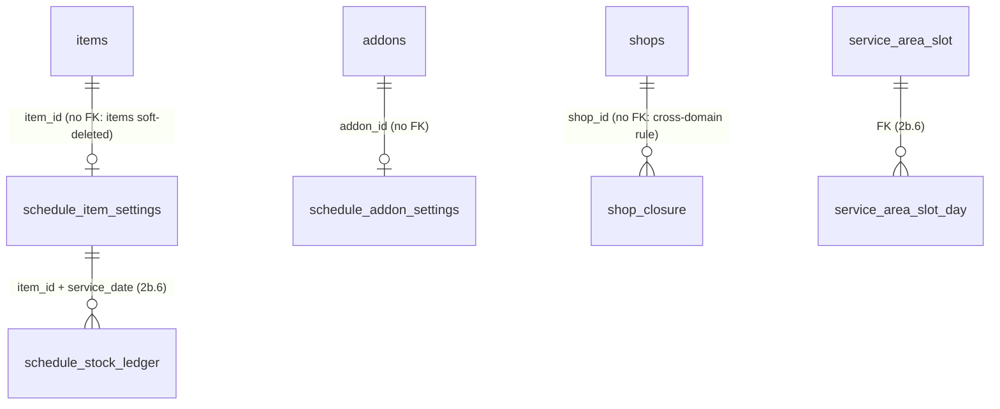

# Schedule menu (2b.2)

**Status:** APPROVED WITH CHANGES 2026-10-22 (build spec v2.2). Building: PR (a) on backend branch `feature/schedule-2b2a`.
**Review page:** https://claude.ai/artifact/LpTqKK3hecUeCT8dcN8zgS (answers are saved in its `answers` collection and copied into the Approval record below)

> **Build from the "Build spec (FINAL)" section below.** Everything after it is the history of how the design was reached. Where they differ, the build spec wins.

## Build spec (FINAL, v2.2, 2026-10-22)
This resolves the 22 findings of a Codex review of this plan (C-1 to C-22). Items marked **OWNER** still need Samivan's answer; everything else is decided.

### Owner items to answer first
| # | question | recommendation |
|---|---|---|
| O-1 | After all of a restaurant's order-by times pass, is it still listed? (C-2) | Yes. It's listed with its dishes greyed and "Order again tomorrow from 08:00". It's left out only when closed that day, not assigned, or with every dish off. |
| O-2 | D-8: which permissions? (C-3) | `GET` requires `menu.view`; every write requires `menu.manage`, through `permissionService.requirePermissionOrPlatformAdmin` (the `StockServiceImpl` pattern). Owner and Manager hold it; Staff and Chef don't, so they can't edit. Platform admin passes. No new `schedule_menu.*` keys; #50 is replaced. Closures use `menu.manage` too in v1. |
| O-3 | L-5 "manual": what does ops do? (C-6) | Ops edits the slot's own `capacity` for the day and edits it back afterwards. While changed it applies to every date, which is fine because same-day only means one open date. A per-day exception table is added only if this proves too blunt. |
| O-4 | Existing areas: how are they brought into line with same-day only? (C-7) | Before 2b.2 ships, run `SELECT id, name, advance_days, window_open_day_offset FROM service_area WHERE schedule_enabled` read-only, and set any non-zero value to 0 through the admin screen. |

On 2026-10-22 Samivan said "start with implementation" without answering O-1 to O-4, so the build follows the recommendations above. Each is still to be confirmed before the PR it touches merges: O-2 before PR (b), O-1 before PR (c), O-3 and O-4 before release. "Order from" stays area-level for v1 on the same footing. Ninjasu_Web has no service-area screen, so O-4's fix goes through `PUT /api/admin/service-areas/{areaId}` (admin API, built in 2a), not an admin screen.

### Tables (2b.2): SQL file `db_manual/schedule-menu-migration.sql`, hand-run before deploy (C-18)
- **`schedule_shop_settings`:**
  - columns: `shop_id` UUID; `default_order_until` TIME NOT NULL; `created_at`, `updated_at` BIGINT NOT NULL; `updated_by` UUID NOT NULL;
  - objects: `pk_schedule_shop_settings`.
- **`schedule_item_settings`:**
  - columns: `item_id` UUID; `shop_id` UUID NOT NULL; `is_enabled` BOOLEAN NOT NULL DEFAULT true; `enabled_through` DATE NULL; `daily_max_qty` INT NOT NULL; `order_until` TIME NULL; `created_at`, `updated_at` BIGINT NOT NULL; `updated_by` UUID NOT NULL;
  - objects: `pk_schedule_item_settings`, `chk_schedule_item_settings_daily_max` (1..10000), `chk_schedule_item_settings_enabled_through` (`is_enabled OR enabled_through IS NULL`), `idx_schedule_item_settings_shop` (`shop_id`).
- **`schedule_unavailable_addon`:**
  - columns: `addon_id` UUID; `shop_id` UUID NOT NULL; `created_at` BIGINT NOT NULL; `created_by` UUID NOT NULL;
  - objects: `pk_schedule_unavailable_addon`, `idx_schedule_unavailable_addon_shop`.
- **`shop_closure`:**
  - columns: `shop_id` UUID; `closed_on` DATE; `created_at` BIGINT NOT NULL; `created_by` UUID NOT NULL;
  - objects: `pk_shop_closure` (`shop_id`, `closed_on`);
  - **meaning (C-4):** the restaurant is closed for business on that date. It's a shop-module fact, and in 2b.2 only Schedule reads it.
- `ScheduleSchemaGuard` lists every object above: each table, each PK, each CHECK and each index. A bare table created by Hibernate fails the guard.
- No FKs to `shops`, `items` or `addons` (project rule). All `*_at` columns are epoch ms.

### Tables (2b.6), carried into the 2b.6 spec (C-9, C-20)
- **`schedule_stock_ledger`:**
  - columns: `id`; `item_id`; `shop_id`; `service_date`; `sold_qty`, `restocked_qty`, `turned_away_count` (INT NOT NULL DEFAULT 0, CHECK ≥ 0); `sold_out_at` BIGINT NULL (history only); `created_at`, `updated_at`;
  - UNIQUE (`item_id`, `service_date`); index (`shop_id`, `service_date`);
  - a row is created by the first booking **or the first "Add N for today"**, using `INSERT ... ON CONFLICT (item_id, service_date) DO UPDATE` with an atomic increment.
- **`service_area_slot_day`:**
  - columns: `id`; `service_area_slot_id` (FK, same module); `service_date`; `reserved_groups` INT NOT NULL DEFAULT 0 CHECK ≥ 0; `created_at`, `updated_at`;
  - UNIQUE (slot, date);
  - **no override column**: capacity is read live from `service_area_slot.capacity` (C-5).
- **Booking rule:**
  - dish: one conditional `UPDATE ... SET sold_qty = sold_qty + :q WHERE ... AND sold_qty + :q <= daily_max_qty + restocked_qty` (the max read in the same statement);
  - slot: `reserved_groups + 1 <= current capacity`.
- **Future per-date overrides** (when ordering ahead arrives) go in their own `(item_id, service_date)` settings table, never on the ledger (C-21).

### Rules
- **Remaining (C-10):** `daily_max_qty + restocked_qty − sold_qty`, with sold and restocked taken as 0 when there's no ledger row (always the case in 2b.2). A standing max change applies at once to the open date. Below sold means `SOLD_OUT`; orders are never cancelled.
- **Enabled on date D (C-8):** `is_enabled AND (enabled_through IS NULL OR D <= enabled_through)`.
  - "Today only" sets `enabled_through` to the area-local today.
  - "Every day" sets it to NULL.
  - Turning off sets `is_enabled = false` and `enabled_through = NULL`.
  - After a "Today only" date passes, the row reads as off, and the restaurant screen shows "Off (was today only)".
- **Same-day only (C-7):** while `service_area.schedule_enabled` is true, `ServiceAreaValidator` requires `advance_days = 0` and `window_open_day_offset = 0` (a new error code `SCHEDULE_SAME_DAY_ONLY`). The context endpoint accepts only the area-local today.
- **Slot identity (C-14):** the resolver uses only active slots of the resolved area. A request naming an unknown, inactive or foreign slot gets 400 `SLOT_INVALID`.
- **Options (C-15):**
  - deleted groups and options are ignored;
  - a required group needs at least `max(1, min_select)` options that are not deleted and not in `schedule_unavailable_addon`;
  - the live `addons.is_available` is not read;
  - "Starts at" = the live menu's display-price algorithm on online prices over the remaining options;
  - **/gcp verifies** where `min_select` lives (it's in `menu.md` but not on `AddonGroup.java`) and names the price function.
- **Reasons (C-13), first match wins:**
  1. `AREA_CLOSED`
  2. `NOT_OPEN_YET`
  3. `NOT_ASSIGNED`
  4. `RESTAURANT_CLOSED`
  5. `ITEM_REMOVED`
  6. `OFF`
  7. `MAX_BELOW_MINIMUM`
  8. `REQUIRED_OPTION_UNAVAILABLE`
  9. `ORDER_BY_PASSED`
  10. `SOLD_OUT`
  11. per slot: `SLOT_CLOSED`, else `ORDERABLE`

  **What customers see:**
  - `ORDERABLE`, with `orderBy` and `orderableSlotIds`;
  - `SOLD_OUT`, greyed;
  - `ORDER_BY_PASSED`, greyed, with `nextOrderableAt` (epoch ms of the next window open on a date the restaurant isn't closed; omitted for a "Today only" dish).

  Every other reason hides the dish. Restaurants with reasons 1-4 are not listed (O-1). The restaurant screen sees all reasons, including `emptyRequiredGroupIds`. An unknown reason means unavailable to the app.

### API (C-12, C-11, C-16): restaurant side under `/api/shops/{shopId}`
| method + path | body | permission | notes |
|---|---|---|---|
| `GET /schedule-menu` | — | `menu.view` | every non-deleted item plus dormant settings rows; per dish `reason`, `emptyRequiredGroupIds`; banners `NOT_ASSIGNED`, `AREA_PAUSED`, `CLOSED_TODAY`. **No booked count in 2b.2**: `bookedToday` is added in 2b.6 (additive). No paging (menus are small; revisit above 1000 items) |
| `PUT /schedule-menu/settings` | `{defaultOrderUntil}` | `menu.manage` | upsert |
| `POST /schedule-menu/items` | `{itemId, dailyMaxQty, orderUntil?, todayOnly?}` | `menu.manage` | add; 409 `ALREADY_ON_SCHEDULE` |
| `PATCH /schedule-menu/items/{itemId}` | any of `{isEnabled, todayOnly, dailyMaxQty, orderUntil}`; `orderUntil: null` = use the usual time | `menu.manage` | field-level update (`@DynamicUpdate`) |
| `DELETE /schedule-menu/items/{itemId}` | — | `menu.manage` | remove |
| `PATCH /schedule-menu/items` | `{itemIds[], isEnabled, todayOnly?}` | `menu.manage` | all-or-nothing; > 500 ids → 400 `BULK_TOO_LARGE`; one audit event |
| `PUT` / `DELETE /schedule-menu/addons/{addonId}/off` | — | `menu.manage` | idempotent |
| `PUT` / `DELETE /closures/{date}` | — | `menu.manage` (O-2) | idempotent; `PUT` response `{closedOn, paidOrdersCount}` (0 until 2b.6) |

**Errors:**

| code | status | when |
|---|---|---|
| `SHOP_NOT_ON_SCHEDULE` | 409 | no area assigned |
| `DEFAULT_ORDER_UNTIL_REQUIRED` | 409 | adding or enabling a dish that uses the usual time before one is set |
| `ITEM_NOT_FOUND` / `ADDON_NOT_FOUND` | 404 | foreign or deleted, as in `StockServiceImpl` |
| `DAILY_MAX_INVALID` | 400 | outside 1..10000 or below `min_order_qty` |
| `ORDER_UNTIL_INVALID` | 400 | not after the window open, compared as instants |
| `CLOSURE_DATE_INVALID` | 400 | past, or more than 60 days ahead |
| `BULK_TOO_LARGE` | 400 | more than 500 ids |

An admin area-window edit returns a non-blocking `affectedDishes` warning listing dishes whose order-by would fall before the new opening.

### Audit (C-17)
- New `AuditModule.SCHEDULE` (confirm the enum in `/gcp`). Keys:
  - `schedule_menu.default_order_until_set`
  - `schedule_menu.item_added`
  - `schedule_menu.item_updated`
  - `schedule_menu.item_removed`
  - `schedule_menu.items_bulk_toggled` (one event, `itemIds` in the payload)
  - `schedule_menu.addon_off`
  - `schedule_menu.addon_on`
  - `shop.closure_added`
  - `shop.closure_removed`
- Entity types: `SCHEDULE_ITEM`, `SCHEDULE_SHOP`, `ADDON`, `SHOP_CLOSURE`.
- Before/after allowlist: `isEnabled`, `enabledThrough`, `dailyMaxQty`, `orderUntil`, `defaultOrderUntil`, `closedOn`. The audit records the values actually written.

### Documents to update before coding (C-19): done 2026-10-22
- `schedule-plan.md` #15 and #50.
- `schedule-implementation-order.md`:
  - row 2b.2: standing settings, the three PRs, `menu.manage`;
  - row 2b.6: the ledger and slot-day rules above;
  - row 5.1: restaurant screens.
- `schedule-acceptance-tests.md`:
  - T2b-33: `menu.manage` / `menu.view`, Chef refused;
  - T2b-35: remove copy-day, replace with Today only and the usual time;
  - T2b-36: the reason list above, no over-cap reason (#47).
- Check `menu.md` lines 145-146 for stale stock claims.

### Verified in /gcp (C-22), 2026-10-22
- **Online display price:** the live starts-at SQL is `StartsAtPriceQueries` (repository) and `AddonPricing` (`service/channel`) picks the price a channel charges; PR (c) reads both before it computes "Starts at" over the options that remain.
- **`min_select`:** documented in `menu.md` but absent from the code (`AddonGroup` has no such field), so a required group needs at least one usable option.
- **`items.shop_id`:** immutable in code. `MenuItemServiceImpl` sets it once at creation and `UpdateItemRequest` has no `shopId`.
- **`addons.addon_group_id` index:** none is declared in `db_manual` or on the `Addon` entity. Whether the live database has one is not confirmed (the read-only MCP was down); 2b.2 uses the same group-to-options reads the live menu already uses and adds no new query shape on that column.
- **`AuditModule`:** `FLOOR, TAKEAWAY, BILLING, SETTINGS, MENU`; `SCHEDULE` is added in PR (b).
- **Permissions by DEFAULT template:** Owner/admin has everything; Manager has `menu.view` and `menu.manage`; Staff has `menu.view` only; Chef has only KDS permissions; Cashier and Accountant have no menu permission.

### Decided while building PR (c) (branch `feature/schedule-2b2c`)
- O-1 answered yes by Samivan (2026-10-23): a restaurant whose dishes are all past their order-by time stays listed, greyed.
- The restaurant screen and the customer menu read through one multi-shop `ScheduleFactsLoader` (eight queries however many restaurants); the PR (b) assembler was moved onto it.
- "Starts at" uses `StartsAtPriceQueries.minPricesByItem` with a new list of options to leave out, so a Schedule-off option cannot set the price; the live toggle is still not read. The same query's delivery-channel rule means a dish with no price row is not sold on delivery, so it is hidden from customers (the restaurant screen does not flag this yet).
- A date other than today in the area's zone is a 400 on the context endpoint (the old "advance days" behaviour for tomorrow is gone). An Eat Now-only area still answers with its slots.
- `nextOrderableAtMs` is the window opening of the first following day that the restaurant is not closed and the area is not paused, looked up within the 60-day closure window; absent for a "Today only" dish.
- A restaurant with no dish to show (every dish off, hidden or unpriced) is not listed. SOLD_OUT cannot occur until the 2b.6 ledger exists (sold counts are 0).
- No cache: the public route does about a dozen indexed reads per call. A short per-area cache would show a dish for a few seconds after its order-by time, so it is a separate decision; checkout must re-check the time either way.

### Decided while building PR (b) (branch `feature/schedule-2b2b`)
- The GET names the restaurant-level reason as `restaurantReason` (AREA_CLOSED, NOT_OPEN_YET, NOT_ASSIGNED, RESTAURANT_CLOSED) instead of the spec's three banner names; the app maps them to text.
- Writes answer with the dish's settings (or `{updated}`, `{addonId, offForSchedule}`, `{closedOn, paidOrdersCount}`), not a recomputed dish; the app refetches the GET for reasons.
- One exception type, `ScheduleMenuException(status, code, message)`, carries every code of the API table; the response is `data: {code: message}`. Added codes: `BULK_EMPTY`, `BULK_ENABLED_REQUIRED`, `TODAY_ONLY_NEEDS_ENABLED` (Today only on a dish that ends up off), `CONCURRENT_UPDATE` (409, retry: a duplicate key on insert poisons the transaction, so it is not swallowed).
- `PATCH` tells `"orderUntil": null` from an absent field with a presence flag on the request class.
- The usual order-by time is validated like a dish's own (after the opening of ordering, as instants); both need an area. Switching an option and reopening a date need no area. A closure needs one (it is dated in the area's zone) and today..+60 days, so a restaurant has at most 61 future closures.
- Ownership: the item must be a live dish of the shop in the path; an option's group must belong to it; settings rows are read and deleted only through the `...AndShopId` methods. A platform admin passes the permission check, so the shop's existence is checked by loading it.
- The bulk audit event lists only the dishes that changed, with their shared earlier state in `from` (null when they differed) and `todayOnly` in the metadata.
- Switching an option back on checks the option belongs to the restaurant unless a Schedule-off row of this restaurant was deleted by the call (that row proves ownership, so an option deleted since can still be switched on).
- The booked count (`bookedToday`) and the paid-order count of a closure arrive with 2b.6; the count is 0 until then.
- Permissions follow O-2 as recommended (`menu.view` / `menu.manage`), still to be confirmed by Samivan; SecurityConfig gates the prefix to SHOP or ADMIN.

### Decided while building PR (a)
- Named CHECK constraints use the `chk_` prefix like every existing constraint (this spec said `ck_`). The three single-column tables declare an inline `PRIMARY KEY` like every sibling migration (Hibernate's own key on the same column is equivalent), so the spec's `pk_<table>` names exist only for `shop_closure`, whose key `pk_shop_closure (shop_id, closed_on)` replaces the `(closed_on, shop_id)` key Hibernate creates when it runs first. The guard has 9 entries for this file (4 tables, `pk_shop_closure`, 2 CHECKs, 2 indexes).
- **Judge fixes, 2026-10-22 (deep run, report in the session):**
  - Assigned-id entities extend `AssignedIdEntity` (`Persistable`), so `save()` inserts and a duplicate id fails on the key; PR b maps `DataIntegrityViolationException` to `ALREADY_ON_SCHEDULE` (409).
  - The settings repositories read and delete only through `findByItemIdAndShopId`, `deleteByItemIdAndShopId`, `findByAddonIdAndShopId`, `deleteByAddonIdAndShopId`; `findById`, `deleteById` and `save` of an id taken from a request body are not used.
  - The resolver reports `AREA_CLOSED` unless the service date is today in the area's zone, so rows that predate same-day-only cannot offer tomorrow. The pre-deploy SELECT in the SQL header is a required deploy gate: until it is clean, an admin change to such an area or its slots is refused with `SCHEDULE_SAME_DAY_ONLY`.
  - The area and slot predicates live in `ServiceDateResolver` (`isAreaOpen`, `isWindowOpen`, `isSlotOpen`, `atLocalTime`); the resolver and the slot picker share them. `resolve` has an overload that takes the per-restaurant verdict and the open-slot list, so PR c computes them once per restaurant and area, not once per dish.
  - `ScheduleReason`, `ScheduleAvailabilityResolver` and `ScheduleMenuRules` moved to `service/schedule/menu/` (decision F4).
  - The closure repository has an exact-date finder for the customer menu; the unbounded "all future closures of many shops" finder was removed.
  - Open for PR b: cap closures per shop; map the duplicate-key error; check item to shop and add-on group to shop on every write.
- `ITEM_REMOVED` covers a missing item, a deleted item and `is_active = false` (the admin kill switch; no code sets it).
- `SOLD_OUT` means fewer portions remain than the item's minimum order quantity, as live stock does (`StockLedgerServiceImpl.effectiveAvailable`).
- A dish with no order-by time at all (no override, no usual time) reports `ORDER_BY_PASSED` and is never orderable; the write API prevents the case.
- A service date the area does not take orders for (past, or not today under same-day only) reports `AREA_CLOSED`.
- `ScheduleReason` declares the reasons in precedence order; `ScheduleAvailabilityResolver.restaurantReason` is the once-per-restaurant check (reasons 1-4) and `resolve` adds the dish rules.
The plan row is [schedule-implementation-order.md](schedule-implementation-order.md) 2b.2; decisions are in [schedule-plan.md](schedule-plan.md). The earlier per-date published-menu design and its review (DA-1 to DA-8, geld v1, both 2026-10-22) are superseded by this proposal. Findings that still hold are carried into the reviews below.

## Decisions already made (ciel Step 0)

- **From the decision record:**
  - #16 per-dish order-until.
  - #18 an order's cutoff is locked at payment.
  - #44 the price comes from the add-on options' online price.
  - #47 the online-price cap is checked only at save.
  - #49 paid add-ons are allowed.
  - #50 Schedule permissions `view` / `manage` / `stock`, with Chef getting view + stock.
  - #17 shop ↔ area is assigned by admin only.
  - 2a area window settings (`advance_days`, `window_open_day_offset`, `window_open_time`, `last_call_minutes`) are built.
- **Answered by Samivan on 2026-10-22:**
  - The Eat Now sold-out toggle (`items.is_available`) does not affect Schedule.
  - When an add-on runs out, the restaurant marks it inside the Schedule menu (D20).
  - Business hours stay simple until the pilot.
  - No ordering ahead in v1: same-day only, but the schema and architecture must allow future-date ordering later.
  - Closed days get a proper design after Schedule lands. Until then, a manual closed flag, with its scope of effect tracked.
- **This proposal changes:**
  - #15: the per-date published menu becomes standing settings plus a per-date counter.
  - #15's "greyed, not hidden" once a dish's order-by time passes (decision D-6).
  - #50's mapping: copy-day disappears, and order-until moves to `stock`.
  - Design review P1(i): it avoided a shop-level Schedule flag. The closed dates below are a restaurant-owned, per-date fact, not an "enabled" flag, so they don't recreate that drift.
  - Tests T2b-33, T2b-35 and T2b-36.
  - Implementation-order rows 2b.2 and 5.1.

## Competitor research (Codex with web search, 2026-10-22; sources cited by Codex, not opened by Claude)

- **Zomato order scheduling:** 2 hours to 2 days ahead; an alternative is offered when a slot is full; cancel up to 3 h before delivery; restaurants get advance notice and **choose which items or categories are available for scheduled orders**. That is a subset of the regular menu, not a per-day menu (zomato.com/blog/zomatos-order-scheduling-feature-convenience-at-your-fingertips). Per-dish daily caps and partner order-by cutoffs are not documented.
- **Swiggy:** regular orders can be scheduled up to 48 h ahead; nothing on a separate menu or caps. The "Accepting Orders" toggle makes the outlet unserviceable and turns back on at the next open slot (partner guide copy, possibly an old version).
- **Hours:** the Zomato partner app has outlet timings, leave scheduled in advance, and category timings (time of day, week or year). The exact weekday or split-shift editor is not documented.
- **Stock:** Zomato marks items and variants out of stock, with a return time: 2 h, 4 h, next business day's first slot, custom (≤ 7 days) or indefinite (POS API). Add-ons are not a separate stock entity.
- **Planned meals:** Swiggy Daily (subscriptions) shut down in 2020 (COVID, cost cuts) and was revived in select areas in 2024 (moneycontrol). Zomato Everyday was discontinued in FY2024-25 because Eternal found no path to sustainable scale and profitability (annual report). Zomato Healthy Subscriptions (May 2026) runs 3/5/15-day plans from selected restaurants with a curated menu; the customer can edit tomorrow's dish until it locks.
- **Planned-lunch products (second Codex pass):**
  - **When people order:** no published data was found on the split between same-morning, previous-evening and further-ahead orders. Cutoffs vary:
    - MealPal: opens 5 pm the previous evening, closes 1:30 pm on the day; 10:30 am is its cancellation threshold.
    - Forkable: up to a week ahead; restaurants get final orders by 3 pm the day before.
    - Niraama (Bengaluru): before 10 am, or the previous day.
    - The Lunch Club (Indiranagar): up to a week ahead, with a 10 am same-day cutoff.
  - **Menu model:**
    - MealPal makes the restaurant pick one dish daily by 5 pm the day before, and picks one itself if the restaurant doesn't (agreement published before 2023).
    - Forkable and HungerBox keep reusable menus with enable/disable.
  - **Capacity:**
    - Forkable restaurants choose which days they accept orders, set an order capacity, and blackout single dates or ranges; confirmed orders are not changed.
    - HungerBox auto-disables a dish when it runs out.
    - MealPal sets a minimum cap of 25 per day.
  - **Not found:** how caps reset per day, or how pre-order portions are kept apart from walk-in stock.

## Proposed design (v2)

### In one paragraph
- A restaurant sets up its Schedule menu once, on dishes it already has:
  - per dish: on/off, a maximum number of Schedule portions per day, and an order-by time;
  - per restaurant: the dates it is closed for Schedule.
- Ordering is same-day only: it opens in the morning (the area's window, for example 08:00) and closes at each dish's order-by time or the slot's last call, whichever is earlier.
- Portions are counted per dish per delivery date, so the count starts again at zero every day with no job.
- Live stock (Eat Now, dine-in, POS, guest QR) is never touched.

### Restaurant's day (illustrative)
| when | what the restaurant does | what changes |
|---|---|---|
| once | Turns Schedule on for Chicken Biryani (max 50, order by 11:00) and Veg Thali (max 30, order by 11:30) | two rows in `schedule_item_settings` |
| Sunday evening | Marks "closed for Schedule on Mon 2 Nov" | one row in `shop_closure` |
| Monday | nothing | not listed to customers on Monday |
| Tuesday 08:00 | nothing | listed again automatically |
| Tuesday 10:40 | Biryani shows 50 of 50 booked; raises max to 60 | today has 10 more; the new max also applies to later days until changed |
| Tuesday 10:50 | Egg runs out: switches the egg add-on off for Schedule | thali stays orderable without egg; Eat Now egg unaffected |
| Ninjasu Kitchen, 07:30 | Turns every Schedule dish off, then turns today's three on with max 40 each | bulk on/off |

### Customer's morning (illustrative)
| when | what Priya sees in the Schedule tab (HSR) |
|---|---|
| 07:30 | "Lunch ordering opens at 08:00" |
| 09:15 | Restaurants serving today; each dish shows its price (online price of its options) and "Order by 11:00"; slots 12:30 and 13:30 |
| 10:41 | Biryani: "Sold out" (decision D-6: greyed) |
| 11:01 | Biryani is gone from the list (order-by time passed) |
| 12:01 | 12:30 slot closed (last call); 13:30 still open for dishes whose order-by time hasn't passed |
| Monday | Raju's Kitchen is not listed |

Customer screens, cart and checkout come in later phases (2b.5, 2b.8, phase 4). 2b.2 delivers the data, the rules, the restaurant API and the customer read.

### Data model
| table | grain (one row = one ...) | phase | written by |
|---|---|---|---|
| `schedule_item_settings` | dish offered on Schedule (standing, not per date) | 2b.2 | restaurant (manage creates/removes; stock edits) |
| `schedule_addon_settings` | add-on option the restaurant changed for Schedule (no row = available) | 2b.2 | restaurant (stock) |
| `shop_closure` | date a restaurant takes no Schedule orders | 2b.2 | restaurant (manage) |
| `schedule_stock_ledger` | dish on one delivery date: portions sold, created by the first booking | 2b.6 | reservation at payment confirm |
| `service_area_slot_day` | slot on one date: groups reserved; `capacity_override` NULL = slot capacity | 2b.6 | reservation at payment confirm |

No existing table changes. `items`, `shops`, `addons` and `item_stock_ledger` are untouched.

| table.column | type | null | rule |
|---|---|---|---|
| `schedule_item_settings.item_id` | UUID | no | PK; `items.shop_id` must equal `shop_id` (service + consistency test) |
| `.shop_id` | UUID | no | index; no FK |
| `.enabled` | BOOLEAN | no | default true; false = off for Schedule until turned on (settings kept) |
| `.daily_max` | INT | no | CHECK 1..10000; ≥ the item's `min_order_qty` (service) |
| `.order_until` | TIME | no | clock time on the delivery date in the area's `timezone`; must be after the area's window opening (service) |
| `.created_at`, `.updated_at` | BIGINT | no | epoch ms (2a convention); `updated_by` UUID |
| `schedule_addon_settings.addon_id` | UUID | no | PK; addon's group must belong to `shop_id` |
| `.shop_id` / `.available` | UUID / BOOLEAN | no | |
| `shop_closure.(shop_id, closed_on)` | UUID, DATE | no | PK; `closed_on` ≥ today and ≤ today + 60 (service) |
| `.created_at`, `.created_by` | BIGINT, UUID | no | |
| `schedule_stock_ledger` (2b.6) | id, item_id, shop_id, service_date, sold_qty ≥ 0, turned_away_count ≥ 0, sold_out_at NULL | | UNIQUE (item_id, service_date); same pattern as `item_stock_ledger` |

**Remaining** for a dish on a date = `daily_max` (read live, never copied) − `sold_qty` for that date (0 when there is no ledger row). Lowering the max below what's sold shows "sold out". Orders already paid stay.

### Availability rule (one function, every reader calls it)
A dish is orderable for (date, slot, now) when all of these hold:
1. `ServiceDateResolver.isOrderable(area, date, slotStart, now)`: Schedule enabled for the area, area not paused, date allowed (v1: today only, `advance_days = 0`), window open, before the slot's last call.
2. The shop is assigned to the area, and there is no `shop_closure` row for (shop, date).
3. The item is active and not deleted. The live `is_available` is ignored (decided).
4. A `schedule_item_settings` row exists with `enabled = true`.
5. `now` is before `order_until` on the date, in the area's zone.
6. Remaining ≥ max(1, the item's `min_order_qty`).
7. Every required add-on group of the dish has at least one option that is not deleted and not switched off for Schedule.

Reasons returned per dish: `ORDERABLE`, `SOLD_OUT`, `ORDER_BY_PASSED`, `SLOT_CLOSED`, `REQUIRED_OPTION_UNAVAILABLE`. A restaurant that is closed, unassigned, or has no orderable dish is not listed (D-7).

### API
**Restaurant side (2b.2(b)), under `/api/shops/{shopId}/schedule-menu`:**

| endpoint | permission |
|---|---|
| `GET` every dish, with its Schedule settings or none, plus today's sold count and reason | `view` |
| `PUT /items/{itemId}` add a dish | `manage` |
| `PUT /items/{itemId}` change enabled, daily_max or order_until | `stock` |
| `DELETE /items/{itemId}` | `manage` |
| `PUT /items` bulk enabled on/off | `stock` |
| `PUT /order-until` set for all | `stock` |
| `PUT /addons/{addonId}` | `stock` |
| `PUT /closures` and `DELETE /closures/{date}` | `manage` |

Every edit writes a shop `audit_events` row with before and after values, using new `AuditAction` values.

**Customer side (2b.2(c)):** `GET /api/schedule/context` adds restaurants and dishes, each with its reason. Area and slot data come from `ServiceAreaCatalog`. The menu data is read in batched queries: shops of the area → settings → items → required groups and options → closures (and the ledger from 2b.6).

### Closed flag: where it has an effect (tracked, for the later closed-days design)
| place | effect |
|---|---|
| customer context (2b.2(c)) | restaurant not listed for that date |
| checkout re-check (2b.8) | cart with that restaurant for that date rejected |
| reservation at payment confirm (2b.6/2b.9) | that member order fails → partial refund |
| orders already paid for that date | **not affected**: the restaurant must decline them (refund, 2b.10); the closure screen shows how many exist |
| Eat Now, dine-in POS, guest QR, counter sale | not affected |
| area pause, shop assignment (admin) | separate controls |

**Pilot measures:**
- closure dates set per restaurant per week;
- Schedule orders declined with reason "restaurant closed".

A rise in the second is the trigger to build proper closed days (weekdays, holidays).

### How the schema allows ordering ahead later (parked)
- Everything that counts is keyed by delivery date (`schedule_stock_ledger`, `service_area_slot_day`), and closures are per date. So turning on `advance_days > 0` needs no change to those tables.
- **Ordering ahead later adds:**
  - per-date overrides as nullable columns on the ledger row (a different max, or off for that date);
  - a rule for whether a standing change applies to dates that are already open;
  - the restaurant screen for a future date.
- **Parked:**
  - ordering for a future date;
  - subscriptions instead of future orders;
  - "interest requests" for menus that change (customers ask for a dish on a future day);
  - proper closed days (weekdays, holidays);
  - a per-date "sold out today" that resets itself;
  - weekday rules for specials;
  - a menu planner for future dates;
  - live menu-management improvements (bulk toggle, filters, an online-only switch), a separate track because it changes the live app;
  - Ninjasu sell-out nudges from `turned_away_count`.

## Reviews

### Devil's advocate (v2)
| # | proposal | failure scenario | mitigation | verdict |
|---|---|---|---|---|
| DA2-1 | Standing settings, same-day only | An admin raises `advance_days` (already editable since 2a). Two delivery dates are then open at once, so a chef who lowers today's max to 10 silently caps tomorrow too | Until per-date controls exist, the area validator refuses any window config that opens two delivery dates at once | proceed with conditions |
| DA2-2 | Raising the max | Raising 50 → 60 at 10:40 because of a good day also raises tomorrow, so tomorrow takes more paid orders than the kitchen planned | Mirror live stock: "add N for today" (2b.6 ledger, resets) plus "change daily max" (standing), the same two actions staff already use on Eat Now stock | stop: ask (D-4) |
| DA2-3 | Manual closed flag | The restaurant forgets to mark Monday, so customers pay for lunch from a closed kitchen | Closed on a **date** (set ahead, reopens itself). The closure response carries that date's paid-order count. Pilot metric. Ops follow-up when a released ticket isn't acknowledged (2d/3) | proceed with conditions |
| DA2-4 | `is_enabled = false` to stop a dish | The chef turns biryani off at 10:30 (burnt batch) and forgets; biryani is missing for days (lost sales, the safe direction) | Restaurant screen shows "off since <time>"; a per-date "sold out today" is parked for the ledger (2b.6+) | proceed |
| DA2-5 | Schedule add-on switch | A reader copies POS's add-on check (`PosOrderServiceImpl.java:436`, live `is_available`), so Schedule obeys Eat Now's egg toggle | One Schedule add-on availability function used by resolver, cart, checkout and confirm; a test that the live toggle doesn't hide a Schedule option | proceed with conditions (D-5) |
| DA2-6 | "Set order-until for all" as a bulk write | It overwrites per-dish exceptions (biryani 10:30 becomes 11:30) and stores the same value in N rows (check #2) | Restaurant default plus per-dish override (NULL = default); "change for all" changes only the default | proceed with conditions (D-3) |
| DA2-7 | Hide a dish after its order-by time | Changes #15 ("greyed, not hidden"); a dish already in a cart vanishes from the list | Hide in browse; cart and checkout say "ordering for this dish closed at 11:00" | stop: ask (D-6) |
| DA2-8 | `order_until` vs the area window | An admin moves the window to 09:00, so a dish with order-by 08:30 is never orderable, silently | Validate at save; the restaurant screen shows the reason; the admin window edit lists affected dishes | proceed with conditions |
| DA2-9 | Concurrent edits to one settings row | Owner raises the max while the chef turns the dish off; Hibernate writes the whole row (no `@DynamicUpdate`, as on `Item`), so one edit is lost | Field-level writes: `@DynamicUpdate` plus PATCH bodies where a missing field means unchanged | proceed with conditions |

Memory: `followup_schedule_menu_2b2_da` (replaced with these points).

### geld (v2), deep (Codex blind pass)
**Verdict (draft):** APPROVED WITH CHANGES once D-1 to D-9 are answered. Environment blockers ENV-1 to ENV-3 (two schema writers, a production default datasource, the app running as database owner) stay deferred to pre-launch, as Samivan decided on 2026-10-21 for 2b.13.
**Target:** Postgres on Neon (version unknown) · hand-run `db_manual/` SQL plus `ddl-auto=update` · transaction-mode pooler · one Spring Boot instance.
**Lenses run:** 0, 1, 2, 3, 4, 6, 7, 8. **Skipped:** 5 (no amounts). **Reference designs:** skipped; only one of "complex / costly to undo / well-known class" holds, and the competitor research covers comparables.

**Lens 0:** 1-4 FAIL, deferred as above · 5 unknown (ENV-4) · 6 rehearse the SQL on a Neon branch verified by host · 8: SQL runs before the code; later-phase SQL is labelled DO NOT RUN NOW.

**Findings: must change before the first deploy**
- **PLACE-1** · the same order-by value is stored per dish, and "set for all" clobbers exceptions (DA2-6). Change:
  - add `schedule_shop_settings(shop_id PK, default_order_until TIME NOT NULL, updated_at, updated_by)`;
  - make `schedule_item_settings.order_until` NULL, meaning "use the restaurant default";
  - a dish can be enabled only once the restaurant has a default.
  - Cost: free.
- **MODEL-1** · `schedule_addon_settings.available` puts a second `is_available`-style word beside live `addons.is_available`, and "no row" and "row with true" would both mean available. Change: a presence table `schedule_unavailable_addon(addon_id PK, shop_id, created_at, created_by)`, where a row means unavailable on Schedule and deleting it makes the add-on available again. Same pattern as closures. Cost: free.
- **MODEL-2** · names:
  - `daily_max` → `daily_max_qty` (matches `stock_qty`, `sold_qty`);
  - `enabled` → `is_enabled` (`items` uses `is_*`);
  - explicit names for every constraint and index.
  - Cost: free.
- **INV-1** · lost update on settings rows (DA2-9). Change: `@DynamicUpdate` on the new entities plus PATCH DTOs. A same-field race stays last-writer-wins, which is accepted. Cost: free.
- **INV-2** · `shop_id` is copied onto every settings, add-on and ledger row (no FK by rule). Change:
  - validate on write (the `StockServiceImpl` pattern: item's shop = path shop);
  - add a consistency test that finds mismatches;
  - confirm in `/gcp` that `items.shop_id` never changes after creation.
  - Cost: free.
- **TIME-1** · `order_until` / `default_order_until` are a clock time on the delivery date in the area's IANA zone, converted by one function; strictly before. India has no daylight saving; a zone with daylight saving needs a rule for times that don't exist or occur twice. Cost: free.
- **EVOL-1** · the area validator refuses window configs that open two delivery dates at once (DA2-1), until per-date overrides exist. Cost: cheap (2a validator).
- **API-1** · limits on the restaurant API:
  - bulk on/off is capped (≤ 500 ids);
  - `GET schedule-menu` is bounded by the shop's menu with a hard cap (1000 items) or paged;
  - reason codes are an open enum, so the app treats an unknown code as unavailable.
  - Cost: free.

**Revisit at a trigger**
- **PERF-1** · the context read is about 7 batched queries over small tables. Trigger: measured traffic; then a 5-10 s cache per (area, date). An index on `addons.addon_group_id` was not found in `db_manual` (*to confirm* on the database in `/gcp`; the read-only MCP was down).
- **SIZE-1** · the ledger grows by dishes × days (pilot about 200 rows/day). Retention rule at about 1M rows.
- **COST-1** · each public context request wakes Neon. Fine at pilot.

**Keep**
- separate 1:1 settings table instead of columns on `items`: different role and permission, different lifecycle, a growing family of fields;
- per-date counter keyed by delivery date, no job: copies `item_stock_ledger`;
- no index on `sold_qty`, so updates stay HOT;
- the max is read live, never snapshotted on the order: it's a sales control, not an order fact;
- closures as per-date facts;
- no change to any existing table;
- one availability function (principle 17: backend decides, app renders).

| table | grain | class | size at pilot / 100x |
|---|---|---|---|
| `schedule_shop_settings` | restaurant on Schedule | reference | ~10 / 1k |
| `schedule_item_settings` | dish on Schedule | reference | ~200 / 20k |
| `schedule_unavailable_addon` | add-on off for Schedule | reference | tens / few k |
| `shop_closure` | closed date | reference | ~40/month / 4k/month |
| `schedule_stock_ledger` (2b.6) | dish × delivery date | hot (one update per booking) | ~200/day / 20k/day |

**Access patterns**
1. Customer context (public, peak 09:00-11:00, *assumed* ≤ 20 req/s at pilot, p95 < 300 ms):
   - shops by area: `idx_shops_service_area`;
   - settings by `shop_id IN` (index);
   - items by id (PK);
   - required groups and options by item and group (`addons.addon_group_id` index *to confirm*);
   - unavailable add-ons by `shop_id IN`;
   - closures by (`shop_id IN`, `closed_on`) (PK);
   - ledger by (`item_id IN`, `service_date`) (unique).
2. Restaurant screen: one shop's menu and settings (shop index).
3. Booking (2b.6): conditional UPDATE on one ledger row (unique key).

**Future phases fit**
| phase | adds | change forced |
|---|---|---|
| 2b.6 | `schedule_stock_ledger`, `service_area_slot_day`, reservations | none |
| ordering ahead | nullable per-date override columns on the ledger; lift the validator guard | none |
| subscriptions | own tables, booking through the same ledger | none |
| proper closed days | weekday rule table; one more resolver condition | none |
| per-date "sold out today" | column on the ledger | none |

### ciel (v2): restaurant and customer lenses
**Pitch (illustrative people and values):**
1. Raju's Kitchen sets its usual order-by time to 11:30 once, turns on Chicken Biryani (max 50, order by 10:30 because it's cooked in bulk) and Veg Thali (max 30, uses the default). *(points 1, 3)*
2. Tuesday 09:15: Priya in an HSR office opens Schedule and sees Raju's two dishes at their online price, "Order by 10:30" and "Order by 11:30", with slots 12:30 and 13:30. *(availability rule)*
3. 10:20: biryani reaches 50. Priya's colleague sees "Sold out", greyed. Raju taps "Add 10 for today" (D-4); tomorrow is back to 50. *(D-4, D-6)*
4. 10:50: eggs run out. Raju switches the egg add-on off for Schedule. The thali stays orderable without it, and Eat Now's egg is untouched. *(D-5)*
5. Sunday 21:00: Raju marks "Closed Mon 2 Nov". Monday nobody sees Raju; Tuesday 08:00 he's back with no action. *(D-2)*
6. Ninjasu Kitchen, 07:30: bulk-off, then today's three dishes on with max 40 each. *(bulk on/off)*

**Break-down: one axis per question**

| axis | stored as | who changes it |
|---|---|---|
| Is the dish on the Schedule menu at all? | settings row exists | manage |
| Is it on right now? | `is_enabled` | stock |
| How many? | `daily_max_qty` (+ today's extra, 2b.6) | stock |
| Until when? | dish override, else restaurant default | override: stock; default: manage |
| Which add-ons are off? | `schedule_unavailable_addon` | stock |
| Is the restaurant taking orders on that date? | `shop_closure` | manage |

Overlap test: "sold out" is derived, never stored; "off", "closed" and "not on Schedule" each have exactly one representation. Level test: add-on unavailability sits on the add-on option; a shared group's option switches off for every dish that uses it, which is true in the kitchen.

**Acceptance cases**
- **AC-1:** Tue 09:15, Raju's dishes for the 12:30 slot are listed with their reasons.
- **AC-2:** 50 sold of 50 → `SOLD_OUT`; add 10 for today → orderable, 10 left; Wednesday's max is 50.
- **AC-3:** 10:31 → biryani hidden for both slots.
- **AC-4:** closure on Mon → Raju is absent Mon, present Tue 08:00 with no action.
- **AC-5:** the required "Curry" group has all options off → thali hidden from customers; the restaurant screen shows `REQUIRED_OPTION_UNAVAILABLE`.
- **AC-6:** Eat Now marks biryani unavailable → the Schedule biryani is still orderable.
- **AC-7:** the chef changes the max (ok), adds a dish (403), sets a closure (403).
- **AC-8:** item soft-deleted → gone from Schedule; the settings row is dormant and flagged.
- **AC-9:** shop unassigned from the area → not listed.
- **AC-10:** max lowered to 40 with 45 sold → sold out; the 45 orders are unchanged.
- **AC-11:** closure set while today has paid orders → new orders blocked; the response returns the paid count; the orders stay.
- **AC-12:** `serviceDate` = tomorrow → rejected (same-day only).
- **AC-13:** order-by earlier than the window opens → rejected at save.
- **AC-14:** `min_order_qty` 2 with 1 left → sold out.
- **AC-15:** every edit writes a shop audit row with before and after.
- **AC-16:** owner and chef edit different fields at the same moment → both edits survive.

**State × viewer matrix**

| state | customer browse | checkout / confirm | owner & chef screen | Eat Now / POS / guest QR |
|---|---|---|---|---|
| orderable | listed | passes | "on", counts | unaffected |
| off | hidden | rejected | "off since…" | unaffected |
| sold out | greyed "Sold out" | rejected / confirm fails → refund | "sold out", add for today | unaffected |
| order-by passed | hidden | rejected | "closed for today" | unaffected |
| slot last call passed | slot not selectable | rejected | slot closed | unaffected |
| restaurant closed (date) | restaurant not listed | rejected / refund | "closed on <date>", paid count | unaffected |
| required option off | hidden | rejected | reason shown | unaffected |
| item deleted / inactive | hidden | rejected | "removed from menu" | gone (shared) |
| shop unassigned / area paused | not listed / area message | rejected | banner | unaffected |
| before window opens | "opens at 08:00" | rejected | normal | unaffected |

Not yet covered by any phase: an ops view of today's closed restaurants (phase 3). Live states (`is_available`, `DAILY` sold out) never reach Schedule, except deletion or deactivation of the dish, which is shared.

**Lifecycle**
- **create:** add a dish.
- **edit:** max, order-by, add-ons.
- **toggle:** on/off, bulk.
- **expire:** order-by passes daily; a past closure is inert and can be pruned later.
- **remove:** the settings row is deleted; past ledger rows stay as history.
- **delete:** the dish is deleted in the menu; the settings row goes dormant and is flagged.
- **cached elsewhere:** the customer app keeps its list until refresh; `ServiceAreaCatalog` caches area and slots for 30 s; no menu cache in v1; checkout and confirm re-check.

**Self-review:** checked against principles 6 (checkout re-validation) and 17 (backend-owned availability), the FK-free rule, the multi-session rules and #18 (locked cutoff); no conflict. Schedule reads `items`/`addons` through repository queries, never through `MenuItemService` (dependency guard in the project CLAUDE.md).

### Second opinions (Codex, blind, read-only, 2026-10-22)
| Codex point | outcome |
|---|---|
| Product: a one-day raise shouldn't raise future days | agreed → D-4 |
| Product: a changing menu carries yesterday's dishes over | agreed → D-10 ("Today only") |
| Product: Schedule and live sell from one pot | already Samivan's rule ("50 sold to Schedule, 80 for stock") → D-11 |
| Product: reasons and hidden-vs-greyed undefined for combined states and per slot | fixed: one reason order, per-slot availability (revised design) |
| Product: price varies by option | fixed: reuse the live menu's online display-price function, excluding Schedule-off options (*verify the function in `/gcp`*) |
| Product: #15 also forbids stock below reserved | agreed, named in D-1 |
| Product: closing with paid orders needs a full decline workflow before build | **disagreed:** nothing can be declined before 2b.10; 2b.2 returns the count → L-2 |
| Product: per-slot dish offers | can wait → L-3 |
| Product: group partial failure UX | 2b.9 / phase 4; no 2b.2 change |
| Schema: a booking can commit just before the max is lowered | **disagreed:** a max below sold is allowed by design (AC-10); one conditional `UPDATE ... WHERE sold_qty + :q <= max` per booking is enough (concurrent bookings re-check the row under its lock) |
| Schema: closure saved while a payment confirms | agreed in part → INV-4: paid orders on closed dates stay listed on the restaurant screen and the ops board until handled; no lock on `shops` |
| Schema: concurrent first bookings | agreed → INV-3 (2b.6): unique key, `INSERT ... ON CONFLICT DO NOTHING`, conditional update |
| Schema: slot-day `capacity_override` NULL = inherit vs bounds | agreed; it also **contradicts design review P9 (day rows snapshot capacity at creation)** → L-5, decided in 2b.6 |
| Schema: compare order-by as instants against the window | agreed → TIME-1 (validation compares instants, so it survives a previous-day window later) |
| Schema: "today + 60" needs the area's zone | agreed → closure dates resolved in the assigned area's zone; writes need an assigned area |
| Schema: raising `min_order_qty` above the max strands a dish | agreed → INV-5: reason `MAX_BELOW_MINIMUM` for the restaurant, hidden for customers; no menu → Schedule call |
| Schema: item → shop and add-on → group → shop on every write | agreed → INV-2 extended to add-ons and bulk |
| Schema: version column against lost updates | partly: field-level writes (`@DynamicUpdate` + PATCH); no version column; audit the values written |
| Schema: batched `IN` reads, extra indexes | agreed; ledger index (`shop_id`, `service_date`) in 2b.6; settings index on `shop_id` |
| Schema: keep future per-date overrides out of the counter | agreed → EVOL-2: a separate (item, date) settings table when ordering ahead arrives; "add for today" stays on the counter, as live `restocked_qty` does |

### Revised design (v2.1): changes from v2
| # | before (v2) | after (v2.1) | why |
|---|---|---|---|
| 1 | `order_until` NOT NULL on each dish; "set for all" bulk write | `schedule_shop_settings.default_order_until` plus dish `order_until` NULL = default | PLACE-1, DA2-6 |
| 2 | `schedule_addon_settings(available)` | `schedule_unavailable_addon` (row = off) | MODEL-1 |
| 3 | `daily_max`, `enabled` | `daily_max_qty`, `is_enabled`, plus `enabled_through DATE` NULL (= every day) if D-10 | MODEL-2, D-10 |
| 4 | reasons: 5 codes | full ordered list (area → restaurant → dish → slot); customers get ORDERABLE / SOLD_OUT only | Codex product |
| 5 | one order-by per dish across slots | per dish, per slot: orderable for slot s iff now < min(order-by, last call of s) | Codex product |
| 6 | ledger: sold, turned away, sold_out_at | plus `restocked_qty` (add for today, D-4); `sold_out_at` = first exhaustion, history only | D-4, Codex schema |
| 7 | price "from the add-on options" | the live menu's display-price function on online prices, Schedule-off options excluded | Codex product |
| 8 | restaurant GET: dishes + reason | also dormant rows (deleted dish), the empty required group, today's booked count, banners (closed, not assigned, area paused) | Codex product |

### Cross-phase conditions (recorded now, built later)
- **2b.5 / 2b.8:**
  - re-check options with the Schedule add-on function; a now-unavailable option fails the line with `OPTION_UNAVAILABLE` and is never silently removed;
  - a passed order-by returns the closing time.
- **2b.6:**
  - ledger with `restocked_qty`, created by the first booking (INV-3);
  - an index on (`shop_id`, `service_date`);
  - L-5 decides slot-day capacity.
- **2b.9 / 2b.10:**
  - an area pause or unassignment after payment never cancels paid orders (#14, #18); ops decides;
  - paid orders on a closed date stay listed until handled (INV-4);
  - L-2 adds bulk decline.
- **Phase 4:** the app renders reasons only (principle 17) and treats an unknown reason as unavailable.
- **Phase 5.1:** restaurant screens follow this design; it replaces the "daily lunch list".

## Decisions for approval
| # | decision | recommendation | kind |
|---|---|---|---|
| D-1 | Standing Schedule settings on existing dishes, instead of a menu per date (changes #15: per-date rows, copy-day, "stock not below reserved") | yes | blocking |
| D-2 | Closed flag = "closed on <date>" rows (set ahead, reopen themselves) instead of an on/off switch | yes | blocking |
| D-3 | Usual order-by per restaurant plus a per-dish override; "change for all" changes only the usual time | yes | blocking |
| D-4 | "Add N for today" (resets) and "change daily max" (standing), like live stock | yes | blocking (built in 2b.6) |
| D-5 | The Schedule add-on switch is independent of the live add-on toggle | yes | blocking |
| D-6 | Hide a dish after its order-by (changes #15 "greyed"); show sold out greyed | yes | blocking |
| D-7 | No orderable dish → restaurant not listed; all sold out → "Sold out today" | yes | blocking |
| D-8 | Permissions (changes #50): manage = dishes, usual order-by, closures; stock = on/off, bulk, max, add for today, dish order-by, add-ons; Chef = view + stock | yes | blocking |
| D-9 | Same-day only enforced: the area validator refuses a window that opens two dates at once | yes | blocking |
| D-10 | "Today only" when switching a dish on | yes | blocking |
| D-11 | Allocation: Schedule first, live is the remainder; the screen shows today's Schedule count per dish | yes | blocking |
| L-1 | "Only N left" when ≤ 5 | yes | later (phase 4) |
| L-2 | Bulk decline and refund after a closure | yes | later (2b.10) |
| L-3 | Per-slot dish offers | wait for the pilot | later |
| L-4 | Pilot measures (closures/week, closed declines, dishes off > 1 day, orders by hour) | yes | later (phase 7) |
| L-5 | Slot-day capacity follows the slot, with an optional override (changes the design-review snapshot rule) | yes | later (2b.6) |

## Approval record
| decision | answer | by | date |
|---|---|---|---|
| D-1, D-2, D-4, D-5, D-7, D-9, D-10, D-11 | accepted as recommended | Samivan (review page) | 2026-10-22 |
| L-1, L-3, L-4 | accepted as recommended | Samivan (review page) | 2026-10-22 |
| D-6 | **changed:** a dish past its order-by stays visible, greyed, with when it can next be ordered (next time or date); sold out before the order-by shows "Sold out" | Samivan (review page) | 2026-10-22 |
| L-2 | **changed:** no restaurant self-service decline-all; the Ninjasu team handles refunds for paid orders on a closed date (Ninjasu runs settlement) | Samivan (review page) | 2026-10-22 |
| D-8 | **changed, wording to confirm:** only admin or manager roles, i.e. roles with the menu-update permission, edit the Schedule menu | Samivan (review page) | 2026-10-22 |
| D-3 | accepted (after explanation) | Samivan (chat) | 2026-10-22 |
| L-5 | **parked:** slot capacity per day is handled manually by the Ninjasu team; `service_area_slot_day` has no override column, capacity = the slot's current capacity | Samivan (chat) | 2026-10-22 |
| Settings vs counter | keep `schedule_item_settings` and `schedule_stock_ledger` separate | Samivan (chat) | 2026-10-22 |
| Closures | generic `shop_closure(shop_id, closed_on)` owned by the shop module; Schedule obeys it in 2b.2; Eat Now and guest QR obey it in a later live change; until then the screen says only Schedule stops | Samivan (chat) | 2026-10-22 |
| Still open | D-7 knock-on (keep a restaurant listed after its order-by times pass, now that D-6 shows dishes with the next order time); D-8 reading (reuse `menu.manage`/`menu.view`, no new `schedule_menu.*` keys); "order from" stays area-level (`service_area.window_open_day_offset` + `window_open_time`, built in 2a), with no per-restaurant or per-dish column in v1 (to confirm) | — | 2026-10-22 |

### Column mapping (v2.1)
`*_at` = epoch ms BIGINT. No FK to `shops`/`items`/`addons` (cross-domain rule); ownership is checked on write and by a consistency test.

| table | column | type | null | rule |
|---|---|---|---|---|
| `schedule_shop_settings` (2b.2) | `shop_id` | UUID | no | PK |
| | `default_order_until` | TIME | no | area-zone clock time on the delivery date, after window open |
| | `created_at`, `updated_at` | BIGINT | no | |
| | `updated_by` | UUID | no | |
| `schedule_item_settings` (2b.2) | `item_id` | UUID | no | PK |
| | `shop_id` | UUID | no | = `items.shop_id`; index |
| | `is_enabled` | BOOLEAN | no | default true |
| | `enabled_through` | DATE | yes | NULL = every day; date = "Today only" last date; NULL when not enabled (CHECK) |
| | `daily_max_qty` | INT | no | CHECK 1..10000; ≥ `min_order_qty` (service) |
| | `order_until` | TIME | yes | NULL = restaurant default |
| | `created_at`, `updated_at` | BIGINT | no | |
| | `updated_by` | UUID | no | |
| `schedule_unavailable_addon` (2b.2) | `addon_id` | UUID | no | PK |
| | `shop_id` | UUID | no | = the option's group shop; index |
| | `created_at` | BIGINT | no | |
| | `created_by` | UUID | no | |
| `shop_closure` (2b.2, shop module) | `shop_id`, `closed_on` | UUID, DATE | no | PK; `closed_on` in the area zone, today..today+60 |
| | `created_at` | BIGINT | no | |
| | `created_by` | UUID | no | |
| `schedule_stock_ledger` (2b.6) | `id` | UUID | no | PK |
| | `item_id`, `service_date` | UUID, DATE | no | UNIQUE together |
| | `shop_id` | UUID | no | index (`shop_id`, `service_date`) |
| | `sold_qty`, `restocked_qty`, `turned_away_count` | INT | no | default 0, CHECK ≥ 0 |
| | `sold_out_at` | BIGINT | yes | first exhaustion, history only |
| | `created_at`, `updated_at` | BIGINT | no | `updated_at` not indexed (HOT updates) |
| `service_area_slot_day` (2b.6) | `id` | UUID | no | PK |
| | `service_area_slot_id`, `service_date` | UUID, DATE | no | UNIQUE together; FK to slot (same module) |
| | `reserved_groups` | INT | no | default 0, CHECK ≥ 0 |
| | `created_at`, `updated_at` | BIGINT | no | |
