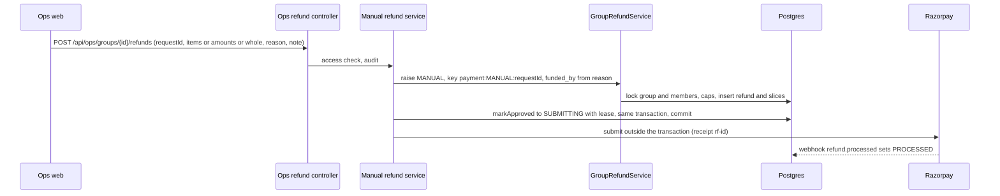

# OPS-5 · Ops-initiated Schedule refund

Status: FINAL v0.4 (2026-11-21), geld + Codex reviewed, F4 accepted by Samivan (refund window taken as 24 h, one admin setting `platform_schedule_config.refund_window_hours`, default 24; confirm if 48 was meant). Moved here from the scratchpad on 2026-11-21; this file is the only copy. Not committed (docs repo is on `docs/schedule-3-4-board-plan`).

## Why
- Pilot needs a person to refund a Schedule customer when something goes wrong: a dish the restaurant could
  not make, an item missing at the door, a failed drop, a very late delivery.
- Today only the system (`raised_by = SYSTEM`) or Razorpay (`EXTERNAL`) creates a refund row, and only a
  platform admin decides (`AdminRefundController`, `/api/admin/refunds`). Area staff have no refund endpoint.
- OPS-5 in `schedule-batches-3-2-3-3-plan.md:262` (D5, 2026-11-18) required the ops role to finish a
  failed-drop refund. This plan replaces its two-person rule (AREA_OPS raises, AREA_MANAGER approves).

## Decisions (Samivan, 2026-11-20)
| # | decision |
|---|---|
| S1 | **One step.** The person who initiates a refund also approves it; it goes to Razorpay at once. No second reviewer. |
| S2 | **Who may initiate:** a platform admin always; an area manager only for groups in their own area and only if granted a refund permission. AREA_OPS cannot. |
| S3 | **Who pays is set by the reason.** Restaurant-fault reasons reduce the restaurant's payout; other reasons are paid by the platform. |
| S4 | **Money only.** No order line, order status, ticket amendment or batch changes. |
| S5 | **Schedule only.** Eat Now refunds stay with the existing admin flow. |
| S6 | Deferred to go-live (slice 2d.6): the restaurant raises "can't make" from its Schedule orders view and ops approves it. |

## What exists (built, deployed 2026-10-29 PR #69 + later group/line work)
- `payment_refunds` (one row = one refund obligation against one captured payment; subject = order or group)
  with `raised_by IN ('SYSTEM','EXTERNAL')`, `decided_by_admin_id`, `customer_reason`, `technical_cause`,
  status machine `REQUESTED → SUBMITTING → ISSUED → PROCESSED` (+ `REJECTED`, `FAILED`), CHECK
  `chk_payment_refunds_decision` requiring an admin decision beyond REQUESTED for SYSTEM rows.
- `payment_refund_allocations` (one row = one slice of a refund taken from one member order, one order line
  and quantity, or one group fee), with `order_line_id`, `refunded_quantity`, `tax_amount`.
- `GroupRefundService.raise(RaiseGroupRefundCommand)`: locks group then members, checks caps (captured amount,
  per-order grand total, per-line quantity), supports `orderAmounts` (amount per member, null = rest),
  `lineQuantities` (units of lines), `includeFees` (only when every member is fully refunded and none
  delivered). Obligation key = `<paymentId>:<event>:group:<groupId>:<subjects>[:items=<line>x<qty>@<alreadyRefunded>][:fees]`.
- `PaymentRefundServiceImpl.approve`: CAS to SUBMITTING in a transaction, then `PaymentRefundSubmitter.submit`
  outside it (receipt `rf-<id>`); webhook marks PROCESSED.
- Settlement (2c): `RefundPositionCalculator` subtracts every PROCESSED `ORDER` slice of a member from that
  member's net and reverses commission for line slices. So today every member-order slice reduces the
  restaurant's payout.
- Area access: `service_area_staff(user_id, service_area_id, role IN ('AREA_MANAGER','AREA_OPS'))`,
  `AreaAccessService.requireForGroup(groupId, AreaRole minimum)`; every `/api/ops` mutation carries
  `@PlatformAuditedEndpoint` + a `PlatformAuditAction`.

> ⚠️ **v0.1 below is SUPERSEDED** by the Data model review further down (names `MANUAL`, `funded_by`, no
> `raised_by_user_id`, key `<paymentId>:MANUAL:<requestId>`) and by "Codex review 2 fixes". Kept as the
> reviewed input only.

## Proposed design v0.1
### Flow
1. Ops board / group detail → "Refund" → form: pick what to refund
   - **Items**: order lines and units (uses `lineQuantities`), or
   - **Amount**: an amount per member order (uses `orderAmounts`), or
   - **Whole group incl. fees** (only if nothing was delivered),
   plus a **reason** (required) and a **note** (required).
2. `POST /api/ops/groups/{groupId}/refunds` with a client `requestId` (UUID made when the form opens).
3. Backend, one transaction: access check (admin, or AREA_MANAGER of the group's area with the refund
   permission) → `GroupRefundService.raise` with `raised_by = OPS`, event `OPS_REFUND`, obligation key
   `<paymentId>:OPS_REFUND:<requestId>` → approve in the same transaction (approved = requested, decided by
   the caller) → audit.
4. After commit: `PaymentRefundSubmitter.submit(refundId)` (same as admin approve). A confirmed Razorpay
   failure → FAILED (the admin board's retry applies); an unknown outcome stays SUBMITTING and the receipt
   lookup or `reconcileStale` settles it (corrected after the Codex review).
5. Customer sees "Refund initiated" through the existing `CustomerRefundView`.

### Reasons → who pays (S3)
| customer reason (new values marked *) | who pays |
|---|---|
| ITEM_UNAVAILABLE (restaurant could not make it) | RESTAURANT |
| ITEM_MISSING* (not in the bag) | RESTAURANT |
| QUALITY_ISSUE* | RESTAURANT |
| DELIVERY_FAILED* (failed drop) | PLATFORM |
| LATE_DELIVERY* | PLATFORM |
| OTHER | PLATFORM |

### Schema changes (sketch, DO NOT RUN)
- `payment_refunds.raised_by`: CHECK gains `OPS`.
- `payment_refunds.raised_by_user_id uuid NULL`: NOT NULL when `raised_by = OPS`.
- `payment_refunds.cost_bearer text NOT NULL DEFAULT 'RESTAURANT'` CHECK IN (`RESTAURANT`, `PLATFORM`).
- `chk_payment_refunds_decision`: decision required beyond REQUESTED for `OPS` rows too.
- `customer_reason` CHECK gains the new values; `technical_cause` stays `NONE` for OPS rows.
- `service_area_staff.can_issue_refunds boolean NOT NULL DEFAULT false`, set by a platform admin.
- Settlement: a slice of a `PLATFORM` refund does not reduce the member's net (still counts toward caps).

### Open questions
- Q1 Should `decided_by_admin_id` be renamed now that an area manager decides?
- Q2 A ceiling per refund or per day for area managers?
- Q3 Time limit after delivery (Razorpay allows refunds for a long window)?
- Q4 One refund mixing items and an amount (not supported by the core today)?

## Next phases that build on this
- 2d.6 (go-live): restaurant raises "can't make" (`ticket_issue`), ops approves; approval would call this
  same one-step refund with reason ITEM_UNAVAILABLE plus line removal and a ticket amendment.
- 3.4g ops problem queue lists those requests.
- 3.5 settlement export reads `cost_bearer`.
- Later: Eat Now ops refunds; auto-approve by policy.

## Data model review

### Summary (read this first)
**Verdict:** the design works on the existing refund core with small changes. Six must-change items come first; the biggest is that settlement would charge a platform-paid refund to the restaurant. Release is still blocked on the known environment gaps (hand-run SQL, `ddl-auto=update`, prod as the default database).
**What changes:**
- A refund row records who raised it (`raised_by = MANUAL`, a person) and who pays (`funded_by = RESTAURANT | PLATFORM`, fixed at raise).
- The decider can be an area manager, so `decided_by_admin_id` becomes `decided_by_user_id` (expand-contract rename).
- The draft's `raised_by_user_id` is dropped: in one step the raiser is the decider.
- An area manager may refund only with `service_area_staff.can_issue_refunds = true`, in their own area.
- Settlement counts a refund against the restaurant only when it is restaurant-funded.
- One ops click gives one Razorpay refund: a client `requestId` is the idempotency key.

**Decisions you need to make:**
| # | decision | options | recommended, and why | if you pick the other option |
|---|---|---|---|---|
| D1 | Rename `decided_by_admin_id` | (a) rename to `decided_by_user_id`, expand-contract over 2 deploys (b) keep the name, document it | (a): the column will hold non-admins; 2 Java readers + 2 web files, small table | (b): a misleading name on a money audit column |
| D2 | Failed drop (platform-paid): is the restaurant still paid for food it cooked? | (a) yes, settlement pays a failed-drop order (b) no, as today | (a) if "platform pays" should mean anything; settlement pays only DELIVERED orders today | (b): the restaurant loses the order value despite "platform pays" |
| D3 | Restaurant-funded refund after the restaurant was paid out for that date | (a) allowed, recovered from the next payout (b) after payout only platform-funded (c) blocked | (b) for the pilot: no claw-back path exists | (a) needs a negative adjustment line in payouts (not built) |
| D4 | Per-refund ceiling for area managers | (a) none, order caps only (b) a fixed ceiling, above it admin only | (a) for the pilot; caps already stop refunding more than was paid | (b) adds a setting and an error path |

**What geld decided for you:**
- `funded_by` lives on the refund, not on each slice (one refund has one reason).
- It is a snapshot from the reason map at raise time, so a later map change never rewrites past payouts.
- `raised_by` value `MANUAL`, not `OPS`: a platform admin raises it too.
- `technical_cause` stays `NONE` for manual rows; the note is required.
- The permission is a boolean on `service_area_staff` (same grain: one user in one area). It becomes a permission list when a second area permission arrives.

**What must happen before deploy:**
1. SQL: new columns and widened CHECKs (expand).
2. Backend with schema-guard entries.
3. Backfill `decided_by_user_id`.
4. Later release: drop `decided_by_admin_id` (contract, DO NOT RUN NOW).

**Unknowns that could change this:**
- Whether the group/lines refund SQL and `service_area_staff` SQL already ran on Neon (owner).
- ENV-4 (Postgres version, PITR) (owner).
- D2/D3 settlement policy (owner).

**Status:** PROPOSED — awaiting decisions · **Verdict:** APPROVED WITH CHANGES (pending D1-D4) · geld deep, 2026-11-20 · previous: none
**Target:** Postgres on Neon (major version unknown, ENV-4) · hand-run SQL from `db_manual/`, explicit BEGIN/COMMIT blocks · Neon pooler · one Spring Boot backend on EC2
**Lenses run:** 0-8 (money + live table + API) · **reference designs:** skipped (extends an approved design)
**Codex second opinion:** 13 findings: 7 agree, 5 Codex-only (all verified in code, 3 became must-change), 1 rank disagreement (refund after payout), decided on evidence
**Open inputs:** pilot refund volume assumed under 50 per day (sizing irrelevant at that level)

### Lens 0 (environment)
| check | result | evidence |
|---|---|---|
| 1 one migration authority | fail (known, deferred ENV-1) | SQL is hand-run from `db_manual/` |
| 2 no unreviewed schema writer | fail (known) | `application.properties:32` `ddl-auto=update`: a backend deployed before the SQL makes Hibernate add new columns with no CHECK or default |
| 3 no default path to prod | fail (known) | `application.properties:6` `DB_URL` falls back to the Neon prod host |
| 4 split credentials | unknown | |
| 5 recovery, 6 rehearsal | unknown (ENV-4) | |
| 8 order of rollout | written below | |

### Tables
| table | grain | change | state |
|---|---|---|---|
| `payment_refunds` | one refund obligation against one captured payment | + `funded_by`, + `decided_by_user_id`, `raised_by` gains `MANUAL`, reason CHECK widened | live (2026-10-29) |
| `payment_refund_allocations` | one slice of a refund (member order, line + qty, or group fee) | none | live; line columns applied: unknown |
| `service_area_staff` | one user's role in one service area | + `can_issue_refunds` | built; applied: unknown |

### Names
| name | holds | project word (grep) | clash | verdict |
|---|---|---|---|---|
| `funded_by` | who bears the refund in payouts | "restaurant-funded / platform-funded" (backlog-ideas.md:29, refund plan L-11) | none in code | keep |
| `raised_by = MANUAL` | a person raised it | SYSTEM / EXTERNAL | draft `OPS` mislabels admin rows | rename to MANUAL |
| `decided_by_user_id` | who approved (admin or area manager) | `decided_by_admin_id` | old name says admin | rename (D1) |
| `can_issue_refunds` | the manager may refund in that area | `AreaRole` | none | keep |
| `RefundEvent.MANUAL` | obligation event | CANCEL..LEGACY | none | keep |

### Findings
#### Must change before the next affected deploy
**MONEY-1 · risk · MUST** — Settlement charges every refund to the restaurant.
- Evidence: `RefundPositionCalculator` adds every PROCESSED `ORDER` slice to `processed` and sets fully refunded when processed is at least the grand total. `SettlementRowAssembler.java:47-50` then pays 0 (fact).
- Failure: a ₹300 platform-funded late-delivery refund on a delivered ₹300 order counts as fully refunded, so the restaurant gets ₹0 for food it delivered.
- Change: the refund position keeps restaurant-funded and platform-funded processed amounts apart. Only restaurant-funded slices reduce the member net, reverse commission and set fully refunded. Platform-funded slices appear as a platform cost line. Caps and the customer view still count all slices.
- Cost to change now: cheap.

**INV-1 · risk · MUST** — One click must give one refund.
- Evidence: the group key includes the units already refunded (`GroupRefundServiceImpl.java:135-144`, fact).
- Failure: a double click on an items refund. The second request waits on the group lock, sees a new already-refunded count, builds a new key and sends a second Razorpay refund.
- Change: a manual key `<paymentId>:MANUAL:<requestId>`, with `requestId` a UUID made when the form opens. Same key with a different body returns 409 (body hash stored in `technical_detail`).
- Cost to change now: free.

**ACCESS-1 · risk · MUST** — The permission check is role-only today.
- Evidence: `requireForGroup(groupId, AREA_MANAGER)` checks role and area (`AreaAccessServiceImpl.java:52-55`, fact).
- Failure: every area manager could refund.
- Change: admin, OR (AREA_MANAGER of the group's area AND `can_issue_refunds`). The endpoint takes a group id only, so Eat Now cannot be reached. Add `@PlatformAuditedEndpoint` + a new `PlatformAuditAction`.
- Cost to change now: free.

**MIG-1 · risk · MUST** — Deploy order with Hibernate `update`.
- Evidence: `ddl-auto=update`; `PaymentRefundSchemaGuard.java:25-39` refuses boot without required constraints/values (fact, keep).
- Failure: backend first, so Hibernate adds a nullable `funded_by` without a CHECK, and manual rows get written with NULL.
- Change: SQL first. Guard entries for `funded_by`, `decided_by_user_id`, `can_issue_refunds`, and `allows(chk_payment_refunds_reasons, 'MANUAL')` plus each new reason.
- Cost to change now: free.

**STATE-1 · risk · MUST** (Codex-only, verified) — A retry turns a manual refund into a system one.
- Evidence: `RefundRows.retryOf` sets `raised_by = SYSTEM` and copies neither the decider nor the new `funded_by` (`RefundRows.java:70-78`, fact).
- Failure: a platform-funded manual refund fails at Razorpay and the admin retries it. The new row is SYSTEM with the default `funded_by = RESTAURANT`, so the restaurant pays for a late delivery.
- Change: `retryOf` copies `raised_by`, `funded_by`, reasons and lineage. The retry's decider is the admin who retries it.
- Cost to change now: free.

**MONEY-4 · risk · MUST** (Codex-only, verified) — Defaulting history to RESTAURANT mislabels admin partials.
- Evidence: an approval below the requested amount is a platform-funded partial by rule L-11 (`refund-approval-plan.md:288`; partial path `RefundApproval.java:53-56`, fact).
- Failure: an existing ₹200-of-₹300 approval gets `funded_by = RESTAURANT` and settlement cuts the restaurant.
- Change: the expand SQL backfills `funded_by = 'PLATFORM'` where `approved_amount < requested_amount`. Run a preflight count first.
- Cost to change now: cheap.

**INV-2 · risk · SHOULD** (Codex-only, verified) — A replay after a confirmed failure creates a fresh attempt.
- Evidence: the obligation index excludes FAILED (`payment-refunds-migration.sql:104`); `raise` looks up the key with `StatusNot(FAILED)` (`GroupRefundServiceImpl.java:66-68`, fact).
- Failure: ops resubmits a request after Razorpay confirmed a failure. A new row goes out, bypassing the admin retry and its lineage. No money is doubled, because the first refund confirmed none.
- Change: a replay whose key has a FAILED row returns that row ("failed, an admin retries it"). Only the admin retry makes the next attempt.
- Cost to change now: free.

**API-1 · risk · SHOULD** (Codex-only, verified) — Ops refunds apply only to PAID groups.
- Evidence: a non-PAID refundable group (FAILED, CANCELLED, CAPTURE_MISMATCH) forces a whole-group refund with no slices (`GroupRefundServiceImpl.java:69-73`, fact).
- Failure: ops picks items on such a group and gets a confusing error, or refunds the whole capture with no slices.
- Change: the ops form is offered only for `PAID` groups with no settlement exception. Other groups stay with the admin refund board.
- Cost to change now: free.

**INV-3 · trade-off · SHOULD** (Codex) — Two people, two tabs, the same intent.
- Failure: two managers each refund ₹100 for the same complaint with different `requestId`s, and both go through within the caps.
- Change: the form lists the group's existing refunds and warns when one with the same reason was raised in the last 30 minutes. Not blocked: it may be genuine.

#### Fine now, revisit at
- **MONEY-2 (D2)**: `funded_by = PLATFORM` does nothing for an order that was never delivered (`SettleableOrderPredicate.java:14-15`). Revisit at 3.5 settlement export.
- **MONEY-3 (D3)**: a restaurant-funded refund after a frozen payout has no claw-back. Revisit at the first payout batch.
- **EVOL-1**: `can_issue_refunds` is a boolean. Move to a permission list when a second area permission appears.
- **ACCESS-2 (D4)**: no ceiling per manager. Revisit after a month of pilot refunds.
- **OPS-1** (Codex): a Razorpay-dashboard refund whose webhook has not arrived makes the local balance stale. Operational rule for the pilot: no dashboard refunds on Schedule payments. Revisit if one ever happens (it shows as an EXTERNAL row).
- **UX-1** (pre-existing): the customer sees FAILED as "Refund initiated" (`RefundSummaryMapper.java:44`). That is right while an admin can retry; revisit if FAILED rows go unretried. The new reasons need customer copy in `RefundSummaryMapper.reason`; the exhaustive switch makes a missing case a compile error (keep).

#### Keep
- One refund core. Manual refunds reuse the `GroupRefundService.raise` caps (captured, per order, per line) under the group lock.
- `RefundState.markApproved` sets SUBMITTING with `lease_until = now` (`RefundState.java:67-77`). A crash between commit and the Razorpay call is finished by `reconcileStale` by receipt, so there is no double send.
- Customer copy through `CustomerRefundView`.
- The schema-guard pattern for enum values.

### Codex comparison (blind, read-only, 13 findings)
| Codex | outcome |
|---|---|
| 1 idempotency key per action | agrees with INV-1; two-tabs part added as INV-3 |
| 2 FAILED key reuse | verified → INV-2 |
| 3 one transaction, submit after commit, reconcile as recovery | agrees (L-1, keep on lease) |
| 4 unknown outcome stays SUBMITTING | verified; the draft's "Failure → FAILED" was wrong, fixed in the flow |
| 5 bearer per refund ok if one reason; caps count all slices | agrees (MONEY-1) |
| 6 settlement math, L-11 history | agrees MONEY-1; history part verified → MONEY-4 |
| 7 refund after payout | disagree on rank: no payout freeze exists yet (2c export is a preview, `schedule-2c-settlement-inputs-plan.md:17`), so nothing can be checked today; kept as MONEY-3 revisit at the first payout batch, rule decided now in D3 |
| 8 permission on the same membership row | agrees (ACCESS-1) |
| 9 dashboard refund race | verified as possible; operational rule OPS-1 |
| 10 one shared CHECK; guard; SQL first | agrees (MIG-1); CHECK is replaced atomically in one transaction |
| 11 retry hardcodes SYSTEM | verified → STATE-1 |
| 12 customer view, FAILED shown as initiated | verified, pre-existing → UX-1 |
| 13 non-PAID groups | verified → API-1 |

### Column mapping (delta) — DO NOT RUN, sketch for review
```sql
-- Expand (before backend release N), each with SET lock_timeout = '3s'; small tables, brief ACCESS EXCLUSIVE accepted
ALTER TABLE payment_refunds ADD COLUMN funded_by text NOT NULL DEFAULT 'RESTAURANT';
ALTER TABLE payment_refunds ADD CONSTRAINT chk_payment_refunds_funded_by
  CHECK (funded_by IN ('RESTAURANT','PLATFORM')) NOT VALID;
ALTER TABLE payment_refunds ADD COLUMN decided_by_user_id uuid;
-- chk_payment_refunds_reasons: raised_by IN ('SYSTEM','EXTERNAL','MANUAL');
--   customer_reason adds ITEM_MISSING, QUALITY_ISSUE, DELIVERY_FAILED, LATE_DELIVERY
-- chk_payment_refunds_decision: SYSTEM or MANUAL beyond REQUESTED => decider and decided_at NOT NULL;
--   MANUAL => decision_note NOT NULL
ALTER TABLE service_area_staff ADD COLUMN can_issue_refunds boolean NOT NULL DEFAULT false;
-- Same block: UPDATE payment_refunds SET funded_by = 'PLATFORM'
--   WHERE approved_amount IS NOT NULL AND approved_amount < requested_amount;   -- MONEY-4, preflight count first
-- Migrate after N: backfill decided_by_user_id = decided_by_admin_id; VALIDATE CONSTRAINT
-- Contract (release N+1, DO NOT RUN NOW): drop decided_by_admin_id after reads switch
```

### Rollout
| change | phase | slot | works with N-1 | rollback | precondition |
|---|---|---|---|---|---|
| `funded_by` + CHECK | expand | before N | yes (default) | leave column | none |
| reason / raised_by CHECK widen | expand | before N | yes (superset) | roll forward | none |
| `decided_by_user_id` | expand, then migrate | before N, backfill after N | yes | leave column | D1 = (a) |
| `can_issue_refunds` | expand | before N | yes | leave column | `service_area_staff` exists on Neon |
| drop `decided_by_admin_id` | contract | N+1 | after reads switch | none | backfill verified |

**Cutover step (review finding, 2026-11-22):** run `schedule-ops-refund-migration.sql` a second time right after the new backend is live and before settlement is served. It is idempotent. An old backend that approves a partial refund between the first run and the deploy leaves that row RESTAURANT; the rerun sets it PLATFORM (the new approval code applies the same rule from then on) and fills any missing `decided_by_user_id`.

### Locked decisions (handoff to /gcp and /judge)
| id | decision | enforced where | code paths |
|---|---|---|---|
| L-1 | manual refund = raise + approve in one transaction, submit after commit | service | new manual refund service, `GroupRefundService.raise`, `RefundState.markApproved`, `PaymentRefundSubmitter` |
| L-2 | key `<paymentId>:MANUAL:<requestId>`; same key + different body = 409 | partial UNIQUE + service | raise |
| L-3 | `funded_by` fixed from the reason map at raise | service + CHECK | reason map, `RefundRows` |
| L-4 | only restaurant-funded slices reduce payout, reverse commission, set fully refunded | service + tests | `RefundPositionCalculator`, `SettlementRowAssembler` |
| L-5 | admin, or AREA_MANAGER of the group's area with `can_issue_refunds` | service | ops refund controller, `AreaAccessService` |
| L-6 | Schedule groups only, PAID groups with no settlement exception | endpoint shape + service | controller |
| L-7 | a retry keeps `raised_by`, `funded_by`, reasons and lineage | service + test | `RefundRows.retryOf` |
| L-9 | refund window = slot START + 48 h (a slot has only a start time, F3): manual refunds by area managers only inside it; after it, platform admin only and `funded_by = PLATFORM`; a date's restaurant payout is not frozen before its window closes | service + 3.5 export | manual refund service, settlement export (3.5) |
| L-8 | an unknown gateway outcome stays SUBMITTING until the receipt lookup or reconcile settles it | existing service | `PaymentRefundSubmitter` (unchanged) |

### Approval record
| finding or decision | option chosen | by | date |
|---|---|---|---|
| D1 rename `decided_by_admin_id` | (a) rename to `decided_by_user_id`, expand-contract | Samivan | 2026-11-20 |
| D3 refund after payout | prevent it: a service date's payout waits until a **48 h refund window** after the slot closes; inside the window ops refunds as designed; after it, only a platform admin refunds and it is platform-funded (L-9) | Samivan | 2026-11-20 |
| D4 manager ceiling | (a) none, order caps only | Samivan | 2026-11-20 |
| D2 research (2026-11-20) | industry splits the loss by FAULT, not by "failed delivery": customer fault (unreachable, cancel after prep) = customer pays, restaurant paid (Swiggy 100% cancellation fee, Zomato cancellation charge; a consumer forum ruled against Zomato when "unreachable" lacked evidence); restaurant fault (wrong/missing/late) = restaurant unpaid or charged (DoorDash, Zomato problem orders); platform/rider fault = platform refunds and still pays the restaurant (Zomato compensation policy, DoorDash "paid if confirmed and prepared"); no source shows riders charged for food. Our `DropFailureReason` (CUSTOMER_UNREACHABLE, ENTRY_DENIED, ADDRESS_WRONG, OTHER) is customer-side except OTHER. Proposal awaiting Samivan | Claude | 2026-11-20 |
| D2 fault model | AGREED: who pays follows fault. (1) customer-fault failed drop = no refund, restaurant paid, ops goodwill refund is PLATFORM; (2) rider/platform fault = customer refunded, restaurant compensated (new drop reason e.g. RIDER_ISSUE), rider not charged; (3) restaurant fault = restaurant-funded refund; (4) settlement (3.5) pays a failed-drop order unless restaurant fault | Samivan | 2026-11-20 |
| D2 point 2 detail | PROPOSED by Samivan, under refinement: restaurant compensation for rider/platform fault follows an AGREED contract percentage; recovery options "restaurant takes the food back" or "platform resells it", and if unsold the restaurant bears the agreed loss. Contract term → `02-Domain/restaurant-schedule-terms.md` new T-row when the docs repo is free | Samivan | 2026-11-20 |
| D2 point 2 decided | no platform resell; v1 has no take-back/resell flow in the system (2-3 km radius, ops handles the food internally); restaurant that does NOT take the food back gets an agreed % of food value (70-100% range accepted, exact number OPEN); compensation when the restaurant DOES take it back: OPEN | Samivan | 2026-11-20 |
| D2 point 2 percentages | (1) restaurant does NOT take the food back (rider or platform fault): the restaurant is paid **100% of the food value by default, changeable per restaurant** (replaces "70-100% range, number OPEN"); stored in a column, never hardcoded; the column is built later, with settlement 3.5, not in OPS-5 (see "Reserved column"). (2) restaurant DOES take the food back: **0%** (a contract rule, no column: v1 has no take-back flow, ops adjusts by hand) | Samivan | 2026-11-21 |
| F4 pilot payout rule | accepted: pay a date's restaurants only after the window closes and no restaurant-bearing refund of that date is unsettled (REQUESTED, SUBMITTING, ISSUED, or FAILED with no successful retry); window length = one admin setting, 24 h by default (Samivan answered "i accept" to a message recommending 24 h) | Samivan | 2026-11-21 |
| D2 rider fault | rider bears the loss when the failed-drop reason is not genuine or has no evidence; a genuine rider issue (accident, breakdown) = platform bears it. Needs: evidence captured at failed drop, an ops review that decides "genuine", a rider deduction record. Karnataka Platform Based Gig Workers Act 2025 (in force; Rules 19 Nov 2025): payout deductions must be recorded and reported, disputes go to the platform's Internal Dispute Resolution Committee: lawyer to confirm before any deduction. Separate slice (rider payouts), not OPS-5 | Samivan | 2026-11-20 |
| D2 failed delivery payout | superseded by the rows above; was OPEN: "ideally pay the restaurant too, but not for every situation"; research how Zomato/Swiggy split cancellation and failed-delivery losses (restaurant / platform / rider) first | Samivan | 2026-11-20 |

## Reserved column: the restaurant's payout for undelivered food (deferred, geld note 2026-11-21)

**Not built in OPS-5.** OPS-5 only records who pays (`funded_by`). The percentage is read by settlement (3.5) when it pays a failed-drop order whose fault is the rider's or the platform's; nothing in OPS-5 reads it, so it is reserved here and built with 3.5.

| item | decision |
|---|---|
| Where | `commission_rate_card_version.platform_fault_payout_percent` (the immutable, dated, per-shop-per-channel terms row that orders already snapshot through `orders.commission_rate_card_version_id`) |
| Type and default | `NUMERIC(5,2) NOT NULL DEFAULT 100`, CHECK between 0 and 100 (adding a column with a constant default is metadata-only; the append-only trigger blocks row edits, not this DDL) |
| Default for everyone | 100: every existing and new version reads 100, so every restaurant, including those on the system "No commission" card, is paid in full |
| Change for one restaurant (later) | create a card version with another percentage and assign it to that restaurant with a date: the existing 24 h notice, forward-only and audit rules apply, and an order placed earlier keeps the percentage it was sold under |
| Applies to | the Schedule channel only (assignments are per channel) |
| Read by | settlement 3.5, through the order's snapshotted version; never by OPS-5 |

**Why this table.** The terms must be dated (a restaurant cannot have its payout cut without notice, T8) and must not rewrite past orders. The rate-card version already has both: forward-only assignments and an order snapshot. A mutable per-shop column would need a new notice and snapshot mechanism.
**Alternative rejected.** `schedule_shop_settings`: one mutable row per shop, no history and no snapshot (a change would reprice orders already placed), and a row exists only after the shop sets an order-by time (`default_order_until NOT NULL`), so the default would still need a code constant.
**Cost.** A commission card now also carries one payout term; two restaurants with the same commission but different percentages need two cards. Acceptable until a second payout term appears; then split into a "terms" version.
**Name check.** Vocabulary in the plan and the Schedule plans: "platform fault", "failed drop", "restaurant-funded / platform-funded". `platform_fault_payout_percent` says when it applies; no clash found in code.
**Until 3.5 is built.** The default 100 is the rule in the restaurant terms; any other agreement with a restaurant is recorded by hand and applied when settlement is paid by hand.

**Contract T-rows to add** to `02-Domain/restaurant-schedule-terms.md` when the docs repo is free: (a) T11 failed drop by rider or platform fault: the restaurant is paid the agreed percentage of the food value (default 100) when it does not take the food back; (b) T12 if it takes the food back, 0%; (c) T13 payout timing: a date's payout is made after the refund window (slot start + 48 h) closes, with no refund in flight (F4).

## Pilot payout rule in plain words (F4, awaiting Samivan's yes)

**The problem.** An area manager may refund a Schedule order for 48 hours after its slot starts (L-9), and a refund the restaurant bears reduces what it is owed. If the restaurant was already paid for that date, there is no way to take the money back (D3: no claw-back path exists, and the 2c export is only a preview with no freeze).
**The rule until 3.5 automates it.** You pay the restaurants for a service date only when both are true: (1) 48 hours have passed since the start of the last Schedule slot of that date, and (2) no restaurant-bearing refund of that date is still unsettled: REQUESTED, SUBMITTING, ISSUED, or FAILED with no successful retry yet (an admin retry keeps the restaurant-bearing label, L-7, so it would reduce a payout already made); the 2c export lists in-flight refunds, so you check that list and the FAILED refunds of that date.
**The window length** is one admin setting read by both the refund service (the hard stop on restaurant-bearing refunds) and the payout check; 24 or 48 hours changes only the wait and how many late complaints the platform bears, not the logic.
**What it costs.** Restaurants wait about 2 to 3 days after the day they cook; every payout is then final, with no claw-back needed. After 48 hours only a platform admin can refund, and the platform bears it.
**If you say no.** Pay sooner and accept that a late restaurant-bearing refund cannot be recovered (the loss stays with the platform), or build the claw-back line in payouts first (not built).

## System design

### Main flow


### Decisions
- One step, not maker-checker (S1, owner's call). Negative: one person moves money, limited by caps, area scope, the permission and the audit log. Revisit if refunds per manager look wrong.

## Codex review 2 fixes (2026-11-20, verified)
| # | Codex finding | fix written into the design |
|---|---|---|
| F1 MUST | v0.1 flow/SQL still say OPS, cost_bearer, raised_by_user_id | v0.1 marked superseded at its heading |
| F2 MUST | reason alone fixes who pays; "missing"/"late" can have different faults; L-9 overrides after 48 h | ops picks a FAULT-explicit reason; ordered rule: (1) after the 48 h window -> PLATFORM, admin only; (2) else reason map; `funded_by` stored on the row (snapshot) |
| F3 MUST (verified: `ServiceAreaSlot` has only `start_local_time`) | the window has no end time to count from | anchor = slot START on the group's `service_date` in the area's zone (via `ServiceDateResolver`) + 48 h; no end time needed |
| F4 MUST | no payout freeze exists; a refund near the deadline can still be in flight | until 3.5 builds the freeze: pilot rule = Samivan pays restaurants for a date only after slot start + 48 h AND no refund on that date is REQUESTED/SUBMITTING/ISSUED (the 2c export already holds in-flight refunds) |
| F5 MUST | `DELIVERY_FAILED` contradicts the fault model (customer fault = no refund) | reason list for ops: ITEM_UNAVAILABLE, ITEM_MISSING, QUALITY_ISSUE (RESTAURANT); RIDER_ISSUE, LATE_DELIVERY, GOODWILL (PLATFORM); no DELIVERY_FAILED. Failed drops by customer fault get no refund; ops may give GOODWILL |
| F6 MUST | rename CHECK would reject old code's writes | transitional CHECK uses `COALESCE(decided_by_user_id, decided_by_admin_id)`; backend N writes both; backfill; CHECK on the new column only in N+1 |
| F7 SHOULD | replay identity across FAILED retries; receipt lookup paging | `technical_detail.requestId` + body hash; replay looks up by requestId across the retry chain; receipt lookup reuses the existing submitter (unchanged) |
| F8 SHOULD | builder still decides acceptance cases, permission admin | /gcp brief carries acceptance cases; `can_issue_refunds` is set by a platform admin through an audited admin endpoint |

## Quality brief (/gcp, 2026-11-21)
- Stacks: spring (Boot 4, Java 21), sql-postgres, testing; web (react, nextjs) for the later form slice. Rules exist for all. `build-index.mjs --check` printed 1 error (stale files); continued.
- Project rules that win: every /api/ops mutation carries `@PlatformAuditedEndpoint` + a `PlatformAuditAction`; SLF4J INFO on entry; DTOs only at the HTTP edge; a new `OrderRepository` method is listed in `OrderRepositoryGroupFilterTest`; each new DB object gets a schema-guard entry; hand-run SQL file, SQL before the backend.
- Rules: CORE-ARCH-01 [MUST] one manual-refund function for every entry; CORE-SEC-01 [MUST] actor and funding come from the server; SB-API-01 retried refund = DB-enforced key; SB-SEC-01 area from the loaded group; SQL-SCHEMA-04 [MUST] NOT NULL in stages (constant default is metadata-only; the decider backfill is staged); SQL-SCHEMA-02 every invariant a constraint; SQL-QUERY-01 [MUST] NOT EXISTS, never NOT IN; CORE-ERR-09 [MUST] stable error codes; CORE-REUSE-01/02; CORE-STRUCT-10; TEST-DB-06/07.
- Reuse map: raise + caps -> `GroupRefundService.raise` (add a `RaiseGroupRefundCommand.forManual` factory, no new ctor overload); approve + submit -> `RefundState.markApproved`, `PaymentRefundSubmitter`; obligation key -> `RefundRows` (add `manualObligationKey` beside `orderObligationKey`); reason -> customer text -> `RefundSummaryMapper.reason` (exhaustive switch: add the new cases); area access -> `AreaAccessService.requireForGroup` + `ServiceAreaStaffRepository` (new `can_issue_refunds` read); platform admin check -> `AdminAccessSettings`; global setting -> `platform_schedule_config` + `ScheduleHoldConfigCache` + `AdminScheduleHoldController` pattern (add `refund_window_hours`); settlement split -> `RefundPositionCalculator`; retry -> `RefundRows.retryOf`. Cross-cutting jobs: money rounding `MoneyRules.money` (use); no new helper expected.
- Folder shape: `service/refund/` has 23 files, `group/` 7: the new service goes in `service/refund/manual/` (service, command, funding rule, window rule); the controller is one new class beside `AdminRefundController`.
- Tests: negative authorization on the real stack (no login 401, AREA_OPS 403, manager without `can_issue_refunds` 403, manager of another area 403, admin ok); window edges (1 ms before and after; after the window manager 403, admin ok and PLATFORM); idempotency (same requestId + body returns the row, different body 409, FAILED replay returns the failed row, concurrent double click on a real database gives one refund); `funded_by` snapshot per reason and fault; `retryOf` keeps `raised_by`, `funded_by`, reason; settlement: a PLATFORM slice does not reduce the net or reverse commission but still counts toward caps; non-PAID group refused; Eat Now order unreachable; items, amounts and whole-group variants; schema test for the SQL on embedded Postgres (rerun, old CHECK upgrade with NOT VALID). Real database: locks, unique and CHECK. Helpers: `GroupRefundTestRows`, `RefundTestFixtures`.
- Copy check: no copy planned; `RaiseGroupRefundCommand` already has 2 constructors, so use a factory. Size: keep `PaymentRefundServiceImpl` (225 of 250) and `GroupRefundServiceImpl` (145) from growing; new logic lives in `manual/`.
- Decisions for you: window default 24 h (assumed from "i accept"); the compare scope (see the session).
- Cannot run here: the SQL on Neon (ENV-4), whether the group/line refund SQL and `service_area_staff` ran on Neon (owner runs read-only queries), a real Razorpay submit (round B2), the full suite (5-7 min, run in the background).
- Done means: `./mvnw -B -o test -Dtest='!NinjaDeliveryServiceApplicationTests'` green, then `/judge full`.
