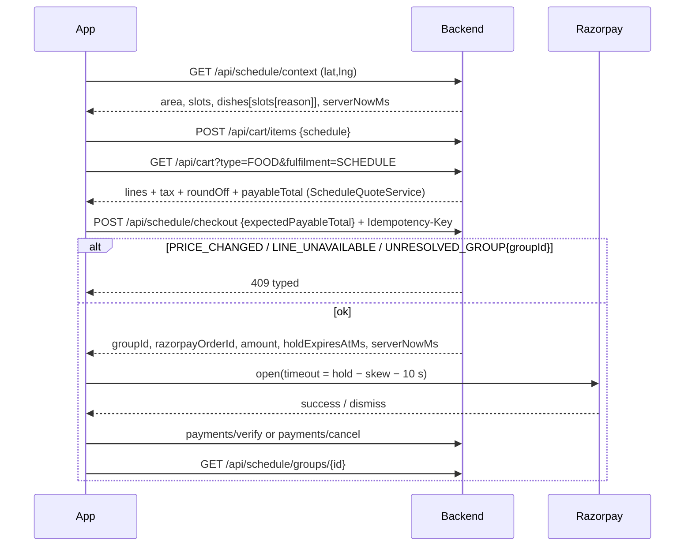

# Schedule Phase 4 — Customer app plan (DRAFT v0.1, 2026-11-08)

**Status:** draft, not reviewed. Reviews pending: /geld (API contracts), /devils-advocate (checkout money), Codex (read-only).
**Repos:** Food-Ninja-Frontend (app) on branches `feature/schedule-4.x` off app `feature/schedule`; small backend additions on `feature/schedule-4b` off backend `feature/schedule`.
**Read with:** [schedule-implementation-order.md](schedule-implementation-order.md) Phase 4, [schedule-2b5-cart-plan.md](schedule-2b5-cart-plan.md), [schedule-2b8-2b10-plan.md](schedule-2b8-2b10-plan.md), [schedule-2b6-holds-plan.md](schedule-2b6-holds-plan.md), [schedule-customer-app-orders-plan.md](schedule-customer-app-orders-plan.md) (My Orders, already built).

**Exit (from the roadmap):** a customer schedules from two restaurants, pays once, sees fees, cancels before the cancel deadline, tracks.

## 1. What the backend already gives the app (verified on backend `origin/feature/schedule` d5f9db5)

| Need | Endpoint | Notes |
|---|---|---|
| Area, slots, restaurants, dishes, reasons | `GET /api/schedule/context?lat&lng&serviceDate` (public, guest OK) | `area` (fees, `maxShopsPerCart`, `advanceDays`), `paused`, `windowOpensAtMs`, `slots[] {id, startLocalTime, lastCallAtMs, orderable}`, `restaurants[] {id, name, imageUrl, hasOrderableDish, dishes[]}`; dish: `startsAtPrice, mrp, discountPercent, minOrderQty, reason, orderByMs, nextOrderableAtMs, orderableSlotIds` |
| Add a Schedule line | `POST /api/cart/items` with `schedule {areaId, serviceDate, slotId}` | 409s: `ScheduleCartConflictResponse` (other date/slot/area), `ScheduleCartShopLimitResponse` (over `maxShops`), `ScheduleDishRefusedResponse {reason}` |
| Read the Schedule cart | `GET /api/cart?type=FOOD&fulfilment=SCHEDULE` | lines carry `shopId/shopName`; `subtotal`, `deliveryFee`, `packagingFee`; `schedule {areaName, serviceDate, slotStart, maxShops, state OPEN/SLOT_CLOSED/DATE_PASSED}`; **no tax, no round-off, no payable** (message "Taxes are added at checkout", `ScheduleCartViewBuilder.java:121-138`) |
| Checkout | `POST /api/schedule/checkout` + `Idempotency-Key` | body `{deliveryAddress, selectedLineIds?, expectedPayableTotal}`; 200 → `groupId, groupCode, members[], razorpayOrderId, keyId, amount (paise), subtotal, deliveryFee, packagingFee, taxTotal, roundOff, holdExpiresAtMs, serverNowMs`; errors 409 `{error: PRICE_CHANGED {members[], payableTotal} | LINE_UNAVAILABLE {lines[] reason SOLD_OUT/HELD/...} | AREA_CLOSED | ROUTE_SPLIT_SHOP | UNRESOLVED_GROUP}`, 400 `CART_EMPTY` |
| Pay result | `POST /api/schedule/payments/verify` → `ScheduleGroupView`; `POST /api/schedule/payments/cancel {groupId}` | verify can return "waiting for capture" |
| Track / cancel | `GET /api/schedule/groups`, `/groups/{id}` (app already uses), `POST /groups/{id}/cancel`, `POST /orders/{id}/late-cancel` | group view has `canCancel`, `cancelUntilAt`, `lateCancelFromAt` |

## 2. Blockers and plan changes found in the code (2026-11-08)

| # | Finding | Effect | Proposed change |
|---|---|---|---|
| **G1** | Checkout requires `expectedPayableTotal`, but no endpoint returns the payable total before checkout (cart says "the final payable and round-off come from checkout"). | The app would have to re-implement `RoundingPolicy` (forbidden: frontend duplicating backend money rules) or every first checkout returns `PRICE_CHANGED`. | **Backend:** Schedule `CartResponse` gains `roundOff` and `payableTotal` from the same quote path checkout uses (`FeeResolver` + tax + `RoundingPolicy`), for the selected lines. App sends that value back unchanged. |
| **G2** | The customize sheet reads `GET /api/shops/{id}/menu`, which knows nothing about `schedule_unavailable_addon` (options switched off for Schedule). Context dishes carry no add-on groups and no "customizable" flag. | Customer picks an option that the cart then refuses (`ScheduleDishRefused`). | **Backend:** context dish gains `customizable` and `unavailableAddonIds` (or the menu endpoint takes `?fulfilment=SCHEDULE&slotId&serviceDate`). Recommend the context fields: one read, no second resolver. |
| **G3** | Dish has one `reason` plus `orderableSlotIds`; there is no reason per slot. 4.1 says never infer availability client-side. | For a dish ORDERABLE in another slot but not the selected one, the app must guess the copy. | **Backend:** context accepts `slotId`; `reason`/`orderByMs` are then for that slot. App re-fetches on slot change (cheap, same endpoint). |
| G4 | Schedule checkout response has no `prefill` (Eat Now's does). | Razorpay sheet loses name/phone prefill. | App takes prefill from `useUserStore`; no backend change. |
| G5 | Hold expiry: app must close the sheet at `holdExpiresAtMs`. `react-native-razorpay` cannot be closed from JS. | Customer may pay after the hold lapsed (backend re-checks or refunds, 2b.9). | Pass Razorpay `timeout` (seconds = (holdExpiresAtMs − serverNowMs)/1000 − 10 s margin). **Verify `timeout` is honoured by the RN Android SDK on a device** before relying on it; the backend late-capture path is the safety net either way. |
| G6 | 2d.2 (group notifications) is not built. | 4.4 "all group notifications" cannot be finished. | 4.4 ships cancel + group card only; push handling waits for 2d.2. |
| G7 | 3.3 (picked-up / delivered) not built. | Tracking stops at "being prepared". | Out of scope; the existing group screen already renders whatever status arrives. |
| G8 | `db_manual/schedule-ticket-migration.sql` not run; backend refuses to boot without it. | No end-to-end test of 4.3 until it runs. | Samivan runs it (DNS fix first); app work is not blocked. |
| G9 | App `CartType` is `'FOOD' \| 'GROCERY' \| 'PRODUCT'`; `useCartStore` holds ONE cart. | A Schedule cart and an Eat Now cart coexist on the server. | Add `'SCHEDULE'`; a separate `useScheduleCartStore` (own slice, own bootstrap) so Eat Now cart state is never touched. |

## 3. Slices (one PR each into app `feature/schedule`)

**4.0 [B] backend contract additions (G1-G3)** — one PR into backend `feature/schedule`, before 4.2/4.3 UI depends on them. No schema. Tests: cart `payableTotal` equals the checkout quote for the same lines (property over fee/tax/round-off cases); context per-slot reason; unavailable add-on ids match the resolver.

**4.1 Area bootstrap** — `useScheduleContext(lat, lng, slotId?)` from `useLocationStore`; Home gets an "Eat Now / Schedule" switch only when `area.scheduleEnabled`; first-open HSR intro screen (shown once, `usePreferencesStore`). States: no area, `paused`, not open yet (`windowOpensAtMs`), no slots. Guest can browse.

**4.2 Slot-first menu** — slot chips (disabled when `!orderable`, label "order by HH:mm" from `lastCallAtMs`); restaurants list, dishes greyed with copy from `reason` (ORDER_BY_PASSED → "Order by 11:30 passed", SOLD_OUT → "Sold out", SLOT_CLOSED → "Closed for this slot", RESTAURANT_CLOSED, OFF ...: one mapping table, unknown reason → generic "Not available"); day picker only when `advanceDays > 0` (always 0 today: SCHEDULE_SAME_DAY_ONLY). Pull-to-refresh re-reads context. ADD → guest gate → customize sheet (hides `unavailableAddonIds`) → `POST /api/cart/items` with `schedule`. Handle the three 409s with dialogs (switch slot = clear cart, shop limit, refused reason).

**4.3 Schedule cart + checkout + Razorpay** — cart grouped by restaurant; bill: subtotal, delivery, packaging, tax, round-off, payable (all server values). Address: saved address picker; `AREA_CLOSED` (outside area) message. Checkout with a per-attempt idempotency key (reuse `features/cart/utils/idempotency.ts`). `PRICE_CHANGED` → reconfirm sheet showing old vs new payable, retry with the new value and a NEW key. `LINE_UNAVAILABLE` → mark lines SOLD_OUT (remove) vs HELD ("someone is checking out, try in a few minutes"). `UNRESOLVED_GROUP` → route to the open group (cancel or pay). Razorpay open with `timeout` (G5); success → verify → group screen; dismiss → `payments/cancel`; verify network failure → "payment received, confirming" + group screen polls (existing `usePollWhileFocused`). Cart `state` SLOT_CLOSED/DATE_PASSED → banner + block checkout.

**4.4 (partial) Cancel + group tie-in** — group screen gets a Cancel button when `canCancel` (confirm dialog shows refund amount from the view); late-cancel button when `now ≥ lateCancelFromAt` per member. After checkout, land on the group screen. Push (2d.2) deferred.

## 4. Out of scope
2d.2 notifications, 3.3 stages, advance days > 0, COD for Schedule, web.

## 5. Verification
tsc + eslint + jest per slice; backend 4.0 with unit/integration tests excluding contextLoads. Device test (Samivan): layout, Razorpay `timeout`, real payment round from [[project_schedule_test_sprint]].

## Data model review

### Summary (read this first)
**Verdict:** APPROVED WITH CHANGES, pending your decisions. Phase 4 adds no tables. Five API contract changes must land in backend slice 4.0 before the app builds on them.

**What changes** (before → after):
1. The Schedule cart shows only subtotal and fees. → It shows tax, round-off and the final payable per restaurant and in total, computed by the same code checkout uses. The app sends that payable back unchanged. (MONEY-1)
2. An abandoned payment sheet blocks checkout for that date for up to an hour. → An expired unpaid checkout is cancelled inline, and the refusal tells the app which checkout is open. (API-1)
3. Dish availability has one reason for all slots. → Each dish carries a reason per slot, so the app never guesses and a slot tap needs no extra read. (API-4, replaces G3's `slotId` refetch)
4. The customize sheet cannot see options switched off for Schedule. → The dish carries `customizable` and `unavailableAddonIds`. (API-3)
5. The menu cannot tell when a slot's last call passes while the screen is open. → The context returns `serverNowMs`, and the app re-reads it at the next last call. (TIME-1)

**Decisions you need to make:**
| # | decision | options | recommended, and why | if you pick the other option |
|---|---|---|---|---|
| D1 | Contract changes 1-5 land as backend 4.0 before the app slices | yes / app works around them | **yes**: the workarounds re-implement rounding and availability in the app, which principles.md forbids | the app duplicates money rules, and every first checkout can hit PRICE_CHANGED |
| D2 | An expired unpaid checkout is cancelled inline when the same customer checks out again | inline cancel / keep refusing until the hourly sweep | **inline cancel**: the hold has already lapsed, and a late capture on a cancelled group is already refunded (2b.9, `OrderGroupRepository.java:66`) | the customer is locked out of the slot until the next hour |

**What geld decided for you:** reasons per slot in one response, not a re-fetch per slot (≤4 slots, saves a database round trip per tap). The idempotency key lives for one request body (API-2). Cart totals come from one shared quote service, never a second copy of the maths.
**What must happen before deploy:** (1) run `db_manual/schedule-ticket-migration.sql` (Samivan; fix the DNS first). (2) Merge backend 4.0. (3) Run the app slices. No new SQL in Phase 4.
**Unknowns that could change this:** whether the RN Android Razorpay SDK honours the `timeout` option (device test). The backend late-capture refund is the safety net either way.

**Status:** PROPOSED — awaiting decisions · **Verdict:** APPROVED WITH CHANGES · geld default, 2026-11-08
**Target:** Spring Boot + Postgres (Neon, one DB = prod), Expo RN app; no schema change in this plan.
**Lenses run:** 0, 1, 4, 5, 6, 8 · **skipped:** 2 (no table, column or key added), 3 (nothing copied into a store; context fields are computed per read), 7 (no existing table changes) · **reference designs:** skipped (no new data model).
**Codex second opinion:** read-only run, 12 findings. Agreed: G1-G5 and G9 (with API-7 added). Codex-only, verified and adopted: API-1b, API-2, API-5, API-6, API-7. Still unverified: G5 (Razorpay `timeout` on Android) and G6-G8 environment facts. Slice-order change adopted: §3 order is now 4.0 → (4.1 ∥ 4.2) → 4.3 with recovery + polling → 4.4. Codex also noted that `useScheduleGroupDetail` polls only while the group is active, so a CREATED/pending group must count as active for polling (check in 4.3).

### Lens 0 (environment)
Checks 1-2 fail repo-wide: SQL is hand-run, and Hibernate uses `ddl-auto=update` (known, recorded in project memory). They are not caused by this plan, which adds no schema. Check 8 (rollout order) passes: the ticket migration is documented to run before the backend boots. Checks 3-7: unchanged from earlier reviews.

### Findings
| id | kind / rank | evidence | failure | change | cost now |
|---|---|---|---|---|---|
| MONEY-1 | risk / must | cart: `ScheduleCartViewBuilder.java:121-138` (no tax); checkout: `ScheduleCheckoutRequest.expectedPayableTotal` required, compared at `ScheduleCheckoutWriter.java:73` | The app has no server payable to send, so it either copies `RoundingPolicy` plus per-shop tax, or always hits PRICE_CHANGED on the first try. The customer also never sees tax before paying. | Extract `ScheduleCheckoutWriter.quote` into a shared `ScheduleQuoteService` (current prices, per-shop tax, area fees, `RoundingPolicy`). The Schedule cart adds `taxTotal`, `taxLines`, `roundOff`, `payableTotal`, `members[{shopId, shopName, total}]`. | cheap (code only) |
| API-1 | risk / must | `failure()` sends empty details (`ScheduleCheckoutWriter.java:203-205`); the customer list shows only captured groups (`findCapturedByCustomer`); the stale sweep is hourly (`PaymentReconciliationJob.java:34`, grace 2 min, `GroupPaymentServiceImpl.java:20`) | The app is killed while the Razorpay sheet is open. Its next checkout gets UNRESOLVED_GROUP with no group id, so the app cannot cancel it, and the customer waits up to 60 min, probably past last call. | (a) UNRESOLVED_GROUP returns `{groupId, holdExpiresAtMs}`. (b) If that group's hold has expired, the writer cancels it inline with the existing `CREATED→CANCELLED` CAS, then proceeds. (c) The app keeps the pending `groupId` and calls `payments/cancel` on dismiss or the next launch. | cheap |
| API-1b | risk / must (Codex #8, verified) | the cart is LOCKED after a checkout (`markLocked`). A new key on a LOCKED cart hits `CART_EMPTY` (400, `ScheduleCheckoutWriter.java:62`) before the open-group check at `:63`. | After any ambiguous outcome (timeout, app killed) the customer gets "No active Schedule cart" and cannot pay, cancel or start over. UNRESOLVED_GROUP is practically unreachable. | The writer checks for the customer's open CREATED group BEFORE the cart status check and returns `UNRESOLVED_GROUP {groupId, holdExpiresAtMs}`. Combined with API-1 (gateway-checked inline cancel when expired). The app persists `{key, body}` in AsyncStorage before sending and replays it unchanged after a timeout or relaunch, so the server returns the same group. Cleared on a terminal outcome. | cheap |
| API-5 | risk / must (Codex #10, verified) | dish refusal is **400** (`GlobalExceptionHandler.java:204-213`); checkout errors sit in `data.error`; `CART_EMPTY` is 400; `LINE_UNAVAILABLE` can come with no `lines` | An app switch on the HTTP status mis-handles the refusal, and a missing `lines` crashes the mapper. | The app branches on `data.error`, not the status. Every detail field is optional, with a generic fallback per error. `SESSION_LOCKED` (409) → the recovery path. | free |
| API-6 | risk / must (Codex #11, verified) | group detail has `canCancel` and existing `refunds`, but no prospective refund (`ScheduleCustomerDtos.java` `Detail`) | The plan's "confirm dialog shows refund amount" has nothing to show, and computing it in the app duplicates refund rules. | The confirm copy names no amount ("You'll get a full refund to your original payment method"); the amount appears after cancel from the `refunds` rows. Late cancel is gated on the member's `canLateCancel`, not the device clock. A server cancel quote is deferred until a partial refund on cancel exists. | free |
| API-7 | risk / must (Codex #7, verified) | `DELETE /api/cart` defaults to FOOD + EAT_NOW (`CartController.java:124-130`); `CartBootstrap` loads FOOD only | A shared helper that clears "the cart" wipes Eat Now while the Schedule cart stays. | A separate Schedule cart store with its own bootstrap, logout reset, badge and refresh. Every Schedule call passes `type=FOOD&fulfilment=SCHEDULE` explicitly (cart split D1, 2026-11-15). | free |
| API-2 | risk / must | same-key different-body → 400 (`ScheduleCheckoutWriter.java:58`) | A "new key per attempt" rule creates a second group when a timed-out request is retried. Reusing a key after the body changed gets a 400. | One key per request body: reuse it on a network retry; mint a new one only after PRICE_CHANGED, a selection change or an address change. Clear it on a terminal outcome. | free |
| API-3 | risk / must | the customize sheet reads `/api/shops/{id}/menu`; Schedule option-off is read only by `ScheduleFactsLoader` | The customer picks an option that is off for Schedule, and the add is refused after the fact. | Context dish gains `customizable` and `unavailableAddonIds`. The sheet hides those ids. The server still refuses as the backstop. | cheap |
| API-4 | **DROPPED 2026-11-08 at /gcp** | `ScheduleAvailabilityResolver.resolve` gives every ORDERABLE dish the area's open slots (`openSlotIds`, the same for all dishes); stock and order-by are per day, not per slot | — | No per-slot reason is needed. The app shows the dish `reason` and greys a slot chip by the server's `slot.orderable`, so nothing is inferred. | — |
| API-4 (original) | trade-off / must | `DishInfo` has one `reason` plus `orderableSlotIds` | Either the app infers "closed for this slot", which 4.1 forbids, or it re-reads context on every slot tap (a database read per tap; the context is not cached past the area catalogue). | Dish gains `slots[{slotId, reason, orderByMs}]`; the top-level `reason` remains for "any slot". This replaces the plan's G3 `slotId` parameter. | cheap |
| TIME-1 | risk / must | `SlotInfo.orderable` is computed at read time (`ScheduleContextServiceImpl.java:63`); there is no server time in the DTO | A menu left open past 11:30 still offers the slot, and the add is refused. Greying by the device clock is wrong on a skewed phone. | Add `serverNowMs`. The app computes skew once and re-reads at the next `lastCallAtMs` and on focus. | free |
| PERF-1 | revisit at pilot | context reads dishes per call | Polling is not planned; reads come on focus and refresh only. | Keep reads on focus and pull-to-refresh; no polling of context. | — |
| KEEP-1 | keep | `holdExpiresAtMs` + `serverNowMs` on the checkout response | The sheet deadline is computed against server time, not the phone. | — | — |
| KEEP-2 | keep | `cancelUntilAt` snapshotted on the group | The cancel promise does not drift with policy edits. | — | — |
| KEEP-3 | keep | group detail returns any owned group, including CREATED (`ScheduleCustomerGroupService.java:58`) | After checkout the app can open the group screen before capture. | — | — |

## System design

### Devil's advocate (2026-11-08, checkout money path)
| # | proposal | failure scenario | mitigation | verdict |
|---|---|---|---|---|
| DA-1 | The cart shows `payableTotal` from the shared quote (MONEY-1) | A line's price changed. The cart subtotal uses snapshot prices but the quote uses current prices, so the bill on screen doesn't add up. | While any line is `PRICE_CHANGED`, the cart returns `payableTotal = null`, and the app shows "Review price changes" (existing `accept-changes`) before checkout. Every bill row comes from the one quote, not from the snapshot subtotal. | proceed with conditions |
| DA-2 | Close the Razorpay sheet at hold expiry, then call `payments/cancel` | The customer is still approving in the UPI app when the sheet times out. The app cancels (`GroupPaymentSettlement.cancelCheckout:93-108` has no gateway check), then the capture lands on a CANCELLED group and is refunded. The customer is charged, gets no lunch, and waits days for the refund. The legacy cancel has the same gap (`PaymentServiceImpl.java:399`), but the 180 s hold makes it far likelier here. | Backend 4.0: `cancelCheckout` first asks the gateway (`gateway.paymentsForOrder`, as `sweepStale` does at `GroupPaymentServiceImpl.java:78`), outside the lock. If a payment exists it settles via `onCaptured` or returns "payment in progress" without cancelling. App: after any dismiss, show "Checking payment…" and poll the group for up to 20 s before calling cancel. | proceed with conditions |
| DA-3 | Inline cancel of an expired CREATED group at the next checkout (API-1) | Same race as DA-2: the old group's UPI payment is mid-flight, the inline cancel kills it, the new checkout is paid too, and the customer is debited twice (one refunded later). | The inline cancel goes through the same gateway-checked cancel as DA-2, never a bare CAS. If the gateway shows a payment, refuse with `UNRESOLVED_GROUP {groupId, paymentInProgress: true}`. | proceed with conditions |
| DA-4 | Idempotency key per request body (API-2) | The app is killed after the server created the group but before the response arrived. The relaunch mints a new key, and the open group blocks it. | **Revised after Codex (API-1b):** persist `{key, body}` before sending and replay it unchanged. The server's open-group check now runs before the cart-status check, so a fresh key also recovers. | proceed with conditions |

Mandatory checks that fired: #3 (business logic in two places: cart vs checkout totals → one `ScheduleQuoteService`); state-transition family (two cancel writers → one gateway-checked cancel helper).

### Decisions recorded
- D1 (backend 4.0 first) and D2 (gateway-checked inline cancel of an expired open checkout): **yes**, Samivan, 2026-11-08 ("fix all the blockers, use codex").
- 4.0 is built on backend branch `feature/schedule-4.0-contracts` (spec `target/codex-4.0-spec.md`, gitignored).

### Build record — backend 4.0 (2026-11-08, uncommitted)
- **Built:** `ScheduleQuoteService` (one quote for cart and checkout); Schedule cart gains `taxTotal`, `roundOff`, `payableTotal`, `members` (null while any selected line is not OK, on a LOCKED cart, or if the quote fails; the cart read never fails); open-checkout check before the cart-status check, with `UNRESOLVED_GROUP {groupId, holdExpiresAtMs, paymentInProgress, paymentStatus?}`; an expired hold is resolved inline through `GroupPaymentService.resolveOpenCheckout`, which asks Razorpay first (captured → settled, authorized/created → kept, failed/none → cancelled, gateway error → kept); `cancelCheckout` uses the same check; context `serverNowMs`; dish `customizable` + `unavailableAddonIds`. API-4 dropped.
- **Verified:** `mvnw test -Dtest=!NinjaDeliveryServiceApplicationTests` = 2175 run, 0 failures (was 2157). Three mutations each caught by a named new test: authorized payment cancelled; PRICE_CHANGED line quoted; open-group check skipped.
- **Not verified:** real database or real Razorpay; `/judge full` not run yet. `OrderAssembler.java` is 403 lines (over the 400 limit; it was 401 before this change).
- **Contract for the app (add to `Food-Ninja-Frontend/skills/api_contracts.md` in 4.1):** the fields above; branch on `data.error`; send `payableTotal` back as `expectedPayableTotal`.

## 6. Open decisions for Samivan
- D1: accept 4.0 backend additions G1-G3 (recommended) vs app-side workarounds.
- D2: G2 shape — context fields (recommended) vs Schedule-aware menu endpoint.
- D3: Where the Eat Now / Schedule switch lives (Home top toggle recommended) and whether the HSR intro screen is needed for the pilot.
