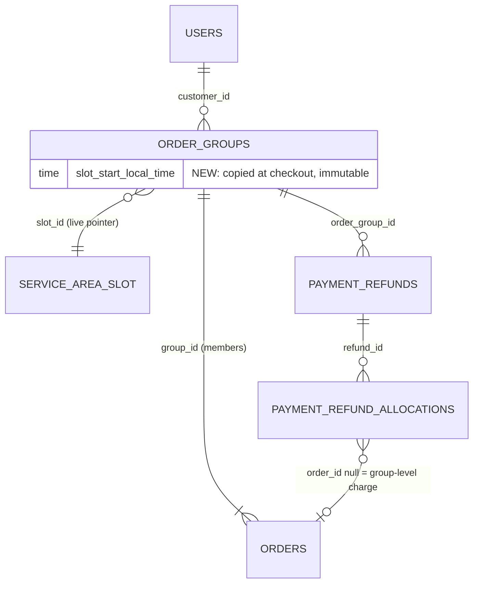
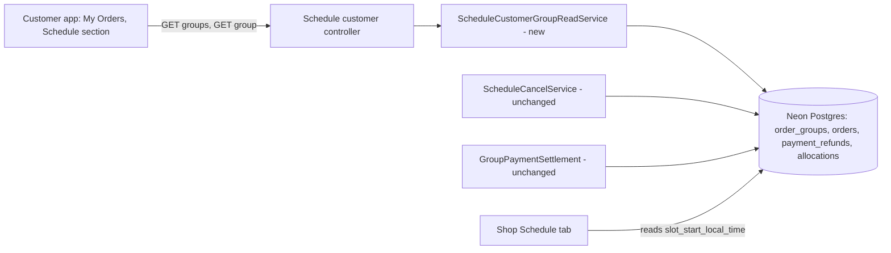
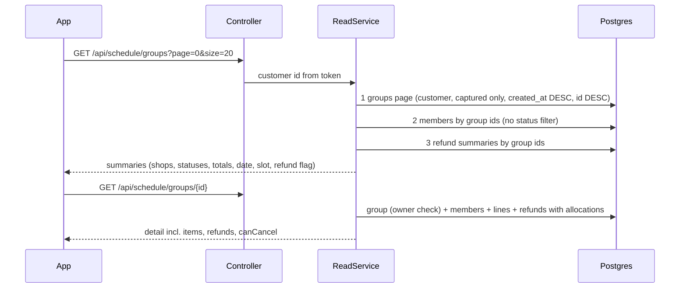

# Schedule PR 5: customer group history and tracking

Source: row 5 of [schedule-shop-visible-slice-plan.md](schedule-shop-visible-slice-plan.md) and the deferred item in [schedule-deferred-todo.md](schedule-deferred-todo.md). Branch: from `feature/schedule`, PR into `feature/schedule`, never `main` ([schedule-branching-policy](schedule-branching-policy.md)).

## Goal
A customer who paid for a Schedule group (one payment, one member order per shop) can open "My orders", find that group, current or past, and see each shop's status with what was ordered, when, and any refund.

## Today
- `GET /api/orders` and `GET /api/orders/active` exclude every group member (`OrderRepository.java:60,73,106`), so a Schedule purchase never appears there.
- `GET /api/schedule/groups/{groupId}` (`ScheduleGroupController.java:21`) returns payment state, deadlines and each member's shop, status and total to a customer who already holds the group id. No endpoint lists a customer's groups (`OrderGroupRepository` has four methods, none by customer). The customer app has no consumer of the group endpoints yet (searched `Food-Ninja-Frontend/src`), so its contract is free to change.

## Proposed design (before review)
1. New owner-scoped, paginated, newest-first list: `GET /api/schedule/groups`.
2. Group detail gains: service date, slot, items per member, refund state per member.
3. Customer app: a separate Schedule section in My Orders; `SCHEDULED` added to the status types.
4. The two regular order reads keep excluding members.
5. Nothing reaches DELIVERED until bulk delivery (STATE-4, deferred), but the contract carries the full status set.

## Data model review

### Summary (read this first)
**Verdict:** Design approved with changes; release blocked until the environment items below are fixed or you defer them in writing.
**What changes** (before → after):
- A group remembers the slot's start time the moment it was booked, so an admin editing a slot later cannot rewrite what old customers were promised. Today the group stores only a pointer to the slot, and the slot's time is edited in place.
- One new list read for the customer ("my Schedule groups"), plus a richer, separate detail read. The detail read used by cancel and payment stays as it is.
- Refunds shown to the customer come through a hand-picked set of fields, never the raw refund record (which holds admin notes and gateway ids).
- Everything else is reads over tables that already exist: no new table, no new index.
**Decisions you need to make:**
| # | decision | options | recommended, and why | if you pick the other option |
|---|---|---|---|---|
| D1 | Remember the slot time on the group at booking | add column now / read the live slot | add now: no group exists yet, so it is free today and a backfill later | old groups show whatever time the slot has now; a shop that prepared for 12:30 sees 13:00 on the customer's screen after an edit |
| D2 | What the customer reads for a refund | REQUESTED, SUBMITTING, FAILED = "Refund pending"; ISSUED = "Refund on its way"; PROCESSED = "Refunded"; REJECTED = "No refund" plus the reason | as listed: never show "failed" (the system retries), always show a reason on a rejection | "failed" scares customers into support calls; hiding a rejection looks like a lost refund |
| D3 | Show the shop's decline reason to the customer | show / hide | show: the goal is that the customer sees what the shop did | the customer sees "Declined" with no why |
| D4 | Environment: accept lens 0 fails 1 to 3 for this PR | accept in writing and plan a separate fix / fix first | accept: they are repo-wide, this PR adds one column, and the schema guard refuses to boot without it | PR 5 waits on a repo-wide change |
| D5 | Where Schedule shows in My Orders | separate Schedule section / merged into the regular list | separate: one payment covers several shops, so the card shape differs | the list handles two shapes and touches the code that skips members on purpose |
**Answers (Samivan, 2026-11-02):** D1 add the column · D2 wording as proposed · D4 accept for PR 5, fix separately · D5 merged into the regular list (against geld's recommendation; the mechanism below keeps the backend reads separate) · D3 not asked: geld default "show the decline reason", changeable on request.
**What geld decided for you:**
- D5 mechanism: "merged" is a display choice. The backend keeps two reads (`GET /api/orders`, `GET /api/schedule/groups`) and the customer app merges them by booking time inside `features/orders`. One backend endpoint over both would make one domain's service call the other's, which the coupling guard forbids, and would reopen the Eat Now reads that isolation protects. Cost: two fetches on the screen. The customer app has no load-more today (page 0 of 20 only), so the merge covers page 0 of each source; when load-more is added, order across page boundaries can be off by a few rows. Schedule volume is small, so this is accepted; revisit with an orchestration layer when volume, load-more or tomorrow-ordering makes it visible.
- The list shows a group only if money was captured (`razorpay_payment_id` is set). Unpaid, abandoned and failed-before-payment groups never appear.
- A member is never dropped from a group's response, whatever its status. Hiding a member would hide money.
- The list is sorted by booking time, newest first, with the group id as tiebreaker (`created_at DESC, id DESC`): both never change, so the order is total and stable. Same-day-only Schedule makes this the same order as service date.
- Offset paging with the app's existing convention (page, size 20). No keyset yet: a customer has tens of groups a year.
- Cancel buttons come from server-computed booleans (`canCancel`, `canLateCancel`), not from the phone comparing clocks.
- The shop's Schedule tab switches to the same slot snapshot in the same PR so both sides show one time.
**What must happen before deploy:**
1. D4 answered (environment).
2. SQL file `db_manual/schedule-group-slot-snapshot.sql` approved, then run on Neon before the backend boots (the schema guard gets the new column in its required list).
3. Backend PR into `feature/schedule`; mutation checks on the visibility rule and the refund allowlist; blind Codex diff review.
4. Customer app work (separate PR, after the contract is merged).
**Unknowns that could change this:**
- Whether pilot customers need a push when a shop declines (2d). PR 5 is pull-only: they learn only by opening the app. Samivan decides before the pilot.
- Real order volume (assumed below).

**Status:** FINAL · **Verdict:** APPROVED WITH CHANGES (every must-change has an agreed change; lens 0 fails 1 to 3 accepted in writing for PR 5 under D4) · geld deep, 2026-11-02 · previous: none
**Target:** PostgreSQL on Neon (version not read; pooled endpoint, `prepareThreshold=0`) · hand-run SQL in `db_manual/` plus Hibernate `ddl-auto=update` · Spring Boot long-running server, scale-to-zero database
**Lenses run:** 0, 1, 2, 3, 4, 5, 6, 7, 8 (all: every lens had something to check; a column is added, money is shown, a list is added) · **skipped:** none · **reference designs:** skipped (not core to a new problem class; the design adds one column and two reads)
**Codex second opinion:** deep, blind: agreed 8, Codex-only verified 2 (API-3, sort key), disagreements 2 (index, offset vs keyset); see "Codex reconciliation"
**Open inputs (assumptions):** pilot 200 groups/day at launch (10x 2,000); a customer opens the list at most 3 times per lunch window; timezone: `service_date` uses the service area's own timezone (`ServiceDateResolver.java`, per Codex, not re-read), so IST is assumed for the pilot area only

### Design changes
This design makes a customer's past and live Schedule groups readable with the facts frozen at booking time, without touching the Eat Now order reads.
| # | before | after | problem it solves (findings) | why it is better | what it costs | alternative considered, why it lost |
|---|---|---|---|---|---|---|
| 1 | `order_groups` keeps `slot_id` only; time lives in `service_area_slot.start_local_time`, edited in place | `order_groups.slot_start_local_time` copied at checkout, never updated | SNAP-1: admin moves 12:30 to 13:00 after bookings, every old and live group now shows 13:00 | the promise shown to the customer is the promise made | one column, one write at checkout, one SQL file, one guard entry | block slot edits while groups reference the slot: lost, because editing is legitimate and old groups still need their time |
| 2 | no customer list | `GET /api/schedule/groups?page&size` summaries | TRACE gap: customer cannot find a group | closes the stated goal | 3 queries per page, no schema | reuse `GET /api/orders` with members included: lost, it changes the Eat Now reads the isolation work protects |
| 3 | one shared `ScheduleGroupView` for GET, cancel, payment | GET detail returns a new `ScheduleGroupDetail`; `ScheduleGroupView` stays and gains `currencyCode` | API-1: adding items and refunds to the shared view also loads them inside locked cancel and payment transactions | write paths stay small; the read can be rich | one more DTO | extend the shared view: lost, longer locks on the cancel path |
| 4 | refund state unreadable by the customer | refund projection by allowlist, per member and group-level | MONEY-1: raw refund rows hold `decisionNote`, `technicalDetail`, `gatewayReceipt`, `decidedByAdminId` | nothing internal can leak by adding a field to the entity | one projection query | serialize the entity: lost, leaks admin notes |

### Tables
| table | grain (one row = one ...) | purpose | class | owner | phase | state |
|---|---|---|---|---|---|---|
| `order_groups` | one customer payment for one service date and slot | the group header | hot (payment and status updates) | schedule | 2b.5 (+PR 5 column) | live schema; 0 groups at 2026-11-02 |
| `orders` (members) | one shop's part of a group | per-shop status, totals, shop name snapshot | hot | orders | existing | live |
| `payment_refunds`, `payment_refund_allocations` | one refund / one allocation of it to an order or group charge | refund truth | append-mostly | refund | existing | live |
| `service_area_slot` | one lunch slot of a service area | reference | reference | schedule admin | 2a | live |
No new table.

### Names
| name | what it holds | project word for this concept (grep evidence) | clashes with | verdict |
|---|---|---|---|---|
| `order_groups.slot_start_local_time` | the slot's local start time copied at checkout | `start_local_time` on `service_area_slot` (`ServiceAreaSlot.java:32`); "snapshot" used for frozen values (`delivery_*` snapshot on orders) | none | keep; time-of-day, so `_local_time` like the source |
| `ScheduleGroupDetail`, `ScheduleGroupSummary` | customer read DTOs | existing `ScheduleGroupView`, `ScheduleShopOrder*` read models | none | keep |

### Columns on touched hot tables
`order_groups` columns by purpose: identity (`id`, `group_code`), owner (`customer_id`), idempotency (`checkout_idempotency_key`, `checkout_request_hash`), where and when (`service_area_id`, `service_date`, `slot_id`, **new** `slot_start_local_time`), delivery snapshot (`delivery_*`), money (`delivery_fee`, `packaging_fee`, `round_off`, `payable_total`, `currency_code`, `captured_amount`), gateway and state (`payment_status`, `razorpay_*`), promises (`cancel_until_at`, `late_cancel_from_at`, `hold_expires_at`), audit (`created_at`, `updated_at`). The new column belongs with "where and when": same lifecycle (written once at checkout, immutable), same access rules. Placement is right.

### Built vs plan
| element | plan says | in code at | deployed | migration applied | depended on by | drift | source |
|---|---|---|---|---|---|---|---|
| `order_groups` + `idx_order_groups_customer (customer_id, service_date DESC)` | exists | `order-group-migration.sql:57` | feature/schedule not on `main` | applied (audit ran 2026-11-02) | cancel, payment, shop tab | none | SQL file + audit doc |
| `slot_start_local_time` | planned | not built | no | no | none | none | this plan |
| `GET /api/schedule/groups/{id}` | extended | `ScheduleGroupController.java:21` | not on `main` | n/a | no mobile consumer | none | repo search |
| group list | planned | absent (`OrderGroupRepository`) | no | n/a | n/a | none | repo search |

### Entity relationships


### Column mapping
`order_groups` addition: | column | type | null | default | key | constraint | phase | note |
| `slot_start_local_time` | `time` | NOT NULL | none | none | none | PR 5 | copied from `service_area_slot.start_local_time` at group creation (`ScheduleCheckoutWriter.java:150`); `updatable = false` like its siblings |
Index: none new. The list uses `idx_order_groups_customer` for the owner filter and first sort key; the sort (`created_at DESC, id DESC`; `created_at` is `BIGINT NOT NULL`, `order-group-migration.sql:36`) runs in memory over one customer's rows (tens to low hundreds). A `(customer_id, created_at DESC, id DESC)` index is not added: no pattern needs it at this size (revisit at PERF-1). Lifecycle: the column is immutable.

### Invariants
| # | invariant | enforced by | evidence |
|---|---|---|---|
| 1 | a customer reads only their own groups | service (owner id from the token, 404 for foreign, as `ScheduleGroupAccess.java:24`) and the list query's `customer_id` predicate | pattern exists |
| 2 | the list shows only groups where money was captured | one repository method (`razorpay_payment_id IS NOT NULL`), tested | settlement sets the id on PAID, mismatch and orphan capture (`GroupPaymentSettlement.java:58,70,158`) |
| 3 | the slot time shown never changes after booking | `updatable = false` plus no writer | new |
| 4 | a customer DTO never carries internal refund fields | projection by allowlist; test lists the DTO's fields | new |
| 5 | every member of a group appears in its response | no status filter on the member read; exhaustiveness test over `OrderStatus` | new |
Concurrency: all reads; no new race. The existing locks on cancel and payment are untouched.

### Scenarios, access patterns, sizing
Scenarios:
1. (latency) At the lunch peak, 100 customers open My Orders within 5 minutes; the list answers p95 < 300 ms with at most 4 queries.
2. (correctness) After an admin moves a slot from 12:30 to 13:00, a group booked at 12:30 still shows 12:30.
3. (correctness) A group fully refunded after a shop decline shows the right refund state per shop and never an internal note.
4. (change) Tomorrow-ordering (2b.11) needs no change to these reads beyond the active/past split.
| # | actor | read/write | endpoint | filter | sort | joins | limit | peak/min | p95 | serving index | rows examined |
|---|---|---|---|---|---|---|---|---|---|---|---|
| A1 | customer | read | `GET /api/schedule/groups` | `customer_id = ?` and `razorpay_payment_id IS NOT NULL` | `created_at DESC, id DESC` | members by group ids; refund-exists by group ids | 20 per page | about 60 | 300 ms | `idx_order_groups_customer` | one customer's groups (under 300 a year) |
| A2 | customer | read | `GET /api/schedule/groups/{id}` | pk plus owner check | members by `id` | lines (`@BatchSize 25`), refunds and allocations by group | one group | about 60 | 300 ms | pk, `uq_orders_group_shop`, refund indexes | under 10 members |
Sizing: 200 groups/day at launch is about 73k rows a year, 730k at 10x, 7.3M at 100x; about 600 bytes a row plus 6 indexes. The per-customer predicate keeps list reads small at every size. No partitioning or archive needed before 100x.

### Findings
#### Must change before the next affected deploy
**SNAP-1 · risk · MUST** — a group keeps only `slot_id`; the slot's time is edited in place.
- Evidence: `OrderGroup.java:43` (`slot_id`), `ServiceAreaAdminServiceImpl.java:231-237` (`applySlot` overwrites `start_local_time` with no guard), `ServiceAreaSlot.java:32` (fact).
- Failure: admin changes a slot from 12:30 to 13:00 at 11:00; every group booked for 12:30 now shows 13:00 on the customer's screen and the shop tab, and past groups lose their history.
- Change: add `order_groups.slot_start_local_time`, written once at checkout; customer reads and the shop Schedule tab read it.
- Cost to change now: free (0 groups exist; migration once any exist).
**INV-1 · risk · MUST** — the list's visibility rule is a filter nobody enforces (Devil's advocate check 8).
- Evidence: group statuses `CREATED`, `CANCELLED`, `FAILED` exist without payment (`GroupPaymentSettlement.java:91-126`); `CAPTURE_MISMATCH` and orphan captures do carry a payment id (`:58`, `:158`).
- Failure: a second list query written later omits the rule and shows abandoned checkouts as orders.
- Change: one named repository method is the only way to list a customer's groups; a test creates one group per status and asserts which appear.
- Cost to change now: free.
**MONEY-1 · risk · MUST** — refunds must reach the customer through an allowlist.
- Evidence: `PaymentRefund.java` holds `decisionNote`, `technicalDetail`, `technicalCause`, `gatewayReceipt`, `gatewayRefundId`, `failureMessage`, `decidedByAdminId`; allocations have `order_id` nullable (group-level charge, `PaymentRefundAllocation.java:30`); the existing refund summary query keys on `PaymentRefund.orderId` and cannot see allocation-only rows (`PaymentRefundQueryServiceImpl.java:40`, per Codex, not re-read).
- Failure: serializing the entity leaks an admin note; keying on `orderId` shows no refund for a group-level or allocated refund.
- Change: projection with fields {status mapped per D2, amount (`approvedAmount` else `requestedAmount`), `currencyCode`, `orderId` or null for group-level, `customerReason`, `requestedAt`, `processedAt`}; join by `order_group_id` then allocations; test lists the DTO fields.
- Cost to change now: free.
**API-1 · risk · MUST** — do not widen the shared `ScheduleGroupView`.
- Evidence: `ScheduleGroupView` is returned by cancel, late-cancel (`ScheduleGroupController.java:27-39`) and payment (`SchedulePaymentController`); only searches found no other consumer.
- Failure: adding items and refunds to it loads them inside the locked cancel and payment transactions and changes three responses at once.
- Change: new `ScheduleGroupDetail` for GET; `ScheduleGroupView` only gains `currencyCode` (a bare `payableTotal` has no currency, MONEY rule).
- Cost to change now: free (no mobile consumer).
**API-3 · risk · MUST** (Codex-only, verified) — `ScheduleGroupView` is assembled in two places.
- Evidence: `ScheduleGroupAccess.java:45` and `GroupPaymentSettlement.java:197` each build the view and its members by hand (fact, searched `ScheduleGroupView.builder`).
- Failure: `currencyCode` is added in one assembler; the cancel response carries it and the checkout-cancel response returns null, so the app shows a price with no currency on one path.
- Change: one shared assembler as a service-layer component (a static factory on the DTO that imports entities breaks backend `CLAUDE.md:95`) used by both; a test builds the view through each path and asserts equal fields.
- Cost to change now: free.
**STATE-1 · risk · MUST** — never drop a member; map every status.
- Evidence: `OrderStatus.java` has `PLACED`, `PREPARING`, `PENDING_PAYMENT`, `PAYMENT_FAILED` besides the seven the plan lists; orphan-captured groups carry `PAYMENT_FAILED` members (`GroupPaymentSettlement.java:162-168`).
- Failure: a status filter on the member read hides a member, so the customer sees fewer shops than they paid for; or the app crashes on an unmapped status.
- Change: the member read has no status filter; the contract lists every `OrderStatus` value the app may receive; a test iterates `OrderStatus.values()` and fails when a new value is neither mapped nor explicitly marked impossible for members. Orphan-capture members show as "not placed, refund".
- Cost to change now: free.
**ENV-1 · lens 0 · blocker** — see Environment below.
#### Fine now, revisit at <trigger>
- **TIME-2 · revisit at the first service area outside Asia/Kolkata, or when area timezone becomes editable:** snapshot the timezone with the slot time. `service_area.timezone` is a column (`ServiceArea.java:43`) so it can change.
- **TIME-3 · revisit at 2b.11 (tomorrow-ordering):** the active/past split in the app assumes same-day-only, so today's groups are always newest.
- **PERF-1 · revisit when a customer averages over 500 groups, or when a duplicate row is reported:** offset paging repeats a row when a new group appears mid-scroll; switch to a cursor on (`created_at`, `id`) with `CREATE INDEX CONCURRENTLY idx_order_groups_customer_created_id ON order_groups (customer_id, created_at DESC, id DESC)` (`DO NOT RUN NOW`).
- **COST-1 · revisit at pilot:** polling. The app refetches on focus and pull-to-refresh, plus a 60 s interval only while a live group is open and the screen is focused. 100 open screens is 100 queries a minute during the lunch window; scale-to-zero compute stays awake only then.
- **OWN-1 · keep the read out of `OrderServiceImpl`:** it already injects `ScheduleCancelService` (`OrderServiceImpl.java:83`, a coupling-guard flag). Put the list in a new `service/schedule/customer/` read service with its own repository, like `ScheduleShopOrderService`.
- **API-2 · DEFAULT:** detail carries `canCancel` and `canLateCancel` computed on the server by `CancelWindowResolver`; the app never compares `cancelUntilAt` to its own clock.
#### Keep (good decisions)
- Ownership check returns "not found" for another customer's group (`ScheduleGroupAccess.java:24`): no enumeration.
- The customer promises (`cancel_until_at`, `late_cancel_from_at`) are stored on the group, not derived (lens 4).
- Shop name and totals are snapshotted on the member order (`Order.java:56`).
- The Eat Now history and active reads keep excluding members (isolation work).
- `idx_order_groups_customer` already serves the list: no new index.

### Devil's advocate trace
| DA point | outcome |
|---|---|
| Hidden-group filter is an implicit trap (check 8) | absorbed (INV-1) |
| Slot edited in place rewrites old promises | absorbed (SNAP-1) |
| Widening the shared view hits cancel and payment | absorbed (API-1) |
| Raw refund entity leaks admin fields | absorbed (MONEY-1) |
| Phone clock decides cancel button | absorbed (API-2) |
| Member status filter hides money; unmapped status crashes the app | absorbed (STATE-1) |
| "No list endpoint exists" claim | verified by mechanism: `OrderGroupRepository` methods listed, controller mappings listed, app searched, so not a guess |
| Pull-only tracking leaves the stated goal partly met (check 9) | accepted as a pilot gate: a shop decline reaches the customer only by opening the app; a push is 2d. See Future phases. |
| Polling keeps the database awake | absorbed (COST-1) |

### Codex reconciliation
Codex ran blind (plan path and lens questions only).
| point | Codex | geld | outcome |
|---|---|---|---|
| hand-run SQL, `ddl-auto=update`, default URL and test config | fail | fail (ENV-1) | agreed |
| committed default credential | treat as compromised | known, unfixed | agreed; added as 3b |
| slot time not snapshotted, edited live | yes | SNAP-1 | agreed |
| snapshot only the start, not end or cutoff | add start, end, cutoff if the product promises the window | start only: the slot has no end column, and cancel and release instants are already stored on the group | geld's reading kept; revisit if a slot gains an end time |
| visibility: show PAID, hide CREATED and FAILED ghosts, surface captured mismatch | yes | INV-1 (`razorpay_payment_id IS NOT NULL` covers PAID, mismatch and orphan capture) | agreed |
| refunds: allocations give per-member amounts, group-level and webhook refunds have no slice | yes | MONEY-1 | agreed; the view shows group-level refunds as their own line, never as a per-member total |
| ownership: Schedule-owned read beside cancel, no direct refund-service call | yes | OWN-1 | agreed; refund data by repository projection |
| two assemblers of the shared view | yes | verified | Codex-only, added as API-3 |
| sort by creation time with `(created_at, id)` | yes | adopted, replacing `service_date, slot time, id` | Codex-only, better: total order, immutable, no dependency on the new column; same order as date while ordering is same-day only |
| new index `(customer_id, created_at DESC, id DESC)` | add | not now: one customer's rows are tens to hundreds, no pattern needs it | disagreement: kept as PERF-1 trigger, not built |
| keyset instead of offset | keyset | offset now (the app's orders list uses offset), cursor at PERF-1 | disagreement: consistency with `orders.service.ts`; revisit on a reported duplicate |
| `PLACED` accepted by the member transition code | notes it | STATE-1 renders every value | agreed |
| OUT_FOR_DELIVERY and DELIVERED reachability | unverified | in the contract, unreachable until STATE-4 | agreed |

### Second Codex review of the final plan (2026-11-02)
Codex read the final plan adversarially. Verified by me and applied: settlement computes deadlines from the live slot (L1), DTO-imports-entity rule (L5), no load-more in the app (L8), retries as new refund rows (L3). Applied from Codex without a separate check: `decisionNote` excluded, group-level `canCancel` versus per-member `canLateCancel` (L6), status list including SERVED and COLLECTED (L4), partial-failure UI states (L8), mismatch presentation (L2). Not applied: offset paging instability (already PERF-1). Could not verify (Codex and me): live schema and row count, credential privileges, gateway state, the exact Hibernate boot outcome, and an exhaustive list of rider, dispatch, invoice and job readers of the slot time. Run that last search at `/gcp` time.

### Future phases
| phase | new tables it adds | change forced on this design |
|---|---|---|
| STATE-4 bulk delivery | none | none: OUT_FOR_DELIVERY and DELIVERED already in the contract |
| 2b.11 tomorrow-ordering | none | TIME-3 active/past split |
| 2d notifications | maybe a device or event table | none to these reads; a pilot gate, not a PR 5 item |
| 2c settlement | settlement tables | none |

### Rollout
| change | phase | release slot | lock and rewrite | works with app N-1? | rollback | precondition |
|---|---|---|---|---|---|---|
| `ALTER TABLE order_groups ADD COLUMN slot_start_local_time time NOT NULL` | expand + contract in one (empty table) | before backend boots | brief ACCESS EXCLUSIVE on a table with 0 rows | only while `schedule_enabled` is OFF everywhere and no group exists: the current checkout writer (`ScheduleCheckoutWriter.java:148`) does not set the column, so with the SQL applied an old instance fails every checkout, and rolling back to it does the same. If a group exists or Schedule is ON: add the column nullable, ship the writer, backfill from the slot, then `SET NOT NULL` | roll forward (leave the column; do not roll back the backend) | audit shows 0 groups; recheck count and `schedule_enabled` at run time; Samivan runs the SQL |
Boot note: Hibernate `ddl-auto=update` runs before `ScheduleSchemaGuard` and checks only that a column exists, so a boot without the SQL on an empty table creates the same column itself and the guard passes. On a table with rows Hibernate cannot add a NOT NULL column without a default, so the SQL (or the nullable-first path) must run first. The guard's entry protects against a missing column, not against a missing NOT NULL.
| backend: writer sets the column, readers use it | code | after SQL | none | yes | revert deploy | SQL applied (schema guard enforces) |
| customer app | app | after contract merged | none | new screens only | n/a | contract merged |
SQL sketch, `DO NOT RUN — sketch for review` (written as a file only after approval):
```sql
-- DO NOT RUN — sketch for review
ALTER TABLE public.order_groups ADD COLUMN IF NOT EXISTS slot_start_local_time time NOT NULL;
```
If a group exists by run time: add the column nullable, backfill from `service_area_slot` in one batch, then `SET NOT NULL`.

#### Environment (lens 0)
1. One migration authority: **fail**. SQL is hand-run from `db_manual/` and Hibernate also writes the schema (`application.properties:32` `ddl-auto=update`).
2. No unreviewed schema writer: **fail**. Same line; any boot against a shared database can alter tables. `ScheduleSchemaGuard` lists required objects and refuses boot without them, which limits but does not remove the risk.
3. No default path to production: **fail**. `application.properties:6` falls back to the Neon pooler URL when `DB_URL` is unset; `src/test/resources` has no test properties, so a test run uses it (known; project rule: exclude the context-load test).
3b. A database username and password also sit as fallbacks in the committed `application.properties:7-8` (Codex: treat as compromised; already tracked in memory "Security findings 2026-10-13", not fixed). Rotating it is the real fix for ENV-1; D4 covers deferring it.
4. Split credentials: **unknown** (not readable from the repo); the fallback user is `neondb_owner`, the owner role, so the application role is not DML-only.
5. Recovery (RPO, RTO, restore): **unknown**; Neon branch restore exists, retention not read.
6. Rehearsal on a copy: not applicable to one column on an empty table.
7. Copies of production data: n/a.
8. Order of rollout: **pass** (above).
These are repo-wide and predate PR 5. PR 5 adds one column. A fail on 1 to 4 blocks APPROVED, so the verdict is APPROVED WITH CHANGES only if you record D4.

### Design versions
| version | phase | date | what changed | why |
|---|---|---|---|---|
| 0.1 | PR 5 | 2026-11-02 | first review | /geld deep |
| 1.0 | PR 5 | 2026-11-02 | Codex reconciled (sort by `created_at, id`, API-3 added); D1, D2, D4, D5 answered; status FINAL | owner decisions recorded |

### Locked decisions (handoff to /gcp and /judge)
| id | decision | enforced where | code paths, callers and enum values that must honour it |
|---|---|---|---|
| L1 | slot start time copied onto the group at checkout, immutable; every group-specific reader uses it | service (`ScheduleCheckoutWriter`) and `updatable = false`; schema guard entry | customer list and detail; the shop Schedule tab display and its slot ordering (`ScheduleShopOrderService.java:91`, `ScheduleShopOrderRepository.java:19`); `GroupPaymentSettlement.finishPaid` (`:135-140`) computes `releaseAt`, `cancelUntilAt` and `lateCancelFromAt` from the snapshot, not from the live slot. Cart and availability reads stay live (they describe what can be booked now). Test: edit the slot between checkout and capture; display and deadlines agree |
| L2 | a customer's group list shows only groups with `razorpay_payment_id IS NOT NULL` | one repository method | statuses PAID, CAPTURE_MISMATCH and orphan-captured FAILED or CANCELLED appear; CREATED and uncaptured FAILED or CANCELLED never. A `CAPTURE_MISMATCH` group (including a capture whose id belongs to another gateway order, `GroupPaymentSettlement.java:43-63`) shows as "Payment problem, refunded" with its refund line. A capture the gateway holds but settlement has not recorded yet is invisible until settlement runs; the checkout screen owns that wait |
| L3 | refunds reach the customer by allowlist, wording per D2 | projection class | `RefundStatus` REQUESTED, SUBMITTING, FAILED = pending; ISSUED; PROCESSED; REJECTED. Per-member amounts sum allocation amounts (`PaymentRefundAllocation.amount`), never the refund header. A refund that has a retry successor (`retry_of_id`, `RefundRows.java:72`) is hidden so a retried refund is not counted twice. REJECTED shows a fixed customer-safe text; `decisionNote` is never sent. Group-level and extra-capture refunds are separate lines. Tests: mixed and partial refunds, a retried refund, an unallocated refund |
| L4 | no member dropped; every `OrderStatus` mapped or marked impossible | service plus exhaustiveness test | all `OrderStatus` values, explicitly including `SERVED`, `COLLECTED`, `PENDING_PAYMENT`, `PAYMENT_FAILED` (mismatch settlement creates `PAYMENT_FAILED` members, `GroupPaymentSettlement.java:162-168`) |
| L5 | detail is a separate DTO; `ScheduleGroupView` has one assembler and gains `currencyCode` | one service-layer mapper component (DTOs must not import entities, backend `CLAUDE.md:95`) | `ScheduleGroupAccess.java:44`, `GroupPaymentSettlement.java:196`, cancel, late-cancel, payment responses |
| L6 | the server decides every action: group `canCancel` (group PAID, every member SCHEDULED or PLACED, window open, as `cancelGroup` checks at `ScheduleCancelServiceImpl.java:53`), per-member `canLateCancel` (feature flag, member status, window), and group `isActive` | service, using `CancelWindowResolver` | detail DTO and list summary; the app compares no clock and no status |
| L7 | list sort `created_at DESC, id DESC`; offset paging, page size capped at 50; no new index | repository query | `GET /api/schedule/groups` |
| L8 | My Orders merges the two reads in the app, inside `features/orders`; backend reads stay separate | frontend | `features/orders` only; no import from another feature. A discriminated view model (order or group); a separate group card and detail (the single-order card, `IOrderResponse` routing, ETA and stepper do not fit); `SCHEDULED` added to the status types; independent loading, error, empty and pull-to-refresh state per source, so one failing source never shows "No orders yet"; refresh on focus plus the 60 s interval only while a live group is visible; Active/Past for groups comes from the server `isActive` (L6). Today the hook loads only page 0 of 20 (`useOrderHistory.ts:19`) and the screen has no load-more, so the merge covers page 0 of each source and does not make older history reachable |
| L9 | decline reason shown to the customer (geld default, D3) | DTO | member `declineReason`, shown as plain text (escaped, stored length). Precedent: the shop's decline text already reaches the customer in notifications (`OrderNotificationListener.java:230`, per Codex, not re-read) |

### Approval record
| finding or decision | option chosen | by | date |
|---|---|---|---|
| D1 slot time snapshot | add column now | Samivan | 2026-11-02 |
| D2 refund wording | as proposed | Samivan | 2026-11-02 |
| D4 environment (lens 0 fails 1 to 3) | accept for PR 5, fix separately | Samivan | 2026-11-02 |
| D5 My Orders placement | merged into the regular list (geld recommended separate); backend reads stay separate, app merges | Samivan | 2026-11-02 |
| D3 decline reason | not asked; geld default: show | geld | 2026-11-02 |
| SNAP-1, INV-1, MONEY-1, API-1, API-3, STATE-1 | accepted as the must-change set via the answers above and the recommended fixes | Samivan (D1, D2, D4, D5), geld | 2026-11-02 |

## System design

### Components

Stores: Postgres only, system of record. No cache, queue, or search index.

### Main flows

Checkout flow change: `ScheduleCheckoutWriter` copies the slot time into the group in the same transaction that creates it.

### Decisions
| decision | options | chosen | negative consequence | revisit when |
|---|---|---|---|---|
| slot time | live read / block edits / snapshot | snapshot | one column | timezone becomes editable |
| list paging | offset / keyset | offset | repeat on concurrent insert | over 500 groups per customer |
| detail contract | extend shared view / new DTO | new DTO | one more class | never |
| refresh | socket / poll | focus plus 60 s while live | wakes database at lunch | notifications (2d) |
| My Orders placement (D5) | separate section / merged by the app / merged by one backend endpoint | merged by the app, two backend reads | two fetches; page-boundary order can be off by a few rows | Schedule volume grows, or tomorrow-ordering (2b.11) |

### Isolation, tenancy, API
Owner module: schedule. Tenancy: single deployment, customer-scoped by token. Lists are bounded (page and size, size capped at 50). Both reads are GET and idempotent. Money is amount plus `currencyCode`. Clients may see new status values: the app must render an unknown status neutrally.

## Quality brief (/gcp, 2026-11-02)
Branch: backend `feature/schedule-pr5-customer-groups` from `origin/feature/schedule` (6f872db), PR into `feature/schedule`. Work is split into slices; Codex edits files, Claude reviews every diff, runs the tests and commits.
- Slice 1: slot-time snapshot (L1) plus the single `ScheduleGroupView` assembler with `currencyCode` (L5, API-3).
- Slice 2: customer list and detail reads, refund projection, server-computed cancel flags, `isActive` (L2, L3, L4, L6, L7, L9), in new folders `service/schedule/customer/` and `dto/schedule/customer/`; `ScheduleGroupAccess` becomes public; the cancel-eligibility predicates are extracted once and used by `ScheduleCancelServiceImpl` and the new read.
- Slice 3 (separate PR, customer app): L8 merge in `features/orders`.
Schema notes: `ScheduleSchemaGuardSqlConsistencyTest` pins entity columns to SQL columns, requires a constraint or index per guarded file (the column-only `dine-in-round-off-migration.sql` is exempted by name; the new file is exempted the same way) and asserts the guarded file count (16 becomes 17).
Group-specific readers of the slot time (searched `getStartLocalTime` and `startLocalTime` in `src/main`): `ScheduleShopOrderService`, `ScheduleShopOrderRepository`, `GroupPaymentSettlement`. Cart, context and hold checks read the live slot for availability on purpose.
Cannot run here: database-backed tests (F18), device, the context-load test, the SQL (Samivan runs it).

## Build record (backend, 2026-11-02)
Branch `feature/schedule-pr5-customer-groups` from `origin/feature/schedule` (6f872db); two local commits, nothing pushed: `aed9e7b` (slot snapshot, shared `ScheduleGroupViewAssembler` with `currencyCode`), `ba50c05` (customer list and detail reads). Full suite green (1,949 tests, context-load test excluded); every new guard killed by a named test in a mutation run (13 mutations).
Built as planned: L1 (snapshot read by checkout, settlement and the shop tab), L2 (one repository method, exact query text pinned by a test), L3, L4, L5, L6, L7, L9. L8 (customer app merge) is the next PR.
Deviations from the plan:
- The snapshot is read from `ServiceAreaCatalog` (30 s cache) once in `ScheduleCheckoutWriter.createGroup`, not carried from the cart validator. Display and payment deadlines use the same stored value, so they agree; an edit made a millisecond before checkout cannot be distinguished from one made earlier. A slot that is missing or inactive at that read fails checkout with `LINE_UNAVAILABLE` (tested).
- The schema guard has a COLUMN entry for `slot_start_local_time`; the SQL file is exempted from the "constraint or index per file" test the way `dine-in-round-off-migration.sql` is.
- Rejected refund: the API sends state `REJECTED` and the original reason code; the app shows the fixed "not refunded" copy. `decisionNote` and every admin or gateway field never leave the backend (a source-scan test pins this).
- `canLateCancel` does not include the delivered-delivery check that `lateCancelMember` performs. Schedule members have no per-order deliveries and late cancel is OFF in production; revisit when STATE-4 or late cancel goes live.
Codex review of the branch (read-only, 2026-11-02): 1 blocker (catalog read, see above), 3 should-fix (guard and Hibernate boot order, already D4; delivered-delivery flag; rejection wording). No finding changed code; each is recorded here.
Merged: PR #73 into `feature/schedule` on 2026-11-02 (merge commit d5fd539). Superseded by the customer app plan ([schedule-customer-app-orders-plan.md](schedule-customer-app-orders-plan.md), A1 and API-1): group refund lines move to the regular-order refund contract through one shared mapper, so L3's four-state wording and "decisionNote never leaves the backend" are replaced by "the note appears only on a not-approved refund, built by `RefundSummaryMapper`" (backend follow-up B1).
Before the pilot: SQL run by Samivan (done 2026-11-02, column verified), customer app PR (L8), push on shop decline (2d), F18 database tests, `/judge deep --base feature/schedule`.
